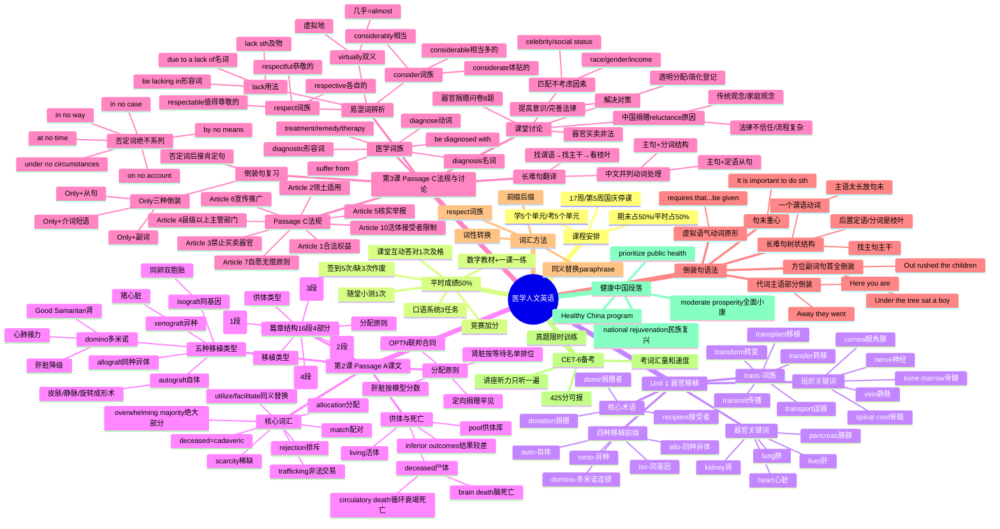

# 知识框架与思维导图 — 大学英语（医学人文英语）

---

## 一、Mermaid 思维导图

---

## 二、层级知识框架

### 1. 课程体系

- **教材**：English for Medical Humanities（第三版）+ 一课一练（第三版）
- **范围**：8个单元中学5个、考5个
- **平台**：超星（数字教材+一课一练）+ 口语系统

### 2. 成绩体系

- **期末考试 50%**：Passage A + 一课一练题型
- **平时成绩 50%**
  - 签到（5次随机）
  - 随堂小测（1次）
  - 课堂互动（回答问题）
  - 口语任务（3个）
  - 章节测验+任务点
  - 竞赛（加分）

### 3. Unit 1 器官移植知识网

- **核心主题**：organ transplant
- **词族**：trans-（from...to...）
  - transplant / transmit / transfer / transform / transport
- **器官英文**：heart, kidney, liver, lung, pancreas, intestine
- **组织英文**：bone marrow, cornea, nerve, vein, spinal cord
- **人物角色**：donor（捐赠者）↔ recipient（接受者）
- **定义**：medical procedure moving an organ from donor to recipient
- **移植前缀**：auto- / iso- / allo- / xeno-
- **其他关键词**：donation, allocation, immunosuppressing, ventilator, trauma

### 4. 第2课：Unit 1 Passage A 课文精讲（2026-09-16）

- **篇章结构（16段4部分）**：总论（定义/器官组织/供体伦理/减少排斥）→ 移植类型 → 供体类型 → 分配原则
- **五种移植类型**（认前缀，小测必考）：
  - autograft 自体移植（皮肤/静脉/旋转成形术 rotationplasty：踝替膝、脚反转180°、胫股连接）
  - allograft 同种异体移植（不同个体间，最常见）
  - isograft 同基因移植（同卵双胞胎 identical twins）
  - xenograft 异种移植（猪心脏→人）
  - domino 多米诺移植（连锁接力：心肺移植后健康心脏转第二位受体；肝脏"降级"给年长患者；Good Samaritan kidney 善意捐赠链，最多助30人）
- **供体**：living（活体）/ deceased（尸体）；尸体供体=循环衰竭死亡（circulatory death，结果较差 inferior）或脑死亡（brain death）；组织死后24小时内恢复、可储存5年
- **分配原则**：美国器官由联邦合同分配给 OPTN（UNOS 运营）；肾脏按等待名单排位/等待时间；肝脏按模型分数（实验室指标 indicative of）；定向捐赠罕见
- **核心词汇**：donor/recipient、allocation/allocate、rejection（排斥）、match（配对）、scarcity/scarce、trafficking=illegal trade、overwhelming majority、deceased=cadaveric、mortal≠moral、criteria/data/media（复数不加s）、superior/inferior to、given=considering
- **同义替换（paraphrase）**：utilize=use、facilitate=promote、contribute to=lead to、outnumber（比…多）

### 5. 倒装句语法（第2课专题）

- **句末重心（end weight）**：主语太长放句末（It is important to do sth.；课文定向捐赠句）
- **方位副词/介词短语句首 → 完全倒装**：Under the tree sat a boy. / Out rushed the children. / Away went the plane.
- **代词主语 → 部分倒装**：Here you are. / Away they went. / Here we are.
- **建议/要求/请求从句 → 虚拟语气动词原形**：requires that organs be given（不是 is given）
- **长难句分析**：先找主句（一个谓语动词），其余（从句/后置定语/分词）都是枝叶；画树状结构
- **后置定语**：given the scarcity（考虑到）、based on the score、indicative of the values（省略 be 动词，因主句已有谓语）

### 5.5 第3课：Passage C 法规问答 + 课堂讨论（2026-09-23）

- **倒装句复习延伸**：
  - Only + 名词不倒装；Only 引起倒装仅限三种（介词短语/副词/从句），且为部分倒装
  - 否定词"绝不"系列：by no means / in no way / on no account / under no circumstances / in no case / at no time
  - 否定词放句首 → 部分倒装，但主句谓语用肯定形式（At no time will China be the first to use nuclear weapons.）
- **Passage C 文章**：Questions and Answers on the Regulation（人体器官移植条例问答），对话体，11 个 Article
  - Article 3 核心：任何组织或个人不得买卖人体器官（illegal / forbidden）
  - Article 7 核心：自愿（freewill）+ 无偿（free of charge）原则
  - Article 10：活体器官接受者限制（直系/旁系亲属、帮扶形成的亲情关系）
- **医学核心词族**：diagnose v. / diagnosis n. / diagnostic adj.；suffer from；treatment / remedy / therapy
- **易混词族**：
  - respect：respectful（恭敬的）/ respectable（值得尊敬的）/ respective（各自的）
  - consider：considerate（体贴的）/ considerable（相当多的）/ considerably（相当）
  - virtually：虚拟地 / 几乎（≈ almost）
  - lack：lack sth（及物）/ due to a lack of（名词）/ be lacking in（形容词）；不说 be lack of
  - county ≠ country
- **课堂讨论**：器官捐赠意愿问卷（8题）+ 移植视频听力 + 中国 reluctance 原因（传统观念/法律不信任/流程复杂）与对策（提高意识/完善法律/透明分配/简化登记）
- **器官匹配不考虑因素**：race / gender / income / celebrity / social status

### 6. 词汇学习方法

- **构词法**：prefix（前缀）+ suffix（后缀）+ root（词根）
- **同义替换**：paraphrase = synonym替换 + 句式变换
- **respect词族**：respect（方面/尊敬）、respective（各自的）、respectful（恭敬的）、respectable（值得尊敬的）

### 7. CET-6 与医学英语

- **CET-6**：听力为讲座（只听一遍），考词汇量和做题速度
- **METS医护英语**：三级易、四级稍难
- **作文大赛**：联盟杯，下学期参加
- 六级作文：背范文句式（图表描述 increase by 20%）；利用同义替换积累高级词汇
