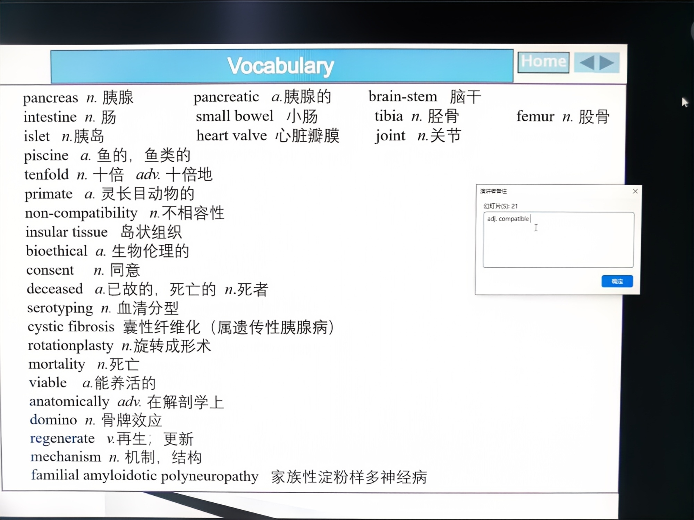
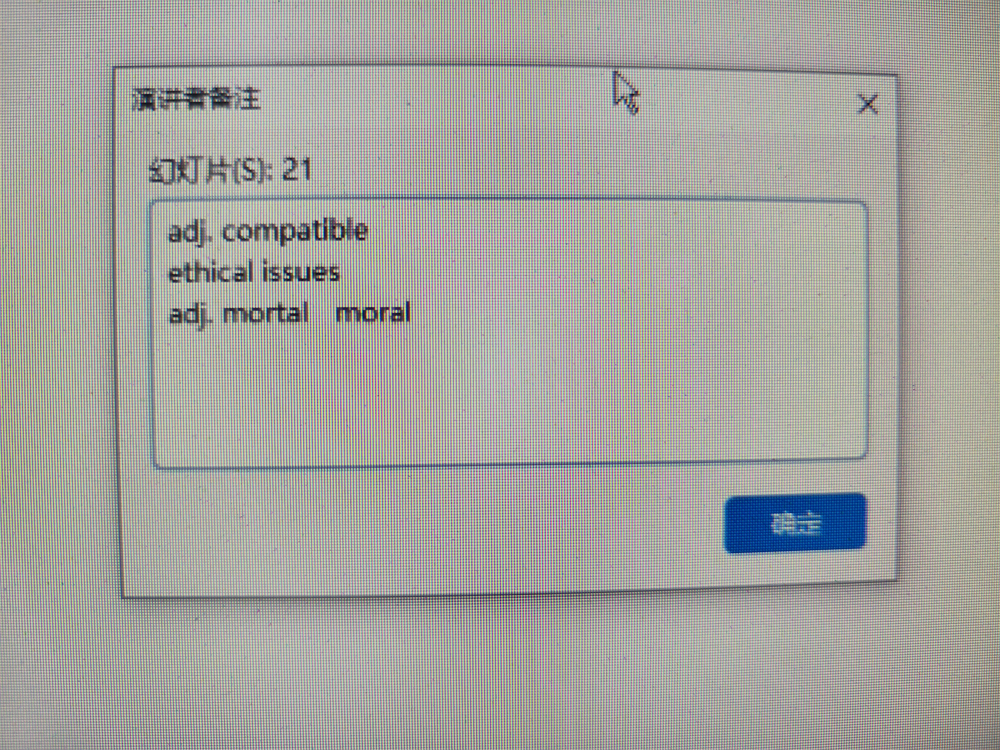
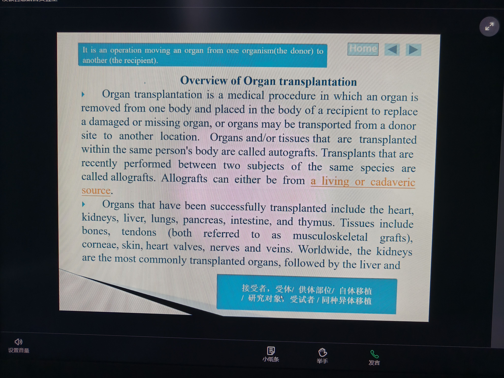
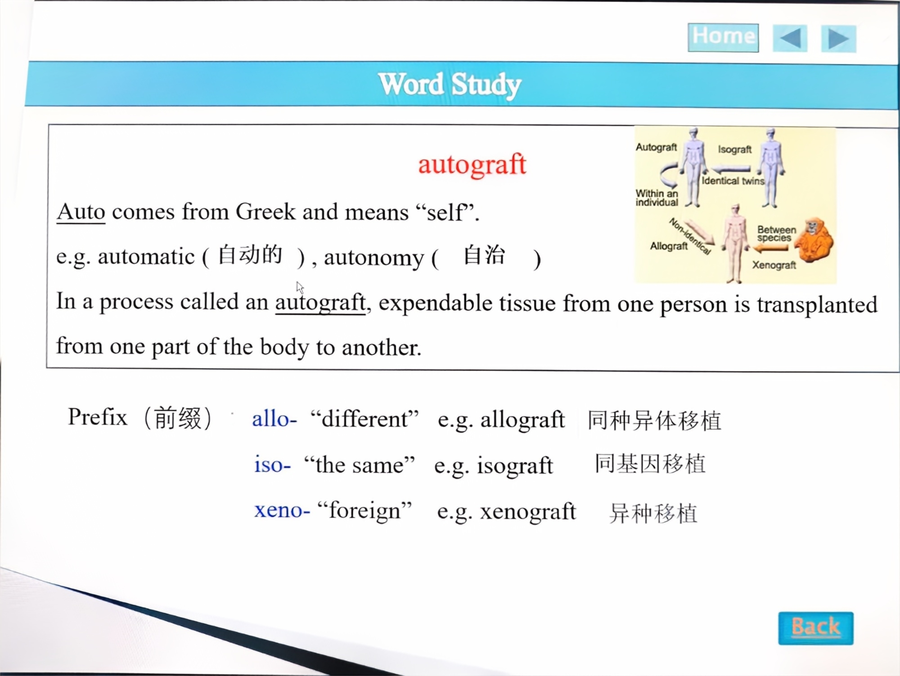
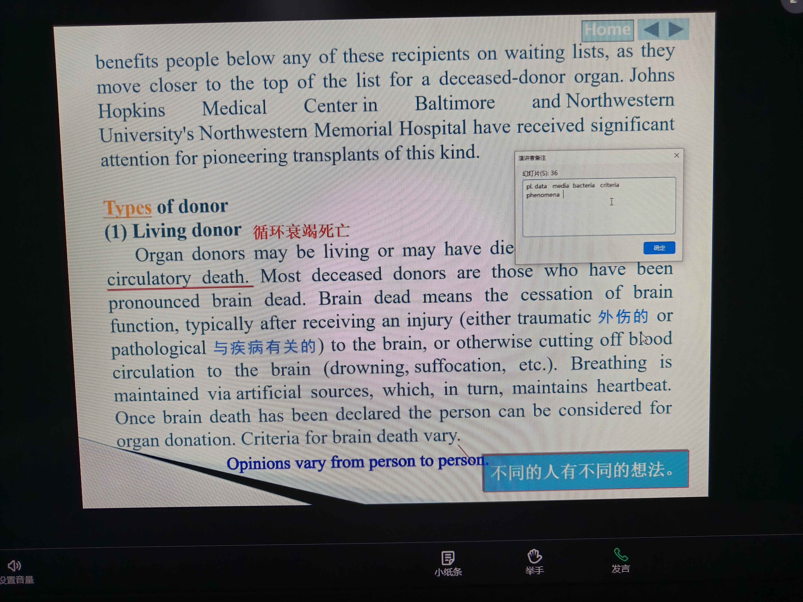
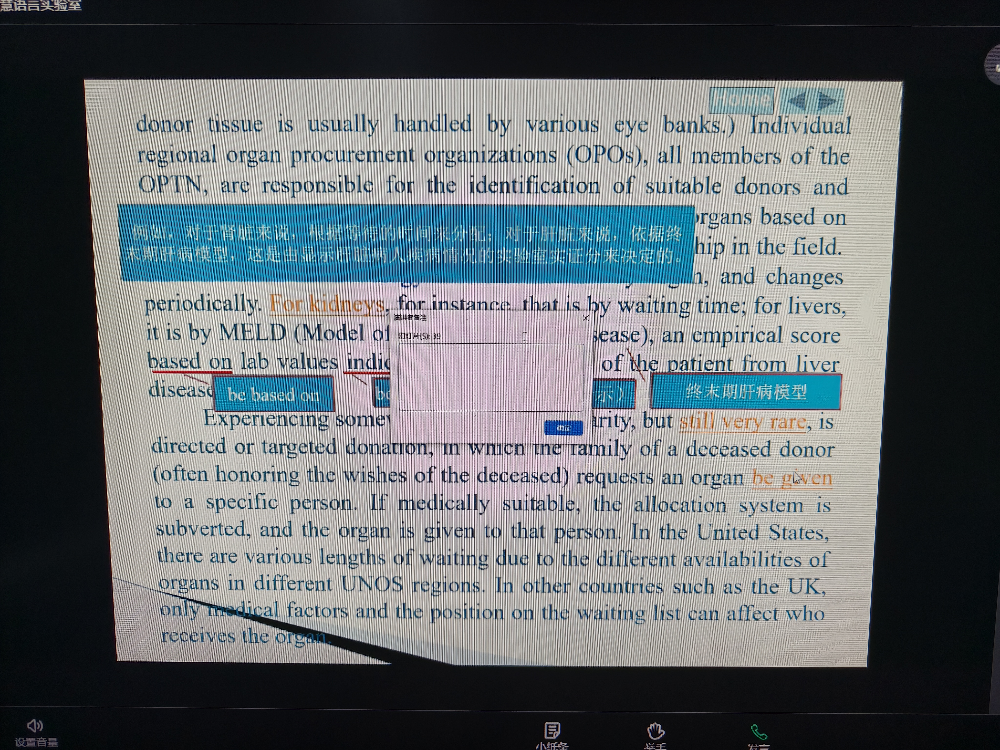

# 大学英语 第2课：倒装句语法与 Unit 1 器官移植课文精讲（Passage A）

> 科目：大学英语（医学人文英语）Humanistic Medical English (I)
> 上课日期：2026-09-16（周三）16:14 起（转写 687 行）
> 教材：《English for Medical Humanities (I)》Unit 1，Passage A（器官移植）
> 本课课堂照片 6 张（课件 PPT 截图，含 1 张演讲者备注弹窗），已按拍摄时间戳嵌入对应知识点段落并附批注；**期末考试重点 = 通读 Passage A**（老师反复强调）

---

## 一、本课总览

本课是 Unit 1 的课文精讲课，核心三件事：

1. **Passage A 词汇复习**（老师快速带过 + 补充生词，含词根词缀法）；
2. **Passage A 篇章结构与内容精讲**（16 段、4 大部分：定义→移植类型→供体→分配原则），重点讲**五种移植类型（含多米诺移植）**与**分配原则**；
3. **语法专题：倒装句**（句末重心、方位副词倒装、虚拟语气中 be 动词原形），用于期末长难句分析与写作。

作业提醒：超星平台 Exercise 3、段落匹配（26~29 页）、中译英（24 页）、通读 Passage A、预习 Passage C、肖伟校长英文作业（周末截止）。

---

## 二、Passage A 核心词汇复习（老师逐词过，含词根词缀）



> 📝 **批注**：课件 Vocabulary 总表（16:30 拍摄，对应幻灯片 21 附近的词汇页）。图上可见本课核心词：pancreas 胰腺 / pancreatic 胰腺的 / intestine 肠 / small bowel 小肠 / islet 胰岛 / tibia 胫骨 / femur 股骨 / heart valve 心脏瓣膜 / **piscine 鱼的** / **tenfold 十倍**（文中 outnumber ... tenfold）/ **primate 灵长目** / **non-compatibility 不相容性** / insular tissue 岛状组织 / **bioethical 生物伦理的** / consent 同意 / deceased 已故的 / serotyping 血清分型 / **cystic fibrosis 囊性纤维化**（属遗传性胰腺病）/ **rotationplasty 旋转成形术**（3.2.1 节的词）/ mortality 死亡 / viable 能存活的 / anatomically 解剖学上 / domino 骨牌效应 / regenerate 再生 / mechanism 机制 / **familial amyloidotic polyneuropathy 家族性淀粉样多神经病**（长难词，认识即可）。复习时以 2.1/2.2 两表为准，此图做词汇"全景回顾"。

### 2.1 器官与移植基础词

| 单词 | 词性/词根 | 释义 | 备注 |
|------|-----------|------|------|
| pancreas | n. | 胰腺 | 器官词 |
| cornea | n. | 角膜 | 器官词 |
| heart | n. | 心脏 | 器官词 |
| vein | n. | 静脉 | 血管词 |
| bone marrow | n. | 骨髓 | 移植常用组织 |
| donor | n. | 捐赠者、供体 | 对应 recipient |
| recipient | n. | 接受者、受体 | 对应 donor |
| transplant | v./n. | 移植 | trans-（跨越）+ plant |
| transfer | v. | 转移、转运 | trans- 词族 |
| transfusion | n. | 输血 | trans- 词族（fusion 融合） |
| immune system | n. | 免疫系统 | immune 免疫的 |
| trauma | n. | 创伤 | 形容词 traumatic |
| allocation | n. | 分配 | 动词 allocate；本课关键词 |
| compatibility | n. | 相容性、匹配度 | 形容词 compatible；反义 incompatible（in- = 不） |
| tissue | n. | 组织 | tissue typing 组织配型 |
| ethical issue | n. | 伦理问题 | 用 issue 代替 problem（更正式） |

### 2.2 老师补充的高频生词（Passage A 预习生词）

| 单词 | 词性 | 释义 | 记忆点 |
|------|------|------|--------|
| consent | n./v. | 同意、知情同意 | informed consent 知情同意 |
| deceased | adj. | 已故的、死去的 | ≈ dead；与 cadaveric（尸体的）同义替换 |
| cadaveric | adj. | 尸体的 | cadaver 尸体；deceased donor / cadaveric donor 尸体供体 |
| serotyping | n. | 血清分型 | sero-（血清）+ typing |
| mortality | n. | 死亡率、死亡 | 词根 mortal（致命的）；**别与 moral（道德的）混淆**——"很多同学阅读只认前三个字母，肯定认错" |
| viable | adj. | 可行的、能存活的 | 重音在第一个音节 vi- |
| anatomy | n. | 解剖学/解剖结构 | 形容词 anatomical；副词 anatomically；重音规律：名词 anatomy、形容词 anatomical（重音倒三音节） |
| regenerate | v. | 再生 | re-（再）+ generate（产生）；名词 regeneration |
| mechanism | n. | 机制 | 医学高频词 |
| domino | n. | 多米诺骨牌 | domino effect/transplant 骨牌效应/多米诺移植 |
| scarcity | n. | 稀缺性 | 形容词 scarce（稀缺的）；scarcity of organs 器官稀缺 |
| rejection | n. | 排斥（反应） | transplant rejection 移植排斥 |
| match | n./v. | 配对、匹配 | a good match 良好配对；reduce rejection 减少排斥 |
| rejuvenation | n. | 复兴、返老还童 | re-（重新）+ juven（年轻）；rejuvenation of the Chinese nation 民族复兴（上周词汇） |
| procurement | n. | 获取、采购 | organ procurement 器官获取 |
| trafficking | n. | 非法交易、贩卖 | illegal trade 的同义替换；organ trafficking 器官贩卖 |
| majority | n. | 大多数 | the overwhelming majority 绝大部分 |
| utilize | v. | 利用 | = make good use of / employ（六级替换词） |
| facilitate | v. | 促进、使便利 | = promote；to facilitate multiple transplants |
| pool | n. | 捐献库、资源库 | a pool of donors 供体库（不是"游泳池"） |
| criteria | n. | 标准（复数） | criterion 单数；**a 结尾的复数不加 s**：criteria/data/media/bacteria；phenomenon → phenomena |

> 【考点】**同义替换（paraphrase）是六级备考关键**：阅读中不会简单用 use，而用 utilize/facilitate；作文里也要学会替换。老师原话："这就是你要准备 6 级考试的一个关键点，你要找多点近义词、高级词汇去替代。"

### 2.3 易混词辨析（老师专门强调）

| 易混词对 | 区别 |
|----------|------|
| mortal（致命的）vs moral（道德的） | 只认前三个字母必错；名词分别是 mortality（死亡率）/ morality（道德） |
| deceased vs contemporary | 转写此处语音不清，老师实义：deceased = 已故（= cadaveric 尸体来源），文章中与"尸体供体"语境互换 |
| superior vs inferior | superior（高级的/优于）与 inferior（低级的/劣于）搭配都是 **to**（be superior to / be inferior to），**不能用 than**；superman（超人）助记 superior |
| compatible vs incompatible | in- = 不 → 不相容的 |



> 📝 **批注**：课件"演讲者备注"弹窗（16:20 拍摄，幻灯片 21 号）。老师备注的词汇要点恰好是本课易混重点：**adj. compatible（相容的）**、**ethical issues（伦理问题）**、**adj. mortal / moral（致命的/道德的）**——直接对应 2.3 节的三个辨析考点。老师讲课时强调"很多同学阅读只认前三个字母"（mortal/moral），复习时把这行备注背下来。

---

## 三、Passage A 篇章结构（16 段、4 大部分）——【考试重点】

老师要求：**给每个段落标号（共 16 段）**，副标题不用标；阅读长篇先看标题、副标题把握篇章结构。

```
Passage A（器官移植）
├── Part 1（第1~4段）：总论 General Introduction
│   ├── 第1段：定义（What is transplantation?）
│   ├── 第2段：器官与组织（数量比器官多 10 倍）
│   ├── 第3段：供体与伦理问题（移植旅游/非法交易/死亡定义/知情同意/付费）
│   └── 第4段：如何减少排斥（rejection / match）
├── Part 2：移植类型（autograft / allograft / isograft / xenograft / domino）
├── Part 3：供体类型（living 活体 / deceased 尸体；circulatory death / brain death）
└── Part 4：分配原则 allocation（OPTN / 等待名单 / 肝脏模型分数 / 定向捐赠）
```

### 3.1 Part 1 总论（第1~4段）关键词

- **第1段定义**：找出以下短语的英文翻译（老师留的课堂任务）：器官移植的定义、供体受体等。
- **第2段**：organ 与 tissue 的关系——**组织移植的数量比器官移植多 10 倍**。老师强调介词用法："比……多 10 倍"表达：**outnumber ... tenfold**（"more than ten times"）；作文图表描述：**increase by 20%**（增加了 20%）；同义替换技巧：不说 "there are more girl students than boy students"，可说 "girl students **outnumber** boy students"（outweigh / outlive / outsize 同族）。
- **第3段伦理问题（ethical issues）**：死亡的定义、知情同意、器官付费，还有 **transplant tourism（移植旅游/器官旅游）**：器官短缺 → 患者出国"旅游"买器官 → 通常**非法**（只能从**黑市 black market** 获得）→ **illegal trade = trafficking（非法交易/器官贩卖）**。
  - 老师名句："to do or not to do, that's the question"（要不要这样解决器官短缺？）
- **第4段排斥**：**rejection（排斥反应）**——移植后免疫系统攻击外来器官；对策：**找 good match（良好配对）**，用**免疫抑制剂（immunosuppressant）**降低排斥。
  - match maker（牵线人/媒人）一词：make a good match 的引申。



> 📝 **批注**：课件"Overview of Organ transplantation"（16:52 拍摄）。蓝色高亮句就是第 1 段定义：器官移植 = 把器官从一个身体（donor）取出、放入受体（recipient）身体以替代损伤或缺失的器官；同体内移植叫 **autograft**、同种间移植叫 **allograft**（可来自 living 活体或 cadaveric 尸体来源）。下方列举**已成功移植的器官**：heart 心、kidneys 肾、liver 肝、lungs 肺、pancreas 胰、intestine 肠、thymus 胸腺；**组织**：bones 骨、tendons 肌腱（合称 musculoskeletal grafts 肌肉骨骼移植物）、corneae 角膜、skin 皮肤、heart valves 心脏瓣膜、nerves 神经、veins 静脉。**全球移植量最高的是肾脏（kidneys），其次肝脏**——细节题爱考。底部中文注释（接受者/受体、供体部位、自体移植、研究对象/受试者、同种异体移植）是课文翻译必背。

### 3.2 Part 2 移植的五种类型（本课重点）——【考点：认前缀】

老师原话："知识点小测，我可能随意写一个出来，看你能不能分辨出是什么样的词，**所以你必须要认前缀**。"

| 类型 | 英文 | 前缀/词根 | 定义 | 例子 |
|------|------|-----------|------|------|
| 自体移植 | **autograft** | auto-（自己，如 automatic 自动） | 同一个体内部移植 | 皮肤移植、静脉移植、旋转成形术 |
| 同种异体移植 | **allograft** | allo-（其他，不同） | 同种不同个体间移植 | 最常见的移植（异体肾、肝等） |
| 同基因移植 | **isograft** | iso-（相同，如 isometric） | 遗传完全相同个体间移植 | **同卵双胞胎（identical twins）**之间；Passage A 中 isograft 归入 allograft 一类讨论 |
| 异种移植 | **xenograft** | xeno-（外来的，如 xenophobia 仇外） | 不同物种间移植 | **猪心脏移植给人**（xenotransplant，解决器官短缺的方向之一） |
| 多米诺移植 | **domino transplant** | domino（多米诺骨牌） | 一个接一个的连锁移植 | 见 3.3 节（本课难点） |

> 【考点】前缀速记：**auto-自己 / allo-不同个体 / iso-相同（双胞胎）/ xeno-外来物种 / domini-连锁**。考试给一个词（如 isograft），你要能说出是"同基因移植"。



> 📝 **批注**：课件"Word Study"页（16:37 拍摄）——**本课重点图**。上半部分：**auto-** 来自希腊语 = self（例：automatic 自动、autonomy 自治）；autograft = 把人体自身可替换组织从一处移植到另一处。下半部分**移植类型示意图**：Autograft（个体内）/ Isograft（同卵双胞胎 identical twins 之间）/ Allograft（同种非相同个体 non-identical）/ Xenograft（跨物种 between species）。右下图还列了三个前缀：**allo- "different"（allograft 同种异体移植）、iso- "the same"（isograft 同基因移植）、xeno- "foreign"（xenograft 异种移植）**。配合 3.2 表格背诵，考试认前缀秒答。

#### 3.2.1 旋转成形术（rotationplasty）——自体移植的奇特例子

- 适用于离心脏**较远**的关节（如踝关节）替代**较近**的关节（如膝关节）。
- 操作：**脚被切断（cut）并旋转 180°（reversed）**，替代膝盖位置，**胫骨与股骨连接**起来（因为踝关节和膝关节弯曲方向相反，所以肢体要旋转过来）。
- 记忆：踝替膝、脚反转、胫股接。

### 3.3 多米诺移植（Domino transplant）——【本课难点，长难句翻译重点】

**原理：一个器官在多个受体间"接力"，像多米诺骨牌一样一个接一个。**

老师给了 3 个真实/经典案例：

1. **案例1（心肺移植）**：囊性纤维化（cystic fibrosis）患者肺功能衰竭，需要**同时置换心肺**（即使受体自己的心脏是健康的）——因为"技术难度更低、成功率更高"（easier to replace both heart and lungs）；取出的**健康心脏**再移植给**第二位受体**（another recipient whose own heart is failing）。→ 一例手术救两个人。
2. **案例2（肝脏移植）**：受体的**肝脏**（因疾病被取出，但对某些患者仍可用）可以移植给**较年长的患者**——对年长患者来说，该疾病的影响**不一定会显著增加死亡率（contribute to mortality = lead to / 导致、显著影响）**。→ 供肝"降级"利用。
3. **案例3（Good Samaritan kidney 善意捐赠者肾脏）**：原本的**捐赠者（intended donor）**——通常是患者亲属——因为**血型、年龄、抗体**等原因**无法捐给原定受体**，于是**转而捐给一个陌生人**；而这位陌生人（或其家属）又捐出肾脏帮助其他人……形成**捐赠链条**，最多可以**帮助 30 人**的生命。
   - 老师强调翻译要点：domino 移植里的 donor 要译成"**原本的捐赠者（intended donor）**"才合逻辑——否则"他已经接受了肾脏，怎么还能是 donor 呢"。
   - 关键词：utilize（利用）、facilitate（促进）：移植中心利用这种连锁捐赠去促进多重移植。

> 【考点】翻译练习原文（老师课堂带译）：
> "For a cystic fibrosis patient, both the heart and lungs need to be replaced... The healthy heart can then be transplanted into a second recipient."（囊性纤维化患者需置换心肺……健康心脏可移植给第二位受体。）
> "The recipient's liver can be transplanted into an older patient, for whom the disease may not contribute significantly to mortality."（受体的肝脏可移植给较年长患者，对该患者而言疾病影响不显著增加死亡率——contribute to = lead to 导致。）

### 3.4 Part 3 供体类型（donor）

- **两类供体**：**living（活体）** 与 **deceased / cadaveric（尸体）**。
- 尸体供体有两种死亡判定：
  - **circulatory death（循环衰竭死亡）**——心跳呼吸停止后；
  - **brain death（脑死亡）**——脑功能不可逆丧失（法律与伦理上更被认可为"死亡"标准，器官质量更好）。
- **组织恢复与储存**：组织可以从**死后 24 小时内**（"哪怕一天、一个小时早起来都行"）的死亡捐赠者恢复；组织可**储存长达 5 年**。
- **供体库**：a **pool** of donors（捐献数据库）。
- **inferior outcomes（较差结果）**：相比脑死亡供体，**循环衰竭死亡供体**的器官移植**结果较差（be inferior to）**——历史背景：美国过去曾认为黑人"inferior"（老师引为 inferior 的语境例句，注意这是历史错误观念，仅作词汇教学）。
- **given the scarcity of suitable organs（考虑到合适器官的稀缺性）**——**given = considering（考虑到）**，评论性分词结构，其主语与主句主语不必一致（given their inexperience = 考虑到他们缺乏经验）。



> 📝 **批注**：课件"Types of donor"页（17:28 拍摄，幻灯片 36 号）。原文重点：器官供体可以是 living（活体）或已死亡的（circulatory death 循环衰竭死亡）；**大多数尸体供体是脑死亡（brain death）**——脑死亡 = 脑功能停止（外伤 traumatic 或病理 pathological 损伤、或脑血流中断如溺水/窒息），靠人工手段维持呼吸和心跳；**宣布脑死亡后（Criteria for brain death vary，标准各地不一）才可考虑捐献**。右侧演讲者备注：**pl. data / media / bacteria / criteria / phenomena**（复数形式不加 s）——正好呼应 2.2 节 criteria 的考点！

### 3.5 Part 4 分配原则（allocation）——【长难句分析重点】

- **美国现状**：**The overwhelming majority of organs in the United States are allocated by federal contract to the OPTN**（美国绝大多数器官由联邦合同分配给 OPTN——Organ Procurement and Transplantation Network，器官获取与移植网络），**by the United Network for Organ Sharing (UNOS)**（由 UNOS 运营），**since it was created**（自其成立以来）。
- **长难句树状结构（tree structure）分析**（本课语法重点练习，作业：第 32 页第 3 句画树状结构）：
  - 主句（main clause）：The organs **are allocated to OPTN**（by federal contract）
  - 后置定语（postpositive attributive）：by the UNOS
  - 时间从句（adverbial clause）：since it was created
  - 方法论：**英语长难句 = 一个主句（一个谓语动词）+ 各种枝叶（从句、后置定语、分词结构）**；理解长难句先找主句主干。中文句子是"线性结构"（可以并列多个动词：我起床吃饭上学），英语只能有一个主句一个谓语——**写作文自查：是否只有一个主句、一个谓语动词**。
- **肾脏分配**：**by the ranking on the waiting list（按等待名单的排位）**，通常**按等待时间（waiting time）**长短。
- **肝脏分配**：**by a model（根据一个模型）**——模型实际上是**一个分数（a score）**，由**实验室指标**（能反映疾病严重程度与预后的指标，**indicative of** = 显示、表明）决定。搭配：**be based on（基于）**、**be indicative of（表明）**、后置定语省略 be 动词（因为主句已有 it is）。
- **最后一段：定向捐赠（directed donation）**——逝者家属在捐赠时**要求把器官捐给某个特定的人**；"这种方式虽然有些流行，但依然十分罕见"（rare）。



> 📝 **批注**：课件分配机制页（17:40 拍摄，幻灯片 39 号，本课最后一张 PPT）。原文拆解：①**OPOs**（regional organ procurement organizations 区域器官获取组织）都是 OPTN 成员，负责识别合适供体（眼睛组织常由眼库 eye banks 处理）；②**肾脏按等待时间（waiting time）分配**；③**肝脏按 MELD 模型（Model for End-stage Liver Disease 终末期肝病模型）**——由显示肝病病人疾病情况的**实验室指标（lab values indicative of...）**计算出的分数；④**定向捐赠（directed/targeted donation）**：逝者家属要求把器官给某个特定的人，医学上合适时分配系统可被绕过（subverted）——"有些流行但依然十分罕见"；⑤美国不同 UNOS 区域因器官可获得性不同，等待时间长短不一；英国等其他国家**只按医学因素和等待名单位置**分配。这一段是长难句翻译重点，句中 be based on / indicative of 后置定语省略 be 的语法点见 4.5 节。

---

## 四、语法专题：倒装句（本课语法核心，写作与长难句分析都考）

### 4.1 为什么要倒装？——句末重心（end weight）

**英语习惯把"太长/太复杂的主语"放到句末，保持句子重心在末尾**，从而引出倒装。

- 例（课文最后一段）：*...it is required that organs **be given** to a specific person*——主语"the family of a deceased person requires..."很长（后面还跟定语从句 in which...），所以用形式主语 it 开头、真正的主语放句末。
- 简单例：*It is important **to do something**.*——形式主语 it 代替后面真正的主语 to do something（不定式太长）。

### 4.2 方位副词/介词短语放句首 → 完全倒装（全倒装）

当**方位副词（here, there, away, out, up, down, in）或介词短语**置于句首时，句子**完全倒装**（谓语动词提到主语前）：

| 例句 | 说明 |
|------|------|
| **Under the tree sat a boy.** | 介词短语 under the tree 放句首 → 全倒装（正常：A boy sat under the tree.） |
| **Away went the plane.** | 方位副词 away 放句首 → 全倒装 |
| **Out rushed the children.** | out 放句首 → 全倒装 |
| **Here comes your turn / Now comes your turn.** | here/now 放句首 |

### 4.3 主语是代词 → 部分倒装（不倒装动词，只调整语序）

**如果主语是代词（人称代词），不倒装动词**，只把代词放在动词之后、副词之前：

| 例句 | 说明 |
|------|------|
| **Here you are.** | 口语"给你/你在这"（代词 you，不倒装） |
| **Away they went.** | 他们走了（代词 they → away + they + went） |
| **Here we are.** | 我们到了（after a long journey） |

> 【考点】规则一句话：**句首方位副词/介词短语 + 名词主语 → 完全倒装；主语是代词 → 部分倒装（代词放动词前）**。

### 4.4 虚拟语气/建议请求从句：动词用原形（be given 不是 is given）

- 课文句子：*...requires that the organs **be given** to a specific person.*
- 规则：**表示建议、要求、命令、请求的动词（require, suggest, demand, order, ask...）后面的 that 从句，谓语动词用"should + 动词原形"或直接用动词原形（虚拟语气）**，所以是 **be given**（不是 is given）。
- 这正是前面课文例句：*"The family of a deceased person requires that (the organ) not be given to a specific person."*

### 4.5 后置定语与分词结构（长难句要素，配合倒装句一起复习）

- **given the scarcity** = considering（考虑到）：评论性分词短语，位于句首时**主语可以不一致**（given their inexperience, ...）。
- **based on the score / indicative of the values**：作后置定语修饰名词；**省略 be 动词**是因为主句已有谓语（it is by a model ...）。若写简单句，必须有谓语：*The result is based on the experiment.*（不能说 Based on the experiment, is it right?——句子没有动词）。
- 方法论：**先找主句（一个谓语动词），其余都是修饰成分**；画树状结构（主干 + 枝叶）是期末长难句练习的标准动作。

---

## 五、作业与备考提醒（本课布置，直接关系平时分）

1. **超星平台 Exercise 3**（Passage A 词汇练习，含 incompatible 等词）——必做作业；
2. **段落匹配**：教材 26~29 页，超星作业；
3. **中译英段落**：教材 24 页，类似四六级段落翻译，老师可能挑读；
4. **口语练习**：教材后面口语部分（课外练）；
5. **通读 Passage A**：老师原话"期末考试就是要弄好 A 篇"，A 篇文章是期末考试重点；
6. **预习 Passage C**：下周讲；
7. **肖伟校长英文作业**：老师在超星发布（"上周四发布"），**周末截止**，别忘了做；
8. **思考题**：*How can we solve the problem of organ scarcity?*（如何解决器官稀缺问题）——下周没志愿者就点名回答；
9. **四六级**：六级报名机会珍惜；作文背范文句式（图表作文描述数据：increase by 20% 等）。

---

## 六、本课易错点与复习提醒

1. **mortal vs moral**：死亡率（mortality）≠ 道德（morality）——认词要看全，不能只看前三个字母。
2. **superior/inferior + to**（不是 than）；overwhelming majority = 绝大部分。
3. **criteria/data/media/bacteria 是复数、不加 s**；phenomenon 的复数是 phenomena。
4. **五类移植认前缀**：auto（自己）/ allo（不同个体）/ iso（同卵双胞胎）/ xeno（异种）/ domino（连锁）。
5. **多米诺移植的 donor 要理解成"原本的捐赠者（intended donor）"**，翻译才合逻辑。
6. **倒装句三规则**：句末重心（主语太长放句末）、方位副词句首完全倒装（名词主语）、代词主语部分倒装；建议/要求从句用动词原形（be given）。
7. **长难句分析 = 找主句主干**，其余是枝叶（从句/后置定语/分词）；写作自查"只有一个谓语动词"。
8. **同义替换**（paraphrase）：utilize=use、facilitate=promote、contribute to=lead to、deceased=cadaveric、trafficking=illegal trade——六级阅读/写作关键。
