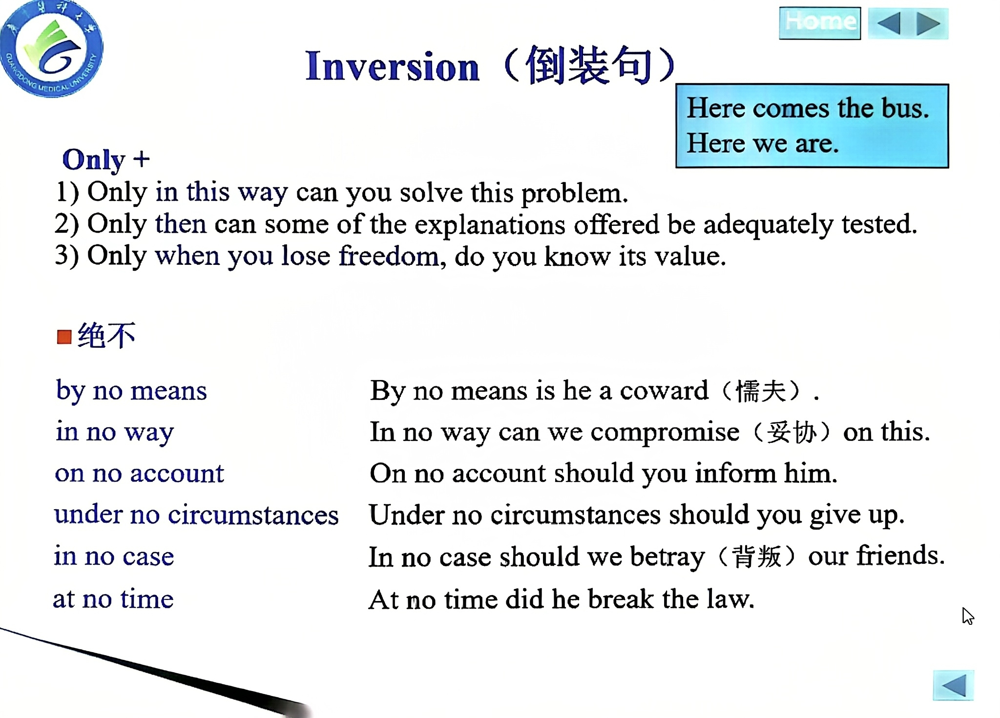
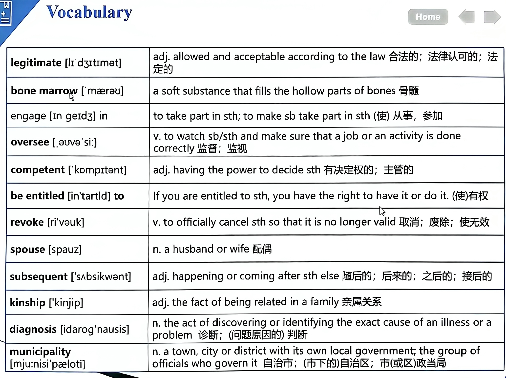

# 大学英语 第3课：倒装句复习 + Passage C 器官移植法规精讲 + 课堂讨论与作业提醒

> 科目：大学英语（医学人文英语）Humanistic Medical English (I)
> 上课日期：2026-09-23（周三）16:10 起（英文授课，笔记约 90 分钟）
> 教材：《English for Medical Humanities (I)》Unit 1，Passage C（器官移植法规问答）
> 本课课堂照片 2 张（均为课件 PPT 实拍），已按拍摄时间戳嵌入对应知识点段落并附批注；截图 1 张为个人课表，与本课知识点无关，未收录
> 前课承接：第2课 Passage A 课文精讲 + 倒装句入门；本课 = 倒装句复习巩固 + Passage C 词汇与法规条文 + 课堂讨论 + 作业布置

---

## 一、本课总览

本课是 Unit 1 的收尾课，核心四件事：

1. **倒装句复习巩固**（第2课语法点延伸：Only 倒装三种情况、否定词"绝不"系列搭配），用于写作与长难句分析；
2. **Passage C 词汇精讲**（Questions and Answers on the Regulation，法规问答体），重点讲医学词族与易混词；
3. **Passage C 课文结构**（Article 1~10 法规条文解读），配合长难句翻译练习；
4. **课堂讨论与问卷**（器官捐赠意愿调查 + 视频听力 + 伦理讨论），为期末话题作文积累素材。

作业提醒：教材 20 页第一段及 Article 10 中译英、教材 24 页长难句翻译、18~19 页词组复述、超星问卷完成、口语系统国庆前截止任务、留意校园网医学英语水平考试（METS）报名通知。

---

## 二、倒装句复习：Only 倒装与否定词倒装（写作高频考点）

> 📷 照片对应：`./照片/pic_20260923162221_0.jpg`（16:22 拍摄，课件 Inversion 幻灯片）

> 📝 **批注**：课件"Inversion（倒装句）"幻灯片（16:22 拍摄）。右上角蓝框例句：**Here comes the bus.**（方位副词 here + 名词主语 the bus → 完全倒装）/ **Here we are.**（主语 we 是代词 → 部分倒装，动词不提前）——正好对应第2课讲的"方位副词句首：名词主语全倒装、代词主语部分倒装"规则。左侧 **Only +** 三组例句：①Only in this way can you solve this problem.（Only + 介词短语）②Only then can some of the explanations offered be adequately tested.（Only + 副词）③Only when you lose freedom, do you know its value.（Only + 从句）。下方"绝不"系列：by no means / in no way / on no account / under no circumstances / in no case / at no time，每个都配倒装例句。这张图是倒装句语法复习的核心参考。

### 2.1 Only 倒装的三种情况——【考点：Only + 名词不倒装】

老师原话："Only 如果加名词是不存在倒装的，有很多同学在作文最后一段经常会用到 only in this...，对吧，但实际上 only 是有三种情况才存在倒装，而这种倒装也不是把整个动词提前。"

> 【考点】**Only + 名词 → 不倒装**。老师举例：*We only have a book.* 不能说成 *Only a book do we have.*（only 加名词时不放在句首倒装）。

Only 能引起倒装的只有以下三种结构（**Only + 状语**，其后用**部分倒装**——助动词/情态动词/be 动词提前，不是整个动词提前）：

| Only + 结构 | 例句 | 翻译 |
|-------------|------|------|
| Only + 介词短语 | Only in this way **can you** solve this problem. | 只有用这种方法你才能解决这个问题。 |
| Only + 副词 | Only then **can** some of the explanations offered **be** adequately tested. | 只有在那时，提供的某些解释才得到充分验证。 |
| Only + 从句 | Only when you lose freedom, **do you know** its value. | 只有当你失去自由时，你才知道它的价值。 |

> 【考点】老师强调："只有我刚才说的方位副词（here/there/now）前面才是整个动词提前（完全倒装），其他的倒装基本上都是助动词、情态动词、be 动词提前（部分倒装）。"

### 2.2 否定词放句首 → "绝不"系列（部分倒装）

老师原话："否定词放句首……例如 never, not until……我今天想强调的是几个'绝不'。"以下短语放句首时，句子用**部分倒装**（助动词/情态动词/be 动词提前）：

| 短语 | 搭配介词 | 例句 | 翻译 |
|------|----------|------|------|
| by no means | by | By no means **is he** a coward. | 他绝不是懦夫。 |
| in no way | in | In no way **can we** compromise on this. | 我们在这件事上绝不可能妥协。 |
| on no account | on | On no account **should you** inform him. | 你无论如何都不应该通知他。 |
| under no circumstances | under | Under no circumstances **should you** give up. | 在任何情况下你都不应该放弃。 |
| in no case | in | In no case **should we** betray our friends. | 我们绝不应该背叛朋友。 |
| at no time | at | At no time **did he** break the law. | 他从未违反过法律。 |

> 【考点】老师原话："你们要留意这个搭配介词都不同的——加上 way 肯定是用 in（in no way）；under no circumstances（在……情况下）；at no time（在……时刻）。"介词搭配是记忆关键。

### 2.3 翻译实战：中国不首先使用核武器

老师课堂翻译练习：**"中国在任何时候、任何情况下都不会首先使用核武器。"**

参考答案（老师给的）：
> **At no time and under no circumstances will China be the first to use nuclear weapons.**

> 【考点】老师原话："你不要忘了这个已经是否定的词，所以后面应该跟着**肯定的句式**——将来时提前哪个词？Will China be...？" 即：否定词（at no time / under no circumstances）放句首 → 部分倒装（助动词 will 提前），但主句谓语用**肯定形式**（be the first to...），因为否定意义已经由句首的否定短语承担了。

---

## 三、Passage C 核心词汇精讲（含音标）

> 📷 照片对应：`./照片/pic_20260923162434_0.jpg`（16:24 拍摄，课件 Vocabulary 词汇表）

> 📝 **批注**：课件"Vocabulary"词汇表幻灯片（16:24 拍摄），列出 Passage C 核心词共 12 个，每个单词都标注了国际音标、词性、英文释义和中文释义。逐行识别：①**legitimate [lɪˈdʒɪtɪmət]** adj. 合法的、法律认可的；②**bone marrow [ˈmærəʊ]** 骨髓（骨质中空部分的柔软物质）；③**engage [ɪnˈɡeɪdʒ] in**（使）从事、参加；④**oversee [ˌəʊvəˈsiː]** v. 监督、监视；⑤**competent [ˈkɒmpɪtənt]** adj. 有决定权的、主管的；⑥**be entitled [ɪnˈtaɪtld] to**（使）有权；⑦**revoke [rɪˈvəʊk]** v. 取消、废除、使无效；⑧**spouse [spaʊz]** n. 配偶；⑨**subsequent [ˈsʌbsɪkwənt]** adj. 随后的、后来的；⑩**kinship [ˈkɪnʃɪp]** n. 亲属关系；⑪**diagnosis [ˌdaɪəɡˈnəʊsɪs]** n. 诊断；⑫**municipality [mjuːˌnɪsɪˈpæləti]** n. 自治市、市政当局。这张表是 Passage C 词汇背诵的权威依据，配合下文 3.1~3.4 节扩展记忆。

### 3.1 Passage C 核心词汇表（老师逐词讲解，含音标）

| 单词 | 音标 | 词性 | 释义 | 搭配/例句 |
|------|------|------|------|-----------|
| legitimate | [lɪˈdʒɪtɪmət] | adj. | 合法的；法律认可的 | legitimate rights and interests 合法权益 |
| bone marrow | [bəʊn ˈmærəʊ] | n. | 骨髓 | 可移植组织 |
| engage in | [ɪnˈɡeɪdʒ ɪn] | phr. | 从事、参加 | be engaged in sth 忙于/从事某事 |
| oversee | [ˌəʊvəˈsiː] | v. | 监督；监视 | = supervise |
| competent | [ˈkɒmpɪtənt] | adj. | 有决定权的；主管的 | competent health authorities 主管卫生部门 |
| be entitled to | [ɪnˈtaɪtld tuː] | phr. | 有权（做某事） | be entitled to do sth |
| revoke | [rɪˈvəʊk] | v. | 取消；废除；使无效 | = officially cancel |
| valid | [ˈvælɪd] | adj. | 有效的 | 反义 invalid [ɪnˈvælɪd] 无效的 |
| spouse | [spaʊz] | n. | 配偶 | husband or wife |
| subsequent | [ˈsʌbsɪkwənt] | adj. | 随后的；后来的 | subsequent to sth 在……之后 |
| kinship | [ˈkɪnʃɪp] | n. | 亲属关系 | kinship relation 亲属关系 |
| diagnosis | [ˌdaɪəɡˈnəʊsɪs] | n. | 诊断；（问题原因的）判断 | 动词 diagnose |
| municipal | [mjuːˈnɪsɪpl] | adj. | 市政的；自治市的 | municipality n. 自治市 |
| territory | [ˈterətri] | n. | 领土；领域 | within the territory of 在……境内 |
| authority | [ɔːˈθɒrəti] | n. | 当局；权力 | authorities（复数）政府当局 |
| county | [ˈkaʊnti] | n. | 县；郡 | county level 县级（≠ country 国家） |
| regulation | [ˌreɡjuˈleɪʃn] | n. | 法规；条例 | 来自 regulate v. |
| provision | [prəˈvɪʒn] | n. | 规定；条款；提供 | in accordance with the provisions 根据条款 |
| verify | [ˈverɪfaɪ] | v. | 核实；证实 | = confirm |
| violation | [ˌvaɪəˈleɪʃn] | n. | 违反；违背 | violate v. 违反 |
| notify | [ˈnəʊtɪfaɪ] | v. | 通知；告知 | = inform |
| publicity | [pʌbˈlɪsəti] | n. | 宣传；推广 | carry out publicity 开展宣传 |
| promotion | [prəˈməʊʃn] | n. | 推广；促进 | publicity and promotion 宣传推广 |
| enhance | [ɪnˈhɑːns] | v. | 提高；增强 | = improve / promote |
| freewill | [friː wɪl] | n./adj. | 自愿（的） | freewill principle 自愿原则 |
| willing | [ˈwɪlɪŋ] | adj. | 乐意的；自愿的 | be willing to do sth |
| civil | [ˈsɪvl] | adj. | 民事的；公民的 | civil law 民法 / civil act 民事行为 |
| collateral | [kəˈlætərəl] | adj. | 旁系的；附属的 | collateral relative 旁系亲属 |
| severe | [sɪˈvɪə] | adj. | 严重的；剧烈的 | severity n. 严重性 |
| evaluation | [ɪˌvæljuˈeɪʃn] | n. | 评估；评价 | evaluate v. |
| kidney failure | [ˈkɪdni ˈfeɪljə] | n. | 肾衰竭 | renal failure 同义 |
| feasible | [ˈfiːzəbl] | adj. | 可行的；合理的 | = practicable |
| commercialize | [kəˈmɜːʃəlaɪz] | v. | 使商业化 | commercialization n. |
| scarcity | [ˈskeəsəti] | n. | 稀缺；不足 | scarce adj. 稀缺的 |
| reluctant | [rɪˈlʌktənt] | adj. | 不情愿的；勉强的 | reluctance n. |
| compensation | [ˌkɒmpenˈseɪʃn] | n. | 赔偿；补偿 | compensate v. |
| awareness | [əˈweənəs] | n. | 意识；认识 | raise public awareness 提高公众意识 |
| alternative | [ɔːlˈtɜːnətɪv] | n./adj. | 替代方案；可供选择的 | alternative ways 替代方式 |

### 3.2 医学核心词族（老师专门强调，任何单元都是重点）

老师原话："我们还是要把一些和医学类的……虽然这个是 C 篇文章也说了，C 篇可能小测啊，或者期末考的不多，但是这一系列的单词在任何单元都是重点来的，因为我们就是学医学的。"

| 词性 | 单词 | 音标 | 释义 | 搭配 |
|------|------|------|------|------|
| 动词 | diagnose | [ˈdaɪəɡnəʊz] | 诊断（疾病） | be diagnosed with sth 被诊断患有…… |
| 名词 | diagnosis | [ˌdaɪəɡˈnəʊsɪs] | 诊断（过程/结果） | make a diagnosis 做出诊断 |
| 形容词 | diagnostic | [ˌdaɪəɡˈnɒstɪk] | 诊断的 | diagnostic center 诊断中心 |
| 动词 | suffer | [ˈsʌfə] | 患病；遭受 | suffer from sth 患有……疾病 |
| 名词 | treatment | [ˈtriːtmənt] | 治疗（总称） | medical treatment 医疗 |
| 名词 | remedy | [ˈremədi] | 治疗法；补救 | a remedy for sth ……的疗法 |
| 名词 | therapy | [ˈθerəpi] | 疗法（具体） | physical therapy 物理治疗 |

> 【考点】老师原话："被诊断为患有什么疾病？哪个搭配？be diagnosed with。例如 He is diagnosed with a flu. somebody is diagnosed with a disease。但如果 something 作为主语，说这个疾病被诊断为是什么什么，那只能用 is diagnosed as。"——**人 + be diagnosed with + 疾病；疾病 + be diagnosed as + 名称**。

老师串讲例句：
> "He suffers from the flu. He has a flu. And he is diagnosed with the flu."
> （他得了流感。他有流感。他被诊断为流感。）

> 【考点】老师原话："有症状、有诊断，那肯定有治疗啊——treatment, remedy, therapy。"三个治疗词的区别：treatment 泛指治疗；remedy 指具体疗法/补救；therapy 指特定疗法（如物理治疗、心理治疗）。

### 3.3 易混词辨析（老师课堂重点对比）

#### 3.3.1 respect 词族

| 单词 | 音标 | 释义 | 例句 |
|------|------|------|------|
| respect | [rɪˈspekt] | v./n. 尊敬；方面 | in this respect 在这方面 |
| respectful | [rɪˈspektfl] | adj. 恭敬的；有礼貌的 | be respectful to sb 对某人恭敬 |
| respective | [rɪˈspektɪv] | adj. 各自的 | go home respective 各自回家 |
| respectable | [rɪˈspektəbl] | adj. 值得尊敬的 | a respectable teacher 一位值得尊敬的老师 |

> 【考点】老师原话："Respect 如果是尊敬的，它是哪两个形容词？Respectful and respectable. The teacher is respectable, so we are respectful to her. 但 this respective——we went home respective，各自的家。"——**respectful（主动恭敬）/ respectable（值得被尊敬）/ respective（各自的）**，阅读中极易混淆。

#### 3.3.2 consider 词族

| 单词 | 音标 | 释义 | 例句 |
|------|------|------|------|
| consider | [kənˈsɪdə] | v. 考虑；认为 | consider doing sth |
| considerate | [kənˈsɪdərət] | adj. 考虑周到的；体贴的 | a considerate mother 体贴的母亲 |
| considerable | [kənˈsɪdərəbl] | adj. 相当多的；相当大的 | a considerable amount 相当大的数量 |
| considerably | [kənˈsɪdərəbli] | adv. 相当；非常（程度副词） | The tree is considerably tall. 这棵树相当高。 |

> 【考点】老师原话："如果说考虑周到的其实是另外一个词 consider——She is a considerate mother. So for the considerable，a large amount 相当多。你们在阅读中要留意这个词。所以副词呢？considerably，for example the tree is considerably tall，相当高，是一个程度副词。"

#### 3.3.3 其他易混词

| 单词 | 音标 | 释义 | 说明 |
|------|------|------|------|
| indifferent | [ɪnˈdɪfrənt] | adj. 漠不关心的；冷漠的 | ≠ different 的反义词；老师："不着急啊，无所谓的、漠不关心的" |
| uneasy | [ʌnˈiːzi] | adj. 不安的；焦虑的 | = nervous / anxious；此处 easy ≠ "容易的" |
| virtual | [ˈvɜːtʃuəl] | adj. 虚拟的 | virtual reality 虚拟现实（VR） |
| virtue | [ˈvɜːtʃuː] | n. 美德；优点 | Honesty is a virtue. 诚实是一种美德。 |
| virtually | [ˈvɜːtʃuəli] | adv. 几乎；实质上；虚拟地 | It's virtually done. 差不多完成了。 |
| capability | [ˌkeɪpəˈbɪləti] | n. 能力；才能 | ≠ ability（能力）；competence 胜任力 |
| competent | [ˈkɒmpɪtənt] | adj. 有能力的；主管的 | 名词 competence |

> 【考点】老师原话："Virtually 既可以是虚拟的，还有一个意思——有没有同学了解过？Virtually that means almost，几乎或者实质上。It's almost done. It's virtually done."——**virtually 有两个意思：①虚拟地（技术语境）②几乎、实质上（≈ almost，写作高级替换）**。

### 3.4 其他重点短语

| 短语 | 音标 | 释义 |
|------|------|------|
| apply for | [əˈplaɪ fɔː] | 申请 |
| be applied to | [biː əˈplaɪd tuː] | 适用于；应用于 |
| be entitled to do | [ɪnˈtaɪtld tuː duː] | 有权做某事 |
| carry out | [ˈkæri aʊt] | 开展；执行 |
| stem from | [stem frɒm] | 起源于；由……引起 |
| be short of | [biː ʃɔːt ɒv] | 缺乏；短缺 |
| lack sth | [læk] | 缺乏（及物动词，直接加宾语） |
| due to a lack of | [djuː tuː ə læk ɒv] | 由于缺乏……（lack 作名词） |
| in accordance with | [ɪn əˈkɔːdəns wɪð] | 根据；依照（= according to，写作高级替换） |
| legitimate rights and interests | [lɪˈdʒɪtɪmət raɪts ənd ˈɪntrəsts] | 合法权益 |

> 【考点】老师原话："写 6 级作文的话，不要老用 according to，你们换一个——in accordance with。"——**in accordance with 是 according to 的高级替换，作文加分项**。

---

## 四、Passage C 课文精讲：Questions and Answers on the Regulation（法规问答）

### 4.1 标题纠错

老师原话："Passage C the title is Questions and Answers——Q and A stands for Questions and Answers on the Regulation. There's some mistake in the title——regulation 没有字母 a 的，好像这里打印错了，多了一个字母 A。"

> 【考点】**标题印刷错误**：Regulation 被误印为 Regula**a**tion（多了一个 a），正确拼写是 regulation [ˌreɡjuˈleɪʃn]。

### 4.2 文章结构

本文是一段**学生与老师之间的对话（dialogue）**，内容围绕**人体器官移植条例（the Regulation on Human Organ Transplantation）**展开，共 **11 个条款（Articles）**。课文前有表格概述全部条款。

老师原话："每一篇 passage 前面有一个表格……你有没有发现这个表格就是这篇文章的概述，说总共有 11 条、11 个条款 Article。这里是指它的一个条款，所以以后也讲个法规，Article one、two……都是在前面的表格。"

### 4.3 逐条解读（Article 1 ~ 10）

#### Article 1（第一条）

- **legitimate rights and interests**：合法权利和利益
- **interest**：此处不是"兴趣"，而是"利益"；银行语境下还有"利息"
- **citizen**：公民、市民
- 原文大意：为维护公民的合法权益和利益，制定本法规。

> 【考点】老师原话："Interest 应该不仅仅是兴趣，而是自己利益。我们要维护公民市民的合法权益和利益。论银行的话还有利息。"——**interest 多义：兴趣 / 利益 / 利息**。

#### Article 2（第二条）

- **territory** [ˈterətri]：领土、境内
- 原文大意：本法规适用于中华人民共和国境内的人体器官移植活动。

#### Article 3（第三条）——【核心考点：禁止买卖器官】

老师带领全班齐读：
> "According to Article 3, any organization or person shall not trade in any way human organs, and shall not be engaged in any activity in relation to the trade of human organs."

翻译：根据第三条，任何组织或个人不得以任何形式买卖人体器官，不得从事与买卖人体器官有关的活动。

> 【考点】老师原话："Shall not trade human organs and shall not be engaged in... we cannot buy or sell the organs." **买卖器官是非法的（illegal / forbidden）**——这是课堂讨论问卷第 8 题的核心判断依据，老师反复强调"下次如果再让你选，千万不要再选 a 了"。

#### Article 4（第四条）

重点词组翻译练习：
- **competent** [ˈkɒmpɪtənt]：主管的、有决定权的（competent health authorities 主管卫生部门）
- **authorities** [ɔːˈθɒrətiz]：当局（复数形式特指政府当局）
- **State Council** [steɪt ˈkaʊnsl]：国务院
- **county** [ˈkaʊnti]：县、郡（≠ country [ˈkʌntri] 国家！）
- **respective** [rɪˈspektɪv]：各自的
- 原文大意：县级以上地方人民政府卫生主管部门负责本行政区域内的人体器官移植工作管理。

> 【考点】老师原话："This is county instead of country. Don't please understand this word——它加的是 n-t-y，不是 t-r-y。" **county（县）≠ country（国家）**，阅读中极易看混。

#### Article 5（第五条）

- **verify** [ˈverɪfaɪ]：核实、查验
- **violation** [ˌvaɪəˈleɪʃn]：违反（法律）
- **notify** [ˈnəʊtɪfaɪ]：通知
- 原文大意：相关部门应当及时核实举报信息，对违反现行法律的行为进行处理，并将处理结果通知举报人。

#### Article 6（第六条）

- **carry out the publicity and promotion work**：开展宣传推广工作
- **publicity** [pʌbˈlɪsəti]：宣传
- **promotion** [prəˈməʊʃn]：推广

#### Article 7（第七条）——【器官捐赠原则】

- **freewill / willing**：自愿原则
- **free of charge**：免费原则
- **be entitled to do**：有权做某事
- **enhance** [ɪnˈhɑːns]：提高、增强
- **revoke** [rɪˈvəʊk]：取消（正式撤回捐赠意愿）
- **civil act capacity**：民事行为能力
- **civil law** [ˈsɪvl lɔː]：民法
- 原文大意：器官捐赠应当遵循自愿、无偿原则；具有完全民事行为能力的公民可以捐赠器官；捐赠人有权书面撤销捐赠意愿。

> 【考点】老师原话："Freewill 或者是 freewill 自愿的原则——Are you willing to do something? Willing 这是形容词嘛，所以这是意愿、是自愿。还有呢？免费的原则。比如说器官这种捐赠应该是自愿的、免费的。" + "Civil act 民事行为，那民法 civil law。"

#### Article 10（第十条）——【课堂翻译作业】

老师布置作业：将 Article 10 翻译成中文。课文原文涉及活体器官接受者的资格限制，包括：
- **直系亲属**（relatives by blood / direct relatives）
- **旁系亲属**（collateral relatives / collateral relatives by blood）
- **因帮扶等形成的亲情关系**（kinship formed through assistance and support）

老师课堂解析长句：
> "They can agree... We join, we agree. Correct. So writing 应该这个介词后面动词加 ing——可以找到谓语，也就是说他们可以来共同来同意这件事情。"

> 【考点】老师方法论：**长难句找谓语动词 → 找主干 → 再看枝叶**。"可以通过句子结构找谓语、找主干、找主句，看看这句话的谓语在哪里。"

---

## 五、长难句翻译练习（教材 20 页 & 24 页）

### 5.1 教材 20 页第一段（课堂翻译作业）

老师布置：翻译 20 页第一段长难句。课堂学生尝试翻译，老师纠正：

- 谓语动词：**agree**（主句谓语）
- 关键搭配：介词后面动词加 **-ing**（writing / providing 等）
- 大意：相关各方可以就活体器官捐赠事宜达成一致……

### 5.2 教材 24 页：Kidney Donation 翻译（课堂带译）

老师给出的原文（选自 3 月 27 日医院为一名 3 岁患儿实施器官捐献的报道）：

> "On March 27, the hospital conducted the donation procedure for the donor. The day before, he was diagnosed with a severe congenital heart disease. According to the local Red Cross, after the boy's passing, his parents decided to donate his organs to prolong the lives of others."

老师重点词：
- **severe** [sɪˈvɪə]：严重的；名词 **severity** [sɪˈverəti]：严重性
- **congenital** [kənˈdʒenɪtl]：先天的（课文词，认识即可）
- **Red Cross** [red krɒs]：红十字会
- **prolong** [prəˈlɒŋ]：延长（pro- 向前 + long 长）

最后一句翻译练习（老师课堂带学生做）：

> **原文**：经过评估，该女孩成功捐献了两个肾脏，用于帮助挽救一名 27 岁肾衰竭患者的生命。

学生翻译版本：
> "After the doctor's evaluation, the girl successfully donated two kidneys to help save the life of a 27-year-old patient with kidney failure."

老师肯定的要点：
1. **after evaluation / after the doctor's evaluation**：经过评估
2. **kidney failure** [ˈkɪdni ˈfeɪljə]：肾衰竭（= renal failure）
3. 用 **to do**（to help save）表目的——正确
4. 用 **with kidney failure** 作后置定语修饰 patient——正确

老师补充的另一种译法（定语从句版本）：
> "The girl successfully donated two kidneys to help save the life of a 27-year-old patient **who suffered from** kidney failure."

> 【考点】老师原话："老难点在于你怎么来处理这几个动词。中文是现状结构——中文句子现状结构，你看有很多并列的动词对吧，经过评估、捐献、用于帮助挽救——那你英文怎么处理？所以这个时候主句还是应该是前面的，捐献两个症状，后面不妨用定语从句啊，或者用分词结构跟来练一练。"

> 【考点】老师语法提醒："假如你在这里引用了定语从句，那在后面我就不建议你再用 who suffer from。但是刚才同学呢，他前面没有用 which，而是直接用了 to do something。所以还是要看你前后的搭配问题，假如你在这里引用了定语从句，那我不建议你后面又来一个定语 who suffer，那你就要改一个分词——suffering。"

即：如果前面用了 to do 结构表目的，后面可以用 who suffer from 定语从句；但如果前面已经用了 which 定语从句，后面就改用**现在分词 suffering** 作定语，避免重复用定语从句。

---

## 六、课堂讨论：器官捐赠意愿问卷分析

### 6.1 问卷概况

老师课堂发起超星在线问卷（8 个 items），全班约 60 人参与。老师实时投屏统计结果并逐题分析：

| 题号 | 话题 | 结果概要 | 老师点评 |
|------|------|----------|----------|
| Q1 | 是否了解器官移植相关法规 | 约 50 人选 A/B（了解一些），6 人选 Don't know | "看来还是得要继续阅读，我们刚刚是不是读了 Passage C 里面就有很多的法规" |
| Q2 | 器官买卖是否合法 | 多数选正确答案，但有同学选了"合法" | "Do you know it's legal or illegal? 还是需要了解一下相应的法规" |
| Q3 | 是否接受异种器官移植 | 观点各异（opinions vary from person to person） | 可以理解不接受，遗体捐献也是一种解决方式 |
| Q4 | 器官来源方式选择 | A/B/D 相对可行 | 异种移植（xenotransplantation）作为替代方案 |
| Q5 | 自己是否愿意登记器官捐赠 | 不愿意+不确定 37 人，愿意 19 人 | "I hope if we know the meaning and the significance of organ donation, more students would like to sign this contract" |
| Q6 | 最关心的问题 | B/D/C 居多（术后排斥反应等） | "Rejection——so you may be concerned with this problem" |
| Q7 | 不愿意捐赠的原因 | 传统观念、法律不完善、家人意见、流程复杂 | 支付宝已上线器官捐赠登记功能，流程简化中 |
| Q8 | 器官是否可以商业化买卖 | 23 人选了 Yes（错误！） | **"千万不要再选 a 了——trade is illegal, it's forbidden"** |

### 6.2 第 8 题深度讲解：为什么器官不能买卖？

老师原话："Why not? Because the paid donation may lead to more serious social problems. Just imagine one day if it's legal——I think everybody should worry about your own life, because some bad guys may kill somebody just for money."

> 【考点】**器官买卖 = 非法（illegal / forbidden）**，这是 Passage C Article 3 的核心规定。原因：付费捐赠会导致更严重的社会问题（如为钱杀人摘取器官）。

### 6.3 教材 32 页阅读材料：支付宝器官捐赠登记

老师引导看教材 32 页第二部分第 3 题：
> "Alipay——the leading mobile payment service——launched the function in cooperation with the China Organ Transplantation Development Foundation."

大意：支付宝（中国领先的移动支付平台）与中国器官移植发展基金会合作上线了器官捐赠登记功能，简化登记流程。

---

## 七、视频听力要点：器官移植工作原理

课堂播放一段英文教学视频（约 2 分钟），讲解器官移植的工作流程。老师逐段领读并提炼考点：

### 7.1 移植工作流程

1. **器官衰竭 → 需要移植**：Someone's organ begins to fail and that person will need a transplant to survive.
2. **移植中心评估**：A thorough evaluation is conducted at a transplant center.
3. **进入等待名单**：If a person is a good candidate for a transplant, he or she will be put on the National Transplant Waiting List.
4. **等待供体**：Once a person is on the list, the wait for an organ begins.

### 7.2 匹配因素（Matching Factors）

国家系统将等待名单上的患者与供体进行匹配。考虑因素包括：

- **blood type**（血型）
- **body size**（体型）
- **how sick the patient is**（患者病情严重程度）
- **distance from the donor**（与供体的距离）
- **tissue type**（组织类型）
- **length of time on the waiting list**（等待时间长短）

> 【考点】**以下因素不纳入匹配考量**：race（种族）、gender（性别）、income（收入）、celebrity（是否名人）、social status（社会地位）。老师原话："What doesn't get taken into account? Organs are never matched based on race or gender, income, celebrity and social status."

### 7.3 器官短缺现状

- **等待名单太长**：Some people don't receive an organ in time because the waiting list is very long.
- **供体不足**：There aren't enough donors available.
- **每日死亡人数**：Average 18 people on the waiting list die each day.

> 【考点】老师补充词汇："我们缺乏供体——we lack donors。可以说一个 shortage 或 scarcity。大家不妨也记记一些近义词，缺乏还有哪个词不要忘了——scarcity comes from scarce。"

### 7.4 lack 的用法纠错

> 【考点】老师原话："我发现很多同学造句用错——lack can you say be lack of? No, because lack is a transitive verb or it is a noun. 既然它是及物，所以你直接说 lack something。然后说他缺乏经验，怎么造句？He lacks experience. 那为什么会见到有 be lack of 呢？是因为它临死的时候才会有 due to a lack of donors。"

| 用法 | 例句 | 说明 |
|------|------|------|
| lack + 宾语（及物动词） | He lacks experience. | ✅ 正确 |
| due to a lack of + 名词（名词用法） | Due to a lack of donors, many die. | ✅ 正确 |
| be lacking in + 名词（形容词用法） | He is lacking in experience. | ✅ 正确（lacking 是形容词） |
| be lack of | ❌ 错误说法 | lack 不作形容词用在 be 后面 |
| be short of | ✅ 可以 | = 缺乏 |

---

## 八、课堂口语讨论：中国器官捐赠 reluctance 分析

老师要求学生用笔记功能回答讨论题：**"Why are people in China reluctant to donate organs? How can we solve this problem?"**

### 8.1 学生回答范例

> "In China, organ donation reluctance stems from traditional beliefs, family concepts and distrust. Solutions like public education and transparent allocation, and simplified registration and support for donor families."

### 8.2 原因（Reasons）

| 原因 | 英文表达 |
|------|----------|
| 传统观念 | traditional beliefs / traditional ideas |
| 家庭观念 | family concepts |
| 对相关法律的不信任 | distrust of relevant laws |
| 家人意见 | opinions of family members |
| 流程复杂 | complicated procedures |
| 补偿机制不完善 | inadequate compensation mechanism |

### 8.3 解决方法（Solutions）

| 方法 | 英文表达 |
|------|----------|
| 提高公众意识 | raise / enhance public awareness |
| 完善相关法律 | improve relevant laws |
| 透明分配机制 | transparent allocation |
| 简化登记流程 | simplified registration |
| 支持捐赠者家属 | support for donor families |
| 宣传推广 | carry out publicity and promotion |
| 替代方案 | alternative ways（如异种移植 xenotransplantation） |

> 【考点】老师原话："Solution 的动词就是 solve——Solve the problem. Or can say adjust the problem or the solution to the problem." + "Raise or enhance the public awareness. Improve the related law. Or we can use some alternative ways like the transplantation." + "Work compensation 赔偿——虽然我们说器官不能买卖，但是你捐赠器官还是可以有一些赔偿机制的。"

---

## 九、作业与备考提醒（本课布置，直接关系平时分）

1. **教材 20 页第一段翻译**（中译英长难句）——找谓语、找主干；
2. **Article 10 翻译**（教材 20 页）——活体器官接受者资格限制；
3. **教材 18~19 页词组复述**——刚讲完的重点词组，老师课堂抽查了多名同学复述；
4. **教材 24 页长难句翻译**——Kidney Donation 段落翻译（老师课堂带译）；
5. **超星问卷完成**——器官捐赠意愿调查问卷（课堂现场完成，未完成的 15 人被老师点名提醒）；
6. **口语系统任务**：**国庆前第一个任务截止！** 老师原话："口语你要抓紧做了，国庆前第一个任务要截止了，你做了没有？没做的赶快做。" 口语密码与评价系统密码相同；如忘记密码可留言给老师重置。进入方式参考超星上的"过程性评价方案"；
7. **医学英语水平考试（METS）报名**：留意校园网通知，下半年报名即将开始。有三级（较易）和四级（较难），不一定要从三级考起；
8. **预习第 2 单元**：下周讲第 2 单元前，老师会安排练习（今天时间不够没练）；
9. **倒装句复习**：Only 三种倒装 + 否定词"绝不"系列，写作必考；
10. **Passage C 词组积累**：be engaged in / authorities / respective / revoke 等阅读高频动词。

---

## 十、本课易错点与复习提醒

1. **Only + 名词不倒装**；Only 引起倒装仅限三种：介词短语 / 副词 / 从句，且是部分倒装（助动词提前）。
2. **否定词放句首用部分倒装，但主句谓语用肯定形式**（At no time will China be the first...）。
3. **"绝不"系列介词搭配**：by no means / in no way / on no account / under no circumstances / in no case / at no time——介词各不相同。
4. **county（县）≠ country（国家）**——阅读中看混就错。
5. **interest 多义**：兴趣 / 利益 / 利息。
6. **respect 词族辨析**：respectful（恭敬的）/ respectable（值得尊敬的）/ respective（各自的）。
7. **consider 词族辨析**：considerate（体贴的）/ considerable（相当多的）/ considerably（相当，程度副词）。
8. **virtually 双义**：虚拟地 / 几乎、实质上（= almost）。
9. **diagnose 搭配**：人 + be diagnosed with + 疾病；疾病 + be diagnosed as + 名称。
10. **lack 的用法**：及物动词直接加宾语（lack sth）；名词搭配 due to a lack of；形容词是 lacking（be lacking in）；**不说 be lack of**。
11. **器官买卖 = 非法**（Article 3）——问卷第 8 题考点，绝对不能选"合法"。
12. **long sentence 分析方法论**：找谓语 → 找主句主干 → 其余都是枝叶（从句/后置定语/分词）。
13. **翻译技巧**：中文并列动词多 → 英文用一个主句 + 定语从句/分词结构处理后续动词。
14. **写作替换**：according to → in accordance with；use → utilize / employ；promote → facilitate / enhance。
