# 第6课 生物氧化与ATP生成——知识点总结（教材精讲版）

> 课程：生物化学与分子生物学（科学出版社案例版第3版）
> 上课时间：2026-09-23 09:45
> 课时：第6课（承接第5课呼吸链/电子传递链）
> 课堂照片：共 20 张 PPT 照片（已去重，插入于对应知识点位置；教材书页实拍图 0 张）
> 参考教材：人卫第9版（周春燕、药立波主编），补充内容标注【教材补充·人卫第9版】

---

## 一、细胞内 ATP 的生成方式

生物氧化释放的能量并不能直接被细胞利用，必须先"货币化"为 ATP。细胞内 ADP 磷酸化生成 ATP 的途径有两条，能量来源不同。

### 1.1 两种磷酸化方式

1. **底物水平磷酸化（substrate-level phosphorylation）**：代谢物分子内部能量重新分布，生成高能键后再水解，将高能键转移给 ADP 生成 ATP。不经过呼吸链，不依赖氧。【考点】老师原话："来自于底物分子内部能量重新分布，生成高能键后水解，称底物水平磷酸化。"
2. **氧化磷酸化（oxidative phosphorylation）**：代谢物脱下的氢经呼吸链传递电子给 O₂ 生成水，逐步释放的能量偶联 ADP 磷酸化生成 ATP。又称**偶联磷酸化**。【考点】老师原话："来自于代谢物脱氢经呼吸链传递电子给 O₂ 生成水逐步释放的能量，称氧化磷酸化，又称为偶联磷酸化。"

【考点】**90% 的 ATP 经氧化磷酸化方式产生**，底物水平磷酸化只占很少一部分。这是本章最核心的一句话。

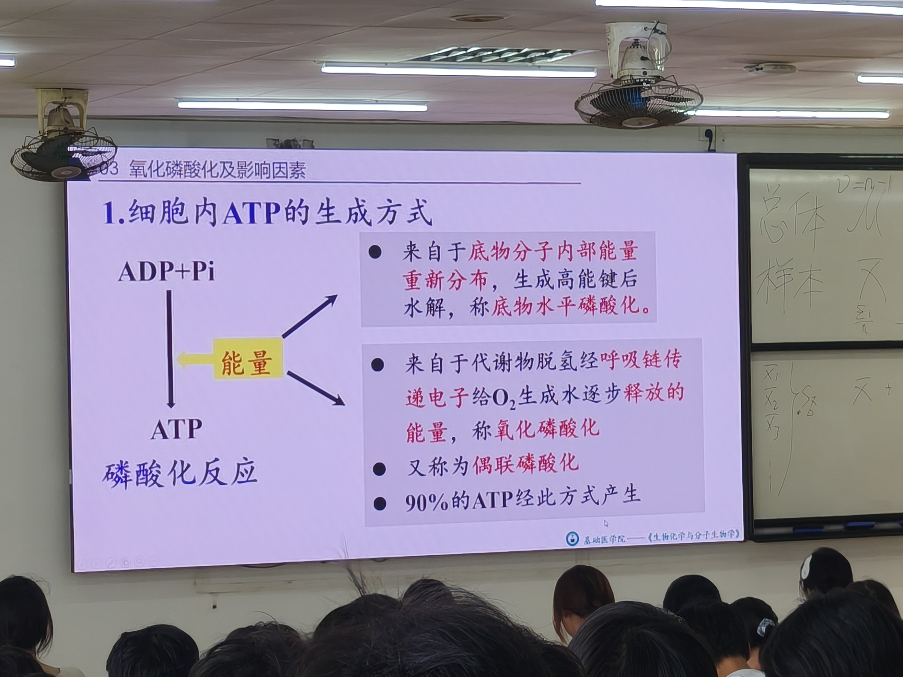
📝 09:51 PPT：ADP+Pi 经能量驱动生成 ATP（磷酸化反应），能量有两个来源——底物分子内部能量重新分布（底物水平磷酸化）与呼吸链递氢给 O₂ 释能（氧化磷酸化=偶联磷酸化）；红字强调"90%的ATP经此方式产生"。

【教材补充·人卫第9版】底物水平磷酸化的典型反应举例：①1,3-二磷酸甘油酸 → 3-磷酸甘油酸（磷酸甘油酸激酶）；②磷酸烯醇式丙酮酸 → 丙酮酸（丙酮酸激酶）；③琥珀酰 CoA → 琥珀酸（琥珀酰 CoA 合成酶，高能硫酯键断裂）。这三步在糖酵解与三羧酸循环中各出现一次，是考试常考的"底物水平磷酸化三步反应"。

---

## 二、氧化磷酸化偶联部位——P/O 比值

### 2.1 P/O 比值的定义

【考点】老师原话："物质氧化时，每消耗 1 摩尔 **氧原子（O）**，同时所消耗无机磷酸（P）的摩尔数，亦即生成 ATP 的摩尔数。"

⚠️ **易错点（老师反复强调）**：这里的"O"是**氧原子**，不是氧分子 O₂。去年期末有人把 O 看成 O₂，整道题算错。1 摩尔 O 原子 = 0.5 摩尔 O₂。

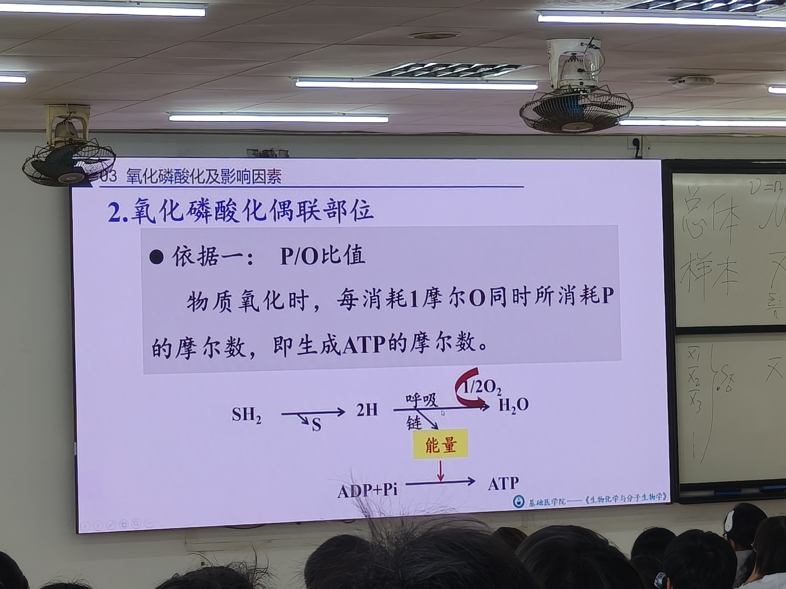
📝 09:54 PPT：P/O 比值定义页——SH₂ 脱 2H 经呼吸链交给 ½O₂ 生成 H₂O，释放能量驱动 ADP+Pi→ATP；底部示意图明确写"每消耗1摩尔O同时所消耗P的摩尔数"。

### 2.2 离体实验测得的 P/O 比值表

通过在线粒体离体实验中加入不同底物，测定 P/O 比值，可以反推氧化磷酸化的偶联部位。

| 底物 | 呼吸链组成 | P/O 比值 | 可能生成 ATP 的部位 |
|------|-----------|----------|---------------------|
| β-羟丁酸 | NAD⁺→复合体Ⅰ→CoQ→复合体Ⅲ→Cyt c→复合体Ⅳ→O₂ | 2.4~2.8 | 3 |
| 琥珀酸 | 复合体Ⅱ→CoQ→复合体Ⅲ→Cyt c→复合体Ⅳ→O₂ | 1.7 | 2 |
| 抗坏血酸 | Cyt c→复合体Ⅳ→O₂ | 0.88 | 1 |
| 细胞色素 c(Fe²⁺) | 复合体Ⅳ→O₂ | 0.61~0.68 | 1 |

【考点】由表推出**三个偶联部位**：
- 第一个偶联部位：**NADH → CoQ 之间**（对应复合体Ⅰ）
- 第二个偶联部位：**CoQ → Cyt c 之间**（对应复合体Ⅲ）
- 第三个偶联部位：**Cyt aa₃ → O₂ 之间**（对应复合体Ⅳ）

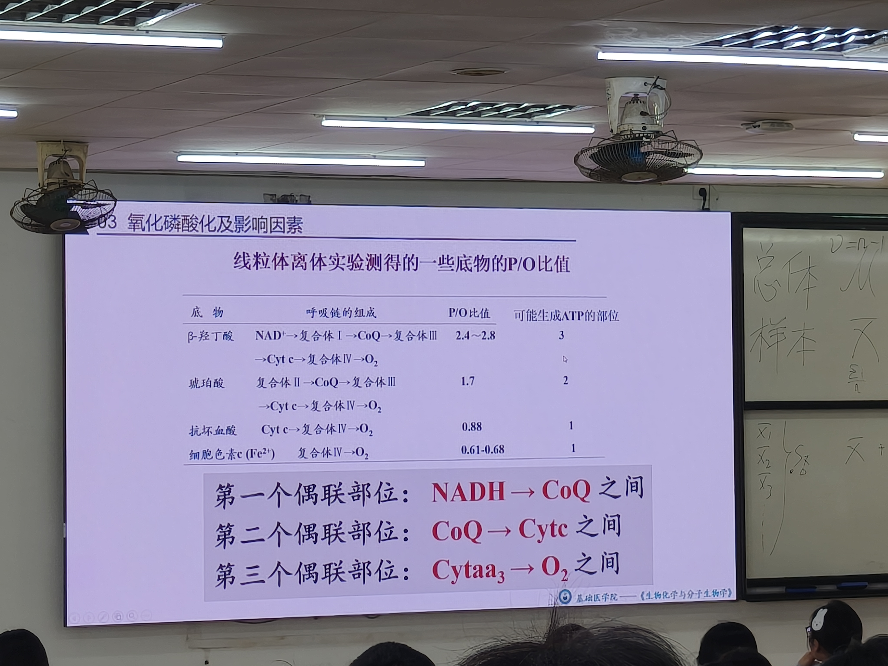
📝 09:55 PPT：离体线粒体 P/O 比值表——β-羟丁酸(2.4~2.8，3部位)、琥珀酸(1.7，2部位)、抗坏血酸(0.88，1部位)、Cyt c Fe²⁺(0.61~0.68，1部位)；红字标出三个偶联部位：NADH→CoQ、CoQ→Cyt c、Cyt aa₃→O₂。

### 2.3 偶联部位的自由能依据

【考点】老师原话："电子传递过程中自由能变化超过 30.5 kJ/mol 的部位才能偶联生成 ATP。"因为 ATP 水解的标准自由能变化 ΔG°′ ≈ 30.5 kJ/mol，只有电子传递释放的自由能大于这个值，才能驱动 ADP+Pi → ATP。

- 复合体Ⅰ（NADH→CoQ）：ΔG°′ ≈ −69.5 kJ/mol，>30.5，可偶联。
- 复合体Ⅲ（CoQ→Cyt c）：ΔG°′ ≈ −36.7 kJ/mol，>30.5，可偶联。
- 复合体Ⅳ（Cyt aa₃→O₂）：ΔG°′ ≈ −102.3 kJ/mol，>30.5，可偶联。

【考点】老师特别提醒："复合体Ⅳ的自由能变化最大（102.3 kJ/mol），但它只泵 2H⁺，只偶联 0.5 个 ATP——**不是自由能释放越多，生成的 ATP 就越多**。"自由能大小只决定"能不能偶联"，实际生成 ATP 数取决于泵出的 H⁺ 数。

### 2.4 氧化磷酸化偶联部位示意图

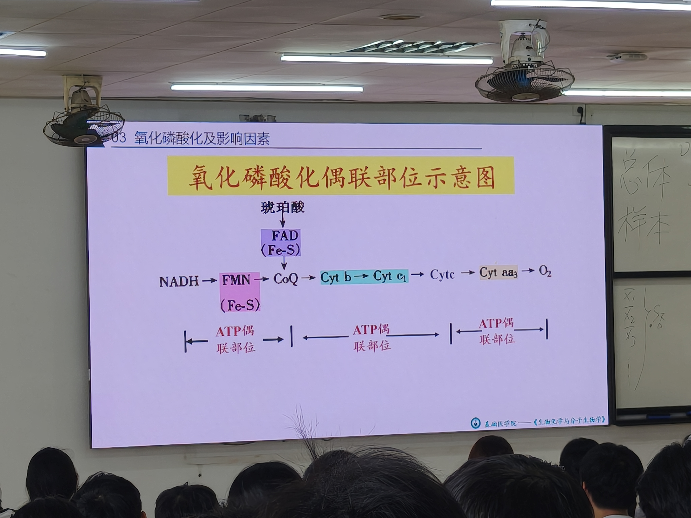
📝 10:00 PPT：两条呼吸链走行——NADH→FMN(Fe-S)→CoQ→Cyt b→Cyt c₁→Cyt c→Cyt aa₃→O₂；琥珀酸经 FAD(Fe-S) 汇入 CoQ；三个"ATP偶联部位"分别框在 NADH-FMN段、CoQ-Cyt c段、Cyt aa₃-O₂段下方。

---

## 三、氧化磷酸化的偶联机制——化学渗透假说

### 3.1 化学渗透假说（chemiosmotic hypothesis）

1961 年由 Peter Mitchell 提出，1978 年获诺贝尔化学奖。但老师强调："它叫**假说**，不叫学说，说明还有细节在完善。"

【考点】核心内容：电子经呼吸链传递时，复合体Ⅰ、Ⅲ、Ⅳ将基质中的 H⁺ **泵到线粒体内膜胞质侧（膜间隙）**，形成跨膜的**电化学梯度**（外正内负、外酸内碱）储存能量。当 H⁺ 顺浓度梯度经 ATP 合酶 F₀ 通道回流到基质时，释放的自由能驱动 ADP+Pi 生成 ATP。

- 电子传递（横向）与 H⁺ 泵出（纵向）相偶联。
- 胞质侧（膜间隙）带正电、H⁺ 多；基质侧带负电、H⁺ 少。
- H⁺ 只能经 ATP 合酶的 F₀ 通道回流（正常内膜对 H⁺ 不通透）。

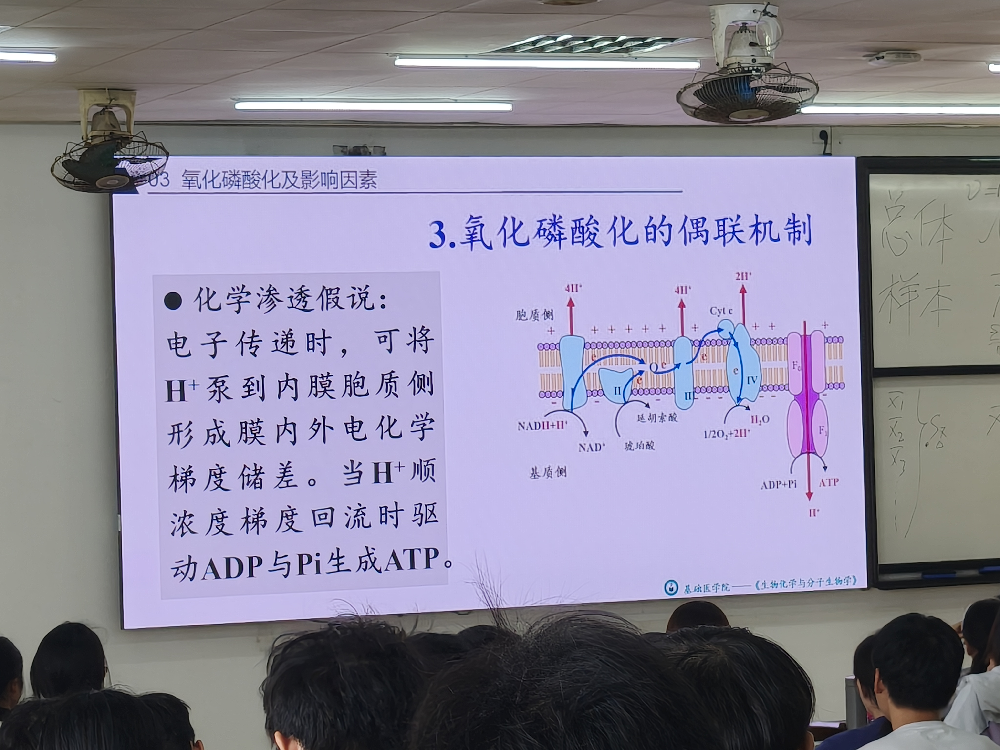
📝 10:02 PPT：化学渗透假说文字 + 内膜剖面图——复合体Ⅰ泵 4H⁺、Ⅲ泵 4H⁺、Ⅳ泵 2H⁺ 到胞质侧；NADH+H⁺→NAD⁺、琥珀酸→延胡索酸、½O₂+2H⁺→H₂O；右侧 F₀/F₁ ATP 合酶让 H⁺ 回流并合成 ATP。

### 3.2 两条呼吸链的质子泵出与 ATP 产量

【考点】老师原话（PPT 原文）：
- 每 2H 通过 **NADH 氧化呼吸链**可向胞质侧泵出 **10 H⁺**，回流后生成 **10/4 = 2.5 ATP**；
- 每 2H 通过 **琥珀酸氧化呼吸链**可向胞质侧泵出 **6 H⁺**，回流后生成 **6/4 = 1.5 ATP**。

推算：复合体Ⅰ泵 4H⁺ + 复合体Ⅲ泵 4H⁺ + 复合体Ⅳ泵 2H⁺ = 10H⁺（NADH 链）；复合体Ⅱ不泵 H⁺，故琥珀酸链只有 Ⅲ+Ⅳ = 4+2 = 6H⁺。

【考点】**4 H⁺ 回流 = 1 ATP**（含 ATP 合成后转运出线粒体所需的 1 H⁺ 成本；部分教材按 3 H⁺=1 ATP 算合成、再 1 H⁺ 转运，合计 4 H⁺/ATP）。

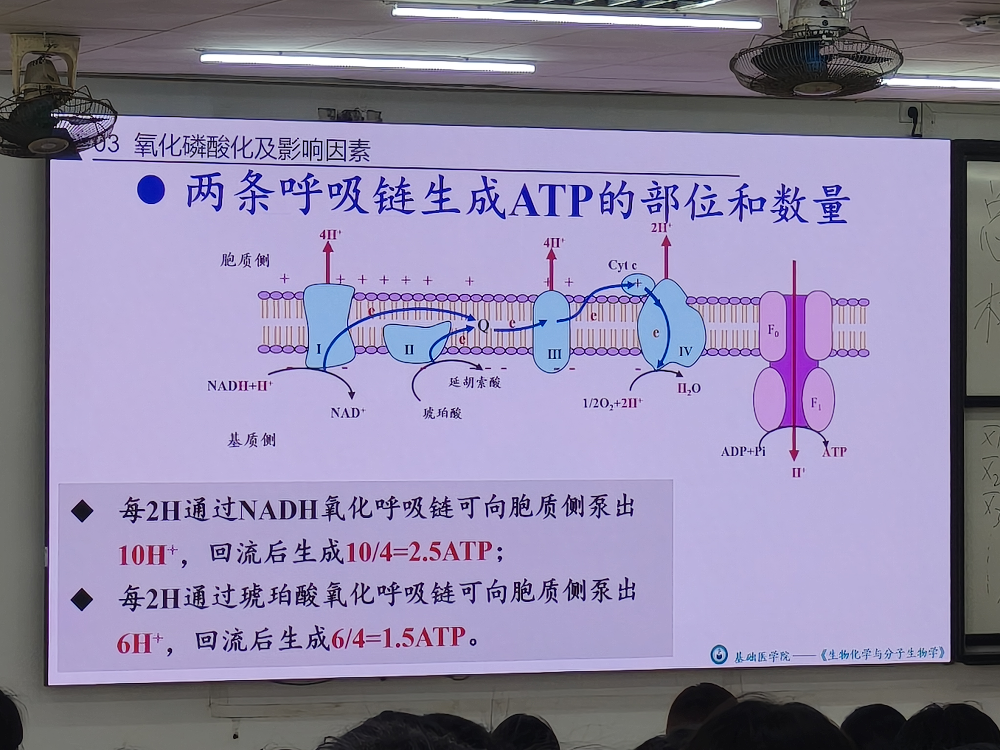
📝 10:14 PPT：内膜剖面图标注复合体Ⅰ泵4H⁺、Ⅲ泵4H⁺、Ⅳ泵2H⁺；底部红底结论——NADH链泵10H⁺→10/4=2.5 ATP；琥珀酸链泵6H⁺→6/4=1.5 ATP。

---

## 四、ATP 合酶的结构与工作机制

### 4.1 ATP 合酶（ATP synthase）的组成

ATP 合酶即复合体 V，由亲水的 F₁ 头部和疏水的 F₀ 基部组成。

| 部分 | 位置 | 组成 | 功能 |
|------|------|------|------|
| F₁ | 内膜**基质侧**（亲水，突出于基质） | α₃β₃γδε 共 9 个亚基 | **催化 ATP 生成** |
| F₀ | 镶嵌在内膜中（疏水） | a₁b₂c₉~₁₂ | **质子通道**（H⁺ 回流通道） |

【考点】老师原话："F₁ 是亲水部分，α₃β₃γδε 亚基；F₀ 是疏水部分，a₁b₂c₉~₁₂ 亚基。F₁ 催化 ATP 生成，F₀ 是质子通道。"

- F₁ 的 3 个 β 亚基是催化中心；3 个 α 亚基起调节作用。
- γ 亚基是"转轴"，连接 F₀ 的 c 环与 F₁ 的 α₃β₃。
- F₀ 的 c 环由 9~12 个 c 亚基围成，随 H⁺ 流过而旋转。

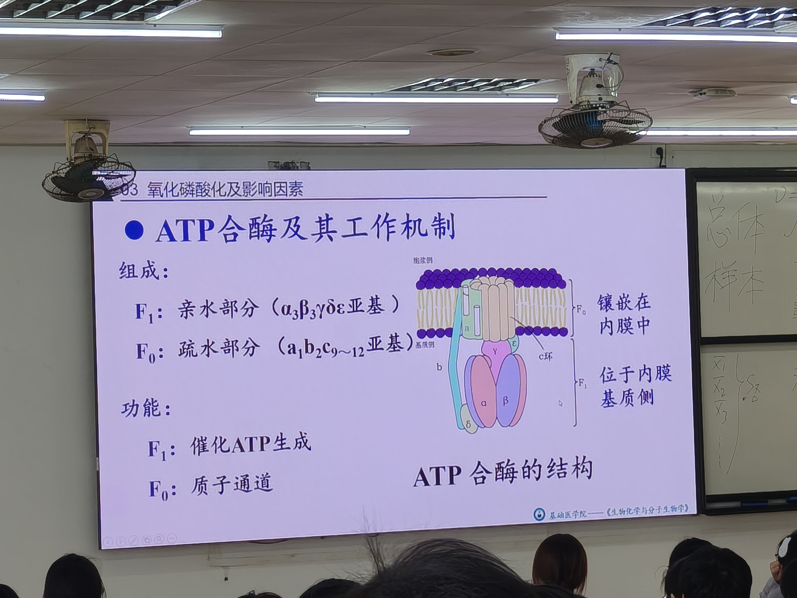
📝 10:07 PPT：ATP 合酶结构图——F₀（a、b、c环）镶嵌在内膜中，F₁（α、β、γ、δ、ε）位于内膜基质侧；左列文字标注 F₁=亲水(α₃β₃γδε)、F₀=疏水(a₁b₂c₉~₁₂)；功能：F₁催化ATP生成、F₀质子通道。

### 4.2 结合变构机制（binding change mechanism）

【教材补充·人卫第9版】Boyer 提出结合变构机制，与 Walker 的晶体结构研究共获 1997 年诺贝尔化学奖。要点：
- F₁ 的 3 个 β 亚基构象不同，分别处于 **L（loose，疏松）、T（tight，紧密）、O（open，开放）** 三种状态。
- L 态：结合 ADP+Pi；T 态：直接合成 ATP（不需额外能量）；O 态：释放 ATP。
- γ 亚基随 F₀ c 环旋转，每转 **120°** 就把一个 β 亚基从一种构象切换到下一种。
- γ 亚基转满 **360°**（一圈），3 个 β 亚基各经历一次 L→T→O，共生成 **3 分子 ATP**。

【考点】老师强调："ATP 在 T 态生成是不需能量的，能量主要花在把 ATP 从 O 态释放出来。"——这纠正了"ATP 合成需要能量"的直觉，实际能量用在释放与质子回流上。

---

## 五、影响氧化磷酸化的因素

### 5.1 抑制剂——三大类

【考点】老师把影响氧化磷酸化的抑制剂分三类，要求掌握每类作用机制：

1. **呼吸链抑制剂**：阻断呼吸链中某些部位的电子传递。
2. **解偶联剂**：使氧化（电子传递）与磷酸化（ATP 合成）偶联过程脱离。
3. **氧化磷酸化抑制剂**：对电子传递及 ADP 磷酸化均抑制。

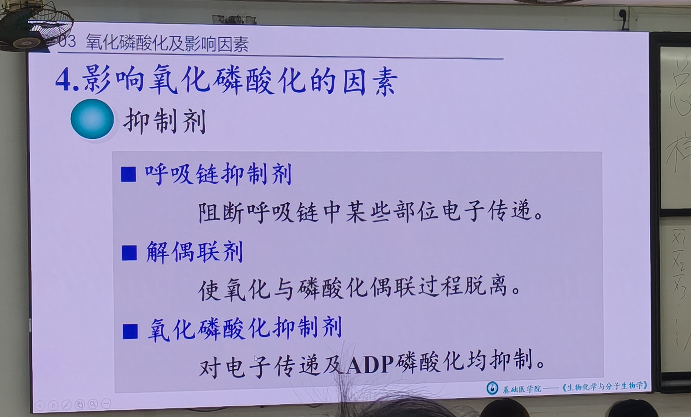
📝 10:16 PPT：4.影响氧化磷酸化的因素——抑制剂三类：呼吸链抑制剂（阻断呼吸链中某些部位电子传递）、解偶联剂（使氧化与磷酸化偶联过程脱离）、氧化磷酸化抑制剂（对电子传递及ADP磷酸化均抑制）。

### 5.2 呼吸链抑制剂——阻断位点必考

| 抑制剂 | 阻断位点 | 对应复合体 |
|--------|----------|-----------|
| 鱼藤酮（rotenone）、粉蝶霉素 A（piericidin A）、异戊巴比妥（amobarbital） | FMN→CoQ（Fe-S 蛋白到泛醌） | 复合体Ⅰ |
| 抗霉素 A（antimycin A）、二巯基丙醇（dimercaprol/BAL） | Cyt b → Cyt c₁ | 复合体Ⅲ |
| CO、CN⁻、N₃⁻、H₂S | Cyt aa₃ → O₂ | 复合体Ⅳ |

【考点】老师临床联系："**火灾中浓烟致死率高达 80%，浓烟中的 CO 以及 HCN（氢氰酸）是主要原因**。"——CO 与 CN⁻ 都阻断复合体Ⅳ，使组织不能利用氧，造成细胞内窒息。

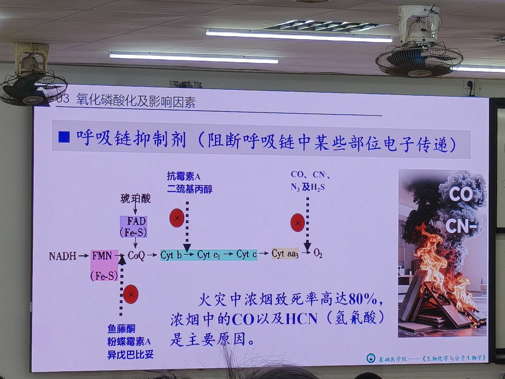
📝 10:19 PPT：呼吸链抑制剂位点图——NADH→FMN(Fe-S)→CoQ→Cyt b→Cyt c₁→Cyt c→Cyt aa₃→O₂；下方鱼藤酮/粉蝶霉素A/异戊巴比妥打叉于 FMN→CoQ；抗霉素A+二巯基丙醇打叉于 Cyt b→Cyt c₁；CO/CN⁻/N₃⁻/H₂S 打叉于 Cyt aa₃→O₂；右侧火灾浓烟 CO、HCN 致死率80%。

【教材补充·人卫第9版】二巯基丙醇（BAL）原本是砷化物（路易士气）中毒的解毒剂，因能结合巯基；课堂 PPT 将其与抗霉素 A 并列为复合体Ⅲ抑制剂，按 PPT 记忆即可。注意与第4课"砷化物→二巯基丙醇解毒"区分：二巯基丙醇既可作解毒剂，也可抑制复合体Ⅲ。

### 5.3 解偶联剂（uncoupler）

【考点】**解偶联蛋白（UCP）**：棕色脂肪组织线粒体内膜上的质子通道，让 H⁺ 不经过 F₀ 通道而直接漏回基质，电化学梯度以**热能**形式释放，不生成 ATP。
- 氧化（电子传递）照常进行甚至加快，但磷酸化（ATP 合成）停止。
- **新生儿硬肿症**：缺乏棕色脂肪组织，不能维持正常体温而使皮下脂肪凝固所致（案例 8-1）。【考点】老师原话："新生儿硬肿症就是缺乏棕色脂肪，不能产热。"

【教材补充·人卫第9版】经典化学解偶联剂是 **2,4-二硝基苯酚（DNP）**：脂溶性弱酸，能携带 H⁺ 穿过内膜，破坏质子梯度。UCP1（棕色脂肪）、UCP2/UCP3 是内源性解偶联蛋白。早产儿因棕色脂肪少，易发生新生儿寒冷损伤综合征（旧称新生儿硬肿症）。

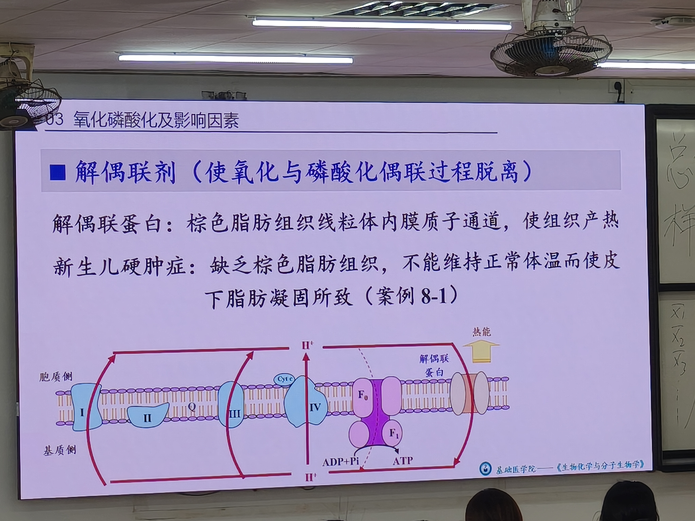
📝 10:23 PPT：解偶联剂页——解偶联蛋白=棕色脂肪组织线粒体内膜质子通道，使组织产热；新生儿硬肿症=缺乏棕色脂肪组织，不能维持正常体温而使皮下脂肪凝固（案例8-1）；示意图中解偶联蛋白让 H⁺ 绕过 F₀F₁ 直接回流，能量以"热能"散失。

### 5.4 氧化磷酸化抑制剂

【考点】**寡霉素（oligomycin）**：结合 F₀ 的 c 环/a 亚基部位，阻止 H⁺ 通道，既抑制 ATP 合成，又因质子梯度无法回流而间接抑制电子传递（呼吸控制）。这一类"对电子传递及 ADP 磷酸化均抑制"。

### 5.5 体内能量状态的调节作用

【考点】老师原话："**ADP 浓度或 ADP/ATP 比率是调节正常人体氧化磷酸化速率的主要因素。**"
- ADP/ATP **↓**（ATP 充足）：**抑制**氧化磷酸化（呼吸控制减弱）。
- ADP/ATP **↑**（能量消耗、ATP 用掉变 ADP）：**促进**氧化磷酸化（呼吸控制增强）。

这是一种反馈调节：耗能越多→ADP 越多→氧化磷酸化越快；ATP 充足→氧化磷酸化减慢。

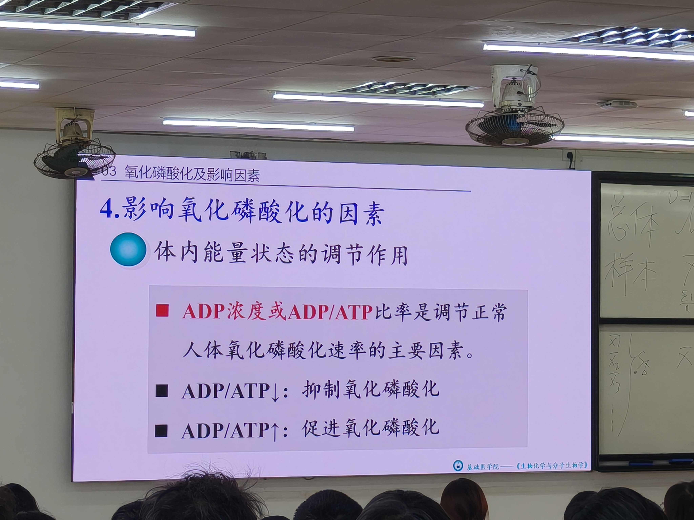
📝 10:40 PPT：4.影响氧化磷酸化的因素——体内能量状态的调节作用；红字结论"ADP浓度或ADP/ATP比率是调节正常人体氧化磷酸化速率的主要因素"；ADP/ATP↓抑制、ADP/ATP↑促进。

### 5.6 甲状腺激素的影响

【考点】甲状腺激素（主要是 T₃）两方面作用：
1. **诱导 Na⁺,K⁺-ATP 酶生成**，加速 ATP 分解（ATP→ADP+Pi 增多）。
2. **诱导解偶联蛋白基因表达**，使氧化与磷酸化解偶联。

结果：**耗氧和产热均增加**。甲亢患者怕热、多汗、消瘦、基础代谢率升高；甲减则相反。

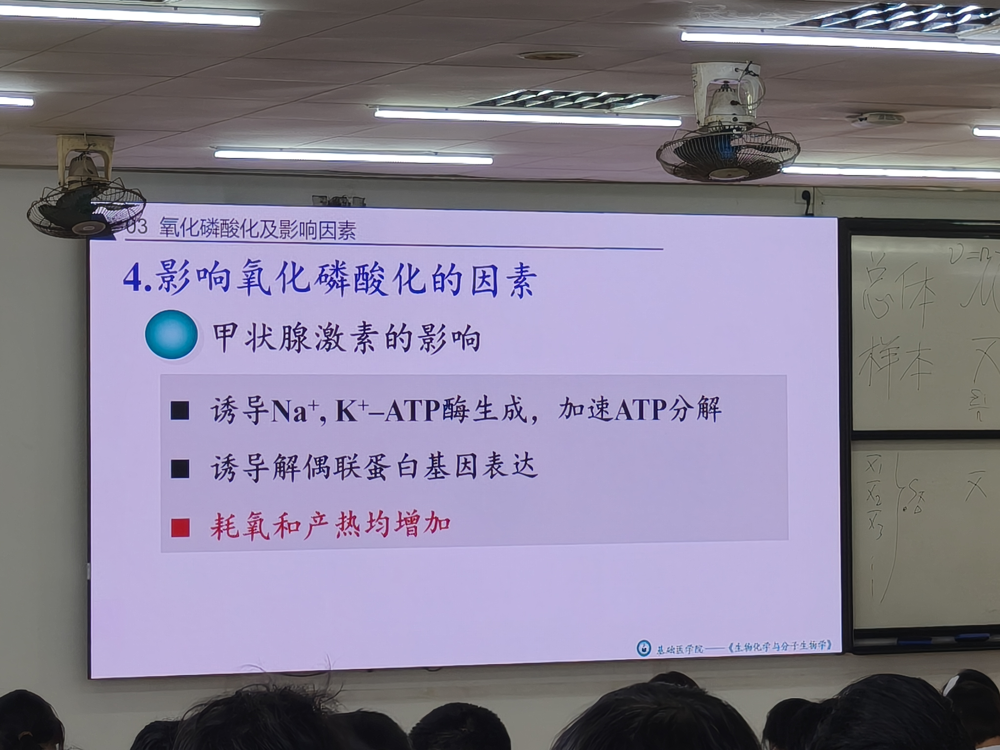
📝 10:41 PPT：甲状腺激素的影响——诱导 Na⁺,K⁺-ATP酶生成、加速ATP分解；诱导解偶联蛋白基因表达；红字结论"耗氧和产热均增加"。

### 5.7 线粒体 DNA（mtDNA）突变

【教材补充·人卫第9版】mtDNA 为裸露环状双链 DNA，无组蛋白保护、无高效修复系统，突变率高（是核 DNA 的 10~20 倍）。呼吸链复合体亚基部分由 mtDNA 编码，突变可致氧化磷酸化功能下降，出现线粒体病（如 MELAS、MERRF、Leber 视神经萎缩），且**母系遗传**（受精卵线粒体几乎全来自卵细胞）。耗能多的组织（脑、肌、心）最先受累。

---

## 六、高能化合物与 ATP

### 6.1 高能化合物的定义

【考点】老师原话（PPT）："**高能化合物：水解时放能大于 25 kJ/mol 的化合物。**"按所含高能键类型分两类：

| 类别 | 高能键 | 举例 |
|------|--------|------|
| 高能磷酸化合物 | 含 ~P（高能磷酸键） | ATP、磷酸肌酸、磷酸烯醇式丙酮酸、1,3-二磷酸甘油酸 |
| 高能硫酯化合物 | 含 ~SCoA | 乙酰 CoA、脂酰 CoA、琥珀酰 CoA |

【考点】ATP 水解的 ΔG°′ ≈ 30.5 kJ/mol，是细胞内"能量货币"，处于众多高能化合物的"中间位置"——既不最高也不最低，便于通过转磷酸反应把能量从高能化合物转移给 ADP 生成 ATP，再由 ATP 转移给需能反应。

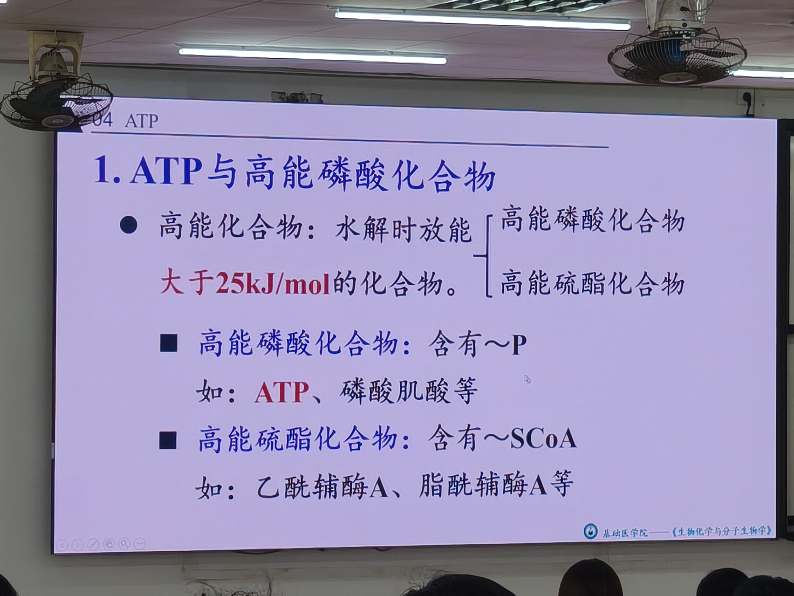
📝 10:46 PPT：04 ATP——1.ATP与高能磷酸化合物；高能化合物=水解时放能大于25kJ/mol的化合物；分高能磷酸化合物（含~P，如ATP、磷酸肌酸）与高能硫酯化合物（含~SCoA，如乙酰辅酶A、脂酰辅酶A）。

### 6.2 ATP 的转换、储存和利用

#### 6.2.1 转换（~P 在不同核苷二磷酸间转移）

| 反应 | 酶 |
|------|----|
| ATP + UDP → ADP + UTP | 尿苷二磷酸激酶 |
| ATP + CDP → ADP + CTP | 胞苷二磷酸激酶 |
| ATP + GDP → ADP + GTP | 鸟苷二磷酸激酶 |
| ADP + ADP → ATP + AMP | 腺苷酸激酶（adenylate kinase） |

分工：
- **ATP**：用于糖、脂质、蛋白质合成的通用能量货币。
- **CTP**：用于磷脂合成。
- **GTP**：用于蛋白质合成（翻译）、微管聚合等。
- **UTP**：用于糖原合成（UDPG 活化葡萄糖）。

#### 6.2.2 储存（磷酸肌酸）

【考点】**肌酸 + ATP ⇌ 磷酸肌酸 + ADP**（肌酸激酶，CK）。
- 磷酸肌酸（CP）是**肌肉和脑组织中能量的储存形式**，含量比 ATP 多。
- 当 ATP 充足时，把 ~P 转给肌酸生成磷酸肌酸储存；当 ATP 消耗过多时，磷酸肌酸把 ~P 转回 ADP 生成 ATP。

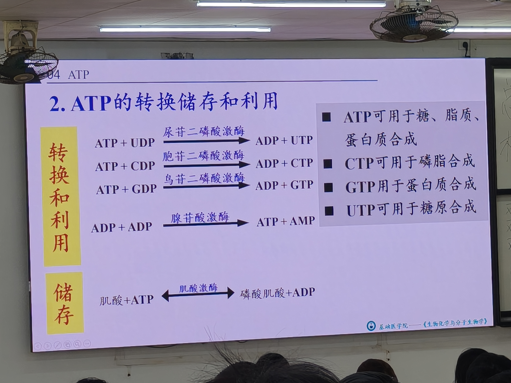
📝 10:48 PPT：2.ATP的转换储存和利用——上半"转换和利用"：ATP+UDP→UTP、ATP+CDP→CTP、ATP+GDP→GTP、ADP+ADP→ATP+AMP；右侧分工（ATP糖脂蛋白合成、CTP磷脂、GTP蛋白合成、UTP糖原）；下半"储存"：肌酸+ATP ⇌(肌酸激酶) 磷酸肌酸+ADP。

### 6.3 ATP 在能量代谢中的中心地位

【考点 Q5】老师原话："如何理解 ATP 在生物体内能量代谢的中心地位？"
- 生成端：氧化磷酸化 + 底物水平磷酸化把 ~P 交给 ADP 生成 ATP；磷酸肌酸与 ATP 互变储存。
- 利用端：ATP 水解释放能量用于各种生命活动——**机械能（肌肉收缩）、渗透能（物质主动转运）、化学能（合成代谢）、电能（生物电）、热能（维持体温）**。
- ATP 是"能量货币"，不是"能量储存库"（储存库是磷酸肌酸、糖原、脂肪）。

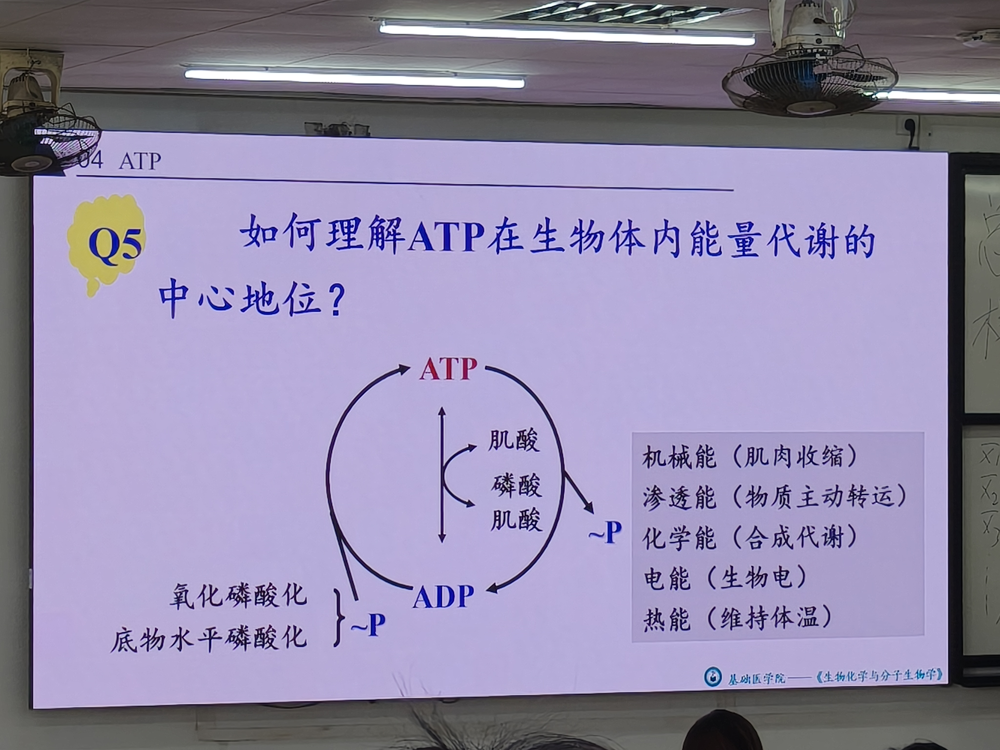
📝 10:55 PPT：Q5——ATP↔ADP 循环中心图：氧化磷酸化+底物水平磷酸化提供 ~P，肌酸⇌磷酸肌酸储存；ATP 水解释能用于机械能/渗透能/化学能/电能/热能。

---

## 七、线粒体内膜的物质转运

### 7.1 概述

【考点】老师原话："**线粒体外膜通透性高，线粒体对物质通过的选择性主要依赖于内膜中不同转运蛋白对各种物质的转运。**"

外膜孔蛋白允许分子量 <5 kDa 物质自由通过；内膜则高度选择，靠各类转运蛋白。

### 7.2 内膜主要转运蛋白

| 转运蛋白 | 胞浆侧 ⇌ 线粒体基质 |
|----------|---------------------|
| α-酮戊二酸转运蛋白 | 苹果酸 ⇌ α-酮戊二酸 |
| 酸性氨基酸转运蛋白 | 谷氨酸 ⇌ 天冬氨酸 |
| 磷酸盐转运蛋白 | H₂PO₄⁻-H⁺ 同向 |
| 腺苷酸转运蛋白（ANT） | ADP³⁻ ⇌ ATP⁴⁻ |
| 丙酮酸转运蛋白 | 丙酮酸 ⇌ OH⁻ |
| 三羧酸转运蛋白 | 苹果酸 ⇌ 柠檬酸 |
| 碱性氨基酸转运蛋白 | 鸟氨酸 ⇌ 瓜氨酸 |
| 肉碱转运蛋白 | 脂酰肉碱 ⇌ 肉碱 |

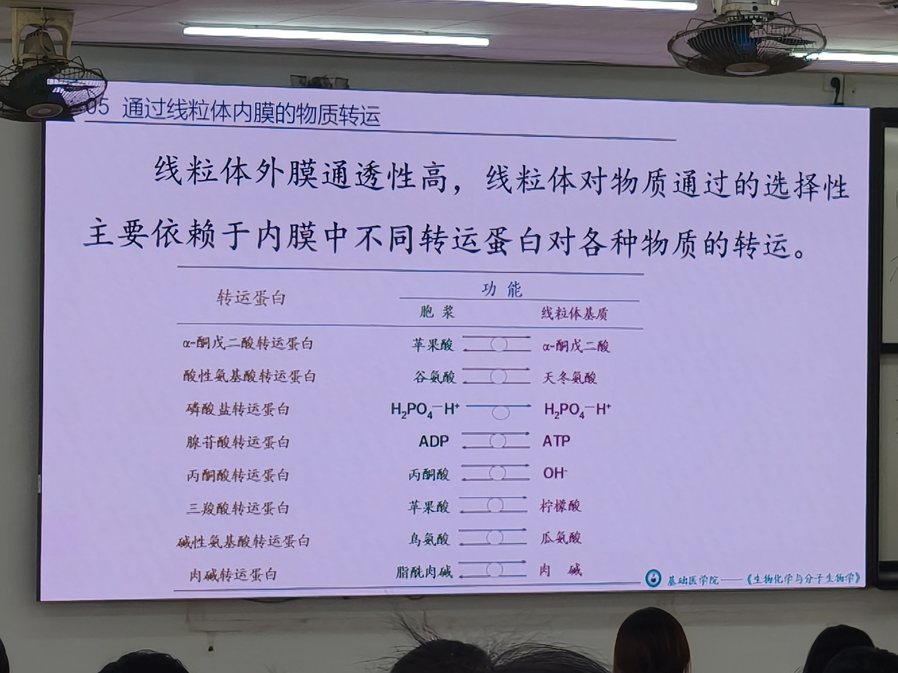
📝 10:58 PPT：05 通过线粒体内膜的物质转运——外膜通透性高，选择性主要依赖内膜转运蛋白；表格列出 8 种转运蛋白及胞浆/基质间对向交换的物质。

### 7.3 胞质中 NADH 的跨膜转运（穿梭）

【考点 Q6】老师原话："**呼吸链位于线粒体内，胞质中产生的 NADH 要经呼吸链进行氧化磷酸化，必须经一定转运机制进入线粒体。**"因为 NADH 不能自由透过线粒体内膜，需要"穿梭"把氢搬进去。

两种穿梭机制：

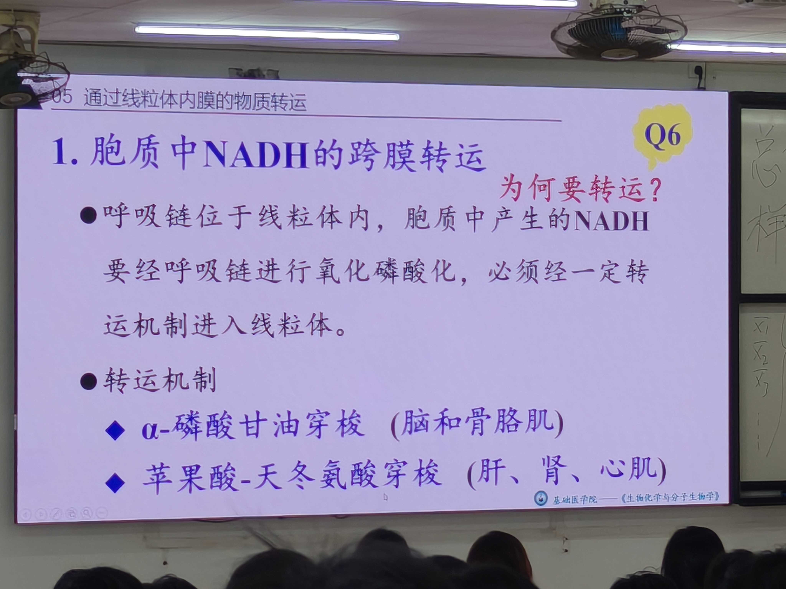
📝 11:01 PPT：Q6——1.胞质中 NADH 的跨膜转运；为何要转运？呼吸链位于线粒体内，胞质 NADH 必须经一定转运机制进入线粒体；两种穿梭：α-磷酸甘油穿梭（脑和骨骼肌）、苹果酸-天冬氨酸穿梭（肝、肾、心肌）。

| 穿梭类型 | 存在组织 | 进入哪条呼吸链 | 生成 ATP |
|----------|----------|---------------|----------|
| **α-磷酸甘油穿梭** | 脑、骨骼肌 | 琥珀酸链（FADH₂ 进入复合体Ⅱ） | **1.5 ATP** |
| **苹果酸-天冬氨酸穿梭** | 肝、肾、心肌 | NADH 链（NAD⁺ 进入复合体Ⅰ） | **2.5 ATP** |

#### 7.3.1 α-磷酸甘油穿梭机制

- 胞质：NADH+H⁺ + 磷酸二羟丙酮 →（α-磷酸甘油脱氢酶，NAD⁺ 为辅酶）→ α-磷酸甘油 + NAD⁺。
- α-磷酸甘油穿过外膜到膜间隙，再被内膜上的**α-磷酸甘油脱氢酶**（FAD 为辅基）氧化回磷酸二羟丙酮，同时把 2H 交给 FAD → FADH₂。
- FADH₂ 把氢交给 CoQ 进入琥珀酸链（复合体Ⅱ支路），故只生成 1.5 ATP。

【考点】老师强调："这就是为什么糖有氧氧化时，胞质 NADH 在脑和骨骼肌只算 1.5 ATP，在肝肾心肌算 2.5 ATP——不同组织穿梭不同，所以 1 分子葡萄糖有氧氧化净生成 **30 或 32 ATP**。"

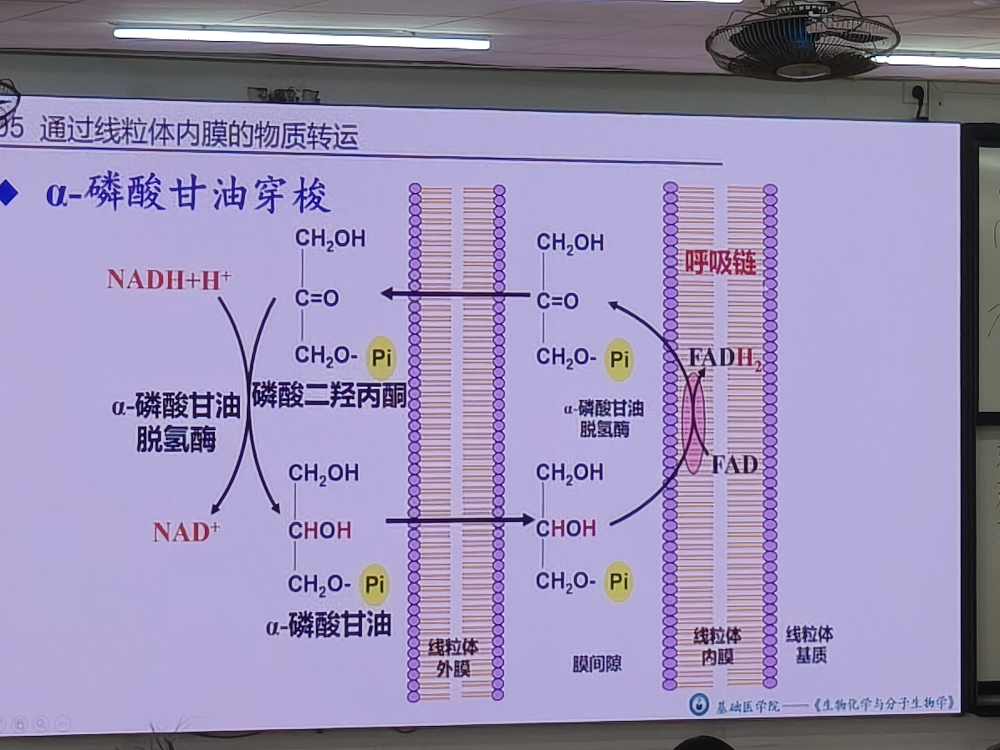
📝 11:05 PPT：α-磷酸甘油穿梭——胞质 NADH+H⁺ 把氢给磷酸二羟丙酮生成 α-磷酸甘油（NAD⁺ 出来）；α-磷酸甘油到内膜外膜间隙，被内膜上以 FAD 为辅基的 α-磷酸甘油脱氢酶氧化，生成 FADH₂ 进呼吸链（琥珀酸链），同时回到磷酸二羟丙酮。

【教材补充·人卫第9版】苹果酸-天冬氨酸穿梭细节：胞质 NADH + 草酰乙酸 →（苹果酸脱氢酶）→ 苹果酸；苹果酸经 α-酮戊二酸转运蛋白进入基质 → 草酰乙酸 → 天冬氨酸（经谷氨酸-天冬氨酸转氨基）→ 出胞质。该穿梭把 NADH 的氢完整交给线粒体 NAD⁺，故走 NADH 链生成 2.5 ATP。

### 7.4 ATP 与 ADP 的转运

【考点】ATP 在线粒体基质中生成，需运到胞质使用；ADP 在胞质生成，需运进基质。靠**腺苷酸转运蛋白（ANT，亦称 ATP-ADP 转位酶）**完成：
- **ADP³⁻（胞质）入基质 ⇌ ATP⁴⁻（基质）出胞质**。
- 由于 ATP⁴⁻ 比 ADP³⁻ 多带一个负电荷，这种交换实质上把一个负电荷"运出"，相当于把一个 H⁺ 的正电荷"运入"，与内膜外正内负的质子梯度方向一致，不额外耗能（顺电化学梯度）。
- 同时，无机磷酸 Pi 经**磷酸盐转运蛋白**以 H₂PO₄⁻ + H⁺ 同向转运进基质（消耗 1 H⁺ 梯度）。
- 这就是为什么"4 H⁺ 回流 = 1 ATP"——3 H⁺ 经 F₀ 回流驱动合成，1 H⁺ 用于 Pi 转运/ANT 电荷交换。

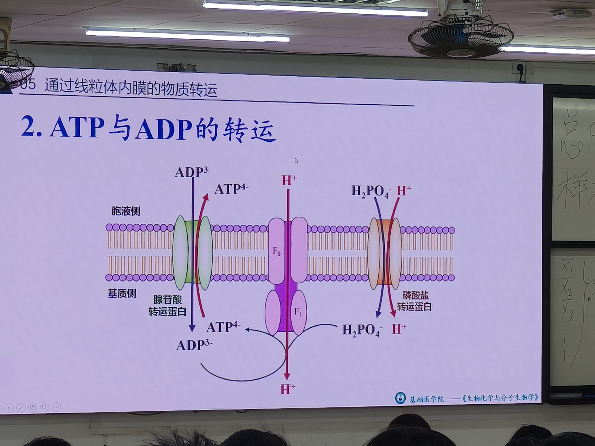
📝 11:11 PPT：2.ATP与ADP的转运——腺苷酸转运蛋白让 ADP³⁻(胞液侧)进基质、ATP⁴⁻(基质)出胞液侧；磷酸盐转运蛋白让 H₂PO₄⁻+H⁺ 同向进基质；中间 F₀F₁ 合成 ATP 后 H⁺ 回流。

---

## 八、本章小结（PPT 原文）

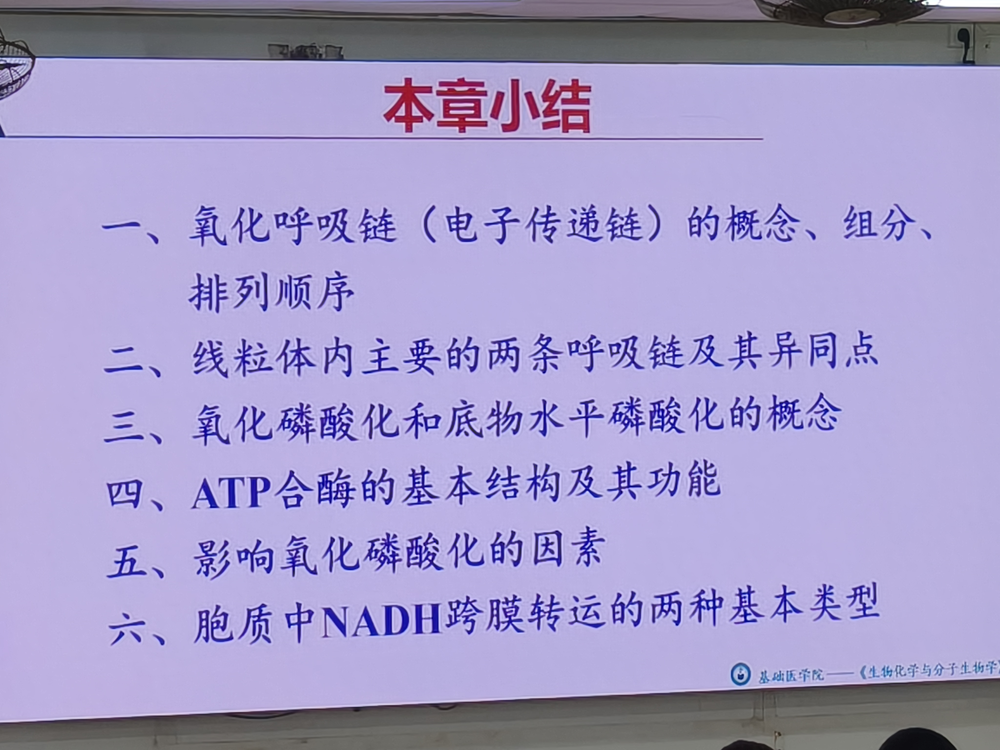
📝 11:14 PPT：本章小结六条——①氧化呼吸链（电子传递链）的概念、组分、排列顺序；②线粒体内主要的两条呼吸链及其异同点；③氧化磷酸化和底物水平磷酸化的概念；④ATP 合酶的基本结构及其功能；⑤影响氧化磷酸化的因素；⑥胞质中 NADH 跨膜转运的两种基本类型。

---

## 九、关键数据速记表

| 项目 | 数值/结论 |
|------|-----------|
| 氧化磷酸化占 ATP 比例 | 90% |
| ATP 水解 ΔG°′ | 30.5 kJ/mol |
| 偶联自由能门槛 | >30.5 kJ/mol |
| 高能化合物阈值 | >25 kJ/mol |
| NADH 链 P/O | 2.5（泵 10 H⁺） |
| 琥珀酸链 P/O | 1.5（泵 6 H⁺） |
| 复合体Ⅰ/Ⅲ/Ⅳ 泵 H⁺ | 4 / 4 / 2（复合体Ⅱ=0） |
| H⁺ 回流 | 4 H⁺ = 1 ATP |
| ATP 合酶 F₁ | α₃β₃γδε（9 亚基） |
| ATP 合酶 F₀ | a₁b₂c₉~₁₂ |
| γ 亚基旋转 | 120°/步，360°=3 ATP |
| β 亚基三构象 | L→T→O |
| α-磷酸甘油穿梭 | 脑、骨骼肌 → 1.5 ATP |
| 苹果酸-天冬氨酸穿梭 | 肝、肾、心肌 → 2.5 ATP |
| 葡萄糖有氧氧化净 ATP | 30 或 32（取决于穿梭） |
