# 第7课 糖的无氧分解与糖酵解辨析——知识点总结（教材精讲版）

> 课程：生物化学与分子生物学（科学出版社案例版第3版）
> 上课时间：2026-10-13 08:00
> 课时：第7课（糖代谢开篇，重点：无氧分解/无氧氧化）
> 课堂照片：本课课堂照片14张（已按知识点位置插入下方）
> 参考教材：人卫第9版（周春燕、药立波主编），补充内容标注【教材补充·人卫第9版】

---

## 一、糖代谢概述

【考点】老师原话："本章有七节内容：概述、糖的无氧分解、有氧氧化、磷酸戊糖途径、糖异生、糖原的合成分解、血糖及其调节。重点放在三个红色的——**无氧分解（又称无氧氧化）、有氧氧化、糖异生**。"

- 糖是体内主要供能物质，提供人体所需能量的 **50%~70%**。
- **糖的有氧氧化**是体内获取能量的主要途径，也是糖氧化最主要的途径；无氧分解只是快速获能的一个途径。
- 糖的生理功能：①主要供能物质；②组织结构成分（糖蛋白、结缔组织基质、核糖/脱氧核糖是核酸骨架）；③提供合成脂类和某些氨基酸的碳骨架（如丙酮酸经转氨基生成丙氨酸）。

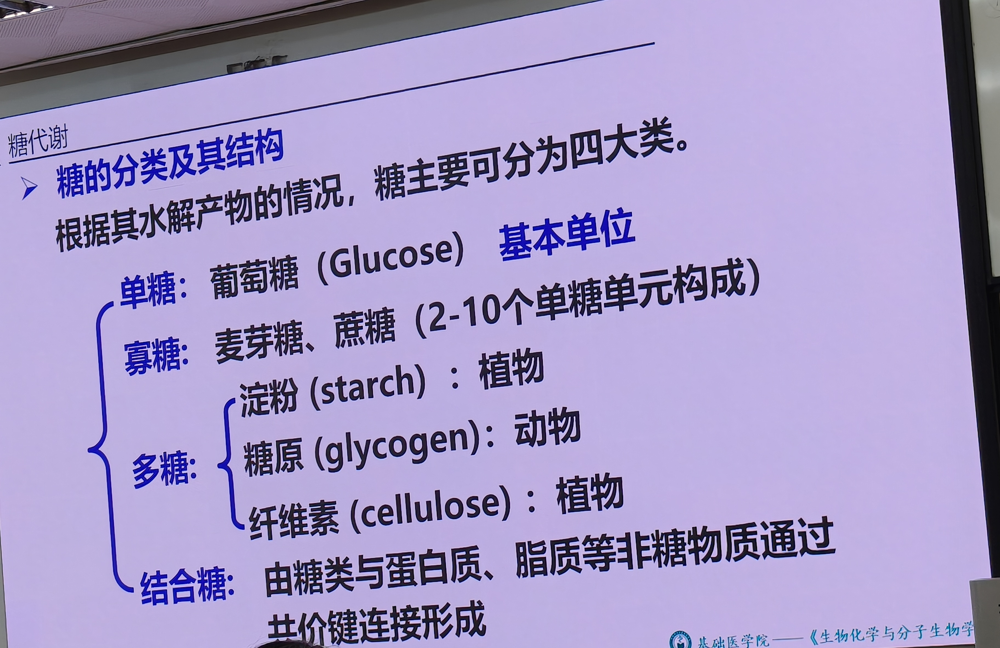

📝 **课堂照片 1636**：糖代谢概述——糖的分类及结构。单糖（葡萄糖/果糖/半乳糖）、寡糖（麦芽糖/蔗糖，2~10单糖）、多糖（淀粉/糖原/纤维素，>10单糖）、结合糖（糖脂/糖蛋白）。淀粉直链α-1,4糖苷键、分支α-1,6糖苷键。

### 1.1 糖的消化与吸收（了解）

- 食物中糖主要是**淀粉**；**纤维素不能被人体消化吸收**（人体无纤维素酶，不能水解 β-1,4-糖苷键），但可促进肠蠕动、防便秘。
- 消化部位：口腔（唾液淀粉酶）和小肠（胰淀粉酶、α-葡萄糖苷酶、α-极限糊精酶）；**胃无淀粉酶，不消化淀粉**。
- 淀粉结构：直链 α-1,4-糖苷键；分支点 α-1,6-糖苷键。

【考点】临床联系——**阿卡波糖（拜糖平）**：一线口服降糖药，特异性抑制 **α-葡萄糖苷酶**，抑制寡糖水解生成葡萄糖，减少肠道葡萄糖吸收，用于2型糖尿病（1型只能用胰岛素）。

【考点】**乳糖不耐受**：乳糖酶基因缺陷者，乳糖不能水解为半乳糖，堆积肠道→腹胀、腹泻。可喝无乳糖牛奶。

### 1.2 葡萄糖的吸收与转运

【考点】老师原话："食物中糖类吸收需要**钠离子依赖型葡萄糖转运蛋白（SGLT）**，是依赖 Na⁺ 的主动转运，消耗 ATP；其他组织细胞摄取葡萄糖不需要钠离子，直接是葡萄糖转运蛋白（GLUT）。"

- **肠腔吸收**：SGLT（钠-葡萄糖协同转运蛋白），位于小肠黏膜刷状缘，Na⁺ 和葡萄糖一起进入细胞，再经 Na⁺,K⁺-ATP 酶（钠泵）把 Na⁺ 泵出，消耗 ATP。

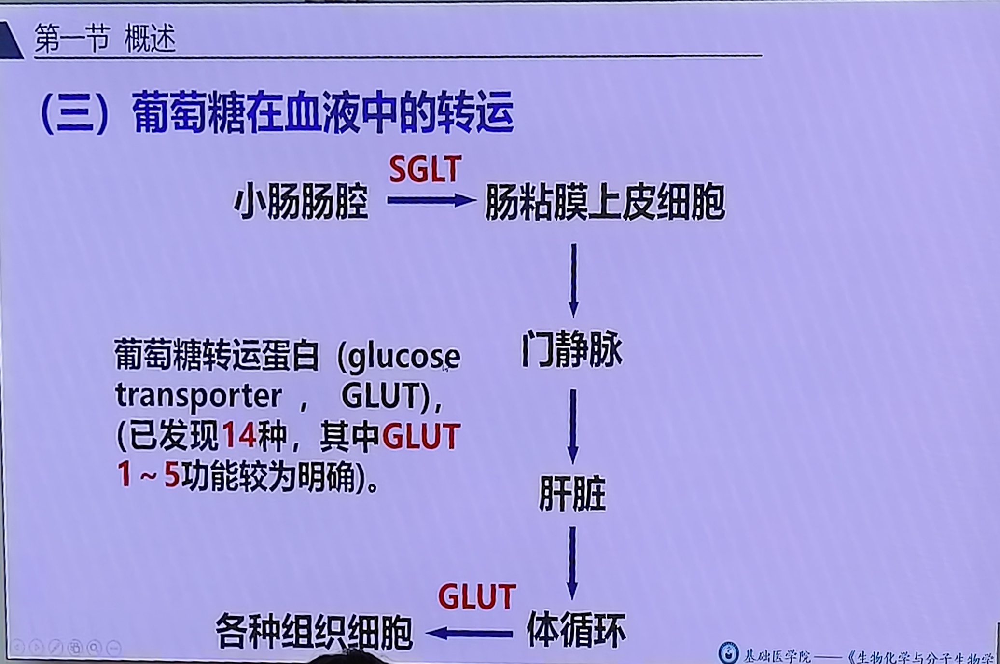

📝 **课堂照片 2045**：葡萄糖在血液中转运路径——SGLT 在小肠吸收葡萄糖→经门静脉入肝→再经体循环由 GLUT 转运到各组织细胞。GLUT 已发现14种，其中 GLUT1~5 功能明确。

- **组织细胞摄取**：GLUT（葡萄糖转运蛋白），不依赖 Na⁺。已发现 14 种，其中 5 种功能明确（GLUT1~5）。
  - GLUT1：红细胞、脑等，对葡萄糖亲和力高（Km 低）。
  - GLUT2：**肝、胰β细胞**，Km 高（对葡萄糖亲和力低），只有血糖很高时肝细胞才摄取葡萄糖。
  - GLUT4：**肌细胞、脂肪细胞**，膜转位依赖胰岛素（平时存于胞质膜性小泡，胰岛素作用下转位到细胞膜）。

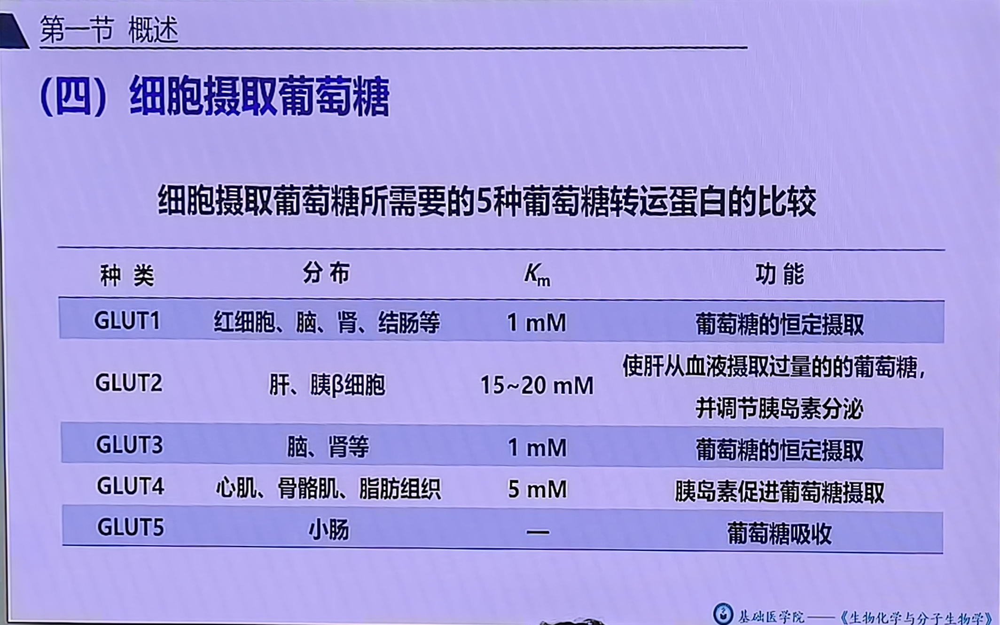

📝 **课堂照片 3122**：5种 GLUT 转运蛋白比较表——GLUT1（红细胞/脑/肾，Km~1 mmol/L，恒定摄取）；GLUT2（肝/胰β细胞，Km 15~20 mmol/L，血糖高才摄取）；GLUT3（脑/肾，高亲和力）；GLUT4（肌/脂肪，Km~5 mmol/L，**胰岛素依赖膜转位**）；GLUT5（小肠，果糖转运）。★拍全。
- 【教材补充·人卫第9版】颜宁团队 2014-2015 年首次解析人源 GLUT1 和 GLUT3 晶体结构，为糖尿病和肿瘤葡萄糖转运干预提供分子基础。

---

## 二、糖酵解与无氧分解的概念辨析（本章核心考点）

【考点】老师反复强调："糖酵解和糖的无氧分解**不是同一个概念**，考试选择题就是陷阱。"

### 2.1 糖酵解（glycolysis）

【考点】**糖酵解**：在**细胞质**中，1 分子葡萄糖经 **10 步反应**生成 **2 分子丙酮酸**的过程。类似酿酒的酒精发酵第一阶段。
- **糖酵解的终产物 = 丙酮酸**（不是乳酸！）。
- 反应部位：细胞质。

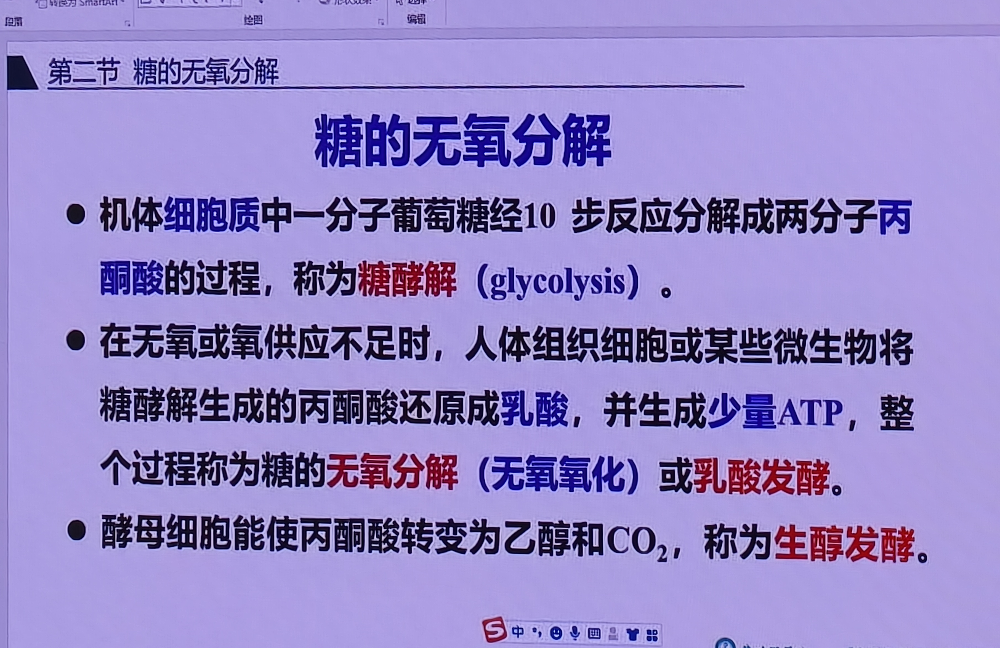

📝 **课堂照片 1364**：糖无氧分解定义页——细胞质中葡萄糖经10步→2丙酮酸=糖酵解（glycolysis）；无氧时丙酮酸→乳酸=乳酸发酵；酵母产酒精=生醇发酵。三个概念对照记忆。

### 2.2 糖的无氧分解（无氧氧化）

【考点】**糖的无氧分解（无氧氧化）**：在无氧或氧供不足时，组织细胞（或某些微生物将糖酵解生成的**丙酮酸还原生成乳酸**，并生成少量 ATP 的过程。
- 糖的无氧分解 = **糖酵解（第一阶段）+ 乳酸生成（第二阶段）**。
- **无氧分解的终产物 = 乳酸**。

| 比较项 | 糖酵解 | 糖的无氧分解 |
|--------|--------|--------------|
| 反应阶段 | 葡萄糖→丙酮酸（10步） | 糖酵解 + 丙酮酸→乳酸 |
| 终产物 | **丙酮酸** | **乳酸** |
| 反应部位 | 细胞质 | 细胞质 |
| 需氧 | 不需氧（有氧无氧都进行） | 无氧/缺氧条件 |
| 范畴 | 是无氧分解的第一阶段 | 范畴更大，包含糖酵解 |

【考点】老师原话："糖酵解的终产物是什么？一选就写乳酸——错！糖酵解终产物是丙酮酸。无氧分解的终产物才是乳酸。"

---

## 三、糖酵解的10步反应

### 3.1 三个关键酶（单向不可逆反应）

【考点】糖酵解有 **3 个关键酶**，催化单向不可逆反应，决定代谢速度和方向：
1. **己糖激酶（HK）**——葡萄糖→葡萄糖-6-磷酸
2. **磷酸果糖激酶-1（PFK-1）**——果糖-6-磷酸→果糖-1,6-二磷酸
3. **丙酮酸激酶**——磷酸烯醇式丙酮酸→丙酮酸

> 注意：前两个关键酶催化反应**消耗 ATP**，第三个**生成 ATP**。

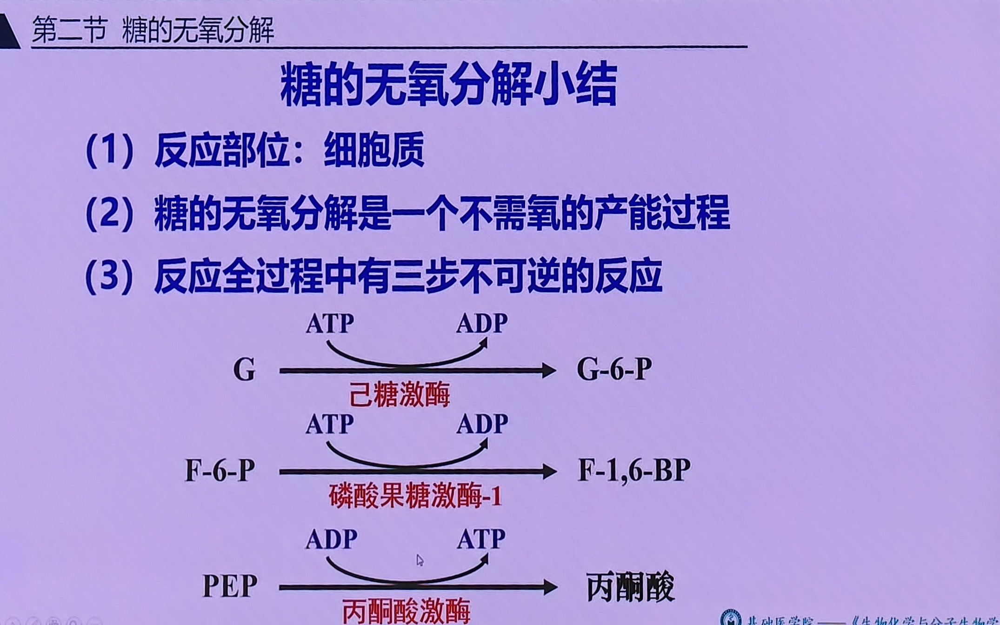

📝 **课堂照片 1261**：糖无氧分解小结——反应部位=细胞质；不需氧产能；三步不可逆反应（己糖激酶/PFK-1/丙酮酸激酶）流程图。前两步耗ATP，第三步产ATP。

### 3.2 十步反应流程

| 步骤 | 反应 | 酶 | 特点 |
|------|------|----|------|
| 1 | 葡萄糖 + ATP → 葡萄糖-6-磷酸 + ADP | **己糖激酶**（关键酶） | 耗1ATP，不可逆 |
| 2 | 葡萄糖-6-磷酸 ⇌ 果糖-6-磷酸 | 磷酸己糖异构酶 | 可逆 |
| 3 | 果糖-6-磷酸 + ATP → 果糖-1,6-二磷酸 + ADP | **磷酸果糖激酶-1**（关键酶，最主要限速酶） | 耗1ATP，不可逆 |
| 4 | 果糖-1,6-二磷酸 ⇌ 磷酸二羟丙酮 + 3-磷酸甘油醛 | 醛缩酶 | 裂解为2个磷酸丙糖 |
| 5 | 磷酸二羟丙酮 ⇌ 3-磷酸甘油醛 | 磷酸丙糖异构酶 | 互变，实际相当于1分子F-1,6-BP生成2分子3-PGAL |
| 6 | 3-磷酸甘油醛 + NAD⁺ + Pi → 1,3-二磷酸甘油酸 + NADH+H⁺ | 3-磷酸甘油醛脱氢酶 | **唯一脱氢反应**，胞质NADH |
| 7 | 1,3-二磷酸甘油酸 + ADP → 3-磷酸甘油酸 + ATP | 磷酸甘油酸激酶 | **第一次底物水平磷酸化** |
| 8 | 3-磷酸甘油酸 ⇌ 2-磷酸甘油酸 | 磷酸甘油酸变位酶 | 可逆 |
| 9 | 2-磷酸甘油酸 → 磷酸烯醇式丙酮酸 + H₂O | 烯醇化酶 | 脱水，形成高能磷酸键 |
| 10 | 磷酸烯醇式丙酮酸 + ADP → 丙酮酸 + ATP | **丙酮酸激酶**（关键酶） | **第二次底物水平磷酸化**，不可逆 |

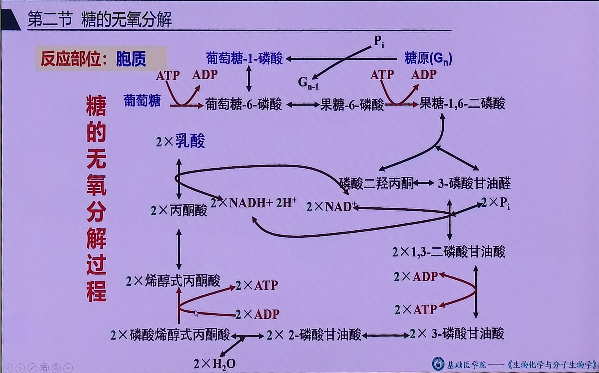

📝 **课堂照片 1766**：糖无氧分解全过程总图（★拍全，最完整一张）——胞质中葡萄糖/糖原（Gn）入口→G6P→F6P→F-1,6-BP→磷酸丙糖→…→PEP→丙酮酸→乳酸，标注ATP消耗/生成与NADH脱氢位置。

### 3.3 第一步反应：己糖激酶与葡萄糖激酶

【考点】**己糖激酶有4种同工酶（HKⅠ~Ⅳ）**，其中肝脏的 HKⅣ 特殊，称**葡萄糖激酶（GK）**。

| 比较项 | 己糖激酶（HKⅠ~Ⅲ） | 葡萄糖激酶（GK，HKⅣ） |
|--------|---------------------|------------------------|
| 分布 | 全身各组织 | 主要肝脏、胰β细胞 |
| Km | 低（对葡萄糖亲和力高） | 高（对葡萄糖亲和力低） |
| 葡萄糖-6-磷酸反馈抑制 | 受抑制 | **不受G6P抑制**（无变构部位） |
| 作用 | 血糖正常时即催化葡萄糖磷酸化 | 血糖很高时才摄取、磷酸化葡萄糖 |

【考点】老师原话："GK 的 Km 高，对葡萄糖亲和力低，只有血糖很高（达 ~10 mmol/L）时肝才摄取葡萄糖；血糖低时肝不摄取，把葡萄糖留给脑等组织，防止血糖过度降低。"

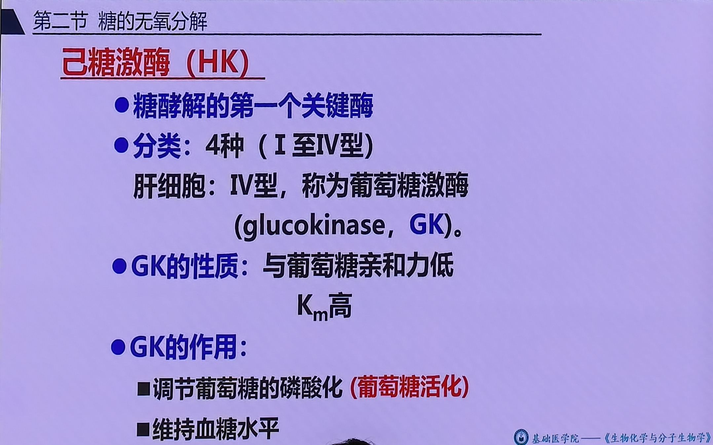

📝 **课堂照片 2219**：己糖激酶HK——糖酵解第一个关键酶；分4型（Ⅰ~Ⅳ），肝细胞IV型=葡萄糖激酶（GK）；GK对葡萄糖亲和力低（Km高），只有血糖高时才催化。

- 磷酸化意义：葡萄糖磷酸化生成 G6P 后带负电，不能自由透出细胞膜，相当于把葡萄糖**固定在细胞内**（活化）。
- 从糖原开始：糖原经糖原磷酸化酶磷酸解生成葡萄糖-1-磷酸，再经磷酸葡萄糖变位酶生成 G6P，**不消耗 ATP**，故从糖原开始净多生成 1 ATP。

### 3.4 第六步：唯一脱氢反应（高频考点）

【考点】老师原话："3-磷酸甘油醛在 3-磷酸甘油醛脱氢酶作用下脱氢，把氢交给氧化型辅酶Ⅰ（NAD⁺）生成 NADH+H⁺，这是糖酵解过程中**唯一一次脱氢反应**。"

⚠️ **关键辨析（考试陷阱）**：
- **无氧分解条件下**：无线粒体氧化磷酸化，胞质 NADH **不能穿梭进入线粒体**，氢保留在胞质，最终交给丙酮酸生成乳酸——**此步不生成 ATP**。
- **有氧氧化条件下**：胞质 NADH 经穿梭进入线粒体氧化磷酸化——经 α-磷酸甘油穿梭（琥珀酸链）生成 2×1.5 = 3 ATP；经苹果酸-天冬氨酸穿梭（NADH链）生成 2×2.5 = 5 ATP。
- 【考点】老师原话："这就是为什么1分子葡萄糖有氧氧化生成 30 或 32 ATP，差别就在这步穿梭机制不同，相差 2 个 ATP。"

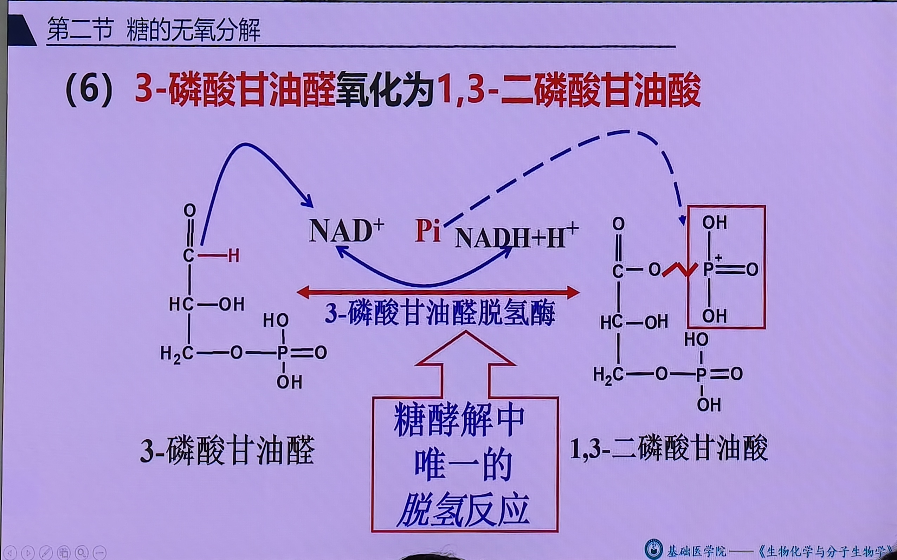

📝 **课堂照片 2369**：第六步唯一脱氢反应——3-磷酸甘油醛在3-磷酸甘油醛脱氢酶作用下脱氢，NAD⁺→NADH+H⁺，同时无机磷酸进入生成1,3-二磷酸甘油酸（含高能磷酸键）。结构式清楚。

### 3.5 两次底物水平磷酸化

【考点】老师原话："底物水平磷酸化 = 底物分子高能化学键（高能磷酸键/高能硫酯键）断裂，与 ADP（或其他核苷二磷酸）磷酸化偶联。"

糖酵解中有两次底物水平磷酸化：
1. **1,3-二磷酸甘油酸 → 3-磷酸甘油酸**（磷酸甘油酸激酶）
2. **磷酸烯醇式丙酮酸 → 丙酮酸**（丙酮酸激酶）

【考点】老师原话："糖有氧氧化全过程有**3次底物水平磷酸化**：糖酵解2次 + 三羧酸循环1次（琥珀酰CoA→琥珀酸）。"

---

## 四、糖无氧分解的产能

### 4.1 能量计算

【考点】老师原话："从葡萄糖开始：消耗2分子ATP（第1步己糖激酶、第3步PFK-1）；底物水平磷酸化生成 2×2 = 4 ATP（第7步×2、第10步×2）。**净生成 2 分子 ATP**。"

- 从葡萄糖开始：**净生成 2 ATP**。
- 从糖原开始：少消耗1 ATP（糖原→G6P不耗ATP），**净生成 3 ATP**。
- 无氧分解**没有氧化磷酸化**，只有底物水平磷酸化。

| 来源 | 从葡萄糖 | 从糖原 |
|------|----------|--------|
| 消耗 ATP | -2 | -1 |
| 底物水平磷酸化生成 ATP | +4 | +4 |
| **净生成 ATP** | **2** | **3** |

【考点】判断题："糖的无氧分解可通过氧化磷酸化或底物水平磷酸化生成ATP"——**错！**无氧条件无线粒体氧化磷酸化，只能底物水平磷酸化。

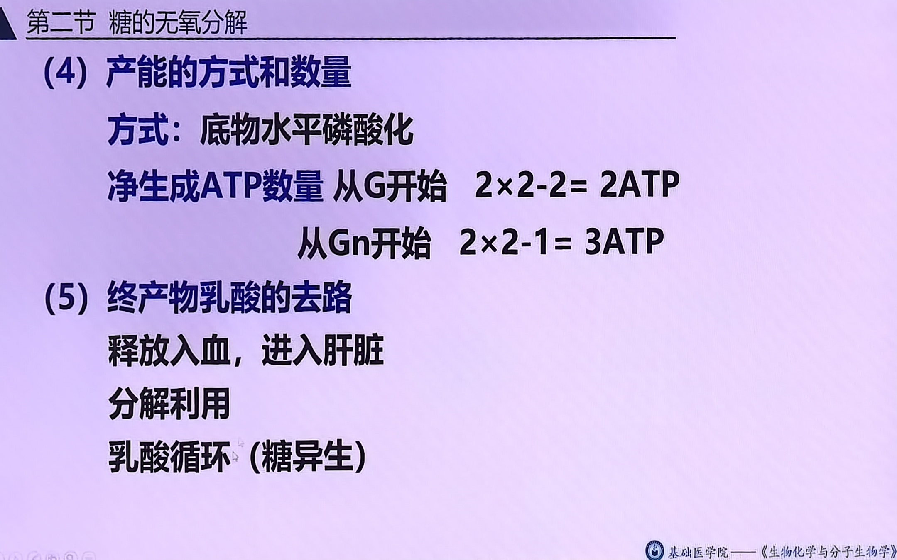

📝 **课堂照片 1179**：糖无氧分解产能方式——底物水平磷酸化；净生成ATP：从葡萄糖起2ATP、从糖原起3ATP；终产物乳酸去路（入肝、乳酸循环/糖异生）。

---

## 五、糖酵解的调节

【考点】物质代谢调节主要针对**关键酶**，酶活性调节有两种方式：**变构调节（别构调节）**和**共价修饰调节**。

### 5.1 变构调节概念

【考点】变构调节：某些代谢物与酶**活性中心以外的部位**发生**可逆的非共价结合**，改变酶活性中心空间结构，从而改变酶活性。产物常是变构抑制剂（反馈抑制）。

### 5.2 三个关键酶的调节

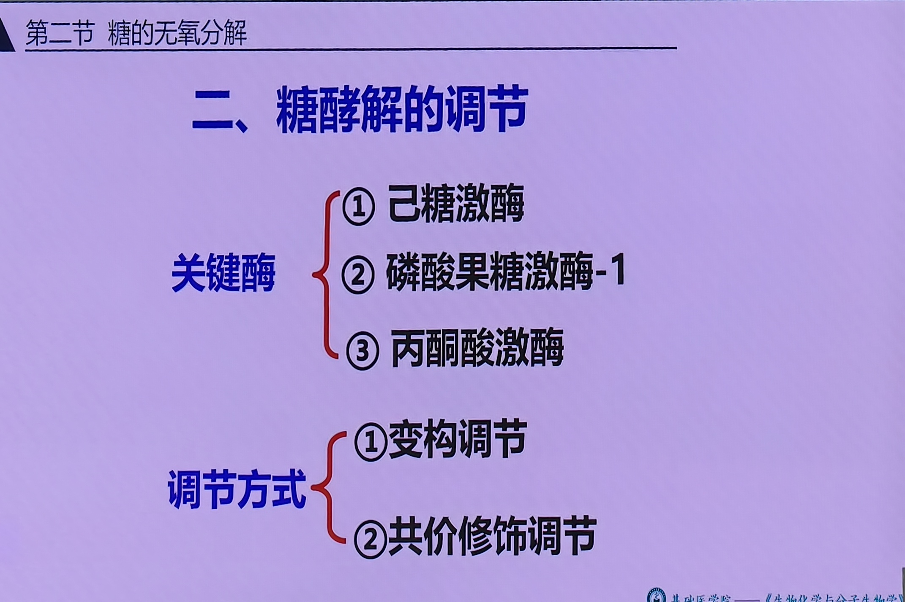

📝 **课堂照片 2755**：糖酵解调节总览——关键酶=①己糖激酶②PFK-1③丙酮酸激酶；调节方式=变构调节（别构调节）+共价修饰调节。

#### （1）磷酸果糖激酶-1（PFK-1）——最主要限速酶

【考点】老师原话："PFK-1 是糖酵解过程中**最关键的限速酶**。"

| 类型 | 物质 |
|------|------|
| 变构激活剂 | **果糖-2,6-二磷酸（F-2,6-BP，最强激活剂）**、AMP、ADP |
| 变构抑制剂 | **ATP**、**柠檬酸** |

- F-2,6-BP 由 PFK-2 催化生成果糖-2,6-二磷酸，是 PFK-1 最强的变构激活剂。
- ATP 充足时反馈抑制 PFK-1，避免能量浪费；AMP/ADP 升高（能量不足）则激活。

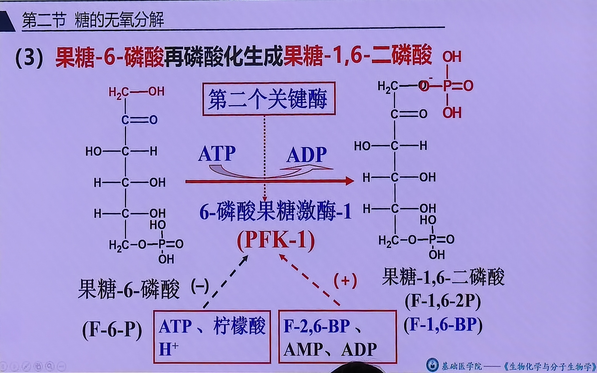

📝 **课堂照片 2113**：F-6-P→F-1,6-BP 反应——磷酸果糖激酶-1（PFK-1）=第二个关键酶；别构抑制剂：ATP/柠檬酸/H⁺；别构激活剂：F-2,6-BP/AMP/ADP。结构式清楚。

#### （2）丙酮酸激酶

- 变构调节：F-1,6-BP 激活；ATP、丙氨酸（可转变为丙酮酸）反馈抑制。
- **共价修饰调节**：胰高血糖素→cAMP→蛋白激酶A（PKA）→使丙酮酸激酶**磷酸化而失活**，抑制糖酵解。磷蛋白磷酸酶使其去磷酸化恢复活性。

【考点】老师原话："胰高血糖素通过 cAMP-PKA 途径磷酸化丙酮酸激酶，使其失活，从而抑制无氧分解。这涉及信号转导通路，可能出综合分析题。"

#### （3）己糖激酶/葡萄糖激酶

- 己糖激酶受**葡萄糖-6-磷酸**变构反馈抑制。
- **葡萄糖激酶（GK）不受 G6P 抑制**；长链脂酰 CoA 是其变构抑制剂；胰岛素可诱导 GK 合成（酶量调节）。

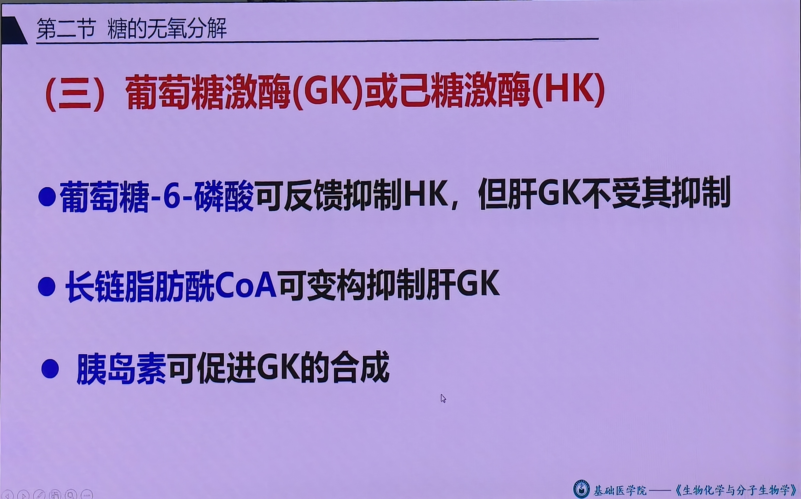

📝 **课堂照片 2484**：GK/HK的调节——G-6-P反馈抑制HK但不抑制肝GK（GK无变构部位）；长链脂酰CoA别构抑制肝GK；胰岛素促进GK合成（酶量调节）。

---

## 六、乳酸生成与乳酸循环（Cori 循环）

### 6.1 乳酸生成

【考点】无氧条件下，3-磷酸甘油醛脱下的氢（胞质 NADH）不能进入线粒体，保留在胞质；丙酮酸在**乳酸脱氢酶**作用下接受 NADH 的氢，加氢还原生成乳酸。

- 【考点】有氧时胞质 NADH 经穿梭进入线粒体，丙酮酸无氢可加，不能生成乳酸，只能进入线粒体氧化脱羧→乙酰CoA→三羧酸循环。这就是**巴斯德效应**（有氧抑制无氧分解）。

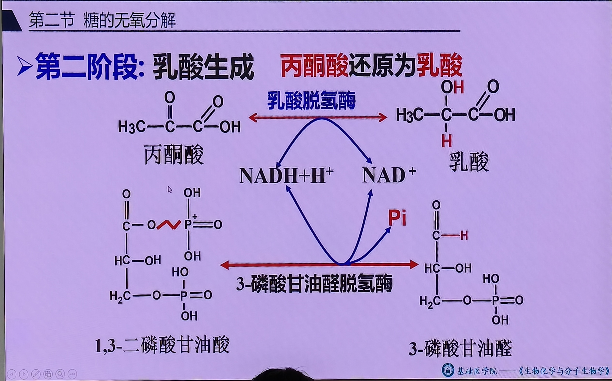

📝 **课堂照片 2550**：糖无氧分解第二阶段·乳酸生成——丙酮酸在乳酸脱氢酶（LDH）作用下接受NADH的氢还原生成乳酸，同时NADH+H⁺→NAD⁺再生（维持胞质NAD⁺库）。结构式清楚。

### 6.2 乳酸循环（Cori 循环）

【考点】老师原话："肌肉组织缺乏葡萄糖-6-磷酸酶，不能把乳酸异生为葡萄糖；肌肉无氧分解生成的乳酸经血液运输到肝脏，肝含活性强的葡萄糖-6-磷酸酶，把乳酸异生为葡萄糖，再释放入血供肌肉利用，形成循环——**乳酸循环**。"

- 肌肉：葡萄糖→无氧分解→乳酸（缺 G6P 酶，不能直接→葡萄糖）。
- 血液：乳酸运输。
- 肝：乳酸→丙酮酸→糖异生→葡萄糖→入血。
- 生理意义：①避免乳酸酸中毒；②乳酸再利用；③**补充肝糖原**（肝糖原合成主要靠乳酸循环来的葡萄糖，而非直接摄取血糖，因肝 GLUT2 和 GK 对葡萄糖亲和力低）。
- 乳酸循环是**耗能过程**：2 分子乳酸异生为 1 分子葡萄糖消耗 **6 ATP**。

---

## 七、糖无氧分解的生理意义

【考点】老师原话总结：
1. **对机体迅速供能**，对肌肉组织尤其重要——肌肉 ATP 储量少（约 4 mmol/L），百米跑几秒耗尽，无氧分解路径短、快速供能。
2. **无线粒体的细胞**（如成熟红细胞）只能靠无氧分解供能；白细胞、骨髓细胞等氧供正常时也需无氧分解补充。
3. **应急供能**：剧烈运动、高原缺氧、贫血等情况下有效供能方式。
4. 过度无氧分解→大量乳酸→**乳酸酸中毒**，需纠正酸碱平衡后用药才有效。

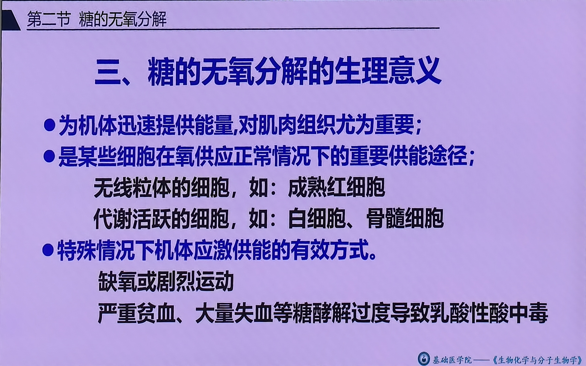

📝 **课堂照片 2933**：糖无氧分解生理意义——①迅速供能（肌肉，ATP储量少路径短）；②无线粒体细胞（成熟RBC）及代谢活跃细胞（白细胞/骨髓）重要供能途径；③应激供能（剧烈运动/高原/贫血）；④过度→乳酸酸中毒。

---

## 八、关键数据速记

| 项目 | 数值/结论 |
|------|-----------|
| 糖提供能量占比 | 50%~70% |
| 糖酵解反应数 | 10步（从糖原11步） |
| 糖酵解终产物 | 丙酮酸 |
| 无氧分解终产物 | 乳酸 |
| 三个关键酶 | 己糖激酶、PFK-1、丙酮酸激酶 |
| 最主要限速酶 | PFK-1 |
| 唯一脱氢反应 | 3-磷酸甘油醛→1,3-二磷酸甘油酸 |
| 底物水平磷酸化次数 | 2次（糖酵解）/ 3次（有氧全过程） |
| 净生成ATP（从葡萄糖） | 2 |
| 净生成ATP（从糖原） | 3 |
| PFK-1最强变构激活剂 | F-2,6-BP |
| PFK-1变构抑制剂 | ATP、柠檬酸 |
| GK Km | 高（肝，对葡萄糖亲和力低） |
| 乳酸循环耗能 | 6 ATP/2乳酸→1葡萄糖 |
