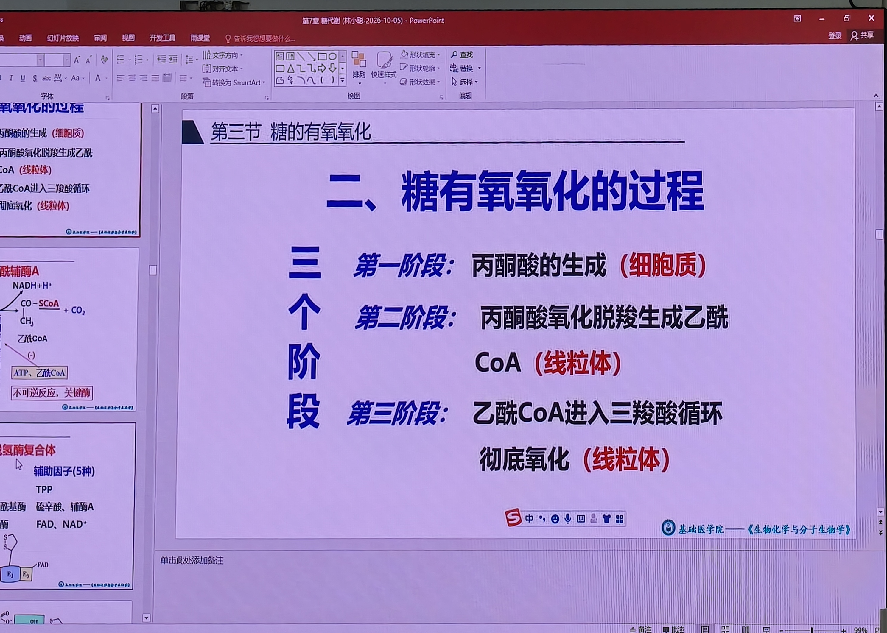

# 第8课 糖有氧氧化·三羧酸循环与糖异生——知识点总结（教材精讲版）

> 课程：生物化学与分子生物学（科学出版社案例版第3版）
> 上课时间：2026-10-14/15
> 课时：第8课（糖代谢重点：有氧氧化、三羧酸循环、糖异生）
> 课堂照片：本课课堂照片1张（已按知识点位置插入下方）
> 参考教材：人卫第9版，补充内容标注【教材补充·人卫第9版】

---

## 一、糖有氧氧化概述

【考点】老师原话："糖有氧氧化 = 葡萄糖或糖原在有氧条件下彻底氧化分解生成 CO₂ 和 H₂O，并释放大量能量的过程。"

### 1.1 三个阶段

| 阶段 | 反应 | 部位 |
|------|------|------|
| 第一阶段 | 糖酵解：葡萄糖→丙酮酸 | 细胞质 |
| 第二阶段 | 丙酮酸氧化脱羧→乙酰CoA | 线粒体 |
| 第三阶段 | 乙酰CoA进入三羧酸循环彻底氧化 | 线粒体 |

📝 **课堂照片 3079**：糖有氧氧化过程三个阶段——①丙酮酸生成（细胞质，糖酵解）；②丙酮酸氧化脱羧→乙酰CoA（线粒体）；③乙酰CoA入三羧酸循环彻底氧化（线粒体）。标题栏见"第7章糖代谢"。

- 【考点】1分子葡萄糖彻底氧化生成 **30 或 32 ATP**（差别在胞质NADH经不同穿梭）；从糖原开始 31 或 33 ATP。
- 无氧分解1分子葡萄糖只净生成2 ATP，有氧氧化产能是其 **15~16倍**。
- 糖有氧氧化是**糖分解代谢最主要途径**。

---

## 二、第二阶段：丙酮酸氧化脱羧

【考点】老师原话："有氧时丙酮酸无氢可加，不能生成乳酸，只能进入线粒体，在**丙酮酸脱氢酶复合体**催化下氧化脱羧生成乙酰CoA。"

### 2.1 丙酮酸脱氢酶复合体

- 不是单一酶，是**多酶复合体**，由 **3 种酶**和 **5 种辅酶（辅助因子）**组成。

| 酶 | 辅酶 | 维生素来源 |
|----|------|------------|
| 丙酮酸脱氢酶 | 焦磷酸硫胺素（TPP） | 维生素B₁ |
| 二氢硫辛酰胺转乙酰酶 | 硫辛酸、辅酶A（CoA） | 硫辛酸、泛酸 |
| 二氢硫辛酰胺脱氢酶 | FAD、NAD⁺ | 维生素B₂、烟酰胺（PP） |

【考点】五种辅酶记忆口诀：**TPP、硫辛酸、CoA、FAD、NAD⁺**（分别来自B₁、硫辛酸、泛酸、B₂、PP）。

- 反应：丙酮酸 + CoA + NAD⁺ → 乙酰CoA + CO₂ + NADH + H⁺
- 催化反应**单向不可逆**，是关键酶。
- 生成的 NADH 在线粒体，经 NADH 氧化呼吸链生成 2.5 ATP（×2 = 5 ATP）。

### 2.2 调节

- 变构抑制剂：乙酰CoA、NADH、ATP；变构激活剂：NAD⁺、AMP、CoA。
- 共价修饰：丙酮酸脱氢酶复合体磷酸化后失活（蛋白激酶），去磷酸化恢复活性（磷蛋白磷酸酶）；**胰岛素、Ca²⁺**促进去磷酸化→激活→促进糖有氧氧化→降血糖。

---

## 三、第三阶段：三羧酸循环（TCA循环）

【考点】老师原话："三羧酸循环是整个生物化学部分最重要的内容，**一定会考**，不管选择题还是问答题。"

### 3.1 概念

【考点】**三羧酸循环（TCA循环 / 柠檬酸循环 / Krebs循环）**：乙酰CoA与草酰乙酸缩合生成含三个羧基的柠檬酸，经过一系列反应，乙酰基被彻底氧化，草酰乙酸再生，形成循环反应途径。

- 反应部位：**线粒体基质**。
- 发现者：Hans Krebs（克雷布斯），德国人，因鸽子胸肌实验提出循环途径，获诺贝尔奖。

### 3.2 八步反应

| 步骤 | 反应 | 酶 | 特点 |
|------|------|----|------|
| 1 | 乙酰CoA + 草酰乙酸 → 柠檬酸 + CoA | **柠檬酸合酶**（关键酶①） | 缩合，不可逆 |
| 2 | 柠檬酸 ⇌ 异柠檬酸 | 顺乌头酸酶 | 脱水再加水，可逆 |
| 3 | 异柠檬酸 + NAD⁺ → α-酮戊二酸 + CO₂ + NADH | **异柠檬酸脱氢酶**（关键酶②） | 氧化脱羧，**最主要限速酶** |
| 4 | α-酮戊二酸 + CoA + NAD⁺ → 琥珀酰CoA + CO₂ + NADH | **α-酮戊二酸脱氢酶复合体**（关键酶③） | 氧化脱羧，形成高能硫酯键 |
| 5 | 琥珀酰CoA + GDP + Pi → 琥珀酸 + GTP + CoA | 琥珀酰CoA合成酶 | **唯一底物水平磷酸化**（先GTP后ATP） |
| 6 | 琥珀酸 + FAD → 延胡索酸 + FADH₂ | 琥珀酸脱氢酶 | 脱氢，唯一结合线粒体内膜的酶 |
| 7 | 延胡索酸 + H₂O → 苹果酸 | 延胡索酸酶 | 加水 |
| 8 | 苹果酸 + NAD⁺ → 草酰乙酸 + NADH | 苹果酸脱氢酶 | 脱氢，草酰乙酸再生 |

### 3.3 一轮循环要点（必背）

【考点】老师原话："三羧酸循环要点就是考试重点：1234。"

| 项目 | 数量 |
|------|------|
| 消耗乙酰CoA | 1分子 |
| 脱羧（生成CO₂） | **2次** |
| 脱氢 | **4次**（3次NADH + 1次FADH₂） |
| 底物水平磷酸化 | **1次**（琥珀酰CoA→琥珀酸，先GTP） |
| 关键酶 | 3个（柠檬酸合酶、异柠檬酸脱氢酶、α-酮戊二酸脱氢酶复合体） |
| 最主要限速酶 | **异柠檬酸脱氢酶** |

### 3.4 一轮循环产能

【考点】1分子乙酰CoA经三羧酸循环：
- 3 NADH × 2.5 = 7.5 ATP
- 1 FADH₂ × 1.5 = 1.5 ATP
- 1 GTP（→ATP）= 1 ATP
- **合计 = 10 ATP**

【考点】碳原子来源辨析：两次脱羧生成的 CO₂ 中的碳来自**草酰乙酸**，不是乙酰CoA（同位素实验：乙酰CoA标记后第一循环无标记CO₂，第二循环才出现，因乙酰CoA碳置换了草酰乙酸碳）。

### 3.5 关键酶

1. **柠檬酸合酶**：受ATP、琥珀酰CoA、NADH变构抑制；AMP激活。
2. **异柠檬酸脱氢酶**：最主要限速酶；受ATP、NADH抑制；受ADP、Ca²⁺激活。
3. **α-酮戊二酸脱氢酶复合体**：类似丙酮酸脱氢酶复合体，3种酶5种辅酶；受琥珀酰CoA、NADH抑制。

### 3.6 添补反应（回补反应）

【考点】理论上三羧酸循环中间产物循环利用不被消耗，但实际中间产物会参与合成代谢被移走，需补充。最重要的补充：
- **丙酮酸 + CO₂ → 草酰乙酸**（丙酮酸羧化酶，最重要来源）
- 柠檬酸裂解（柠檬酸→乙酰CoA+草酰乙酸）
- 苹果酸脱氢生成草酰乙酸
- 天冬氨酸经转氨基生成草酰乙酸

### 3.7 生理意义

1. **三大营养物质彻底氧化的共同通路**：糖、脂、氨基酸代谢最终都生成乙酰CoA进入三羧酸循环。
2. **三大营养物质代谢联系的枢纽**。
3. 是糖、脂、氨基酸代谢相互转变的环节。

---

## 四、巴斯德效应与瓦尔堡效应

### 4.1 巴斯德效应（Pasteur effect）

【考点】老师原话："**有氧氧化抑制糖的无氧分解**——这就是巴斯德效应。"

- 机制：有氧时胞质NADH经穿梭进入线粒体氧化磷酸化，丙酮酸无氢可加→不能生成乳酸→无氧分解受抑制；丙酮酸进入线粒体彻底氧化。

### 4.2 瓦尔堡效应（Warburg effect）

- 肿瘤细胞即使在有氧条件下也主要进行无氧分解（糖酵解），生成大量乳酸和丙酮酸，为快速增殖提供合成原料。
- 临床应用：¹⁸F-FDG PET-CT利用肿瘤细胞高摄取葡萄糖的特点定位肿瘤病灶。

---

## 五、磷酸戊糖途径（了解）

【考点】老师原话："磷酸戊糖途径是糖酵解的分支，**不生成ATP**，关键酶是葡萄糖-6-磷酸脱氢酶（G6PD）。"

- 反应部位：**细胞质**。
- 底物：葡萄糖-6-磷酸。
- 关键酶：**葡萄糖-6-磷酸脱氢酶（G6PD）**。
- 重要中间产物：**5-磷酸核糖** + **NADPH（还原型辅酶Ⅱ）**。

| 生理意义 | 说明 |
|----------|------|
| 5-磷酸核糖 | 核苷酸/脱氧核苷酸合成原料 |
| NADPH | 脂肪酸、胆固醇合成供氢；肝生物转化（细胞色素P450）；维持还原型谷胱甘肽 |

【考点】**G6PD缺乏症（蚕豆病）**：G6PD基因缺陷→NADPH生成不足→还原型谷胱甘肽减少→红细胞膜易受氧化剂破坏→溶血性贫血。诱因：蚕豆、抗疟药、磺胺类药物。表现：血红蛋白尿（酱油色尿）、黄疸、贫血。

---

## 六、糖异生

### 6.1 概念

【考点】**糖异生**：由**非糖物质**（乳酸、甘油、丙酮酸、生糖氨基酸）转变为葡萄糖或糖原的过程。

- 主要器官：**肝脏**（最主要）、肾脏（长期饥饿时肾糖异生增强）。
- 亚细胞部位：线粒体 + 细胞质。

### 6.2 四个关键酶

【考点】糖异生不是糖酵解简单逆过程，需跨越3个能障，由4个关键酶催化：

| 糖酵解关键酶（单向） | 糖异生替代酶 | 位置 |
|----------------------|--------------|------|
| 己糖激酶（G→G6P） | **葡萄糖-6-磷酸酶** | 内质网 |
| PFK-1（F6P→F-1,6-BP） | **果糖二磷酸酶-1** | 细胞质 |
| 丙酮酸激酶（PEP→丙酮酸） | **丙酮酸羧化酶** + **磷酸烯醇式丙酮酸羧激酶（PEPCK）** | 线粒体 / 细胞质 |

【考点】丙酮酸→PEP需两步（绕圈）：
1. 丙酮酸 + CO₂ + ATP → 草酰乙酸（丙酮酸羧化酶，耗ATP，线粒体）
2. 草酰乙酸 + GTP → 磷酸烯醇式丙酮酸 + CO₂（PEPCK，耗GTP，胞质/线粒体）

### 6.3 膜障（草酰乙酸出线粒体）

【考点】线粒体内膜无草酰乙酸转运蛋白，草酰乙酸不能直接穿过：
- 草酰乙酸 → 苹果酸（苹果酸脱氢酶，NADH供氢）→ 经苹果酸-天冬氨酸穿梭出线粒体 → 胞质再脱氢为草酰乙酸。
- 或草酰乙酸 → 天冬氨酸（转氨基）→ 经载体出线粒体 → 胞质再转氨为草酰乙酸。

### 6.4 底物循环

【考点】不同酶催化两个单向反应使两种底物互变，称**底物循环**：
- 葡萄糖 ⇌ G6P（己糖激酶 / 葡萄糖-6-磷酸酶）
- F6P ⇌ F-1,6-BP（PFK-1 / 果糖二磷酸酶-1）

### 6.5 糖异生原料入口

| 原料 | 入口 |
|------|------|
| 乳酸 | 乳酸脱氢酶→丙酮酸→丙酮酸羧化支路 |
| 甘油 | 甘油激酶→3-磷酸甘油→脱氢→磷酸二羟丙酮→糖异生 |
| 生糖氨基酸（如丙氨酸） | 转氨→丙酮酸→丙酮酸羧化支路 |
| 其他TCA中间产物 | →草酰乙酸→PEP |

### 6.6 乳酸循环（Cori循环）再述

- 肌肉无氧分解→乳酸→血→肝→糖异生→葡萄糖→血→肌肉。
- 耗能：2乳酸→1葡萄糖耗**6 ATP**。
- 意义：维持血糖、防止乳酸酸中毒、补充肝糖原。

### 6.7 糖异生生理意义

1. **维持血糖浓度相对恒定**：空腹 >24h 肝糖原耗尽后，靠糖异生补充血糖。
2. **补充肝糖原**：肝糖原合成主要靠乳酸循环来的葡萄糖（肝GLUT2/GK对血糖亲和力低）。
3. **调节酸碱平衡**：长期饥饿代谢性酸中毒时，肾糖异生增强，排氨（NH₄⁺）缓冲酸。
4. **乳酸再利用**。

---

## 七、糖原合成与分解（要点）

- 糖原：肝糖原（补充血糖）、肌糖原（供肌肉自身，**不能直接补充血糖**，因肌肉缺葡萄糖-6-磷酸酶）。
- 糖原合成关键酶：**糖原合酶**；分解关键酶：**糖原磷酸化酶**。
- 受共价修饰调节：胰高血糖素/肾上腺素→cAMP-PKA→磷酸化酶磷酸化激活（分解）、糖原合酶磷酸化失活（抑制合成）；胰岛素相反。

---

## 八、关键数据速记

| 项目 | 数值/结论 |
|------|-----------|
| 有氧氧化总ATP（葡萄糖） | 30或32 |
| 有氧氧化总ATP（糖原） | 31或33 |
| 三羧酸循环一轮产能 | 10 ATP |
| 一轮循环脱氢次数 | 4次（3 NADH + 1 FADH₂） |
| 一轮循环脱羧次数 | 2次 |
| 一轮循环底物水平磷酸化 | 1次（先GTP后ATP） |
| 丙酮酸脱氢酶复合体辅酶 | 5种（TPP、硫辛酸、CoA、FAD、NAD⁺） |
| 三羧酸循环关键酶 | 3个 |
| 最主要限速酶 | 异柠檬酸脱氢酶 |
| 糖异生关键酶 | 4个 |
| 乳酸循环耗能 | 6 ATP/2乳酸→1葡萄糖 |
| 磷酸戊糖途径关键酶 | G6PD |
| G6PD缺乏症 | 蚕豆病（溶血性贫血） |
