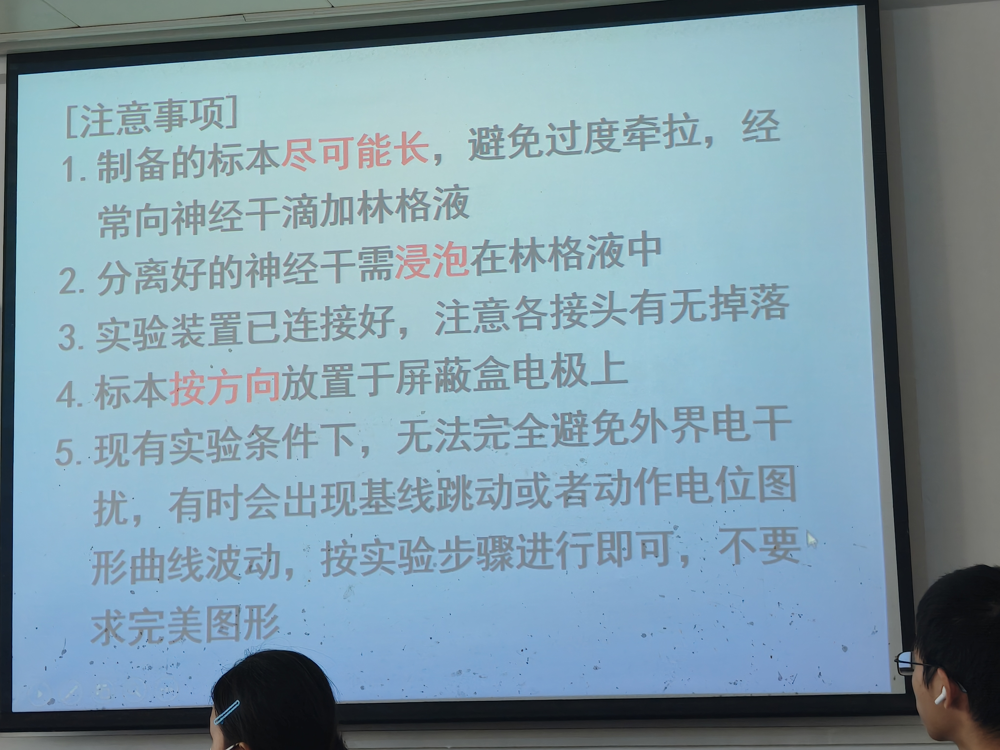
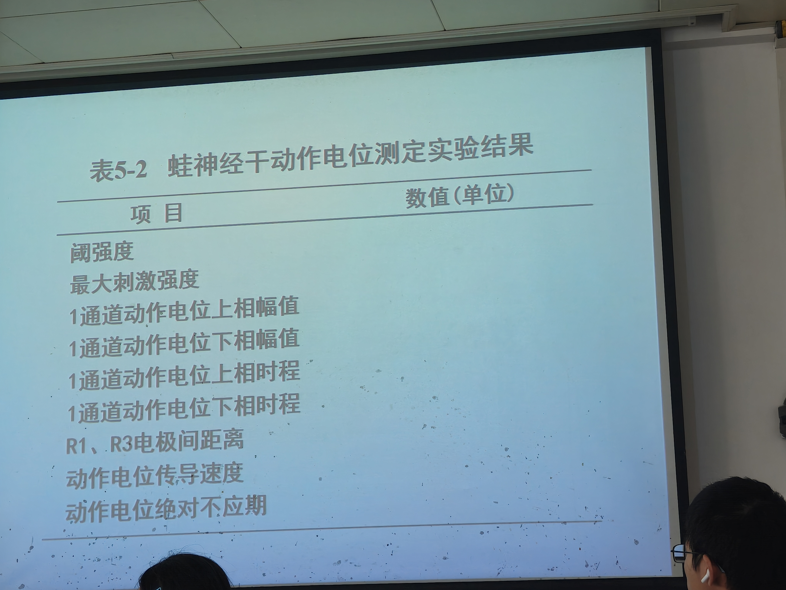
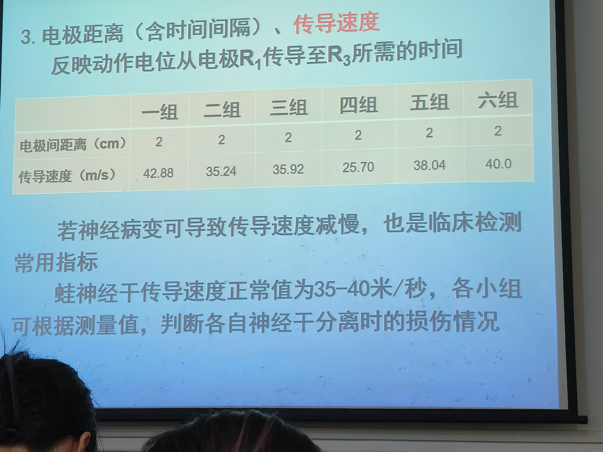
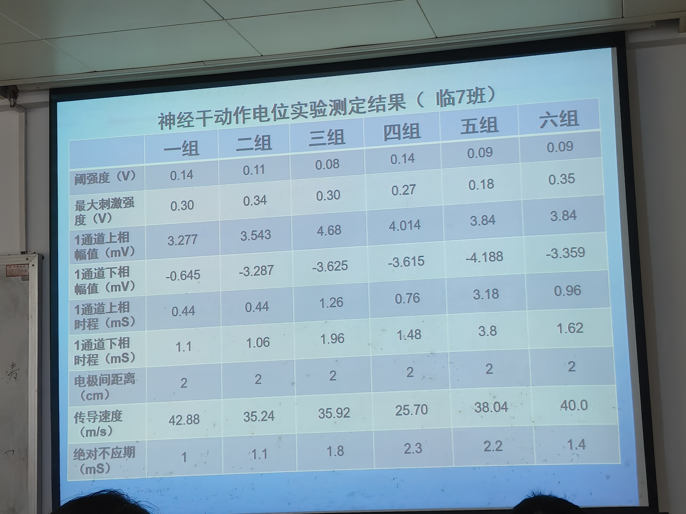
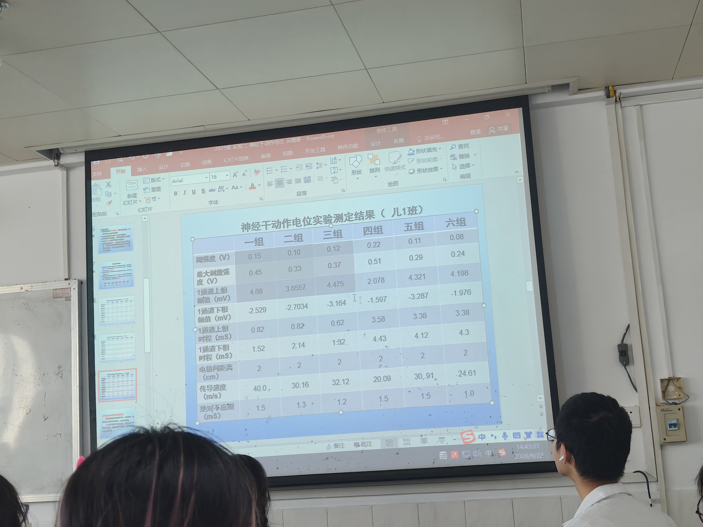
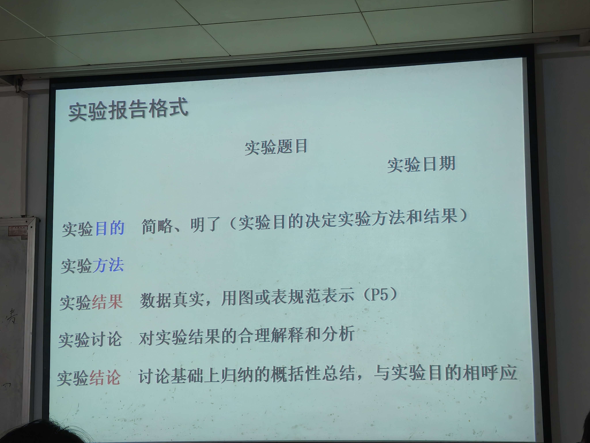

# 第2课 蛙坐骨神经干动作电位测定实验 — 知识点总结（教材精讲版）

> 课程：03 生理科学实验（医学机能学实验，Physiological Science Experiment）
> 授课时间：2026-09-22（14:30 实验操作段；17:17 结果分析与实验报告要求段，两时段为同一节课的延续）
> 内容：蛙坐骨神经干标本制备、神经干动作电位的引导与测定（阈强度、最大刺激强度、双相动作电位上下相幅值、传导速度、绝对不应期）、误差来源分析、实验报告格式与提交互评要求
> 本课课堂照片：6 张（均为课堂 PPT 投影实拍，已按时间戳嵌入对应知识点；无教材书页实拍图）

---

## 一、实验目的

本实验属于生理学验证性实验，通过在体/离体引导蛙坐骨神经干的复合动作电位，巩固并验证《生理学》"细胞的电活动"一章的核心理论，同时训练神经干标本制备与生物信号采集系统的使用。

老师在课堂上明确概括本实验目的：

> 【考点】"今天的实验目的就是测定蛙坐骨神经干动作电位的传导速度及绝对不应期。"

具体可分解为以下四项目的：

1. **掌握蛙坐骨神经干（坐骨神经-胫腓神经干）标本的制备方法**：包括双毁髓法破坏蛙脑脊髓、暴露并游离坐骨神经、分离至腓肠肌/胫腓神经分支，全程保持神经活性。
2. **学习生物信号采集系统（放大器 + 刺激器 + 引导电极 + 屏蔽盒）的连接与使用**：先开放大器、再开软件，调用系统定制实验模块。
3. **测定并理解以下电生理参数**：
   - 阈强度（threshold intensity）与最大刺激强度（maximal stimulus intensity）；
   - 双相动作电位的上相、下相幅值与时程；
   - 神经干动作电位的传导速度（正常范围 35～40 m/s）；
   - 绝对不应期（absolute refractory period）。
4. **结合理论解释实验结果、识别异常结果并分析原因**，并按规范撰写实验报告。

> 【考点】老师强调本实验的临床意义："神经传导速度也是临床电生理比较常见的一个检查项目之一，它也可以用来判断神经是否存在病变以及病变的程度。"——即本实验并非与临床脱节，而是神经传导速度（NCV）测定在基础实验阶段的雏形。

---

## 二、实验原理

### 2.1 动作电位的"全或无"现象与神经干复合动作电位

单个细胞（单根神经纤维）受到刺激后，一旦刺激达到阈强度，即可爆发动作电位；此后**动作电位的幅值不再随刺激强度增大而增大**，这称为动作电位的"**全或无**"（all-or-none）现象。

但本实验在蛙坐骨神经干上引导到的动作电位**并不严格遵循"全或无"**。老师在课堂提问中引导学生理解：

> 【考点】"在一定范围内（动作电位的幅值）是可以增大的，它就不具备全或无的现象……因为它的神经干是由很多神经纤维一起组成的，这些神经纤维它有什么不一样呢？——（跳跃式传导与连续传导）这传导方式不一样，就会导致阈强度不一样，也就是兴奋性不一样。"

原理要点：
- 坐骨神经干是由**成千上万根兴奋性高低不同的神经纤维**集聚而成的神经束；
- 每根纤维的兴奋性不同，其阈强度（阈值）有高有低；
- 当刺激强度刚达到**阈强度**时，只有**兴奋性最高（阈值最低）**的那部分纤维先兴奋，引导出一个较小的复合动作电位；
- 随刺激强度增大，**兴奋性较低（阈值较高）**的纤维相继被募集（recruitment），参与兴奋的纤维数目增多，复合动作电位的幅值随之增大；
- 当刺激强度达到**最大刺激强度**时，神经干内**全部**可兴奋纤维均已兴奋，再增大刺激强度，复合动作电位幅值也不再增加。

因此，从神经干上引导到的是**多根纤维动作电位在时间和空间上叠加形成的复合动作电位（compound action potential, CAP）**，其幅值在阈强度与最大刺激强度之间随刺激强度增大而增大，这是神经干标本区别于单根纤维记录的根本特征。

### 2.2 细胞兴奋后兴奋性的周期性变化

细胞（神经纤维）每爆发一次动作电位，其兴奋性会经历一系列周期性变化：

| 时期 | 兴奋性 | 再次兴奋所需刺激 |
|------|--------|------------------|
| 绝对不应期（absolute refractory period） | 降至零（无论多强刺激均不能再次兴奋） | 任何刺激均不能引起新的动作电位 |
| 相对不应期（relative refractory period） | 低于正常（部分恢复） | 需**阈上刺激**（大于阈强度）才能引起兴奋 |
| 超常期（supernormal period） | 略高于正常 | 阈下刺激即可 |
| 低常期（subnormal period） | 略低于正常 | 需稍强刺激 |

> 【考点】老师指出："教材上已经不讲（超常期、低常期）了，主要就是要注意绝对不应期和相对不应期；等你们学到心肌细胞的时候，那就是（另一种不应期表现）……绝对不应期这个细胞的兴奋性是多少？（零）相对不应期的兴奋性比正常来说应该是小了、低了，那如果想要它产生兴奋的话，要用什么样的刺激啊？——阈上刺激。"

本实验测定**绝对不应期**，其电生理本质见 2.5 节。

### 2.3 双相动作电位的形成机制

当神经干一端被刺激电极（S₁、S₂）兴奋，兴奋沿神经干传导到第一对引导电极（R₁、R₂）时，先记录到一个向上（或向下，依仪器极性而定）的电位偏转，称为**上相**；当兴奋继续传导越过 R₁ 与 R₂ 之间、到达第二对引导电极时，又记录到一个方向相反的偏转，称为**下相**。这种在双引导电极记录下先后出现两个方向相反波相的动作电位，称为**双相动作电位（biphasic action potential）**。

> 【考点】老师在结果分析阶段强调："上相幅值是不是一般都要比下相要大呀？……正常来说应该是上相大还是下相大？——应该上相大于下相。这个为什么？一些视频里面是说得很清楚的，主要就是跟双相动作电位形成的机制是密切相关的。"
>
> 正常规律：**上相幅值 > 下相幅值**。原因在于：双相动作电位的下相是在兴奋已离开第一对电极、并在传导过程中发生一定程度的衰减与不同步之后才被第二对电极记录到的，故其幅值通常小于上相。若实验中出现下相大于上相的反常结果，并非"做错了"，而应分析原因（如刺激伪迹干扰、电极处神经受压/受损、电极间距过近等）。

### 2.4 动作电位传导速度的测定原理

兴奋（动作电位）在神经干上以一定速度传导。本实验在神经屏蔽盒内设置刺激电极（S₁、S₂）与多对引导电极（R₁、R₂、R₃）。据课堂 PPT 明确：**传导速度反映动作电位从引导电极 R₁ 传导至 R₃ 所需的时间**，**R₁、R₃ 电极间距离统一规定为 2 cm**（老师要求直接在表中填写"电极间距离 = 2 cm"，无需再用尺子实测）。计算机自动测量出动作电位从 R₁ 传导到 R₃ 所**经历的时间（Δt）**，则：

> 传导速度 v = 电极间距（距离）/ 传导时间 Δt

> 【考点】"传导速度主要反映的是动作电位从 R₁ 这个电极传导到 R₃ 电极所需要的时间……正常的蛙神经干动作电位的传导速度是多少呀？有个范围的——**35～40 m/s**，没问题。"

老师在课堂上同时指出："现在都是系统去算，如果你自己去算的话，应该很少会超过 40（m/s）。"若某组数据明显偏大，多为**系统识别动作电位起点（刺激伪迹或起点）有误**所致，而非神经真的"进化"了。

### 2.5 绝对不应期与钠通道复活

绝对不应期的本质是电压门控 Na⁺ 通道的功能状态决定的。Na⁺ 通道有三种功能状态：

1. **静息（备用）态（resting state）**：通道关闭，但可被去极化激活；
2. **激活态（activated state）**：通道开放，Na⁺ 内流产生动作电位升支——**激活态是瞬时态**，一激活随即失活；
3. **失活态（inactivated state）**：通道关闭，**此时无论多强的去极化刺激都不能使其再次开放**；必须经历一个**复活（恢复）过程**，才能重新回到静息（备用）态，再次接受刺激产生动作电位。

> 【考点】"钠通道我们说它有三个状态，分别是哪几个呢？——静息、激活、失活。激活态是它瞬时态，一激活就失活，失活的要经历复活过程才能够恢复到静息态。所以绝对不应期主要反映的就是钠通道复活所需要的时间。"

测定方法：在第一次刺激引起动作电位后，在不同时间间隔再给予第二次刺激，观察第二次动作电位能否出现及其幅值。当第二次刺激落在第一次兴奋后的**绝对不应期内**时，无论第二次刺激多强，均不能再次引起动作电位（Na⁺ 通道尚处于失活态、未复活）；逐渐增大两次刺激的时间间隔，直到第二次刺激又能引起动作电位，此时的最短时间间隔即约为绝对不应期。

> 【考点】临床意义："临床上了解不应期，主要是可以用不同频率的电刺激去治疗（相关疾病）。"此外，若神经干保存活性较好，测得的绝对不应期会稍长一些。

---

## 三、实验材料

### 3.1 实验动物

- **蟾蜍/青蛙**（本实验称蛙，常用蟾蜍 Rana / Bufo）。
- 老师说明："一只青蛙可以分出两根坐骨神经-胫腓神经干（两条腿各一根），所以一只青蛙有两条腿。"
- 分组配置：**每组约 3 只青蛙**，"也就是起码每人都有一条腿"可操作。

### 3.2 实验器材与药品

| 类别 | 名称 | 说明 |
|------|------|------|
| 标本制备器械 | 粗剪刀、手术剪/组织剪、眼科剪、镊子、玻璃分针/钝针 | 分离神经用；玻璃分针用于钝性分离神经周围结缔组织，避免直接夹伤神经 |
| 固定器具 | 蛙板、蛙腿固定钉/大头针 | 双毁髓后背位固定于蛙板 |
| 记录装置 | 神经屏蔽盒（内含刺激电极 S₁/S₂、引导电极 R₁/R₂/R₃） | 屏蔽外界电干扰，标本槽内滴林格液保持湿润 |
| 信号系统 | 生物信号采集系统（放大器 + 刺激器 + 计算机软件） | "显示器旁边这个就是放大器" |
| 药品 | **林格液（Ringer's solution，蛙生理盐水）** | 保持神经标本活性；神经干分离过程中及分离后须经常滴加，干燥即失活 |

> 【考点·术语纠错】原笔记中"零隔液"系语音识别错误；据课堂 PPT（注意事项页）确认，正确术语为**林格液（Ringer's solution，部分教材译称"任氏液"）**，是两栖类实验的生理盐溶液。

### 3.3 仪器开机顺序（易错点）

> 【考点】"把神经干标本放置到屏蔽盒里面，要先开启放大器……大家知道哪个是放大器吗？显示器旁边这个就是放大器。**先开放大器，再去打开软件，不然它检测不到**。然后调用系统定制实验，测定相关参数。"

开机顺序固定为：**先开放大器（硬件）→ 再开采集软件**。

---

## 四、实验方法与操作步骤

### 4.1 标本制备总原则

> 【考点】"制备的标本尽可能长。但这个长不是说太短了我去扯一扯把它拉长，这肯定不行——一扯就扯烂、扯断了，甚至虽然它不断，但是也会让它功能丧失。所以分离的过程当中要**避免过度牵拉**。不是说我看见神经在那就把它使劲扯出来；它只是很小心地把神经旁边的组织剥开、分离，等到神经完全游离的时候，再把它慢慢地提起来。"

> 【考点】"分的过程一定要记得经常滴加**林格液**，不然它干了一样也会失活。好的神经干要泡在林格液里面；你还没那么快上机的话，先把它泡起来。"

标本制备关键要点：
1. **双毁髓法**破坏脑和脊髓，使蛙麻醉、四肢松软；
2. 去后肢以上躯干及内脏，保留两后肢及腰骶部皮肤肌肉；
3. 沿脊柱背面暴露并分离坐骨神经，沿大腿后侧沟下行，分离至小腿胫腓神经分支；
4. 分离时用玻璃分针钝性剥离神经周围结缔组织，**忌用金属镊直接夹捏神经、忌过度牵拉**；
5. 全程不断滴加林格液保湿；
6. 游离完毕后将神经干两端结扎/穿线，轻轻提起备用。

> 📝 **批注（2026-09-22 14:41 PPT《注意事项》）**：5 条——①标本**尽可能长**、避免过度牵拉，经常向神经干滴加**林格液**；②分离好的神经干需**浸泡在林格液**中；③装置已连好，注意各接头有无掉落；④标本**按方向**放置于屏蔽盒电极上；⑤现有条件无法完全避免外界电干扰，出现基线跳动/曲线波动属正常，按步骤做即可，**不要求完美图形**。"尽可能长""林格液""按方向"在 PPT 上用红字标注为重点；本页同时确认保湿液为**林格液**（纠正原笔记"零隔液"）。

### 4.2 装置连接与标本放置

> 【考点】"实验装置基本上已经连接好了，注意这个接头有没有掉落就行了。标本放置怎么放？我们说有刺激电极、引导电极。按照你们的方向从左到右，左边这个就是刺激电极的方向。神经干有中枢端、外周端，应该哪一端放到刺激电极？——**中枢端放到刺激电极这一边**。"

> 【考点】"放上去之后，最好把露出来的线都给它剪了，要不然也会有干扰；尽量不要露出线头在外面，不要露在屏蔽盒外面，都剪了，然后再盖上盖子，尽量避免其他的干扰。"

操作要点：
- 神经干**中枢端（近脊髓端）搭在刺激电极 S 上**，**外周端搭在引导电极 R₁、R₂ 上**；
- 神经干应平整地搭在各电极上，避免悬空、折叠、扭曲；
- 剪去屏蔽盒外多余线头，盖好屏蔽盒盖，减少市电/空间电干扰。

### 4.3 测定流程

1. 按"先放大器、后软件"开机；
2. 调用系统中**本实验定制的实验模块**（老师强调："参数在这里，我们按照这上面的来，不需要按照书本的，书本有一些我们现在不需要测了"）；
3. **R₁、R₃ 电极间距离统一填写 2 cm**（"因为它没有提供尺子，你不用去量了，先填 2 cm"）；
4. 从小到大逐步增大刺激强度，观察并记录：
   - 刚出现动作电位时的最小刺激强度 → **阈强度**；
   - 动作电位幅值刚达到最大、再增大刺激幅值不再增加时的刺激强度 → **最大刺激强度**；
   - 第一通道动作电位的**上相幅值、下相幅值、上相时程、下相时程**；
   - 两通道动作电位潜伏期差 → 由计算机自动计算**传导速度**；
5. 用**双刺激法**测定绝对不应期：固定第一个条件刺激，调节第二个测试刺激的间隔，观察第二个动作电位从无到有的临界间隔；
6. 每组选一根合格神经干的结果填入老师下发的汇总表；实验完成后将图形**另存为自己命名的文件**备查。

> 📝 **批注（2026-09-22 14:38 PPT《表5-2》）**：本实验需填表项目共 10 项——阈强度、最大刺激强度、1 通道动作电位上相幅值、1 通道下相幅值、1 通道上相时程、1 通道下相时程、**R₁、R₃ 电极间距离**、动作电位传导速度、动作电位绝对不应期。表头两栏为"项目 / 数值（单位）"，即表题在表上方、为**三线表**，与第七章报告图表规范一致。

### 4.4 干扰与稳定性

> 【考点】"在我们这个实验条件下，很难完全避免外界的一些电干扰。有时候有些组会出现基线跳动，或者动作电位这个曲线也在波动。那没关系，我们按步骤去做，把要测的指标都测出来就行了。我们很难说要求这个完美的图形，没有必要，只是个别组，有些组出来的图还是很稳定的。"

### 4.5 评分标准（课堂当场打分）

> 【考点】"今天的评分标准：每组至少要分离一根蛙坐骨神经-胫腓神经干的标本，而且能够引导出两个通道的动作电位；做好之后另存为一个自己命名的文件，测量并记录表格中的这些数据——这样我们这一组就能拿到 **7 分**。各组每多分离 1 根具有以上标准的神经干标本，就**加 1 分**（有上限），上限是加 3 分，也就是满分 **10 分**。"

> 【考点】"要拿到满分 10 分，每组应该要多少根啊？起码 4 根。0 分的时候我有可能会随机选取神经干上机测试。神经干泡在林格液当中，兴奋性是可以保持 **12 小时以上**的，所以不用担心说我刚才能测出来、现在测不出来的情况。也就是说你要真的是分出有这样标准的神经干你才说，或者你保存好了文件，我去调取你的存盘文件检查。**如果有造假，全组的评分就只有 6 分**。"

| 项目 | 标准 | 分值 |
|------|------|------|
| 基本要求 | 每组至少 1 根合格神经干标本，引导出双通道动作电位并存盘记录数据 | 7 分 |
| 加分项 | 每多 1 根合格标本加 1 分，上限 +3 分 | 最高至 10 分 |
| 满分所需 | 每组至少 **4 根**合格神经干 | — |
| 造假惩罚 | 一经查实造假 | 全组仅 6 分 |
| 活性保持 | 林格液浸泡下神经干兴奋性可保持 **12 小时以上** | — |

---

## 五、实验结果与数据分析

实验结果按"先全班汇总、再逐组对照正常值"的方式分析。老师带领各组逐项解读。

### 5.1 阈强度与最大刺激强度

> 【考点】"阈强度和最大刺激强度分别代表的就是不同神经纤维的最高和最低的兴奋性。阈强度是什么呀？最高兴奋性对吧；最大刺激强度是最低的兴奋性。**阈强度越小，说明它的这个神经干最高的兴奋性越高**；最大刺激强度越大，那就说明它的兴奋性相对小一点。如果说神经纤维的兴奋性降低的话，那主要就是我们分离的时候各种原因导致的神经损伤引起的。"

解读要点：
- **阈强度（threshold intensity）**：能引起神经干出现最小复合动作电位的最小刺激强度，代表神经干内**兴奋性最高**那部分纤维的阈值；
- **最大刺激强度（maximal stimulus intensity）**：使全部可兴奋纤维均兴奋、复合动作电位幅值刚达最大的刺激强度，代表神经干内**兴奋性最低**纤维的阈值；
- 阈强度越小 → 神经干最高兴奋性越高（标本活性越好）；
- 阈强度/最大刺激强度偏大 → 多提示分离过程中神经受损、兴奋性下降。

### 5.2 复合动作电位幅值随刺激强度的变化

> 【考点】"在阈强度和最大刺激强度之间，随刺激强度的增大，（动作电位）幅值是增大的，没有全或无的现象，这个我们都可以理解。"

这正是 2.1 节"神经干由多根兴奋性不同纤维组成、随刺激增强而逐根募集"的实验体现。

### 5.3 双相动作电位上相、下相幅值与时程

> 【考点】"第一通道动作电位的上下相幅值和时程，主要就是用这个数值来表示动作电位形状的大小，告诉你这个峰值。各组的幅值也不一样，但我们应该能找出其中一个规律：上相和下相相比，上相幅值是不是一般都要比下相要大呀？……其他的都是上相幅值大于下相幅值。那正常来说应该是什么？应该上相大于下相，这跟双相动作电位形成的机制是密切相关的。"

正常规律：**上相幅值 > 下相幅值**。

**异常结果分析**（以下相大于上相为例，如课堂第五组）：

> 【考点】"第五组是下相大于上相，对不对？并没有说他做错了，这种结果我们这里也不少见。碰到这种异常结果的时候，我们怎么办呢？分析可能的原因就可以了。据我们推测，一般有可能是一个是**刺激伪迹的影响**……会有这样的情况出现，那你就把这个原因写上去就行了。"

即：
- 下相 > 上相 → 常见原因包括**刺激伪迹（stimulus artifact）干扰**、引导电极处神经受压/受损、电极间距过近、引导电极接触不良等；
- 异常结果**不需要"修正"**，如实在实验报告中分析原因即可（详见第七章）。

> 【考点】"幅值说明的问题：如果神经纤维受损，就会出现动作电位幅值减小；我们看到有些比较大的幅值，说明这个神经干的神经纤维的兴奋性保持得比较好。临床上这也是一个检测指标之一。"

### 5.4 传导速度

> 【考点】"传导速度主要反映动作电位从 R₁ 传导到 R₃ 所需要的时间。首先要知道正常的蛙神经干动作电位的传导速度是多少？——**35～40 m/s**。"

| 实测结果 | 可能原因 |
|----------|----------|
| 小于 35 m/s（偏低） | 分离过程中神经**受损伤**（按本实验操作"这是很正常的"） |
| 大于 40 m/s（偏高） | 多为**系统自动识别动作电位起点（含刺激伪迹）有误**所致；人手计算极少超过 40 m/s |
| 35～40 m/s | 正常，提示神经干分离损伤小、活性好 |

> 【考点】"病变也会导致传导速度的减慢，这也是临床检测的指标。我们可以根据测量值判断神经干分离的损伤情况。"

> 📝 **批注（2026-09-22 17:25 PPT）**：标题"3. 电极距离（含时间间隔）、**传导速度**"，正文明确"反映动作电位从电极 **R₁ 传导至 R₃** 所需的时间"。下表为临7班六组电极间距离（均为 **2 cm**）与传导速度（42.88 / 35.24 / 35.92 / 25.70 / 38.04 / 40.0 m/s）。结论文字："若神经病变可导致传导速度减慢，也是临床检测常用指标；**蛙神经干传导速度正常值为 35–40 米/秒**，各小组可根据测量值判断各自神经干分离时的损伤情况。"

### 5.5 绝对不应期

> 【考点】"绝对不应期主要反映的就是钠通道复活所需要的时间。一般来说，如果这个神经干保存的活性比较好的话，这个时间会稍微长一些。"

结论要点：
- 绝对不应期 ≈ 电压门控 Na⁺ 通道从失活态恢复到静（备用）态所需时间；
- 活性好的神经干，测得的绝对不应期相对稍长；
- 临床用于指导不同频率电刺激治疗的参数选择。

### 5.6 课堂实测数据示例（PPT 汇总表，据照片核对）

下午段（17:17）老师所分析的正是**临7班**六组实测结果，数据与课堂讲解完全对应。

> 📝 **批注（2026-09-22 17:16 PPT，临7班）**：六组实测数据如下表。单位——阈强度/最大刺激强度 **V**、上下相幅值 **mV**、上下相时程 **ms**、电极间距离 **cm**、传导速度 **m/s**、绝对不应期 **ms**。

| 项目 | 一组 | 二组 | 三组 | 四组 | 五组 | 六组 |
|------|------|------|------|------|------|------|
| 阈强度 (V) | 0.14 | 0.11 | 0.08 | 0.14 | 0.09 | 0.09 |
| 最大刺激强度 (V) | 0.30 | 0.34 | 0.30 | 0.27 | 0.18 | 0.35 |
| 1通道上相幅值 (mV) | 3.277 | 3.543 | 4.68 | 4.014 | 3.84 | 3.84 |
| 1通道下相幅值 (mV) | -0.645 | -3.287 | -3.625 | -3.615 | -4.188 | -3.359 |
| 1通道上相时程 (ms) | 0.44 | 0.44 | 1.26 | 0.76 | 3.18 | 0.96 |
| 1通道下相时程 (ms) | 1.10 | 1.06 | 1.96 | 1.48 | 3.80 | 1.62 |
| 电极间距离 (cm) | 2 | 2 | 2 | 2 | 2 | 2 |
| 传导速度 (m/s) | 42.88 | 35.24 | 35.92 | 25.70 | 38.04 | 40.0 |
| 绝对不应期 (ms) | 1.0 | 1.1 | 1.8 | 2.3 | 2.2 | 1.4 |

对照表中数据与老师口头分析：
- **一组传导速度 42.88 m/s（>40）**——即老师说的"第一组稍微大了一些"，系**系统自动识别动作电位起点（含刺激伪迹）有误**，非神经异常；
- **四组传导速度 25.70 m/s（<35）**——即老师说的"第四组小于正常"，系**分离过程神经损伤**；
- **五组上相 3.84 mV、下相 -4.188 mV**——**|下相| > 上相**，正是老师点名"第五组下相大于上相"的异常组，原因多为**刺激伪迹干扰**；其余五组均为上相幅值 > 下相幅值；
- 绝对不应期实测约 **1.0～2.3 ms**（活性好的组偏长）。

上午段（14:43）投影的**儿1班**汇总表作为第二例备查：

> 📝 **批注（2026-09-22 14:43 PPT，儿1班）**：同样六组，电极间距离均为 2 cm；传导速度 40.0 / 30.16 / 32.12 / 20.09 / 30.91 / 24.61 m/s（多数低于 35，反映分离损伤）；绝对不应期 1.0～1.5 ms；上相幅值均为正、下相幅值均为负，方向相反且上相幅值绝对值普遍大于下相。

---

## 六、误差来源分析

老师在结果分析开讲即指出实验结果存在差异的客观必然性，并归纳为三大来源：

> 【考点】"还有它客观的原因啊，一个呢就是**实验动物个体**，还有就是**人类的操作**，以及**仪器的性能**，那这些都会影响到我们的实验结果，而且也很难避免。那是不是说有一定差异，我们做这个实验就没有意义了呢？也不是，毕竟它是一个重复性的实验，我们可以通过结果去看到底哪些因素影响的，尽量保证我们实验的可靠就可以了。"

| 误差来源 | 具体表现 | 对结果的影响 |
|----------|----------|--------------|
| ① 实验动物个体差异 | 不同蛙的神经纤维组成、兴奋性、生理状态各不相同 | 阈强度、最大刺激强度、幅值、传导速度、不应期各组间存在自然差异 |
| ② 人类操作因素 | 分离时牵拉、夹捏、干燥（未及时滴林格液）、中枢端/外周端放反、线头未剪净引入干扰 | 神经受损→幅值下降、传导速度减慢；放置错误/干扰→双相波形异常、基线波动 |
| ③ 仪器性能因素 | 放大器/刺激器参数、电极接触电阻、系统自动识别动作电位起点（含刺激伪迹） | 传导速度计算偏大/偏小；基线跳动、波形波动 |

认识要点：
- 差异**不可完全避免**，实验不是为追求"完美无波动的图形"；
- 应通过重复实验、规范操作把误差控制在合理范围；
- **异常结果不等于失败**，关键是能识别并用上述三因素框架去解释。

---

## 七、实验报告格式与提交要求

> 老师强调："实验报告的格式也是要求我们要掌握的。我们生理的实验报告格式已经固定给你们了，就像填空一样填上去；但是到后面你们还有病生和药理，他们的实验报告就是一张大白纸了。所以这个格式你们要掌握了，不要到后面病生老师说我们生理老师没教。"

### 7.1 报告七要素

一份规范的生理科学实验报告包含以下七个部分：

1. **题目（实验题目）**；
2. **日期（实验日期）**；
3. **实验目的**——简单明了；
4. **实验方法**——按书本做、无新方法时**不必详写，注明"详见教材第 ×× 页"即可**；
5. **实验结果**——必须是**真实数据**，并用规范的图、表表示；
6. **讨论**——本报告最重要的部分；
7. **结论**——在讨论基础上归纳概括、呼应实验目的。

> 📝 **批注（2026-09-22 17:27 PPT《实验报告格式》）**：PPT 自上而下列出——**实验题目、实验日期**（右上角分列）；**实验目的**（简略、明了——实验目的决定实验方法和结果）；**实验方法**；**实验结果**（数据真实，用图或表规范表示，P5）；**实验讨论**（对实验结果的合理解释和分析）；**实验结论**（讨论基础上归纳的概括性总结，与实验目的相呼应）。与本节七要素一一对应。

> 【考点】"实验目的简单明了，因为我们的实验都比较简单，做不到很多的目的。你要达到这样的目的，那就是你要采用什么方法、得到什么结果，基本上目的就确定了。那我们今天的实验目的是什么呢？——测定蛙神经干动作电位的传导速度和绝对不应期。"

### 7.2 实验结果：真实、规范

> 【考点】"实验结果一定是真实的数据。你做出来是什么结果你就写什么结果，不能说像我们刚才说的上相大于下相是正常的、下相大于上相是异常的，我要分析好烦啊，改一改——这种不允许，这个有留底的。我们也要养成这种习惯，毕竟我们这种专业以后有可能自己要发各种论文。"

结果的图表规范（通用论文格式）：

> 【考点】"有数据还要用图和表规范表示。你们看书的时候可以注意，每一幅图的**正下方都会有图号**，这就是它的格式；表格用**三线表**，**表号、表题在表格的正上方**，这是表格的格式。这些格式基本上是通用的，不管你以后发什么论文，基本上都是这样。"

| 要素 | 位置 | 说明 |
|------|------|------|
| 图号（图题） | **图的正下方** | 如"图 1 蛙坐骨神经干双相动作电位" |
| 表号、表题 | **表的正上方** | 如"表 1 各组神经干动作电位测定结果" |
| 表格线型 | **三线表** | 仅顶线、表头线、底线三条横线 |

### 7.3 讨论：围绕自己的真实数据（最重要）

> 【考点】"讨论是最重要的一部分。讨论什么呢？讨论你自己的结果，对实验结果进行合理的解释和分析：是正常的，为什么这样？异常的，为什么这样？讨论是讨论自己的结果。"

> 【考点】"怎么说讨论自己的结果呢？就好像我们刚才说的，神经干动作电位在一定范围内幅值随刺激强度增大而增大，这个'一定范围'第一组的跟第二组的一样吗？不一样。那第一组你就把你第一组从阈强度到最大刺激强度这个范围写上去，那就是你的结果了。还有上下相幅值，你测出来的上相幅值是多少、下相幅值是多少，然后你再说谁大谁小——这样就是讨论实验结果。而不是一上来就空谈理论、完全忽视自己的结果，这种就不是好的讨论。"

讨论写作要点：
- 必须先列**本组自己的具体数据**（阈强度、最大刺激强度、上/下相幅值、传导速度、绝对不应期）；
- 再用理论解释：为什么在该范围内幅值随刺激增大而增大；上相与下相谁大谁小、为什么；传导速度是否在 35～40 m/s 范围；
- 出现异常结果（如下相大于上相、传导速度偏快/偏慢）时，按第六章三因素框架分析原因；
- **忌空谈理论、忌照抄教材、忌为"好看"修改数据**。

### 7.4 结论：呼应实验目的

> 【考点】"结论是在讨论的基础上进行归纳概括性的总结，**呼应我们的实验目的**。既然是呼应实验目的，那今天的实验结论应该怎么写？目的是测定传导速度，那你就说神经干动作电位的传导速度是多少、绝对不应期是多少——这个是呼应实验目的。"

举例：若把实验目的改为"测定我分出的神经干动作电位传导速度是否正常"，则结论就应与正常值比较后作出判断性结论（"传导速度正常"或"低于正常"），形成完整的"目的—方法—结果—讨论—结论"闭环。

### 7.5 提交、互评与存档规则（务必听清）

> 【考点】"线上线下实验报告要求：我们生理部分的实验，是要求**纸质版和电子版配合**来完成的。电子版的实验报告在**学习通**上发布，具体方法学习通上有。一定要注意：**电子版实验报告在发布后的 24 小时内完成并提交**——也就是他什么时候发，比如 5:30 发那你 5:30 之前要完成，6:00 发你就 6:00 之前要完成，都有时效的，过期不候。"

> 【考点】"还有一个**互评环节**：当你提交完自己的实验报告，到下一个 24 小时，你会收到一份实验报告，这个互评你也需要在 24 小时之内完成，收到尽快完成。互评我们都有给互评标准，你们就按照互评标准认真给分，不能说我跟他很熟就给满分。**我如果看到不认真互评的同学，会倒扣回给分**。"

> 【考点】"还要提醒：在完成电子版的同时完成**纸质版的讨论部分**，因为你提交了之后就没办法再看到电子版的实验报告了。学期末这个**纸质版的实验报告要交到实验室来存档**。所以大家一定要按时，跟着电子版一起去完成，这样比较省事，不要到后面自己又做一遍。**如果不按时提交实验报告，这次作业就是 0 分；没有按时或者不认真参与互评的，就倒扣 1 分**。"

> 【考点】"实验报告这上面的表是没有单位的，填的时候一定要把单位填上去、单位要填对；还有拍照上传一定要**拍正**上传——老师是用电脑看的，不拍正也会扣分。"

| 环节 | 时限/要求 | 违约后果 |
|------|-----------|----------|
| 电子版实验报告（学习通发布） | 发布后 **24 小时内**提交 | 不按时提交本次作业 **0 分** |
| 纸质版 | 与电子版同步完成**讨论部分**；学期末交实验室**存档** | 提交后无法再回看电子版，须边做边抄录讨论 |
| 互评 | 收到他人报告后 **24 小时内**按互评标准完成 | 不按时/不认真互评，**倒扣 1 分** |
| 数据单位 | 表中空缺单位必须补全、填对 | 缺单位/单位错扣分 |
| 拍照上传 | **拍正**（电脑端批阅，不可旋转） | 拍歪扣分 |

### 7.6 课后预习与实验室卫生

> 【考点】"下节课除了看这里的预习，我还要求同学们回去认真反复看**第一次基本操作的视频**，因为家兔的操作最细的就是这一个，主要就是在第一次操作视频里面。搞好卫生，因为明天有专业认证的专家有可能会来实验室看，所以要把卫生搞好。"

---

## 八、本课关键数字与结论速记

| 项目 | 关键值/结论 |
|------|-------------|
| 实验动物 | 蛙（蟾蜍/青蛙），每组约 3 只；一只蛙两后肢可制 2 根神经干标本 |
| 电极距离 R₁、R₃ | 统一填 **2 cm** |
| 开机顺序 | **先放大器（硬件）→ 后软件** |
| 标本放置 | **中枢端**接刺激电极，外周端接引导电极 |
| 保湿 | 全程滴**林格液**；林格液浸泡下兴奋性保持 **12 小时以上** |
| 正常传导速度 | **35～40 m/s** |
| 正常双相波形 | **上相幅值 > 下相幅值** |
| 绝对不应期本质 | **电压门控 Na⁺ 通道复活（恢复到静息态）所需时间** |
| Na⁺ 通道三状态 | 静息（备用）→ 激活（瞬时）→ 失活，须复活回静息 |
| 复合动作电位 | 阈强度～最大刺激强度间幅值随刺激增强而增大，**无"全或无"** |
| 评分 | 1 根合格标本 7 分，每多 1 根 +1，上限 10 分（约需 4 根）；造假全组仅 6 分 |
| 报告时限 | 电子版发布后 24 h；互评 24 h；纸质版学期末存档 |
| 违约 | 不按时交报告 0 分；不认真互评倒扣 1 分 |
| 误差三因素 | 动物个体差异 / 人类操作 / 仪器性能 |

---

> 备注：本总结依据 2026-09-22 同日两时段课堂实时笔记（14:30 实验操作段、17:17 结果分析与报告要求段）合并整理；语音识别错误（如"零隔液→林格液""动作定位→动作电位""硬强度/预强度/力强度→阈强度""上相/下相误写为上降/下降/上香/下向""刺激尾气/刺激北京→刺激伪迹""有污水→有髓""matlab 系统→生物信号采集系统""磁力电机→刺激电极""神经盖→神经干"等）均已按专业术语纠正，详见同目录《考点与术语.md》。
