# 卫生统计学第4课：定性资料的统计描述（教材精讲版）

> 授课时间：2026-09-18（教材精讲整理版）
> 内容范围：第五章「定性资料的统计描述」——第一节 常用相对数及其应用（率/构成比/相对比）＋第二节 应用相对数需注意的问题＋第三节 动态数列及其应用＋第四节 率的标准化
> **教材依据：《卫生统计学》（科学出版社）第五章，教材第77~89页**，本总结以教材内容为主线精讲，穿插课堂PPT要点
> 📷 **本课已插入14张课堂PPT照片**（拍摄时间戳14:36~15:52，按知识点对应插入），每张附📝批注
> 阅读建议：本课是"相对数"专题，三大核心概念（率/构成比/相对比）的**区别**、四大应用注意事项、动态数列四个指标、标准化率直接法/间接法（SMR）是考试绝对重点，案例题高频（教材案例5-1~5-13要会算）

---

## 第一部分 绪论：为什么需要相对数？（教材77页）

### 1.1 定性资料与相对数的引入

- **定性资料**（qualitative data）：观察结果是定性的，如感染猪链球菌病患者的"死亡/存活"、职业分类、性别等。
- 正如用**集中趋势指标和离散趋势指标**描述定量资料的基本特征，我们用**相对数指标**来描述定性资料的基本特征。
- **绝对数与相对数**（课堂PPT，14:36）：
  - **绝对数**：表示某事物在某时、某地发生的**实际水平**。
  - **相对数**：两个相关指标的**比值**，便于相互比较与分析。

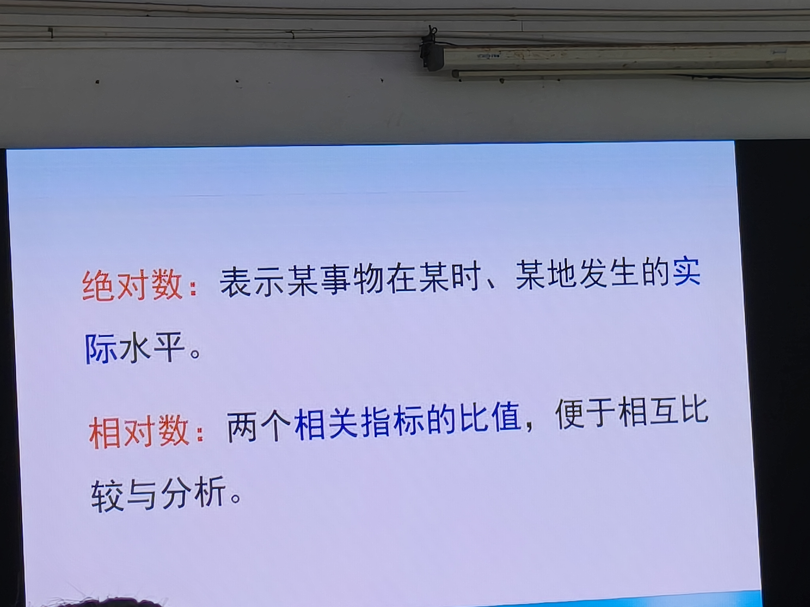
> 📝 **批注（14:36，课堂PPT）**：本课开场——绝对数（实际水平，如"死亡11例"）vs 相对数（两个相关指标的比值，便于比较）。**注意**：绝对数只能说明实际水平，不能互相比较（这是教材案例5-1的核心结论）。

### 1.2 【案例5-1】猪链球菌病死因分析（教材77页，必考入门案例）

- **背景**：某地2005年有38例人感染猪链球菌病死亡，其中休克型11例，脑膜炎型27例。某医师由此认为"脑膜炎型比休克型易发生死亡"。
- **问题5-1**：
  - （1）此资料为何种类型资料？→ **定性资料（二分类变量）**：每个患者的结局是死亡或存活。
  - （2）该医师的结论是否正确？→ **不正确**。死亡病例数是**绝对数**，绝对数只能说明实际水平，**不能互相比较**。脑膜炎型死亡病例多于休克型，可能只是因为脑膜炎型病例本身就多。
  - （3）正确比较需补充什么？→ 补充**两种临床分型的病例总数**。已知休克型37例、脑膜炎型104例时：休克型病死率=11/37=**29.73%**，脑膜炎型病死率=27/104=**25.96%**，结论反转为**休克型病死情况更严重**。
- **结论**：病死率属于**相对数（relative number）**，是描述定性资料的统计指标。

### 1.3 【案例5-2】埃博拉出血热职业分布（教材77页）

- **背景**：某地2000年出现埃博拉出血热44例——卫生保健人员16例、农民13例、家庭主妇8例、儿童保育员6例、警察1例。
- **问题5-2**：以何种职业为多？
- **分析**：职业是**多分类定性变量**，计算各职业病例占总病例数的**比重（构成比）**：卫生保健人员和农民为多。
- **表5-1**：44例埃博拉出血热的职业分布——卫生保健人员16例（36.36%）、农民13例（29.55%）、家庭主妇8例（18.18%）、儿童保育员6例（13.64%）、警察1例（2.27%），合计100%。
- 表中5个数值表示各职业病例所占比重，称**构成比（百分比）**，也是相对数指标。

---

## 第二部分 第一节：常用相对数及其应用（教材78~79页）

### 2.1 相对数的总体定义

> 【知识点5-1】相对数是对定性资料进行统计描述的一类指标。

**常用相对数有三种：率、构成比、相对比**（教材80页知识点5-2总结）。

### 2.2 一、率（rate）——说明发生频率或强度

- **定义**：率是指某现象**实际发生数**与**可能发生某现象总数**之比，用以说明某现象发生的**频率或强度**。
- **计算公式**（式5-1）：

```
率 = 发生某现象的观察单位数 / 可能发生某现象的观察单位总数 × K
```

- **K为比例基数**：可以是100%（百分率）、1000‰（千分率）、10 000/万（万分率）、100 000/10万（十万分率）。**选择原则**：按习惯用法，或使计算结果保留1~2位整数，便于阅读。
- **常用举例**（课堂PPT，14:38~14:39）：
  - **患病率**通常用百分率（100%）
  - **婴儿死亡率**用千分率（1000‰）
  - **肿瘤死亡率**以十万分率（100 000/10万）表示

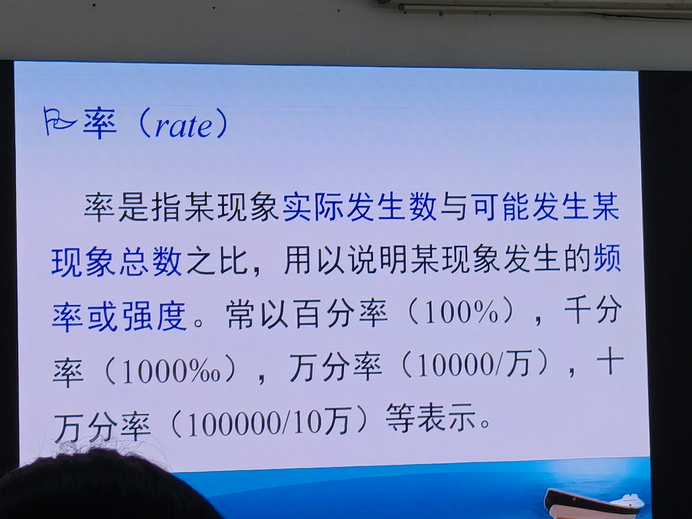
> 📝 **批注（14:38，课堂PPT）**：率的定义——"某现象实际发生数与可能发生某现象总数之比，用以说明某现象发生的频率或强度"。常以百分率、千分率、万分率、十万分率表示。

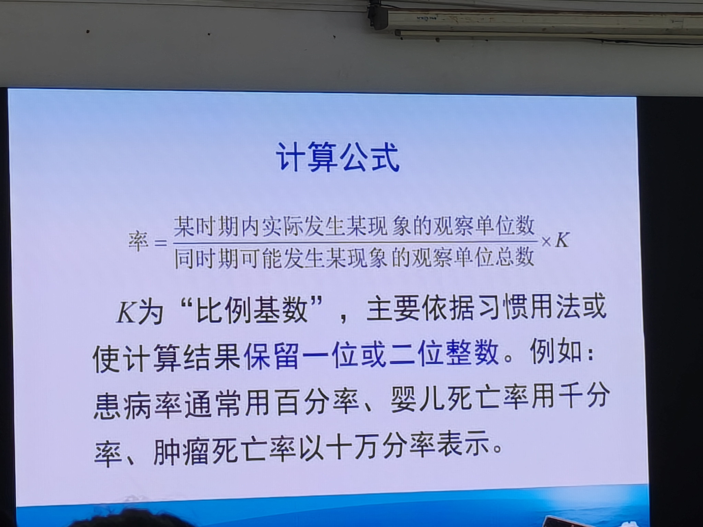
> 📝 **批注（14:39，课堂PPT）**：率=某时期内实际发生某现象的观察单位数/同时期可能发生某现象的观察单位总数×K。**K为"比例基数"**，依据习惯用法或使结果保留1~2位整数。举例：患病率用百分率、婴儿死亡率用千分率、肿瘤死亡率用十万分率。

- **【案例5-3】钩虫感染率比较（教材78页，必会计算）**：
  - 甲村1200人、感染110人：110/1200×100%=**9.17%**
  - 乙村1500人、感染150人：150/1500×100%=**10.00%**
  - 结论：**乙村钩虫感染率高于甲村**，乙村感染情况更严重。
- **率的应用**：患病率、感染率、治愈率、病死率、死亡率等。**要点**：当率的分母**无时间量纲**时，率的分子是分母中的一部分，其值**不会超过1**。

### 2.3 二、构成比（proportion）——说明事物内部比重

- **定义**：构成比表示**事物内部各组成部分所占的比重**，常以百分数表示，因此也称为百分比。
- **计算公式**（式5-2）：

```
构成比 = 某一组成部分的观察单位数 / 同一事物各组成部分的观察单位总数 × K
```

- **【案例5-4】某医院2003年各科室收治住院患者构成（教材78页）**（表5-2）：
  | 科别 | 病例数 | 构成比（%） |
  |------|--------|-------------|
  | 内科 | 850 | 30.08 |
  | 外科 | 1133 | **40.09**（比重最大） |
  | 妇科 | 425 | 15.04 |
  | 儿科 | 418 | 14.79 |
  | 合计 | 2826 | 100.00 |
- **构成比的特点**（课堂PPT，14:46，教材79页）：
  1. **各组成部分构成比之和应为100%（或1）**——分子是分母的一部分，各构成比在0~1之间波动。
  2. **事物内部各组成部分之间呈此消彼长关系**——某一部分构成比增大，其他部分必然减少（如一定人口中男性比例增加→女性比例减少）。

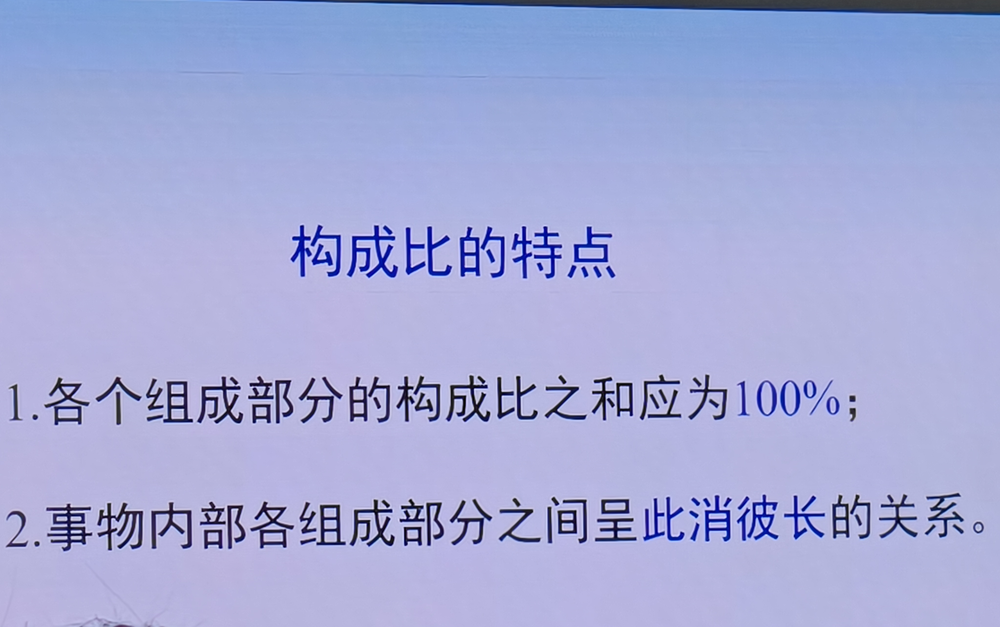
> 📝 **批注（14:46，课堂PPT）**：构成比两大特点——①各组成部分构成比之和应为100%；②各组成部分间呈此消彼长关系。这是"为什么构成比下降可能是其他部分变化引起"的理论基础（呼应案例5-8）。

### 2.4 三、相对比（relative ratio）——两个指标的比

- **定义**：相对比是两个**有关联的指标**之比，用以说明一个指标是另一个指标的几倍或几分之几。两个指标可以是绝对数、相对数或平均数；可以性质相同，也可以性质不同。
- **计算公式**（式5-3）：

```
相对比 = 甲指标 / 乙指标（或×100%）
```

- **常见例子**：变异系数、流行病学中的**相对危险度**、人口学中的**性别比**等都属于相对比。
- **分类**（教材79页）：
  - **① 对比指标**：同类事物的两个指标之比，以达到比较目的。如2000年我国出生性别比116.9（男性出生人数比女性高）；又如同时期不同人群某病发病率之比。
  - **② 关系指标**：两个有关但**非同类事物**的指标之比。如医护人员与病床数之比（床护比）、住院日数与床位数之比等。
  - **③ 计划完成指标**：实际完成数/计划完成数，说明计划完成的程度（课堂PPT补充）。

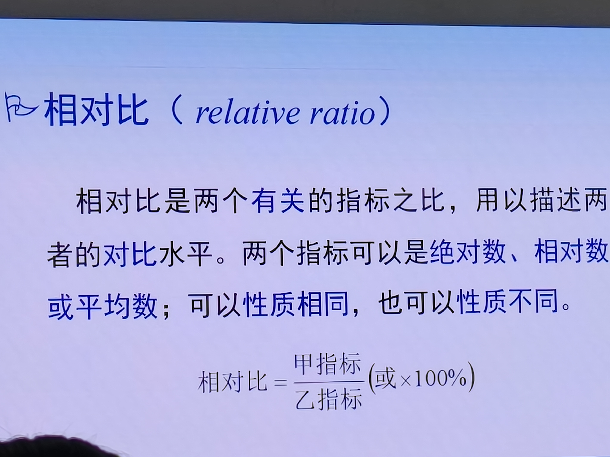
> 📝 **批注（14:53，课堂PPT）**：相对比是两个有关的指标之比，用以描述两者的对比水平。两个指标可以是绝对数、相对数或平均数；可以性质相同，也可以性质不同。公式：相对比=甲指标/乙指标（或×100%）。

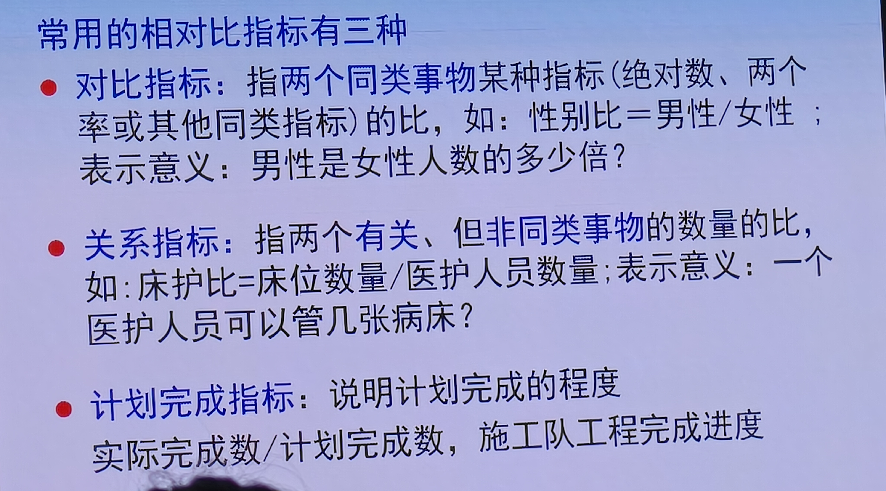
> 📝 **批注（14:58，课堂PPT）**：三种常用相对比——①**对比指标**（同类指标之比，如性别比=男性/女性，意义：男性是女性多少倍）；②**关系指标**（有关但非同类数量之比，如床护比=床位数量/医护人员数量，意义：一个医护人员管几张病床）；③**计划完成指标**（实际完成数/计划完成数，如施工队工程进度）。

### 2.5 【案例5-5】年龄组死亡与恶性肿瘤死亡分析（教材79页，综合应用）

- **资料**（表5-3）：某地各年龄组人口的死亡人数及恶性肿瘤死亡人数（0~：人口82 920、死亡138、肿瘤死亡4；20~：46 639、63、12；40~：28 161、172、52；60~：9 370、342、42；合计167 090、715、110）。
- **问题5-5**：
  - （1）哪个年龄组发生死亡可能性高？→ 看**死亡率**（式5-1）：60岁以上组死亡率最高（342/9370=**36.50‰**），发生死亡可能性高。
  - （2）哪个年龄组容易死于恶性肿瘤？→ 看**恶性肿瘤死亡率**：60岁以上组最高（42/9370×10万=**448.24/10万**）。
  - （3）恶性肿瘤死亡者中以哪个年龄组人数多？→ 看**构成比**（式5-2）：40~60岁组占47.27%，人数最多。
  - （4）恶性肿瘤是否为主要死因之一？→ 看恶性肿瘤死亡占总死亡数的**构成比**：110/715=**15.38%**，比重较大，是主要死因之一。
- **表5-4**（教材80页）：死亡率（‰）——0~：1.66、20~：1.35、40~：6.11、60~：36.50、合计4.28；恶性肿瘤死亡率（1/10万）——4.82、25.73、184.65、448.24、合计65.83；肿瘤死亡占肿瘤总死亡百分比——3.64、10.91、47.27、38.18、合计100.00。
- **核心启示（必考）**：同一份资料，问"哪个组死亡可能性高"用**率**，问"死亡者中哪个组多"用**构成比**——**率与构成比的选用取决于问题**。

---

## 第三部分 第二节：应用相对数需注意的问题（教材80~83页）

> 四大注意事项（课堂PPT，15:31）：①计算相对数分母不宜过小；②不能以构成比代替率；③计算合计率时不能简单地相加求平均；④率的比较时应注意可比性。

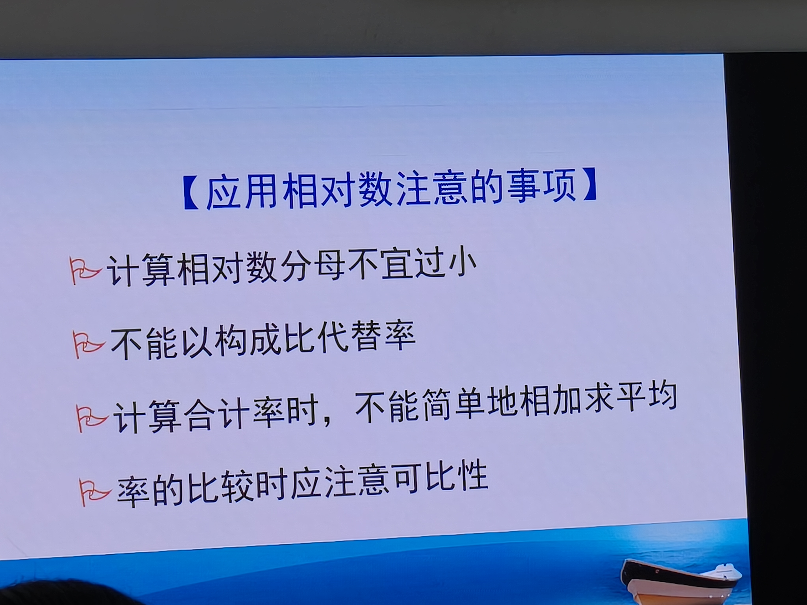
> 📝 **批注（15:31，课堂PPT）**：本课第二大重点——四条注意事项：①计算相对数分母不宜过小；②不能以构成比代替率；③计算合计率时，不能简单地相加求平均；④率的比较时应注意可比性。以下逐条精讲。

### 3.1 一、计算相对数应有足够的观察单位数（分母不宜过小）

- **核心**：观察单位数少时，用相对数不稳定——分子少量变动会使相对数大幅变动，不能反映真实情况。
- **举例（教材80~81页）**：
  - 3例患者：1例有效→有效率33.33%；2例有效→66.67%；3例有效→100%。
  - 2例患者：1例有效→有效率50%；2例都有效→100%——相差1例波动巨大。
- **【案例5-6】某地2015年11月9人死于法定传染病**（狂犬病2人22.22%、肺结核3人33.33%、病毒性肝炎3人33.33%、出血热1人11.11%）：
  - （1）用的什么指标？→ **构成比**（相对数指标）。
  - （2）合适吗？→ **不合适**。仅9例，例数过少，应直接用**绝对数**表示（如2人死于狂犬病、3人死于肺结核……）。
- **处理原则**：观察单位数少时**建议用绝对数**表示结果；如必须用相对数，**应同时列出率的置信区间**。

### 3.2 二、分析时不能以构成比代替率（最高频考点）

- **核心**：构成比说明事物内部各组成部分所占的**比重**，**不能**说明某现象发生的**频率或强度**。误把构成比当率使用→不合理推论。
- **经典错误案例（交通事故）**：某月交通事故中，高速行驶占31%、中速占56%、低速占13%→据此认为"中速行驶最易发生交通事故"（与常识不符）。**错误原因**：把"事故车辆的速度构成"当成"不同速度车辆的事故发生率"。实际生活中中速行驶车辆多→事故数构成比大。车辆事故发生率=事故发生数/行驶车辆数。
- **【案例5-7】麻疹患儿的年龄分布（教材81页，考试经典）**：
  - 某医生对本院某年收治1907例麻疹患者做年龄分布描述（表5-5：0~6月67例3.51%、7月~217例11.38%、1岁~715例**37.49%**、2岁~493例25.85%、3岁~171例8.97%、4岁~122例6.40%、5岁~75例3.93%、6~7岁47例2.47%，合计1907例100%）。
  - 医生认为："1岁儿童麻疹发病率高于其他各年龄组，年龄越大发病率越低。"
  - （1）分析正确吗？→ **不正确**。表5-5第3列是**构成比**（各年龄组麻疹患儿占麻疹患者总数的比重），仅表明该院收治麻疹患儿的**年龄构成**，不说明各年龄组儿童麻疹发病的**强度**（强度由各年龄组儿童麻疹**发病率**反映）。
  - （2）正确结论？→ 该院收治的麻疹患儿中以**1~2岁儿童为多**。
  - **结论（必背）**：率说明事物发生的**频率或强度**；构成比通常只能说明事物的**比重**，两者在应用中不可混淆。

### 3.3 三、应分别将分子和分母合计求合计率

- **核心**：对分组资料计算合计率（平均率）时，**不能**简单地把各组率取平均数，**应分别将分子和分母合计**再求。
- **公式**：

```
Pc = (k₁+k₂+k₃) / (n₁+n₂+n₃)     ← 正确（√）
Pc = (p₁+p₂+p₃)/3                 ← 错误（×）
```

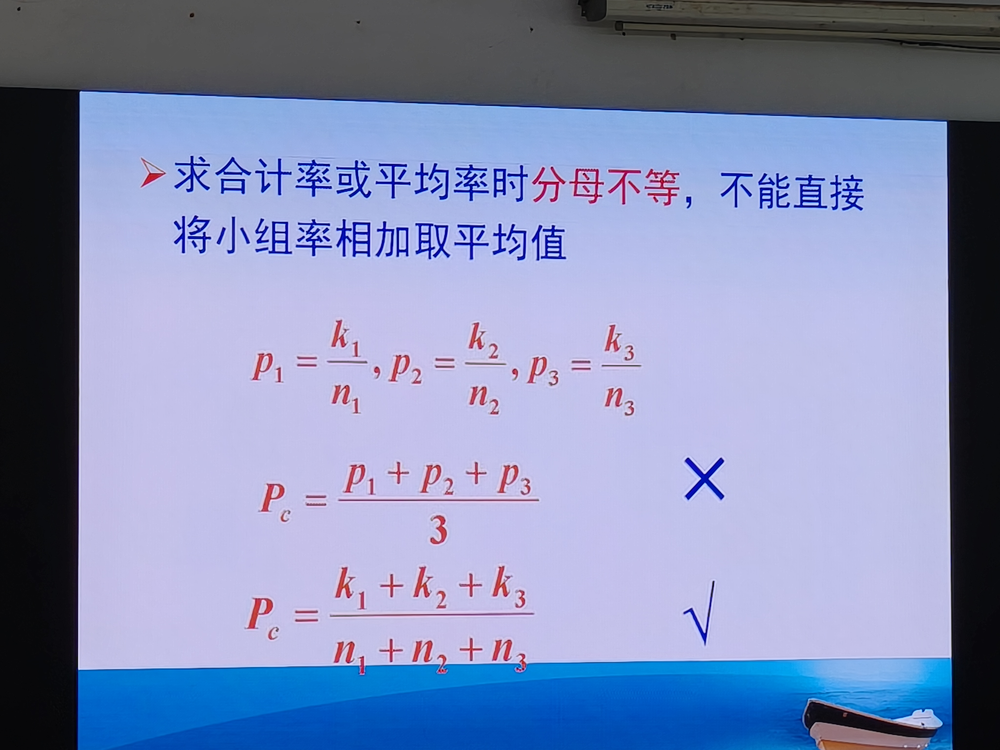
> 📝 **批注（15:24，课堂PPT）**：当分母不等时，不能直接将小组率相加取平均值——错误做法Pc=(p₁+p₂+p₃)/3（标×）；正确做法Pc=(k₁+k₂+k₃)/(n₁+n₂+n₃)（标√）。**合计率=总分子/总分母**。

- **【案例5-8】某地区2005和2006年五种急性传染病死亡情况（教材82页）**（表5-6）：
  - 2005年：伤寒66（10.98%）、流脑54（8.99%）、痢疾420（**69.88%**）、白喉52（8.65%）、百日咳9（1.50%）、合计601（100%）。
  - 2006年：伤寒28（10.61%）、流脑46（17.42%）、痢疾141（**53.41%**）、白喉27（10.23%）、百日咳22（8.33%）、合计264（100%）。
  - 问题5-8（2）：如何解释百分比变化？→ 五种传染病百分比之和为100%，**此消彼长**：2006年痢疾死亡人数大幅减少→其他病（流脑、白喉）构成比相对增高。某部分比重变化可能受两方面影响：**①该部分自身数值变化；②其他部分数值变化**。
- **【案例5-9】某地2003年各年龄组恶性肿瘤死亡（教材82~83页）**（表5-7）：
  - 0~：人口356 980、死亡11、死亡率3.08/10万；15~：232 505、22、9.46；30~：205 032、142、69.26；50~：121 882、443、363.47；70~：20 047、107、533.75；合计936 446、725、**77.42/10万**。
  - 医生的错误算法：P合计=(3.08+9.46+69.26+363.47+533.75)/5=195.80/10万 ❌
  - 正确算法：P合计=725/936 446×10万=**77.42/10万** ✅（分子分母分别相加再除）

### 3.4 四、相对数的比较应注意其可比性

- **核心**：影响相对数高低的因素较多，比较相对数时，除欲对比的因素外，其余影响因素应尽可能**相同或相近**。
- **处理方法**：若各组年龄、性别、病情轻重等构成不同，应考虑**分层比较**（分年龄/性别/病情），或对合计率**标准化后再比较**。
- **【案例5-10】青藏高原高血压（教材83页，标准化引入经典案例）**（表5-8）：
  - 汉族（调查337人、患者29、患病率8.61%）：饮酒100人患病17（17.00%）、不饮酒237人患病12（5.06%）。
  - 藏族（调查1446人、患者206、患病率14.25%）：饮酒980人患病180（18.37%）、不饮酒466人患病26（5.58%）。
  - 医生结论："民族原因是高血压发病危险因素"（藏族合计患病率14.25%>汉族8.61%）。
  - （1）正确吗？→ **不正确**。饮酒与不饮酒组患病率不同→高血压患病与**饮酒有关**。汉族不饮酒者比重大，藏族饮酒者比重大→两组除民族外**饮酒构成不同**→合计患病率**不具备可比性**。
  - （2）正确方法：①**分层比较**（分别比较饮酒组、不饮酒组两个民族间的患病率）；②**直接法计算标准化患病率**再比较；③两样本患病率差异还要做**统计学检验**。
- **相对数比较的两种情况**：
  - **横向比较**：几个单位/地区的同一相对数指标比较（死亡率、患病率等），注意可比性。
  - **纵向比较**：同一地区历年来某指标比较（如20年传染病发病率），注意指标产生背景是否变化。

---

## 第四部分 第三节：动态数列及其应用（教材84~85页）

### 4.1 动态数列（dynamic series）概念

- **定义**：一系列**按照时间顺序排列**的统计指标（包括绝对数、相对数或平均数），用以反映事物或现象在**时间上的变化和发展趋势**。
- **常用分析指标**（4个）：①绝对增长量；②发展速度与增长速度；③平均发展速度与平均增长速度。

> 【知识点5-3】①计算相对数分母不宜过小；②率反映发生频率、构成比表示比重，两者性质不同——构成比总和100%，某部分改变影响其他部分；③计算几个率的合计率不能求平均，应分子分母分别相加相除；④几个率互相比较应注意可比性。

### 4.2 一、绝对增长量

- **定义**：事物现象在一定时期**增长的绝对值**，分两种：
  - **累计增长量**（cumulative quantity of increase）：报告期指标值−某一固定期（基期）指标值（式5-4）。
  - **逐年增长量**：报告期指标值−相邻前期指标值（式5-5）。

### 4.3 二、发展速度与增长速度

- **性质**：都是**相对比指标**，说明事物现象在一定时期的速度变化。
- **发展速度**：报告期指标值水平与固定期/相邻前期相比是其多少倍。
  - **定基比发展速度**：报告期指标值/某一固定期（基期）指标值，a₁/a₀，a₂/a₀，…，aₙ/a₀（式5-6）。反映**总的变动趋势**。
  - **环比发展速度**：报告期指标值/相邻前期指标值，a₁/a₀，a₂/a₁，…，aₙ/aₙ₋₁（式5-7）。反映**逐期变动情况**。
- **增长速度**：发展速度的净增长量——**增长速度=发展速度−1**，说明增长了多少倍。

### 4.4 三、平均发展速度与平均增长速度

- **平均发展速度**：一定时期内各环比发展速度的平均值，说明逐年的平均发展程度，用**几何平均数**计算：

```
平均发展速度 = ⁿ√(aₙ/a₀)    （式5-8，n为间隔期数）
```

- **平均增长速度**：说明逐年平均增长程度：

```
平均增长速度 = 平均发展速度 − 1    （式5-9）
```

- **应用**：动态数列不仅可分析过去的变化规律，也可**预测未来**发生情况（未来几年后指标所达到的水平）。

### 4.5 【案例5-11】男性胃癌发病率动态数列分析（教材84~85页）

- **资料**（表5-9）：某地1988~2002年男性胃癌发病率（1/10万）——1988：106.63、1989：114.41、1990：109.09、1991：103.21、1992：100.81、1993：100.75、1994：98.73、1995：80.95、1996：85.42、1997：86.40、1998：81.81、1999：75.84、2000：83.96、2001：74.28、2002：**65.33**。
- **问题5-11**：15年中变化趋势有何特征？
- **分析**（表5-10）：
  - **定基发展速度**（以1988年为基期）：2002年为0.61（即2002年是1988年的**61%**），总趋势**下降**，发病率减少39%。
  - **环比发展速度**：并非单调下降——1989、1996、1997、2000年有**小幅上升**。
  - **平均每年下降**：1−¹⁴√(65.33/106.63)=**3.44%**（注意是14次方根：15年数据间隔14期）。

---

## 第五部分 第四节：率的标准化（教材86~89页，本课压轴重点）

### 5.1 标准化率的引入与定义

- **问题背景**：比较两个合计率时，若两组对象**内部构成不同**（年龄、性别、病情轻重等），合计率**不具备可比性**——不能直接比较。
- **【案例5-12】扎伊尔埃博拉出血热男女发病率（教材86页）**（表5-11）：
  - 男性：30~岁3150人患病27（8.57‰）、50~岁5014人患病28（5.58‰）、合计8164人患病55（**6.74‰**）。
  - 女性：30~岁6950人患病52（7.48‰）、50~岁2500人患病15（6.00‰）、合计9450人患病67（**7.09‰**）。
  - 医生结论："女性发病率高于男性"。
  - （1）正确吗？→ **不正确**。**各年龄组男性发病率均高于女性**，但女性50岁以下人口比重大→患者数多→合计发病率高。男女人口年龄构成不同→合计率**不可比**。
  - （2）正确方法：①按年龄组分**层比较**；②计算**标准化合计发病率**再比较。
- **标准化率（Standardized rate）**（课堂PPT，15:35）：
  - 又称**调整率（adjusted rate）**，把原率资料按影响因素的**标准构成调整**后计算出来的率。
  - **不代表实际水平**，只是**便于相互比较**。

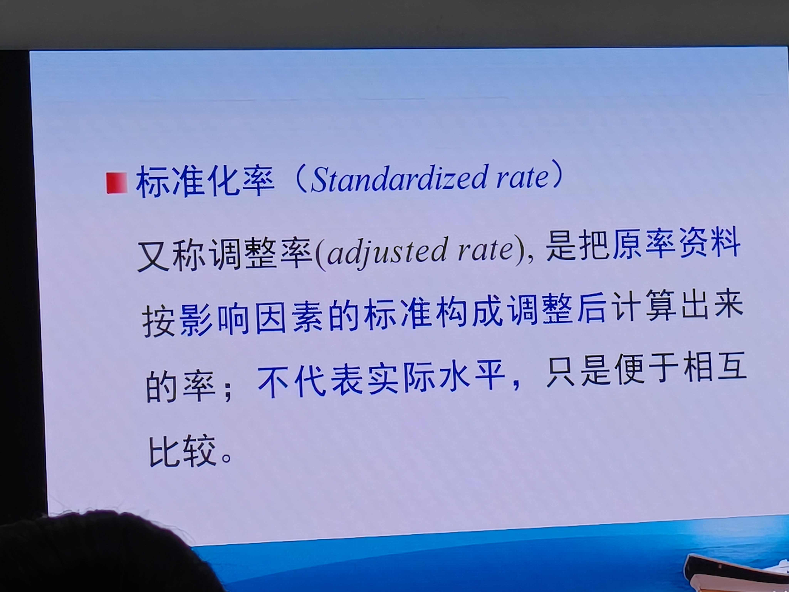
> 📝 **批注（15:35，课堂PPT）**：标准化率又称调整率（adjusted rate）——把原率资料按影响因素的标准构成调整后计算出来的率；**不代表实际水平，只是便于相互比较**。

### 5.2 标准化法的意义和基本思想（教材87页）

- **标准化法（standardization）**：在指定标准构成条件下进行率的对比的方法。当两组对象内部构成差别**足以影响结论**时，应用标准化法消除这种影响，使两个率**具备可比性**。
- **基本思想**：采用**统一的标准构成**，消除年龄、性别、病情轻重、病程长短等因素构成不同对病死率、死亡率、治愈率等的影响，使标准化率具有可比性。
- **扩展**：标准化思想也可用于平均数比较（如比较两医院平均住院天数，需考虑科室构成）。
- **混杂因素（confounding factor）**：指与研究因素有关并对研究结果产生影响的**非研究因素**。标准化法是资料分析阶段控制混杂因素的方法之一。

### 5.3 标准化率的计算——两种方法（课堂PPT对比）

| 方法 | 已知条件 | 适用场景 | 公式 |
|------|---------|---------|------|
| **直接法** | 被标化组**各小组的率**（如年龄别死亡率） | **两组率的对比** | p'=∑Nᵢpᵢ/N 或 p'=∑(Nᵢ/N)pᵢ |
| **间接法** | 被标化组**人口数和总率**＋标准组**各小组率及总率** | **某特殊人群与标准人群比较**（死亡率） | p'=P·r/∑nᵢPᵢ（含SMR） |

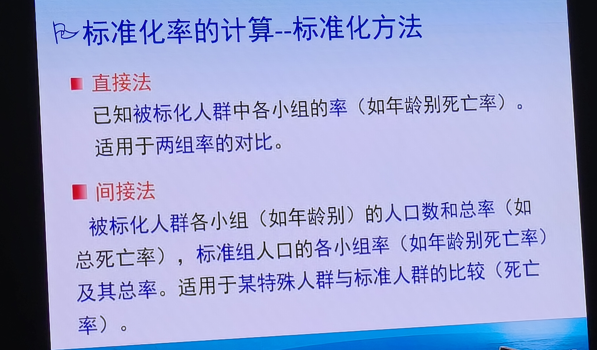
> 📝 **批注（15:36，课堂PPT）**：直接法（已知被标化人群各小组率，适用于两组率对比）vs 间接法（已知被标化人群各小组人口数和总率、标准组各小组率及总率，适用于特殊人群与标准人群比较）。

### 5.4 （一）直接法计算标准化率（教材87页+课堂PPT 15:38）

- **适用**：已知被标化组的**年龄别死亡率pᵢ**时，宜采用直接法。
- **公式**（式5-10）：

```
p' = ∑Nᵢpᵢ / N      （已知标准组人口数时）
p' = ∑(Nᵢ/N)pᵢ      （已知标准组人口构成比时）
```

- **符号含义**（课堂PPT，15:38）：
  - p'：标准化率
  - pᵢ：各组实际死亡率
  - Nᵢ：各组标准人口数
  - N：标准组总人口数
  - **Nᵢpᵢ**：各年龄组的**预期死亡数**（用被标化组年龄别死亡率pᵢ预测标准人口Nᵢ中可能死亡人数）；总预期死亡数∑Nᵢpᵢ除以标准组总人口数N即得标准化率。

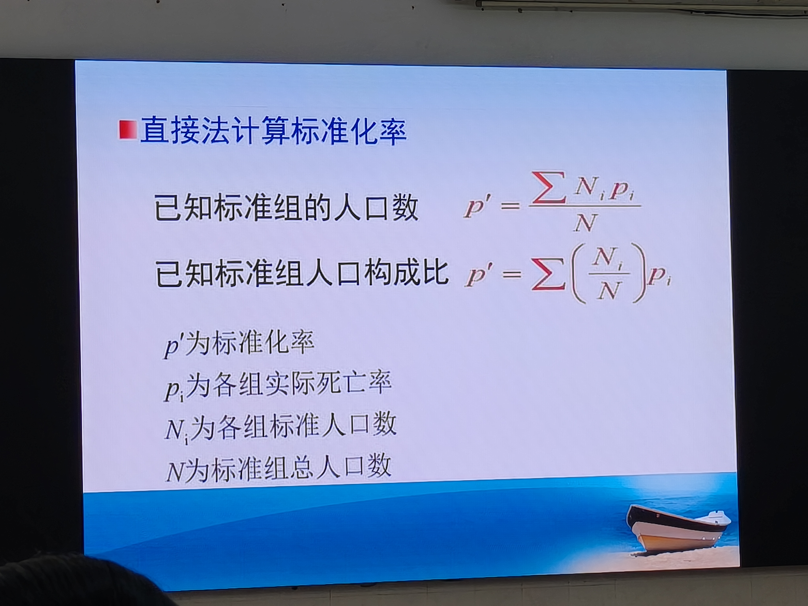
> 📝 **批注（15:38，课堂PPT）**：直接法两个公式——已知标准组人口数：p'=∑Nᵢpᵢ/N；已知标准组人口构成比：p'=∑(Nᵢ/N)pᵢ。符号：p'标准化率、pᵢ各组实际死亡率、Nᵢ各组标准人口数、N标准组总人口数。

- **选择标准构成的三种方法**（课堂PPT，15:37）：
  1. **任选一组资料的人口数（或构成）**作为"共同标准"——适用于直接法。
  2. **两组资料各部分人口数之和**组成的人口数（或构成）作为"共同标准"——适用于直接法。
  3. **选用通用的标准**（全国/全省/全地区数据或抽样调查大样本数据，如年龄别人口数）——适用于直接法和间接法。

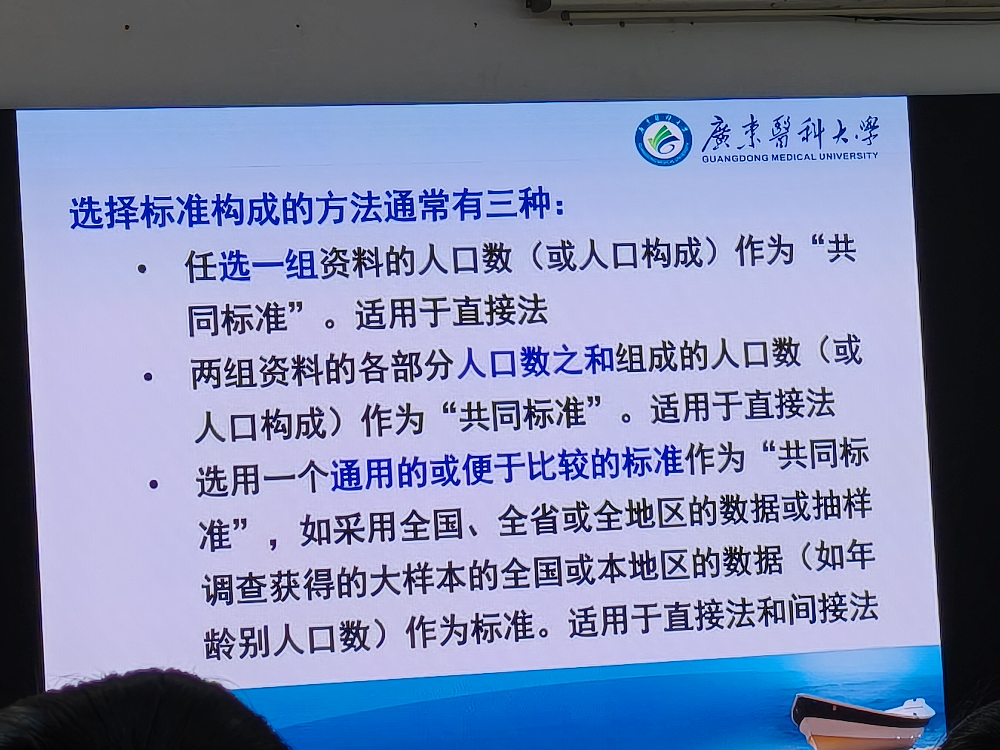
> 📝 **批注（15:37，课堂PPT）**：标准构成选择三法——①任选一组资料的人口数（直接法）；②两组资料人口数之和（直接法）；③通用标准（全国/全省/全地区或大样本数据，直接法与间接法皆可）。**注意：标准选择不同→标准化率数值不同，但比较结论一致**（教材89页知识点5-5第4条）。

- **【案例5-12续】直接法计算男、女标准化发病率（教材88~89页表5-13）**：
  - 以两组资料各年龄组人口数之和为标准（30~：10 100；50~：7 514；合计17 614）。
  - 男性预期患者数：30~=10 100×8.57‰≈87；50~=7 514×5.58‰≈42（表内为129合计）——标准化率 P₁'=129/17 614×100%=**7.32%**。
  - 女性预期患者数：30~=10 100×7.48‰≈76；50~=7 514×6.00‰≈45（表内为115合计）——标准化率 P₂'=115/17 614×100%=**6.53%**。
  - 结论：**标准化后男性发病情况比女性严重**（与各年龄组男性发病率均高于女性的实际一致）。

### 5.5 （二）间接法计算标准化率（教材89页+课堂PPT 15:46）
- **适用**：被标化组**年龄别死亡率pᵢ未知**，只有**年龄别人口数nᵢ和死亡总数r**时；常用于**将某特殊人群与标准人群比较**（如知识分子与当地人群、锡矿工人与当地人群）。
- **公式**（式5-11）：

```
p' = P · r / ∑nᵢPᵢ
```

- **符号**：
  - P：标准组的**合计死亡率**
  - Pᵢ：标准组的**年龄别死亡率**
  - ∑nᵢPᵢ：被标化组的**预期死亡人数**
  - **r/∑nᵢPᵢ = 标准化死亡比（standardized mortality ratio，SMR）**——被标化组实际死亡数与预期死亡数之比。
- **SMR判读**：SMR>1→被标化组死亡数**高于**标准组；SMR<1→**低于**标准组。用SMR乘以标准组合计死亡率P即得间接法标准化死亡率p'。
- **注意**：间接法标准化率的大小与该人群**年龄构成有关**，因此**两个人口年龄构成不同的人群的间接法标准化率一般不能相互比较**。

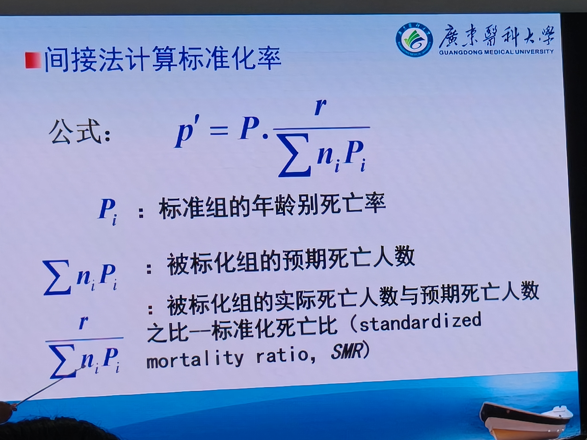
> 📝 **批注（15:46，课堂PPT）**：间接法公式 p'=P·(r/∑nᵢPᵢ)——Pᵢ标准组年龄别死亡率；∑nᵢPᵢ被标化组预期死亡人数；r/∑nᵢPᵢ=标准化死亡比SMR。

- **【案例5-13】某县男性肝癌死亡率（教材89页，间接法完整计算）**（表5-14）：
  - 背景：某县男性人口493 700人，某年肝癌死亡391人→肝癌死亡率391/493 700×10万=**79.20/10万**；所在地区男性肝癌死亡率仅**6.55/10万**。表面看该县严重，但肝癌死亡率受年龄影响（年龄越大越高），需标准化后比较。
  - 步骤：①以该县所在地区男性肝癌死亡率作为标准；②计算预期肝癌死亡人数（假定该县与地区死亡率相同时应有的死亡数）——0~：323 600×0.10=0.32；30~：56 800×0.50=0.28；40~：42 400×6.53=2.77；50~：30 500×17.41=5.31；60~：21 300×35.94=7.66；70~：16 300×71.85=11.71；80~：2 800×65.56=1.84；合计预期死亡**29.89**人。
  - ③求SMR：SMR=实际死亡/预期死亡=391/29.89=**13.08**（远大于1，该县死亡远高于标准）。
  - ④求标准化率：p'=标准总死亡率×SMR=6.55×13.08=**85.67/10万**。
  - 结论：扣除年龄构成影响后，该县男性肝癌标准化死亡率85.67/10万**高于**所在地区6.55/10万→**该县是该地区肝癌高发县**。

### 5.6 应用标准化法应注意的问题（课堂PPT 15:52，必背四条）

1. **选择的标准不同，计算出的标准化率也不相同，但结论相同**。
2. **已知被标化组各年龄段死亡率时，宜采用直接法**；若被标化组各年龄段**人口数太少、年龄别死亡率波动较大**时，宜采用**间接标准化法**。
3. 当所比较的两组内部各分组率呈现**交叉或非平行变化趋势**时，**不宜采用标准化法**，应**分层比较**。
4. 比较样本代表的**总体**标准化率是否不同时，需作**假设检验**。

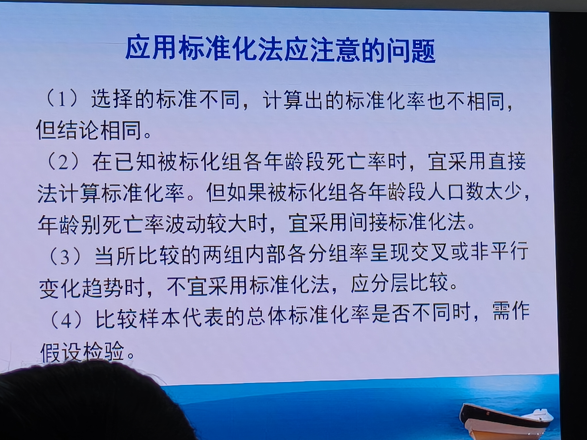
> 📝 **批注（15:52，课堂PPT，本课收尾）**：标准化法四条注意——①标准不同→标准化率不同但结论相同；②已知各组率用直接法，各组人数太少波动大用间接法；③分组率交叉/非平行→不宜标准化，应分层比较；④比较总体标准化率需做假设检验。

---

## 第六部分 全课总结与记忆框架

### 6.1 三大相对数速记表（必背）

| 指标 | 含义 | 公式 | 分子与分母关系 | 典型应用 |
|------|------|------|---------------|----------|
| **率** | 发生频率/强度 | 发生数/可能发生总数×K | 分子是分母的一部分（无时间量纲时≤1） | 患病率、病死率、发病率 |
| **构成比** | 内部比重 | 某组成部分/各组成部分总数×K | 分子是分母的一部分，各构成比之和=100% | 各科住院构成、年龄构成 |
| **相对比** | 两指标之比（倍数） | 甲指标/乙指标（×100%） | 分子分母无包含关系 | 性别比、相对危险度、床护比 |

### 6.2 应用相对数四大注意事项（必背）

1. 计算相对数**分母不宜过小**（观察单位数少→用绝对数或给出置信区间）
2. **不能以构成比代替率**（构成比=比重；率=频率/强度）
3. 计算合计率时**不能简单地相加求平均**（应分子分母分别合计后相除）
4. **率的比较应注意可比性**（构成不同→分层比较或标准化）

### 6.3 动态数列四个指标速记

| 指标 | 计算 | 说明 |
|------|------|------|
| 累计增长量 | 报告期−固定基期 | 总增长量 |
| 逐年增长量 | 报告期−相邻前期 | 逐期增长量 |
| 定基比发展速度 | aₙ/a₀ | 反映**总趋势**；增长速度=发展速度−1 |
| 环比发展速度 | aₙ/aₙ₋₁ | 反映**逐期变动** |
| 平均发展速度 | ⁿ√(aₙ/a₀) | 几何平均数 |
| 平均增长速度 | 平均发展速度−1 | 如胃癌案例每年平均降3.44% |

### 6.4 率的标准化核心要点

- **为什么标准化**：内部构成不同→合计率不可比（案例5-10饮酒构成、案例5-12年龄构成）。
- **直接法**：已知各组率→p'=∑Nᵢpᵢ/N；适用于两组率对比。
- **间接法**：各组率未知→p'=P·r/∑nᵢPᵢ=P×SMR；适用于特殊人群与标准人群比较。
- **SMR**：>1死亡高于标准，<1死亡低于标准（案例5-13：SMR=13.08）。
- **四条注意**：标准不同结论相同；直接/间接法选择；交叉/非平行→分层比较；总体比较需假设检验。
