# 第5课 置信区间与t分布 — 知识点总结

> **本课共13张课堂PPT照片**（拍摄时间10:52~12:01，均为教室投影PPT实拍）
> 授课时间：2026-09-22 10:38
> 教材章节：第六章 参数估计（第一节 均数的抽样误差与标准误；第二节 t分布；第三节 总体均数的估计）
> 授课教师：王老师（统计学）

---

## 一、统计推断总论

### 1.1 什么是统计推断

统计推断（statistical inference）是指**从总体中随机抽取样本，通过样本统计量来推断总体特征**的过程。这是整个卫生统计学的核心环节，也是从今天开始大量使用的一组核心词汇。

整个过程可以用一句话概括：**从总体中进行随机抽样得到样本，再通过样本信息反推总体的分布特征**。这是本节课中"唯一大家能直接理解的过程"。

### 1.2 统计推断的两大组成部分

统计推断主要包括两大部分：

1. **参数估计**（parameter estimation）：用样本统计量估计总体参数
2. **假设检验**（hypothesis testing）：先对总体参数提出假设，再用样本信息判断是否拒绝假设

【考点】老师原话："假设检验是我们下一章的内容，我看周五的课程好像被略掉了，不知道大家假设检验这部分能不能通过自学，到时候看一下要不要补一下那节课。"

> **说明**：由于课程安排原因，假设检验一章可能需要自学。老师建议普通同学尽量补课，因为假设检验涉及很多原理性内容，缺一节课和缺两节课对后续理解影响较大。

### 1.3 引入案例

> 欲了解某地正常成年男性血清胆固醇的平均水平，研究者在该地随机抽取正常成年男性120名，其血清胆固醇均数为3.86（mmol/L），标准差为1.73。据此认为该地正常成年男性血清胆固醇的平均水平为3.86。

这种以样本均数直接代表总体均数的方法，称为**点估计**。它在方向上是正确的，但**不全面**——因为没有考虑抽样误差的存在。这正是本节课要解决的核心问题。

---

## 二、均数的抽样误差与标准误

### 2.1 抽样误差的概念

**抽样误差**（sampling error）：由于**个体变异**的存在，在抽样研究中产生的**样本统计量与总体参数之间**以及**样本统计量之间**的差异。

#### 抽样误差产生的原因

| 层次 | 原因 | 说明 |
|------|------|------|
| 根本原因 | **个体变异** | 每个人的身高、血压、胆固醇等指标本身就不相同，这是客观存在的 |
| 直接原因 | **抽样** | 只要从总体中抽取样本，就必然产生抽样误差 |

【考点】老师原话："只要是个体变异，所以无论谁抽都有这个抽样误差。"

#### 抽样误差的表现形式

1. **样本统计量与总体参数之间**存在差异（样本均数 ≠ 总体均数）
2. **样本统计量与样本统计量之间**也存在差异（不同样本的均数互不相等）

#### 抽样误差的性质

- **不可避免**：只要抽样就一定有抽样误差
- **有规律可循**：抽样误差的大小可以用特定指标来衡量

【考点】老师原话："抽样误差是不可避免的，但抽样误差有它的规律。"

### 2.2 样本均数的抽样分布

#### 上帝视角案例

假设已知某地正常成年男性红细胞数的总体均数 μ = 5.00（×10¹²/L），从该总体中每次随机抽取 n=10 的样本，重复抽取100次，计算每一个样本的均数：

- 第1个样本均数：4.03
- 第2个样本均数：4.817
- 第3个样本均数：……
- ……

将这100个样本均数整理成频数分布表并绘制频数分布图，可以观察到以下规律：

#### 样本均数的分布特征

1. **各样本均数未必等于总体均数**：虽然总体均数已知为5.00，但绝大多数样本均数并不恰好等于5
2. **各样本均数之间也存在差异**：抽100次得到100个不同的均数值
3. **样本均数的分布有一定规律**：
   - 从正态总体中随机抽取样本量为 n 的样本时，**样本均数也服从正态分布**
   - **样本均数的均数 = 总体均数 μ**（把100个样本均数再求平均，结果趋近于总体均数）
4. **样本均数的变异范围比原变量的变异范围小**：因为每个样本均数已经经过一次平均，原数据中的极端值在平均过程中被削弱了

#### 中心极限定理

**中心极限定理**（central limit theorem）：

- 从正态总体中随机抽取例数为 n 的样本，样本均数服从正态分布
- **即使原总体不是正态分布（而是偏态分布），只要样本量 n 足够大，样本均数也近似服从正态分布**

> 老师说明：中心极限定理的目的是告诉你——无论总体是正态还是偏态，只要抽样例数足够多，样本均数这一大串值就会服从正态分布。这是后面所有统计推断方法的理论基础。

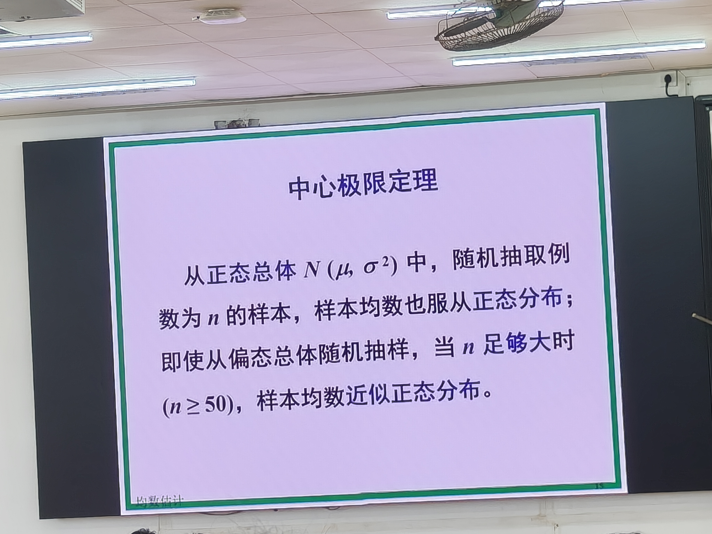

> 📝 **PPT原文**：从正态总体 N(μ, σ²) 中，随机抽取例数为 n 的样本，样本均数也服从正态分布；即使从偏态总体随机抽样，当 n 足够大时（**n≥50**），样本均数近似正态分布。
>
> 💡 **纠错**：PPT明确标注偏态总体近似正态的阈值为 **n≥50**，这与后文"σ未知但n>50时用z近似"的规则一致。

### 2.3 标准误的概念与计算

#### 标准误的定义

**标准误**（standard error, SE）：**样本均数的标准差**，说明样本均数围绕总体均数的离散程度，用来**反映抽样误差的大小**。

> 老师强调："标准误就是样本均数的标准差。"注意不是总体均数的标准差，而是样本均数这个集合的标准差。

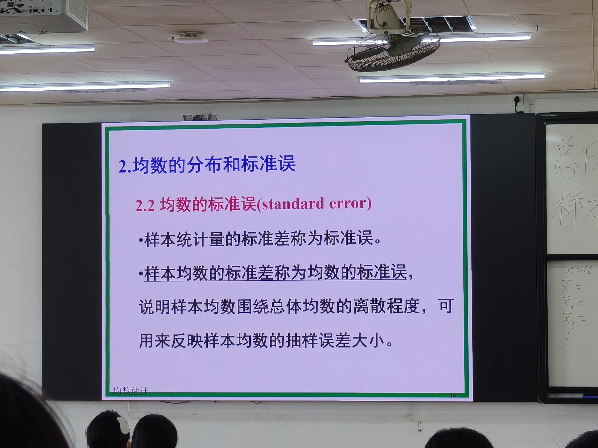

> 📝 **PPT原文**：2.2 均数的标准误(standard error)。①样本统计量的标准差称为标准误；②样本均数的标准差称为均数的标准误，说明样本均数围绕总体均数的离散程度，可用来反映样本均数的抽样误差大小。

【考点】论文写作规范：样本均数表示为 X̄ ± **SD**（标准差，standard deviation），**不是** X̄ ± SE。SE 是标准误，与 SD 是两个完全不同的指标。老师在审阅研究生论文时发现不少人把 SD 写成 SE，这是错误的。

#### 标准误的计算公式

**（1）总体标准差 σ 已知时：**

$$\sigma_{\bar{X}} = \frac{\sigma}{\sqrt{n}}$$

其中 σ 为总体标准差，n 为样本量。

**（2）总体标准差 σ 未知时（实际工作中绝大多数情况）：**

用样本标准差 S 代替总体标准差 σ：

$$S_{\bar{X}} = \frac{S}{\sqrt{n}}$$

> 这就是今天最重要的公式之一：**标准误 = 样本标准差 / √n**

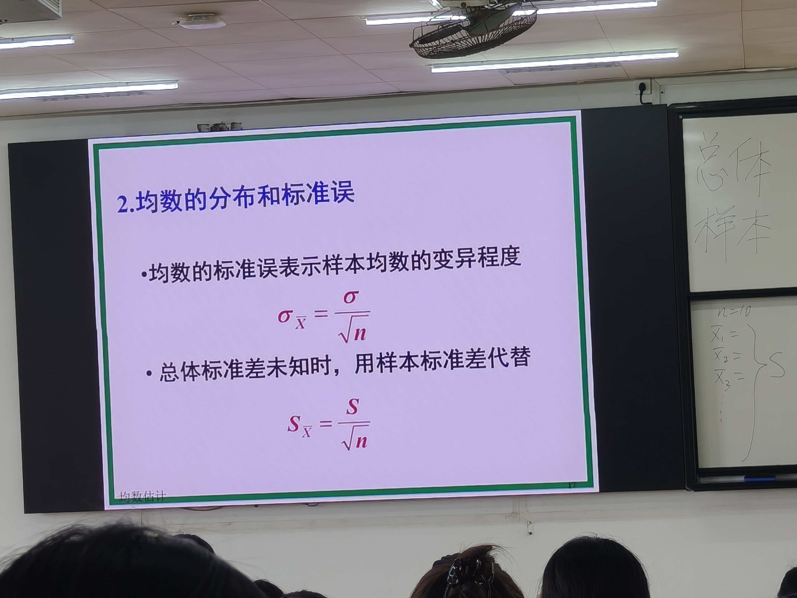

> 📝 **PPT原文**：均数的标准误表示样本均数的变异程度。σ_X̄ = σ/√n。总体标准差未知时，用样本标准差代替：S_X̄ = S/√n。

#### 计算示例

教材例6-2：总体标准差 σ = 0.43，样本量 n = 10

$$S_{\bar{X}} = \frac{0.43}{\sqrt{10}} \approx \frac{0.43}{3.162} \approx 0.136$$

### 2.4 标准误的性质与规律

#### 标准误与标准差、样本量的关系

| 关系 | 说明 |
|------|------|
| 标准误与标准差 | **成正比**：标准差越大，标准误越大 |
| 标准误与样本量 | **与 √n 成反比**：样本量越大，标准误越小 |

#### 极限情况

当样本量 n 趋于无穷大时，样本标准差 S 趋于稳定值，此时标准误趋于零——即抽样误差趋于零，样本均数趋近于总体均数。

【考点·执业医师高频考点】老师原话："**增大样本含量是减小抽样误差的唯一方法**，其他的乱糟糟的方法都没有效果。这个执业医师考试已经出现过非常多次了。"

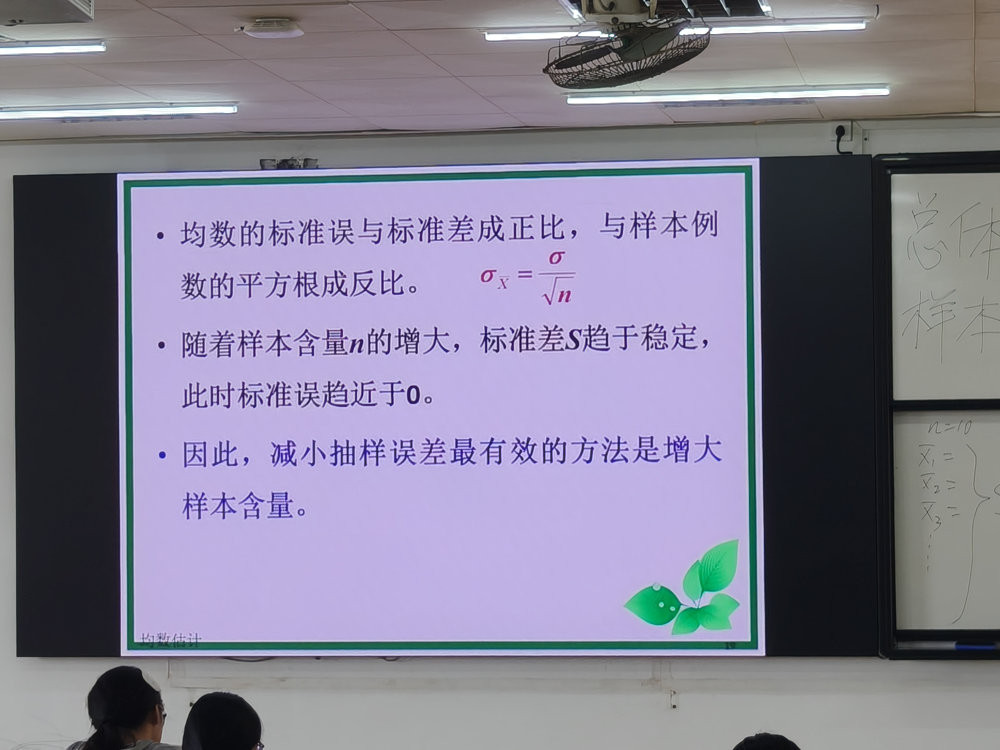

> 📝 **PPT原文**：①均数的标准误与标准差成正比，与样本例数的平方根成反比（σ_X̄=σ/√n）；②随着样本含量n的增大，标准差S趋于稳定，此时标准误趋近于0；③因此，减小抽样误差最有效的方法是增大样本含量。

#### 思考题：抽样误差减半需要多大样本量？

如果想让标准误（抽样误差）减小为原来的1/2，由于 SE = S/√n，要让 SE ÷ 2，则 √n 需要变为原来的2倍，即 **n 需要增大到原来的4倍**。

### 2.5 标准误的应用

1. **反映抽样误差的大小**：标准误越大，说明抽样误差越大，样本均数估计总体均数的可靠性越差
2. **反映样本均数的可靠性**：抽样误差越小，用样本均数推断总体均数的可靠性越好
3. **用于参数估计**：计算置信区间
4. **用于假设检验**：t检验等方法的基础

> 举例说明可靠性：如果用我们班3个男生的平均身高来推断全球男性总体身高水平，此时样本量极小，标准误极大，抽样误差极大，可靠性极差。反之，大样本的标准误小，可靠性好。

### 2.6 标准差与标准误的联系与区别

【考点·简答题高频】老师原话："这一章没有什么可以出简答题的，通常就会出这样的简答题。"

| 比较项目 | 标准差（S） | 标准误（S_x̄） |
|----------|-------------|---------------|
| **含义** | 表示个体观测值之间的变异程度 | 表示样本均数之间的变异程度，说明抽样误差大小 |
| **用途** | 制定医学参考值范围；描述个体值的波动 | 总体均数的区间估计；假设检验 |
| **公式** | S = √[Σ(X−X̄)²/(n−1)] | S_x̄ = S/√n |
| **联系** | 当样本量 n 一定时，标准误与标准差成正比——标准差越大，标准误也越大 |

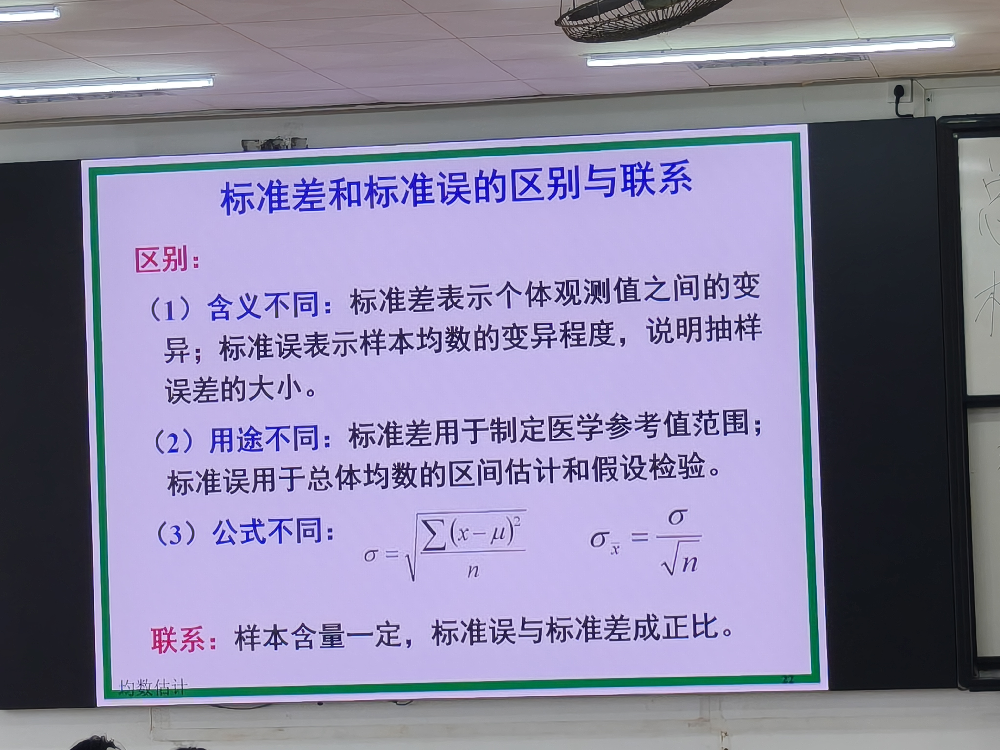

> 📝 **PPT原文**：区别——(1)含义不同：标准差表示个体观测值之间的变异；标准误表示样本均数的变异程度，说明抽样误差的大小。(2)用途不同：标准差用于制定医学参考值范围；标准误用于总体均数的区间估计和假设检验。(3)公式不同：σ=√[Σ(x−μ)²/n]，σ_X̄=σ/√n。联系：样本含量一定，标准误与标准差成正比。
>
> 💡 **纠错**：PPT中总体标准差公式为 σ=√[Σ(x−μ)²/**n**]（除以n），这是**总体**标准差公式；样本标准差才除以(n−1)。两者不要混淆。

---

## 三、t分布

### 3.1 从z分布到t分布的推导

#### 标准正态分布的标准化

在总体标准差 σ 已知时，样本均数服从正态分布，可以通过标准化变换转化为标准正态分布（z分布）：

$$z = \frac{\bar{X} - \mu}{\sigma_{\bar{X}}} = \frac{\bar{X} - \mu}{\sigma/\sqrt{n}}$$

变换后 z 服从标准正态分布 N(0,1)。

#### 总体标准差未知时的问题

**在实际工作中，总体标准差 σ 通常是未知的。**此时用样本标准差 S 代替 σ，变换后得到的统计量不再服从标准正态分布，而是服从一种新的分布——**t分布**：

$$t = \frac{\bar{X} - \mu}{S_{\bar{X}}} = \frac{\bar{X} - \mu}{S/\sqrt{n}}$$

### 3.2 t分布的概念

从正态总体中进行无数次样本量为 n 的随机抽样，每抽一次计算一个 X̄ 和一个 S，再根据上述公式计算出一个 t 值。无数个 t 值的分布就构成了 **t分布**。

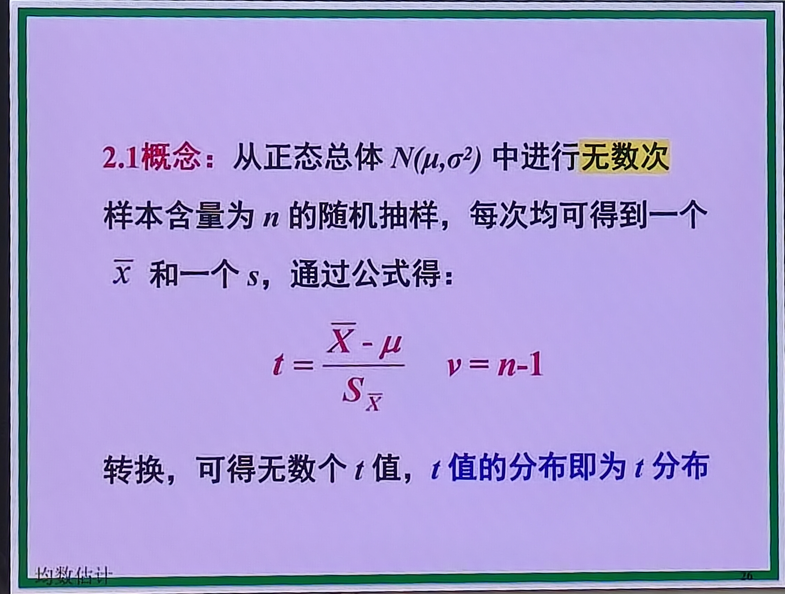

> 📝 **PPT原文**：2.1概念——从正态总体 N(μ,σ²) 中进行**无数次**样本含量为 n 的随机抽样，每次均可得到一个 X̄ 和一个 s，通过公式 t=(X̄−μ)/S_X̄，ν=n−1 转换，可得无数个 t 值，t 值的分布即为 t 分布。

### 3.3 自由度

**自由度**（degree of freedom, df，符号 ν，读作"nu"）：计算统计量时，能够自由取值的变量个数。

本节课最常用的自由度公式：

$$\nu = n - 1$$

> 老师解释：因为在计算样本标准差 S 的过程中用到了样本均数 X̄，这相当于限制了一个自由度，所以要减1。老师补充："我们通常用 n−1，大家记住就行了，后面每一个环节都会有自由度的东西。"

> 注意：在更复杂的统计方法（如方差分析）中，自由度可能是 n−2、n−7 等，不是永远 n−1。本节课学的是最简单的情况。

### 3.4 t分布的特征

【考点】t分布的五大特征（选择题高频）：

1. **以0为中心，左右对称**：与标准正态分布相似
2. **t分布是一簇曲线**：不是一条曲线，而是**多条曲线**，曲线的形状与自由度有关
   - 老师强调："t分布不像标准正态分布，它是一簇曲线，不是一条曲线。它究竟用哪一根曲线，取决于自由度。"
3. **自由度趋于无穷大时，t分布逼近标准正态分布（z分布）**：当 ν→∞ 时，t分布 = z分布
4. **t分布曲线下的总面积为1**：与正态分布一样
5. **t分布的峰值比标准正态分布低，尾部比标准正态分布高（厚尾）**：自由度越小，这种偏离越明显

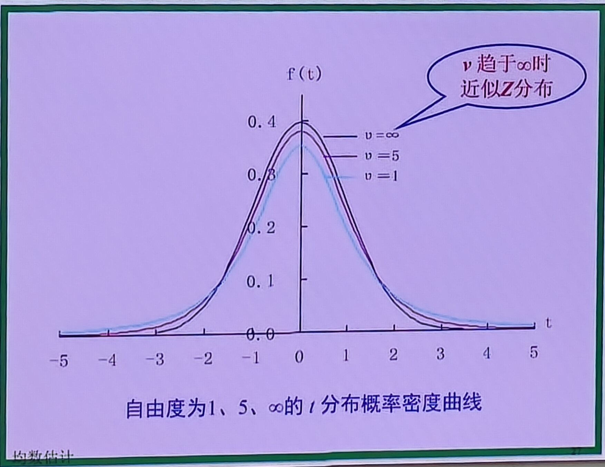

> 📝 **PPT图示**：自由度为1、5、∞的 t 分布概率密度曲线。ν=∞时峰值最高（逼近标准正态分布），ν=5次之，ν=1最低、尾部最厚。标注"ν趋于∞时近似Z分布"。

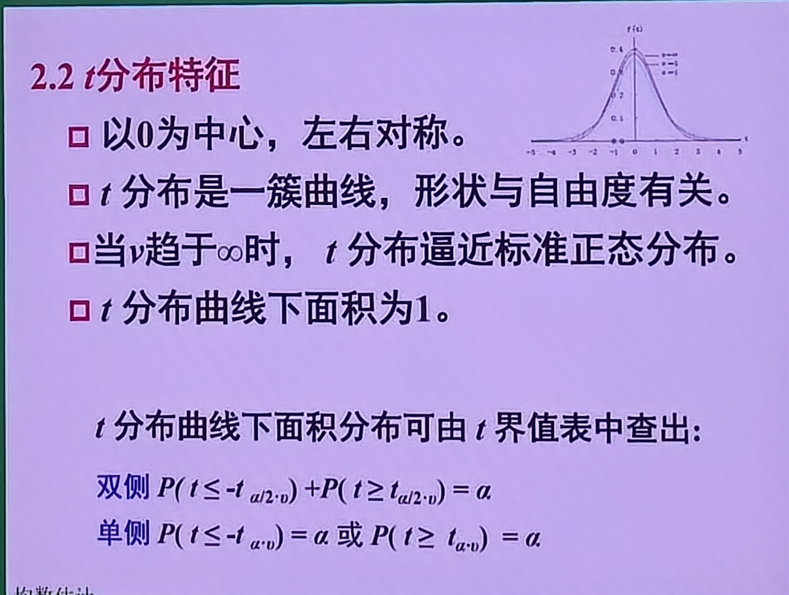

> 📝 **PPT原文**：2.2 t分布特征——①以0为中心，左右对称；②t分布是一簇曲线，形状与自由度有关；③当ν趋于∞时，t分布逼近标准正态分布；④t分布曲线下面积为1。
>
> 📝 **单侧/双侧公式**：双侧 P(t≤−t_{α/2,ν})+P(t≥t_{α/2,ν})=α；单侧 P(t≤−t_{α,ν})=α 或 P(t≥t_{α,ν})=α。

### 3.5 t界值表

#### t界值表的结构

教材附表（约425页）的 t 界值表结构：

- **第一列**：自由度 ν（注意表中用 n' 表示，不是 v）
- **第一行**：概率 P（即 α 值），分为**单侧**（one tail）和**双侧**（two tail）
- **表体**：对应的 t 界值

#### 查表步骤

【考点】查 t 界值表三步走：

1. **确定自由度 ν**（ν = n − 1）
2. **确定单侧还是双侧**（根据研究目的）
3. **确定 α 值**（通常取0.05或0.01）

#### 查表示例

**例1**：ν = 9，α = 0.05，单侧 → t = 1.833

**例2**：ν = 9，α = 0.05，双侧 → t = 2.262

**例3**：ν = 11，α = 0.05/2（即双侧0.05）→ t = 2.201

#### t界值表的规律

【考点】t界值表四大规律（几乎每道题都考）：

| 规律 | 说明 |
|------|------|
| **自由度相同时，t界值越大，P值越小** | t值越大，超出该值的尾部面积越小，P值越小 |
| **P值（α）相同时，自由度越大，t界值越小** | 自由度越大，曲线越接近正态，所需界值越小 |
| **t值相等时，双侧概率为单侧概率的两倍** | 双侧α = 2 × 单侧α |
| **自由度趋于无穷大时，t界值 = z界值** | ν→∞时，t分布=z分布，如双侧0.05时 t=1.96=z₀.₀₅/₂ |

> 老师强调："自由度相同的时候，t界值越大，对应的P值越小。这道题非常容易，几乎每道题都要考。"

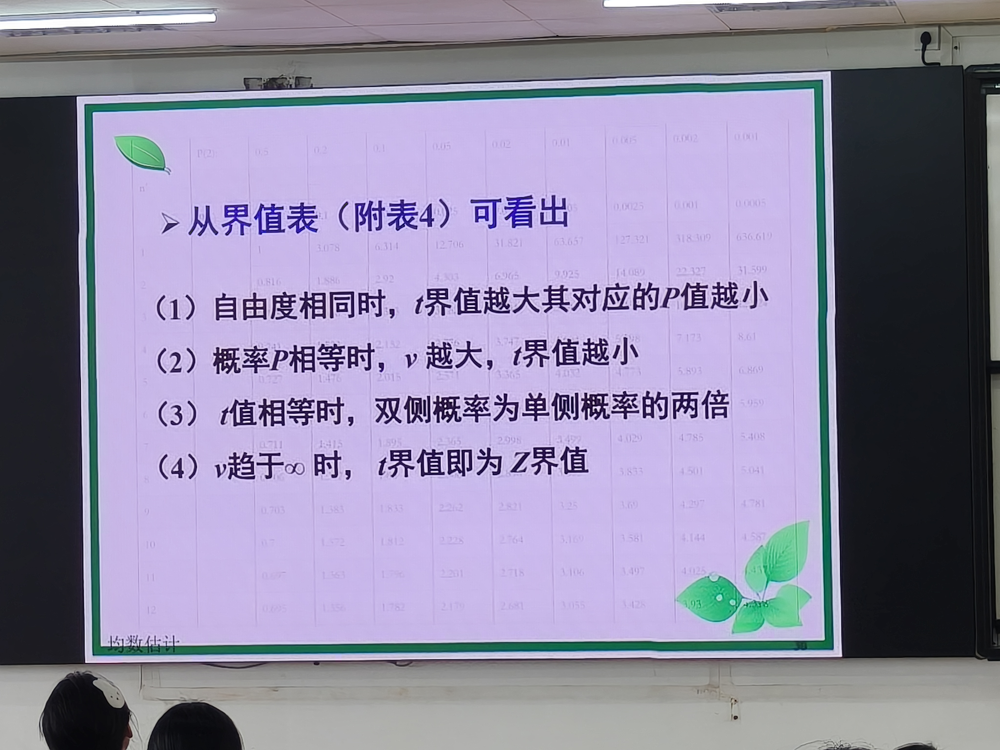

> 📝 **PPT原文**：从界值表（附表4）可看出——(1)自由度相同时，t界值越大其对应的P值越小；(2)概率P相等时，ν越大，t界值越小；(3)t值相等时，双侧概率为单侧概率的两倍；(4)ν趋于∞时，t界值即为Z界值。

---

## 四、参数估计

### 4.1 参数估计的两种方法

参数估计包括**点估计**和**区间估计**两种方法。

### 4.2 点估计

**点估计**（point estimation）：直接用样本统计量（如样本均数 X̄）来估计总体参数（如总体均数 μ）。

例如：用120名正常成年男性的血清胆固醇均数3.86，直接作为该地正常成年男性血清胆固醇总体均数的估计值。

**点估计的缺点**：
- 没有考虑抽样误差的影响
- 无法评价参数估计的准确程度
- 只给出一个点值，不知道这个值的可靠性如何

### 4.3 区间估计

#### 基本思想

区间估计（interval estimation）：假设总体均数为 μ，我们需要找到两个值 a 和 b，使得区间 (a, b) 以一定的可信度（如95%）包含 μ。

从数轴上看：总体均数 μ 是一个固定但未知的点，我们通过样本计算出一个区间 (a, b)，希望这个区间能够"罩住" μ。

#### 置信区间的定义

**置信区间**（confidence interval, CI）：按一定的概率或可信度，估计包含未知总体参数的可能范围。

- **可信度/置信度**（confidence level）：预先给定的概率 1−α，通常取 **95%** 或 **99%**
- **置信限**（confidence limit）：置信区间的上下限，分别记为 C_L（下限）和 C_U（上限）
- 置信区间是**开区间**——即不包括上下限本身

> 【考点】老师反复强调：写作业或考试时写 **CI** 或 **95%CI**，**千万不要写成"95%氯气""95%Cl"之类的化学符号**。CI 是 confidence interval 的缩写，跟化学成分没有任何关系。

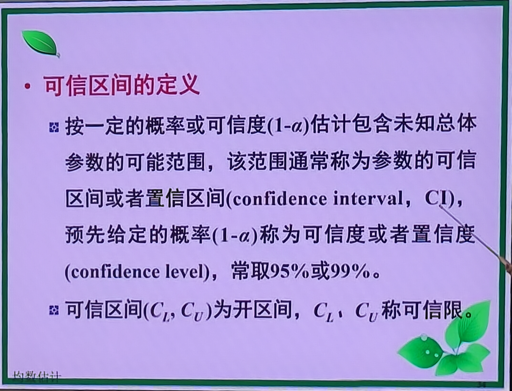

> 📝 **PPT原文**：可信区间的定义——按一定的概率或可信度(1−α)估计包含未知总体参数的可能范围，该范围通常称为参数的可信区间或者置信区间(confidence interval, CI)，预先给定的概率(1−α)称为可信度或者置信度(confidence level)，常取95%或99%。可信区间(C_L, C_U)为开区间，C_L、C_U称可信限。

#### 置信区间的计算公式

根据已知条件的不同，置信区间的计算分为三种情况：

**情况一：总体标准差 σ 已知（用 z 分布）**

$$\bar{X} \pm z_{\alpha/2} \cdot \frac{\sigma}{\sqrt{n}}$$

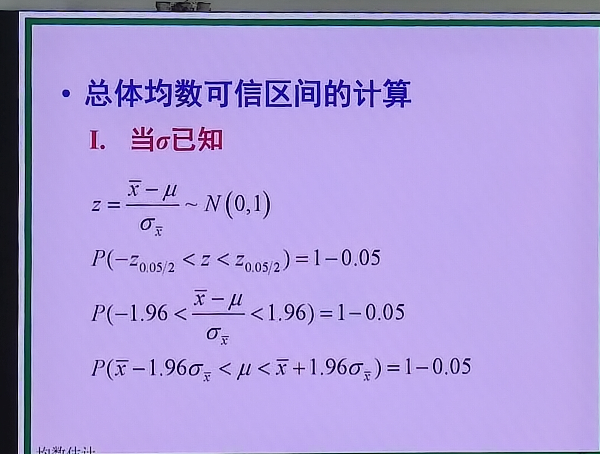

> 📝 **PPT原文**：当σ已知时，z=(X̄−μ)/σ_X̄ ~ N(0,1)。由 P(−z_{0.05/2}<z<z_{0.05/2})=1−0.05，代入 z 变换式，经不等式变形得：P(X̄−1.96σ_X̄ < μ < X̄+1.96σ_X̄)=1−0.05。即95%置信区间为 X̄±1.96σ_X̄。

**情况二：总体标准差 σ 未知，但样本量 n 足够大（n > 50，仍用 z 分布近似）**

$$\bar{X} \pm z_{\alpha/2} \cdot \frac{S}{\sqrt{n}}$$

> 此时用样本标准误 S/√n 代替总体标准误，因为 n 足够大，t 分布近似 z 分布。

**情况三：总体标准差 σ 未知，且样本量 n 较小（n < 50，用 t 分布）**

$$\bar{X} \pm t_{\alpha/2, \nu} \cdot \frac{S}{\sqrt{n}}$$

> 这是最常用的情况。注意 t 界值比 z 界值多一个自由度参数 ν。

#### 三种情况总结表

| 条件 | 分布 | 界值 | 标准误用什么 |
|------|------|------|-------------|
| 总体标准差 σ 已知 | z分布 | z界值（如1.96） | 总体标准误 σ/√n |
| σ 未知，n > 50 | z分布（近似） | z界值（如1.96） | 样本标准误 S/√n |
| σ 未知，n < 50 | t分布 | t界值（需查自由度） | 样本标准误 S/√n |

#### 双侧与单侧置信区间

**双侧置信区间**：估计总体均数在某两个值之间（a < μ < b），适用于总体均数可能偏高也可能偏低的情况。

**单侧置信区间**：只关心总体均数是否不高于某值（μ < b）或不低于某值（μ > a）。

> 老师举例：食品中有害物质（如亚硝酸盐、三聚氰胺）的含量——我们只关心它**不高于**某个安全限值，不关心"不低于"，所以用**单侧**置信区间。
>
> 老师举例：牛奶中蛋白质含量——国家标准要求**不低于**某值（如≥2.9g/100mL），这种也用单侧。

#### 计算示例1（大样本，z分布）

教材例6-1：n=120，X̄=3.86，S=1.73，求95%置信区间。

解：n=120 > 50，用 z 分布：

$$\bar{X} \pm z_{0.05/2} \cdot \frac{S}{\sqrt{n}} = 3.86 \pm 1.96 \times \frac{1.73}{\sqrt{120}}$$

结论：该地正常成年男性血清胆固醇平均水平的95%置信区间为 (3.55, 4.17) mmol/L。

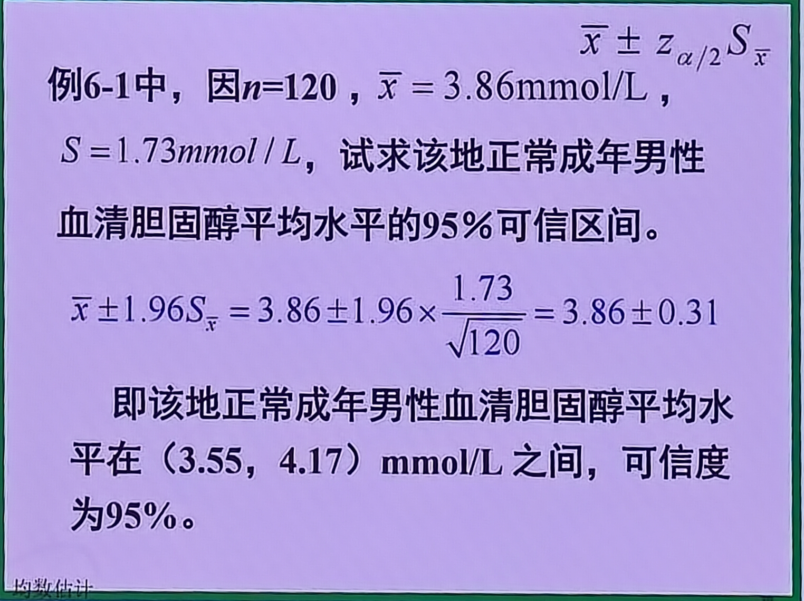

> 📝 **PPT原文**：例6-1中，因n=120，X̄=3.86mmol/L，S=1.73mmol/L，试求该地正常成年男性血清胆固醇平均水平的95%可信区间。X̄±1.96S_X̄ = 3.86±1.96×1.73/√120 = 3.86±0.31。即该地正常成年男性血清胆固醇平均水平在（3.55，4.17）mmol/L之间，可信度为95%。

#### 计算示例2（小样本，t分布，单侧）

教材案例：某批罐头亚硝酸盐含量，抽取10罐测定，计算样本均数和标准差，求95%置信区间。

解：n=10 < 50，且总体标准差未知 → 用 t 分布。

亚硝酸盐含量只关心不高于某值 → **单侧**。

自由度 ν = n − 1 = 10 − 1 = 9

查 t 界值表：ν=9，α=0.05，单侧 → t = 1.833

$$\bar{X} + t_{0.05, 9} \cdot \frac{S}{\sqrt{n}}$$

结论：该批罐头亚硝酸盐平均含量的95%置信区间为不高于某值（单侧上限）。

> 老师提醒：注意这是**单侧**置信区间，只有上限有意义，不要查成双侧。

---

## 五、置信区间的含义

### 5.1 理论含义（上帝视角）

从正态总体中进行随机抽样，理论上可以得到无限多个样本均数 X̄，对每一个样本均数都计算一个95%置信区间。

结果是：**这无数个置信区间中，约95%的区间包含总体均数 μ，约5%的区间不包含 μ**。

> 老师解释：为什么不是100%？因为如果要100%包含，就需要把整个总体都纳入样本——总体有1亿人，样本就要抽1亿人，那不叫抽样了，那叫普查。

### 5.2 实际含义

在实际研究中，我们**只做一次抽样**，只得到一个样本，只计算一个置信区间。

那么这个置信区间的含义是：**我们有95%的把握认为这个区间包含了总体均数 μ**。

> 老师强调："统计学当中谈的都是概率的问题。我们只有95%的可能包含了某一个值，不会说是一定、绝对。"
>
> 【考点】老师原话："在统计学的考试题当中，出现'一定''必然'一些非常极端的确定的词的时候，就要注意了，通常情况下它都是错的。"

### 5.3 α 的含义

**α（检验水准/显著性水准）**：在一次抽样过程中**犯错的概率**。

- 95%置信区间 → α = 0.05 → 犯错概率为5%
- 99%置信区间 → α = 0.01 → 犯错概率为1%

---

## 六、置信区间的两个要素

### 6.1 可信度（可靠性）

**可信度**（confidence level）：即 1−α，反映置信区间包含总体参数的概率大小。

- 可信度越高（如99%），犯错概率越小（α=0.01）
- 可信度越低（如90%），犯错概率越大（α=0.10）

> 老师补充：未来投学术论文时，报告结果除了 X̄±SD，通常还要求报告置信区间。

### 6.2 精确度

**精确度**：即置信区间的宽度（b − a）。

- 区间越窄 → 精确度越高
- 区间越宽 → 精确度越低

### 6.3 可信度与精确度的关系

【考点】二者需要**兼顾**：

- 可信度越高（α越小，如取0.01）→ 区间越宽 → 精确度越低
- 可信度越低（α越大，如取0.10）→ 区间越窄 → 精确度越高
- **在样本量固定时，提高可信度必然降低精确度，反之亦然**
- 要同时提高可信度和精确度，唯一的方法是**增大样本量 n**

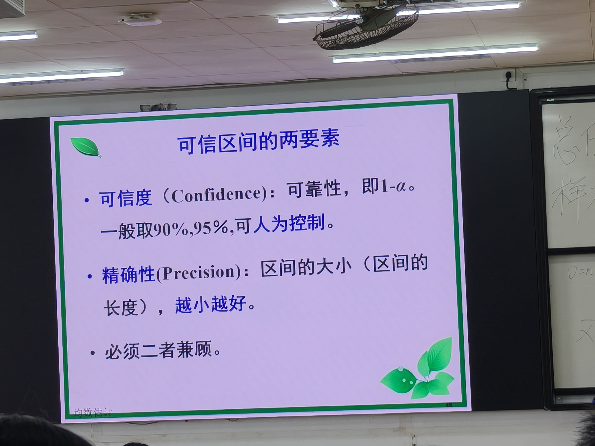

> 📝 **PPT原文**：可信区间的两要素——①可信度（Confidence）：可靠性，即1−α，一般取90%,95%，可人为控制；②精确性(Precision)：区间的大小（区间的长度），越小越好；③必须二者兼顾。
>
> 💡 **补充**：PPT明确写"一般取90%,95%"，与定义页"常取95%或99%"略有出入——实际应用中90%、95%、99%均可，教材最常用95%和99%。

---

## 七、课堂练习与真题解析

### 练习题1

> 从同一总体中随机抽样，样本均数的抽样标准差是指什么？样本量增大时标准误如何变化？

**解析**：
- "样本均数的抽样标准差"= 标准误 = S/√n（老师指出：执医考试喜欢用复杂的说法来混淆视听，"样本均数的抽样标准差"就是标准误）
- 标准误与 √n 成反比 → 样本量增大 → 标准误**减小**
- 答案选 D

### 练习题2

> 关于 t 分布，下列说法错误的是？

**解析**：
- A. t分布形态与自由度有关 ✓ 正确
- B. t分布以0为中心左右对称 ✓ 正确
- C. 自由度趋于无穷时t分布逼近正态分布 ✓ 正确
- D. t分布曲线下面积为1 ✓ 正确
- E. t越小，P越小 ✗ **错误**（正确说法：**t越大，P越小**；t越小，P越大）

> 老师强调：t界值与P值的关系是**反比**——t越大，超出该值的尾部面积越小，P越小。选项把方向说反了，所以错误。答案选 E。

---

## 八、本节课核心公式汇总

| 公式名称 | 公式 | 适用条件 |
|----------|------|----------|
| 自由度 | ν = n − 1 | t分布、t检验 |
| 标准误（总体σ已知） | S_x̄ = σ/√n | 总体标准差已知 |
| 标准误（总体σ未知） | S_x̄ = S/√n | 实际常用 |
| 置信区间（σ已知） | X̄ ± z_{α/2}·σ/√n | 总体标准差已知 |
| 置信区间（σ未知，n>50） | X̄ ± z_{α/2}·S/√n | 大样本，z近似 |
| 置信区间（σ未知，n<50） | X̄ ± t_{α/2,ν}·S/√n | 小样本，t分布 |

---

## 九、本节课两大公式记忆口诀

【考点】老师原话："今天学了两个公式：第一个是自由度等于 n−1；第二个是标准误等于 S/√n。"

1. **自由度**：ν = n − 1
2. **标准误**：S_x̄ = S / √n

> 这两个公式是本节课的核心，也是后续 t 检验、方差分析等所有内容的基础，必须牢记。

---

## 十、学习提示与后续衔接

### 10.1 本节课在课程中的位置

本节课是从**统计描述**转向**统计推断**的关键一课。前四节课学的是"怎么描述数据"（集中趋势、离散趋势、正态分布、相对数），从本节课开始学"怎么用样本推断总体"。

### 10.2 与下节课（假设检验）的衔接

老师说："其实大家已经完全可以实现下下节课的主要内容了。下下节课讲 t 检验，是从假设检验的角度来进行的。但是大家如果现在能理解，那下下节课听起来就没有任何压力了。"

也就是说，本节课学的 t 分布和置信区间，本质上已经为下节课的 t 检验打下了基础——t 检验用的统计量就是 t 值，t 界值表就是下节课查 P 值用的表。

### 10.3 老师建议

- 假设检验一章如果自学有困难，尽量补课
- 所有统计量的计算都会涉及自由度，不要忘记写
- 注意区分标准差（SD）和标准误（SE），论文写作中不要写错
- 注意区分双侧和单侧，根据研究目的选择
