# 第10课 动脉血压影响因素与波动特性（教材精讲版·扩写）

> **说明**：本课课堂照片22张（16张动脉血压内容+6张心肌特性复习内容），已按知识点位置插入并附📝批注（均见 `./照片/` 子目录）。
>
> 教材：《生理学》第10版，罗自强/管又飞主编，人民卫生出版社，2024年，第四章 血液循环 第三/四节（P109~P115）
> 授课时间：2026-10-12 14:28
> 教师：田晓玲
> 课型：血管生理开篇 · 动脉血压形成与影响因素（循环系统重点考点）
>
> 📌 **课堂结构**：本课前约60分钟用来收尾心肌电生理——复习兴奋性周期变化与收缩的关系、期前收缩/代偿间歇、不应期离散度与除颤，然后讲完**传导性、自律性、收缩性**三大剩余生理特性，并用II导联心电图把"三波三间期"对应到心肌电活动；后半段正式进入**血管生理**：血管分类与结构、血流动力学（泊肃叶定律/血流阻力）、动脉血压形成四条件、收缩压/舒张压/脉压/平均动脉压、血压正常标准与昼夜波动、影响动脉血压五因素（重点考点），并由教材补全静脉血压/CVP/静脉回流"两体三泵"。
>
> ⚠️ 课堂通知：循环系统专项测试在循环章结束后24小时内进行，仅10分钟、中午13:00或傍晚19:00两个时段、闭卷不能查资料。

---

# 第一部分　心肌生理特性收尾（复习，承接第9课）

## 1.1 兴奋性周期变化与机械收缩的关系

【考点】有效不应期（ERP）覆盖心室肌**整个收缩期+舒张期早期**。意义：心肌不可能在一次收缩的基础上再叠加一次收缩——**心肌不发生完全强直收缩**，只能收缩、舒张交替，保证心脏泵血有充盈间歇。这与骨骼肌截然不同（骨骼肌正常活动几乎都是强直收缩，收缩可叠加成平滑曲线）。

【考点】**期前收缩（早搏）+代偿间歇**：在ERP之后、下一次窦房结兴奋到达之前，若心室受到一次额外刺激，可在舒张期早期之后提前产生一次收缩，称期前收缩/早搏；其后窦房结传来的兴奋恰好落在这个期前收缩的ERP内而不能引起心室收缩，于是出现一段较长的舒张期，称代偿间歇。

【考点】**不应期离散度与除颤**：整个心室有相当大的物理空间，电信号最快也只两三米每秒传播，不同部位心肌细胞的不应期不可能严丝合缝。正常时差异很小；**各细胞不应期越均一（离散度越小）越安全；离散度越大，越易产生折返、心律失常**。最严重的心律失常是**心室颤动**——心室不能作为整体同步泵血、等于泵血功能丧失。此时用除颤电极让全部心肌瞬间同时除极（除颤=除极），强行把所有细胞拉回同一起点，再让窦房结重新主导节律，这就是电除颤的原理。

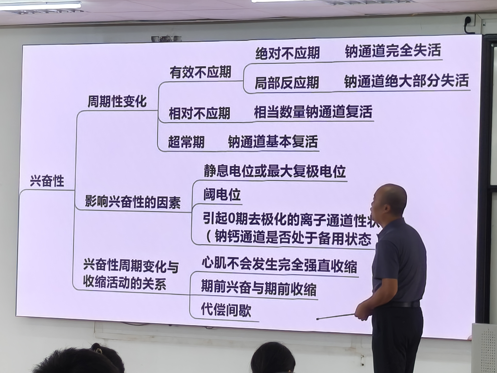

📝 **图中要点**：兴奋性思维导图——周期性变化：有效不应期=绝对不应期（钠通道完全失活）+局部反应期（钠通道绝大部分失活）；相对不应期（相当数量钠通道复活）；超常期（钠通道基本复活）。影响因素：静息电位/最大复极电位水平、阈电位水平、引起0期去极的离子通道性状（钠/钙通道是否处于备用状态）。周期变化与收缩关系：心肌不发生完全强直收缩、期前兴奋与期前收缩、代偿间歇。

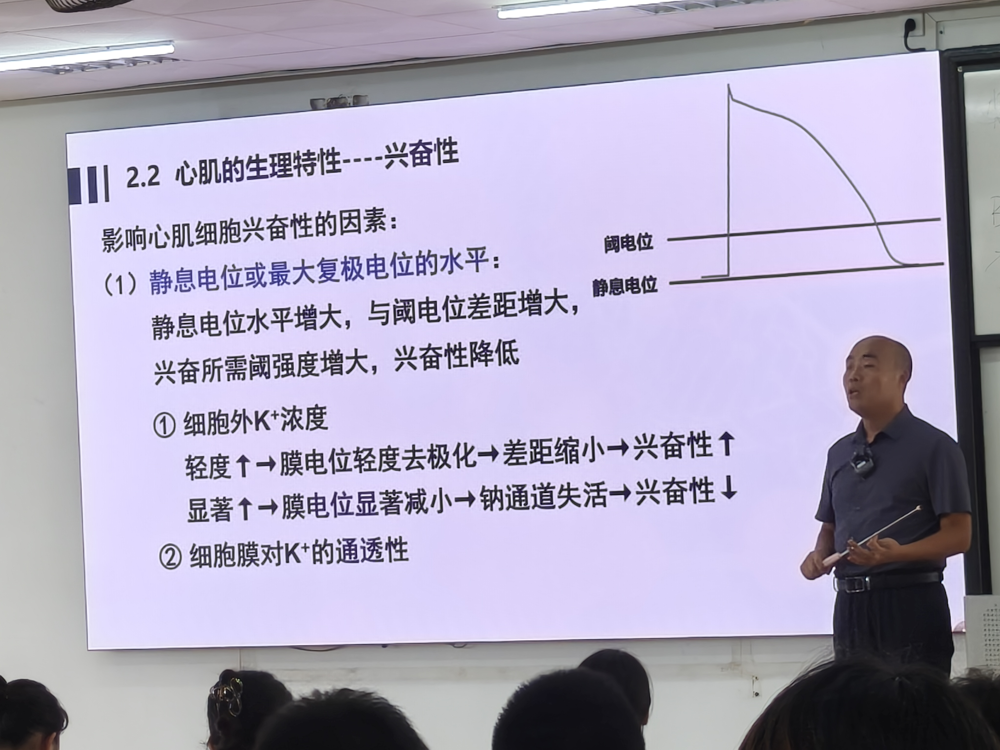

📝 **图中要点**：(1)静息电位/最大复极电位水平：RP水平增大→与阈电位差距增大→所需阈强度增大→兴奋性降低。①胞外K⁺浓度：轻度↑→膜轻度去极化→差距缩小→**兴奋性↑**；显著↑→膜显著减小→钠通道失活→**兴奋性↓**（呼应第9课高钾双向效应）。②细胞膜对K⁺的通透性。右侧配动作电位与阈电位/静息电位两条水平线的距离示意。

## 1.2 传导性

- 正常窦性心律起源于窦房结（自律性最高），兴奋沿特定路径传导：窦房结→优势传导通路（纤维粗、快）→**房室交界（房室结，最慢）**→房室束→左右束支→浦肯野纤维（最快）→心室肌。
- 【考点】**房室延搁**：房室交界区传导速度最慢（约0.02 m/s）。意义：保证**心房先收缩、心室后收缩**——心房先把约1/4血量挤入心室，二者交替而非同步收缩。
- 结构基础——**闰盘**：桥粒（结构上把相邻心肌细胞锚定在一起）+丰富的**缝隙连接**（功能上电偶联，电流直接从一个细胞传到下一个）。故心房、心室各自成为"功能性合胞体"，几乎同步收缩。
- 影响传导速度的因素：
  - 结构因素：①细胞/纤维直径越粗→电阻越小→传导越快（房室结纤维直径仅约0.3 μm，而浦肯野纤维达约70 μm，差两百多倍）；②缝隙连接数量越多、越开放→传导越快（心肌缺血时缝隙连接大量关闭→传导减慢）；③细胞分化程度越高（特化为传导细胞）→传导越快。
  - 生理因素：最终都可归结为"**可被激活的0期去极化离子通道数量**"——0期去极速度越快、幅度越大→局部电流越强→传导越快；膜电位不在-90 mV（如处于相对不应期）时可用钠通道少→0期幅度小→只能紧张性（衰减性）扩布、传导慢。

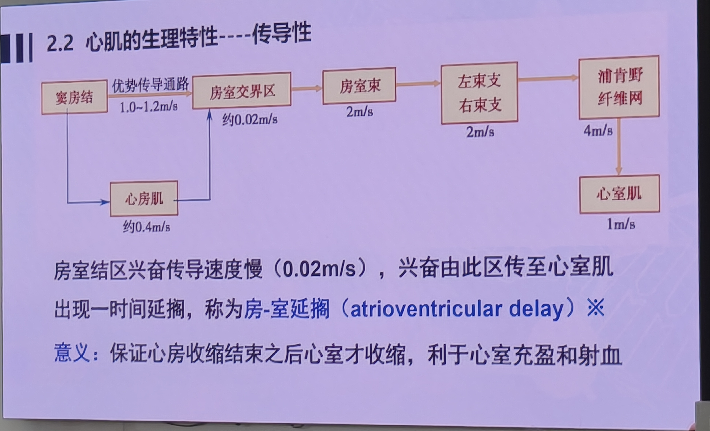

📝 **图中要点**：传导通路及各段速度——窦房结→优势传导通路(1.0~1.2 m/s)→**房室交界区(约0.02 m/s，最慢)**→房室束(2 m/s)→左/右束支(2 m/s)→浦肯野纤维网(4 m/s，最快)→心室肌(1 m/s)；心房肌约0.4 m/s。底部：房室结区传导最慢，兴奋由此传至心室肌出现时间延搁，称**房-室延搁(atrioventricular delay)**；意义=保证心房收缩结束后心室才收缩，利于心室充盈和射血。

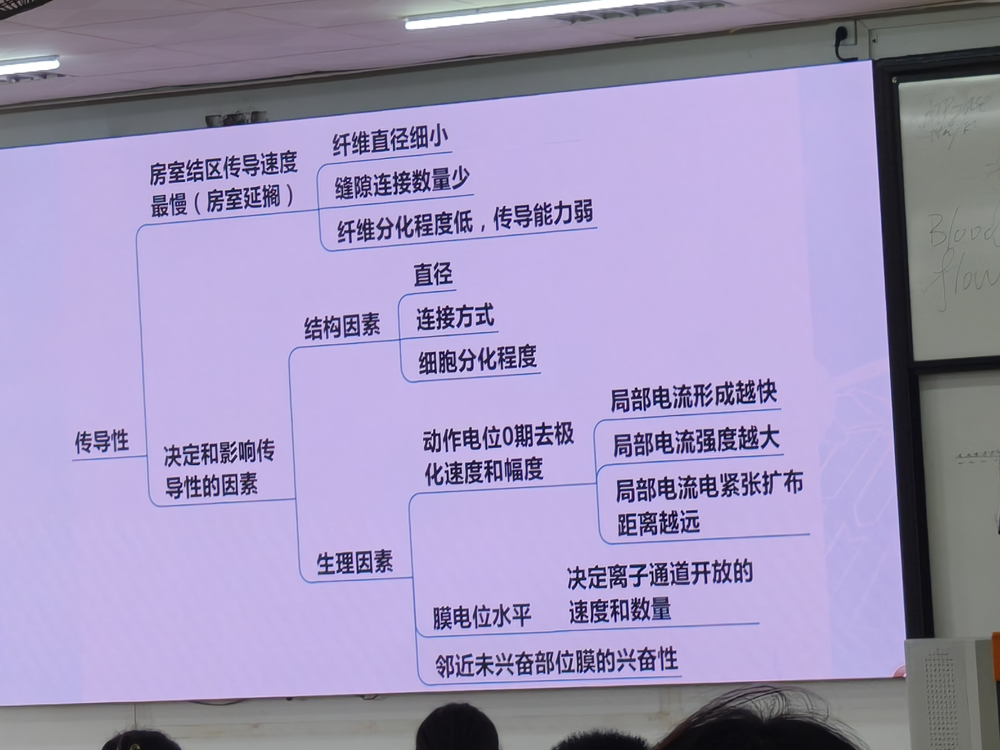

📝 **图中要点**：房室结区传导最慢（房室延搁）原因=纤维直径细小、缝隙连接数量少、纤维分化程度低传导能力弱。决定和影响传导性因素：结构因素（直径、连接方式、细胞分化程度）+生理因素（动作电位0期去极化速度和幅度→局部电流形成越快/强度越大/电紧张扩布距离越远；膜电位水平→决定离子通道开放速度和数量；邻近未兴奋部位膜的兴奋性）。

## 1.3 自律性

- 正常起搏点=窦房结（自律性约100次/分，安静时迷走神经抑制下表现为70~80次/分）；房室结、房室束、浦肯野都有自律性但较低，是**潜在起搏点**。
- 【考点】窦房结独占起搏的两个机制：
  1. **抢先占领**：窦房结自律性最高、4期自动去极最快，在潜在起搏点还没爬到位时就把兴奋传过来，后者只能跟着窦房结节律。
  2. **超速驱动压抑**：潜在起搏点长期被高频的窦房结节律驱动，钠钾泵一直高强度运转（3Na⁺出/2K⁺入→加强外正内负、膜超极化）；一旦窦房结突然停搏，钠钾泵不会立刻降速，膜仍处超极化，潜在起搏点需更长时间才能爬到阈电位，故停搏后有一段停顿。**临床意义**：更换起搏器时不能骤然停机，应先逐步调低频率，让潜在起搏点逐步接管，否则心脏会停跳一段时间。
- 影响自律性因素：①**4期自动去极速度（最主要）**；②最大复极电位水平（越负→爬到阈电位越久→自律性越低）；③阈电位水平（生理情况下相对稳定）。交感β→增强I_f/I_Ca-T→4期去极快→心率快；迷走→最大复极电位更负→心率慢。

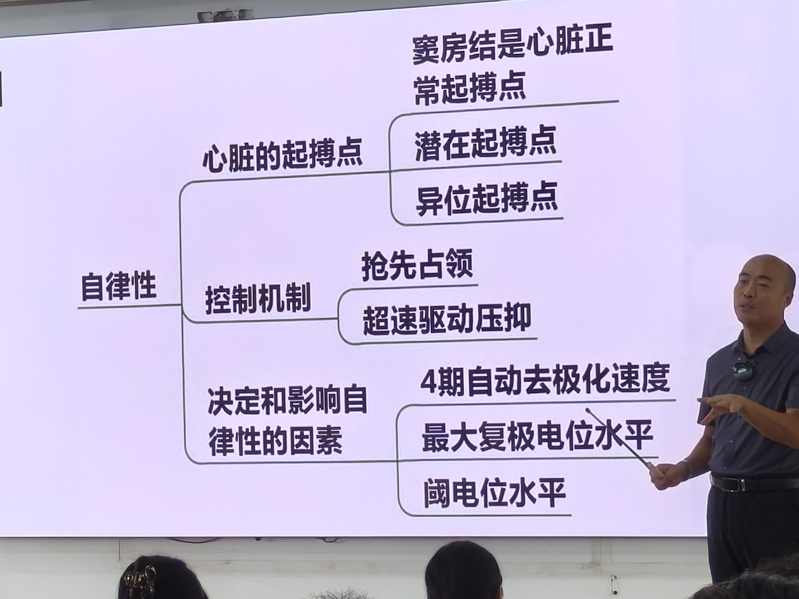

📝 **图中要点**：自律性思维导图——①起搏点：正常起搏点（窦房结）、潜在起搏点、异位起搏点；窦房结通过抢先占领和超速驱动压抑控制潜在起搏点。②控制自律性的机制：抢先占领、超速驱动压抑。③影响自律性的因素：4期自动去极化速度（主要）、最大复极电位、阈电位。

## 1.4 收缩性（与骨骼肌三点不同）

1. **同步收缩（"全或无"式）**：闰盘使心房、心室各成功能合胞体，要么不收缩、要么整个心房/心室一起收缩。
2. **不发生强直收缩**：ERP长（覆盖整个收缩期），只能收缩舒张交替。
3. **对胞外Ca²⁺依赖性大**：心肌肌质网不如骨骼肌发达，2期须靠外钙经L型钙通道内流触发CICR；骨骼肌钙100%来自发达肌质网，不需外钙。

## 1.5 心电图（II导联为代表，"三波三间期"）

【考点】电活动在机械收缩之前。
- **P波**：左右心房去极化。
- **QRS波群**：心室去极化（最高大——心室肌工作强度、电活动远大于心房）。
- **T波**：心室复极化。
- **PR间期**：兴奋从心房传到心室的时间（含房室延搁）。
- **ST段**：QRS与T波之间，心室全部处于动作电位2期平台期、彼此间无电位差，故呈等电位线；ST段应是平的。
- **QT间期**：心室从开始去极到完全复极的总时间。

老师提醒：心电图"三波三间期"是初筛依据；临床最常见的是**ST段异常、T波改变**，且受生理状态影响极大（没睡好、饮酒都可引起），不能单凭一次心电图下结论。

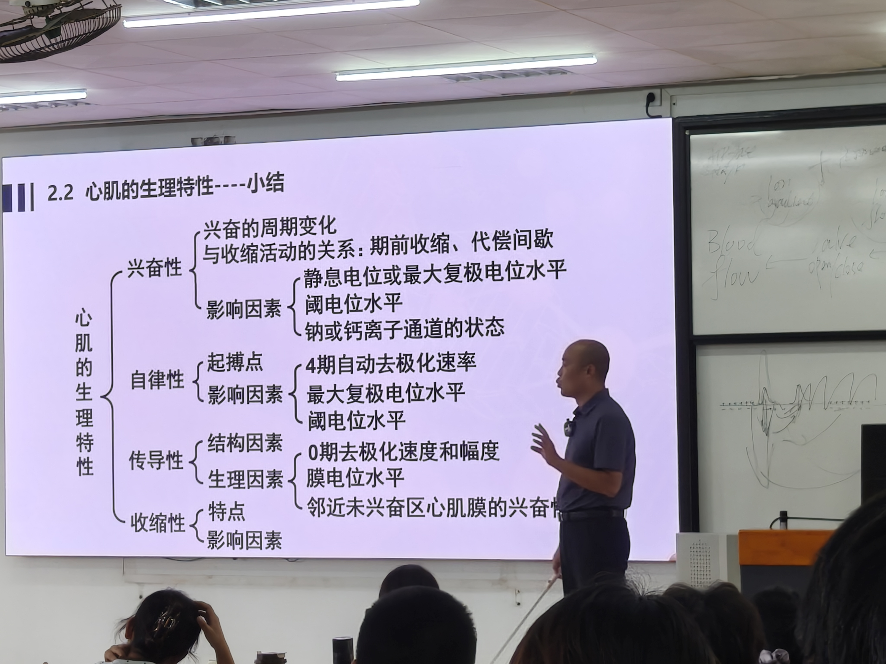

📝 **图中要点**：心肌四种生理特性小结思维导图——兴奋性（周期性变化+影响因素）、自律性（起搏点+控制机制+影响因素）、传导性（传导通路+房室延搁+影响因素）、收缩性（同步收缩/不强直/依赖外钙）。一图收束第8~9课心肌电生理全部考点。

---

# 第二部分　血管生理基础

## 2.1 按结构分类：毛细血管与三层膜血管

- **真毛细血管**：管壁最薄，仅由单层内皮细胞构成，内皮细胞之间连接不紧、甚至有穿孔，故通透性大，是血液与组织液物质交换的主要场所（交换血管）。
- 动脉、静脉管壁分**内膜、中膜、外膜**三层：内膜=内皮细胞（心血管研究前沿，内皮完整决定凝血/抗凝平衡）；外膜=结缔组织；**中膜**弹性纤维和平滑肌的比例随血管段差异极大，决定各段血管功能定位。

## 2.2 按功能分类（考点）

| 功能分类 | 对应血管 | 结构特点与功能 |
|---|---|---|
| 弹性贮器血管 | 主动脉、大动脉（最大分支） | 中膜弹性纤维极丰富、弹性强；心室射血时被动扩张贮血（弹性势能），舒张时弹性回缩推血外流 |
| 分配血管 | 中动脉（冠脉、颈动脉、肾动脉等） | 将血液分流到各器官 |
| 阻力血管 | 小动脉、微动脉 | 管径最小、平滑肌丰富；是**外周阻力主要来源**，受神经体液调节改变管径 |
| 交换血管 | 真毛细血管 | 单层内皮，物质交换 |
| 容量血管 | 静脉 | 壁薄、可扩张性大，容纳全身约60%~70%循环血量（老师课上说约65%），起血液贮存库作用 |
| 短路血管 | 动-静脉吻合支 | 不经过毛细血管，参与体温调节 |

【考点】**弹性贮器作用的两大意义**：①把心室**间断射血**变成血管内**持续血流**（舒张期靠弹性回缩继续推血）；②**缓冲血压波动**——射血时扩张使收缩压不致升得太高，舒张时回缩使舒张压不致降得太低。老年人动脉硬化→弹性减退→收缩压升高、舒张压降低、脉压明显增大（老年人血压特点）。

## 2.3 血管的内分泌功能

内皮细胞可分泌：**内皮素**（已知最强缩血管物质）、一氧化氮(NO)、某些前列腺素（舒血管）；血管壁还可产生肾素-血管紧张素系统。常见场景：血流量增多→对内皮机械冲击增强→内皮释放NO等舒血管物质→血管舒张、降低冲击，属自身调节。

---

# 第三部分　血流动力学

## 3.1 血流量与泊肃叶定律

【考点】**泊肃叶定律（Poiseuille's law）**：单位时间内通过某一血管截面的血流量 Q ∝（血管两端压力差ΔP × 血管半径 r⁴）/（血液黏滞度η × 血管长度L）。

- 关键：血流量与**半径的四次方**成正比——半径扩大一倍，血流量可增大约**16倍**（老师课上说8~16倍）。半径是影响血流量最显著的因素。
- 临床推论：某组织缺血缺氧想增加其局部血流，最有效的办法是**扩张该器官阻力血管（舒张血管药）**，而不是单纯升血压（升血压对全身上下平均起作用，局部效果差）。

## 3.2 血流阻力

类比欧姆定律：流量 ∝ 血压差 / 血流阻力。代入泊肃叶定律变换得：

【考点】**血流阻力 R ∝（血管长度 L × 血液黏滞度 η）/ 血管半径 r⁴**。

- 半径收缩一点点，在四次方放大下，阻力就显著增大。
- **小动脉、微动脉占体循环总阻力的50%以上**——因其半径本就小，是外周阻力的主要部位。全身微动脉若都扩张→阻力骤降→血压暴跌→休克。

## 3.3 血液黏滞度的影响因素

- **血细胞比容**：红细胞数量最多，比容越大→摩擦越多→黏滞度越高。
- **血流切率/口径**：层流分层，口径越小黏滞度越低（法-林效应）。
- **温度**：温度降低→黏滞度升高。老师举例：去寒冷地区体表温度下降→局部黏滞度升高→血流阻力增大→手脚冰凉（供血不充分）。
【教材补充·生理第10版】手指浸冰水中，局部血液黏滞度可增加2倍；法-林效应使小血管血流阻力显著降低。

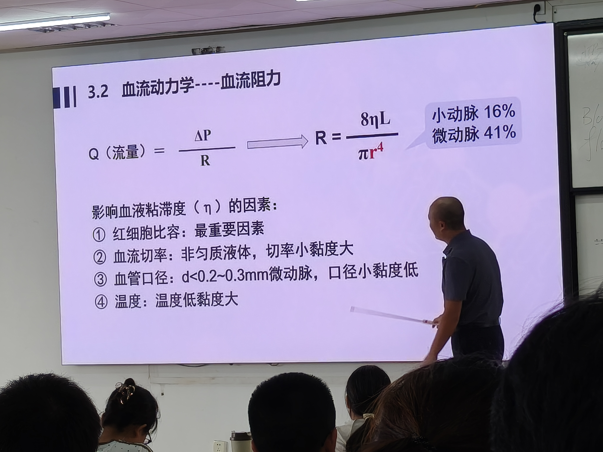

📝 **图中要点**：血流阻力——根据 Q=ΔP/R 及泊肃叶定律，阻力 R=8ηL/(πr⁴)；小动脉约占阻力16%、微动脉约占41%（为阻力血管）。影响血液黏滞度η的因素：①红细胞比容（最重要，比容愈大黏滞度愈高）；②血流切率（非匀质液体，切率小则黏滞度大）；③血管口径（血液在直径<0.2~0.3 mm微动脉中黏度反而降低=法-林效应）；④温度（温度低则黏滞度大）。

## 3.4 血流方式

- **层流**：除主动脉根部外各段血管总体为层流，中央流速快、贴壁流速慢。
- **湍流**：心室射血进入主动脉时、以及血管狭窄处可出现湍流（Korotkoff音即湍流撞击管壁产生）。

---

# 第四部分　动脉血压的形成

## 4.1 血压定义与压力梯度

血压=血管内流动血液对血管壁（侧壁）单位面积的压强。单位mmHg（1 mmHg=0.133 kPa）；静脉压/心房压低，用cmH₂O（1 cmH₂O=0.098 kPa）。

【考点】从左心室射血开始，血液沿途不断克服阻力耗能，血压**逐段下降，且降幅与该段阻力成正比**：

| 血管段 | 平均血压 |
|---|---|
| 主动脉 | 约100 mmHg |
| 直径3 mm动脉 | 约95 mmHg |
| 微动脉起始端 | 约85 mmHg |
| 毛细血管起始端 | 约30 mmHg（流经微动脉骤降约55 mmHg） |
| 微静脉 | 15~20 mmHg |
| 腔静脉/右心房 | 接近0 mmHg |

【考点】**血压在微动脉段下降最显著**（阻力最大）；主动脉、大动脉段降幅小。维持一定高位血压如同高楼供水需要水泵有足够压强，才能克服外周阻力、保证脑、肾等器官灌注；血压过低→肾脏无灌注、无尿。

## 4.2 动脉血压形成的四个条件（考点）

【考点】动脉血压形成四条件：

1. **足够的血液充盈（前提条件）**：先有血才有血压。用心室颤动停搏、血流暂停时测得的循环系统平均充盈压表示（狗约7 mmHg，人接近此值）。它取决于**血量与循环系统容积的相对关系**：失血→血量少→充盈压↓；过敏→血管广泛扩张、容积异常增大→充盈压↓（感染性/过敏性休克）。
2. **心脏射血（必要条件）**：心室收缩释放的能量一部分是推动血流的**动能**，一部分是使大动脉扩张贮存的**势能（压强能）**。停跳时仅7 mmHg，正常射血时约100 mmHg——说明心脏射血绝对关键。
3. **外周阻力**：主要指小动脉、微动脉阻力。正因有阻力，心室每次收缩射出的血只有约**1/3**在收缩期流到外周，其余暂存于大动脉，才使动脉血压维持高位；若无外周阻力，射入大动脉的血会瞬间流空、血压无法维持。
4. **主动脉和大动脉的弹性贮器作用**：缓冲心动周期中血压波动、把间断射血变为持续血流。

老师总结：**循环血量、心脏射血功能、外周阻力是形成血压的三大基本因素**。

---

# 第五部分　动脉血压测量与正常值

## 5.1 测量方法

- **直接测量法**：动脉插管连压力换能器，精确记录每一瞬间血压（有创，仅手术等用）。
- **间接测量法**：临床常用无创袖带听诊法（Korotkoff音）。袖带压高于收缩压时肱动脉完全关闭、无音；缓慢放气，**第一次出现声响（Korotkoff音）=收缩压**；继续放气到血流完全恢复通畅、声音消失=**舒张压**。因大动脉落差小，用上臂肱动脉压代表主动脉压。

## 5.2 四个常用血压值（考点）

【考点】
- **收缩压（SBP）**：心室射血时动脉压达到的最高值。
- **舒张压（DBP）**：心室舒张停止射血时动脉压降到的最低值。
- **脉搏压（脉压）= 收缩压 − 舒张压**。
- **平均动脉压（MAP）**：一个心动周期中每一瞬间血压的平均值。因**舒张期长于收缩期**，平均动脉压更接近舒张压，粗略估算：

【考点公式】**平均动脉压 ≈ 舒张压 + 1/3 脉压**。以120/80 mmHg为例：脉压=40，MAP≈80+40/3≈**93 mmHg**（不是收缩压舒张压的算术平均100）。

## 5.3 正常值与诊断标准

【教材补充·生理第10版】安静时我国健康青年人：收缩压100~120 mmHg、舒张压60~80 mmHg、脉压30~40 mmHg。

血压水平分类（2018中国高血压防治指南）：

| 分类 | 收缩压 mmHg | | 舒张压 mmHg |
|---|---|---|---|
| 正常血压 | <120 | 和 | <80 |
| 正常高值 | 120~139 | 和/或 | 80~89 |
| 高血压 | ≥140 | 和/或 | ≥90 |
| 1级高血压 | 140~159 | 和/或 | 90~99 |
| 2级高血压 | 160~179 | 和/或 | 100~109 |
| 3级高血压 | ≥180 | 和/或 | ≥110 |
| 单纯收缩期高血压 | ≥140 | 和 | <90 |

低血压一般定为收缩压<90 mmHg和/或舒张压<60 mmHg。收缩压与舒张压分属不同级别时按较高分级。

老师临床提醒：**不能机械背数字**。一个常年高血压（日常180 mmHg）的患者昏迷急诊，测出120/80看似"正常"，其实对他已是显著低血压（机体已对高血压产生适应性，需要更高灌注压）——问病史了解基础血压非常重要。

---

# 第六部分　动脉血压的波动特性

## 6.1 个体、年龄、性别波动

血压存在个体、年龄、性别差异：随年龄增长血压逐渐升高，且**收缩压升高比舒张压更显著**（动脉硬化）；女性更年期前略低于同龄男性，更年期后相近甚至略高。正常人双侧上臂血压可差5~10 mmHg，临床应测双侧并记录。

## 6.2 昼夜波动——"双峰双谷"

【教材补充·生理第10版】正常人血压**2~3时最低，6~10时及16~20时各有一个高峰，20时后缓慢下降**，呈"双峰双谷"；老年人和高血压者更明显。老师补充：下午/傍晚高峰与**肾上腺皮质激素（皮质醇）分泌节律**及其对儿茶酚胺（肾上腺素等升压物质）的允许作用有关。临床偶测血压宜选高峰时；长期高血压者此节律可减弱或消失。

## 6.3 呼吸波动与心搏波动

【教材补充·生理第10版，按机制补充】动脉血压随每个心动周期波动（收缩期高、舒张期低）即心搏波动；呼吸时相也可通过改变静脉回流、胸内负压引起血压轻微波动，属生理性波动。

---

# 第七部分　★影响动脉血压的因素（本课重中之重·考点）

分析任一因素时假定其他因素不变。五大因素：

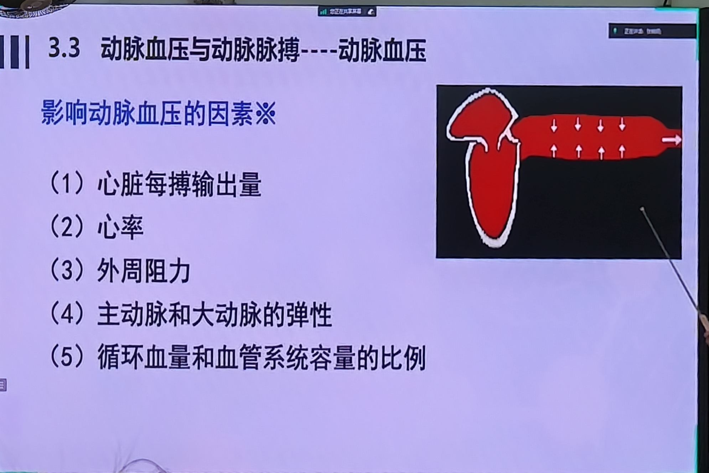

📝 **图中要点**：影响动脉血压的因素※总起页——(1)心脏每搏输出量；(2)心率；(3)外周阻力；(4)主动脉和大动脉的弹性；(5)循环血量和血管系统容量的比例。右侧为心脏+主动脉贮血示意。

| 影响因素 | 主要影响哪个压 | 因素↑时SBP/DBP变化 | 脉压变化 | 备注 |
|---|---|---|---|---|
| 每搏输出量 ↑ | **主要影响收缩压** | SBP明显↑，DBP升高较小 | **脉压↑** | 收缩压高低主要反映搏出量多少 |
| 心率 ↑ | **主要影响舒张压** | DBP明显↑，SBP升高较小 | **脉压↓** | 心率快→舒张期短→大动脉存血多 |
| 外周阻力 ↑ | **主要影响舒张压** | DBP明显↑，SBP升高不如DBP | **脉压↓** | 舒张压高低主要反映外周阻力大小 |
| 大动脉弹性贮器↓（老年硬化） | 缓冲作用↓ | SBP↑、DBP↓ | **脉压明显↑** | 老年人典型血压特点 |
| 循环血量与血管容量失匹配 | 两者都降 | 失血/血管过度扩张→BP↓ | — | 大前提；治疗应先补液而非盲目升压 |

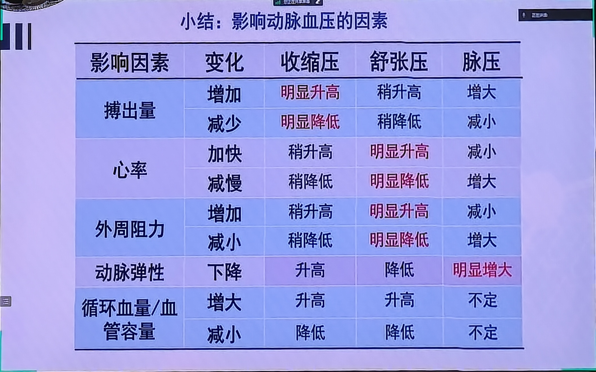

📝 **图中要点（★重点总表，务必背）**：搏出量↑→收缩压明显↑、舒张压稍↑、**脉压↑**；心率↑→收缩压稍↑、舒张压明显↑、**脉压↓**；外周阻力↑→收缩压稍↑、舒张压明显↑、**脉压↓**；大动脉弹性↓→收缩压↑、舒张压↓、**脉压明显↑**；循环血量/血管容量↑→收缩压舒张压都↑、脉压不定。规律：搏出量主攻收缩压，心率与外周阻力主攻舒张压，弹性下降使脉压显著拉开。

逐条理解：

1. **每搏输出量（主要影响收缩压）**：搏出量↑→收缩期射入主动脉血量增多→管壁承受压强增大→**收缩压明显升高**；因血压升高后血流加速，舒张期末大动脉内存血增加不多，故舒张压升高较小→**脉压增大**。反之搏出量↓→收缩压降得比舒张压更显著→脉压减小。【考点】**收缩压主要反映每搏输出量的多少。**

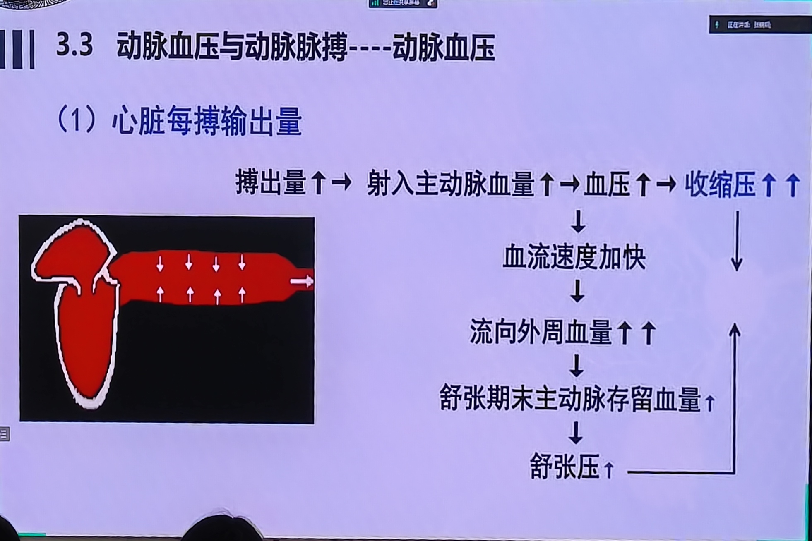

📝 **图中要点**：搏出量↑→射入主动脉血量↑→血压↑→**收缩压↑↑**；同时血流速度加快→流向外周血量↑↑→舒张期末主动脉存留血量↑→舒张压↑（但升高幅度小）。结果：收缩压升高远大于舒张压，脉压增大。

2. **心率（主要影响舒张压）**：心率↑→舒张期明显缩短→舒张期流向外周的血减少、主动脉内存血增多→**舒张压明显升高**；收缩压也升高，但因血流加快、收缩期有较多血外流，升高幅度较小→**脉压减小**。心率↓则相反，脉压增大。

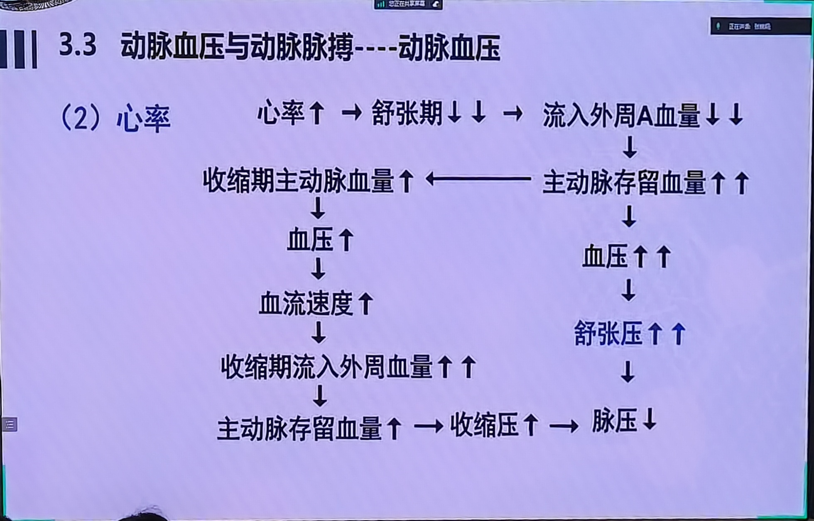

📝 **图中要点**：心率↑→舒张期↓↓→流入外周动脉血量↓↓→主动脉存留血量↑↑→血压↑↑→**舒张压↑↑**；收缩期主动脉血量↑→血压↑→血流速度↑→收缩期流入外周血量↑↑→存留血量↑→收缩压↑；最终脉压↓。

3. **外周阻力（主要影响舒张压）**：外周阻力↑→舒张期血液外流速度减慢→舒张压明显升高；收缩期因血压高、血流快，收缩压升高不如舒张压明显→**脉压减小**。外周阻力↓则舒张压降得更显著、脉压加大。【考点】**舒张压主要反映外周阻力的大小。**

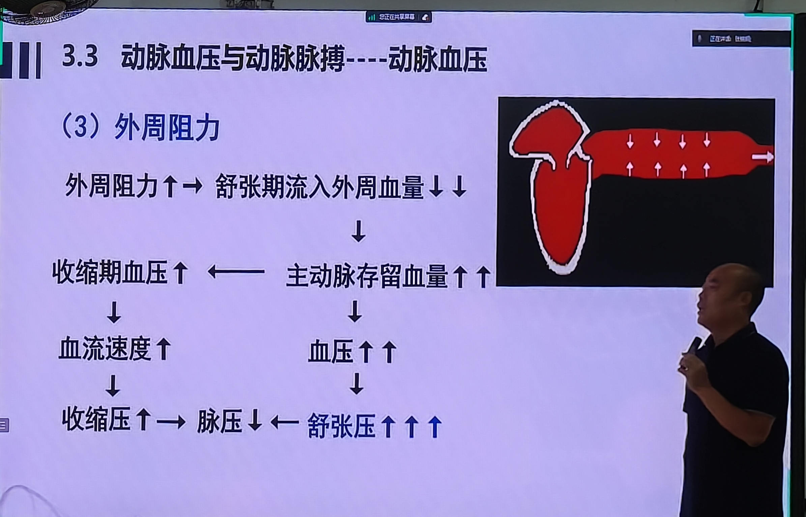

📝 **图中要点**：外周阻力↑→舒张期流入外周血量↓↓→主动脉存留血量↑↑→血压↑↑→**舒张压↑↑↑**；收缩期血压↑→血流速度↑→收缩压↑（幅度小）；最终脉压↓。

4. **大动脉弹性贮器（缓冲波动）**：弹性好→收缩压不太高、舒张压不太低。老年人动脉壁硬化、弹性纤维减少胶原增多→可扩张性降低→缓冲减弱→**收缩压升高而舒张压降低，脉压明显加大**。

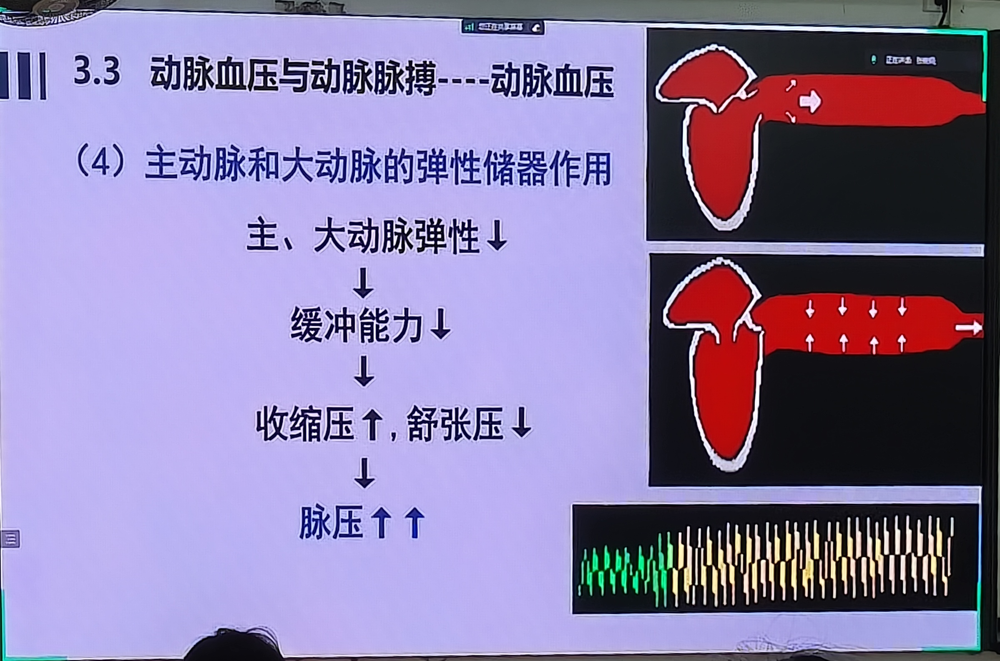

📝 **图中要点**：主、大动脉弹性↓→缓冲能力↓→收缩压↑、舒张压↓→**脉压↑↑**。上方示意图：弹性好的血管射血时扩张贮血、舒张时回缩；下方硬化血管不能扩张，血压波形波动加大。

5. **循环血量与血管容量匹配**：生理下血量略多于血管容量，产生一定平均充盈压（前提）。大失血→血量↓而血管容量不变→充盈压↓→血压↓；若血管容量异常增大（过敏广泛扩张）而血量不变→血压也↓。【考点】慢性消耗/补液不足导致的低血压，**正确治疗是充分补液恢复循环血量**，盲目用缩血管升压药会加重脏器供血不足。

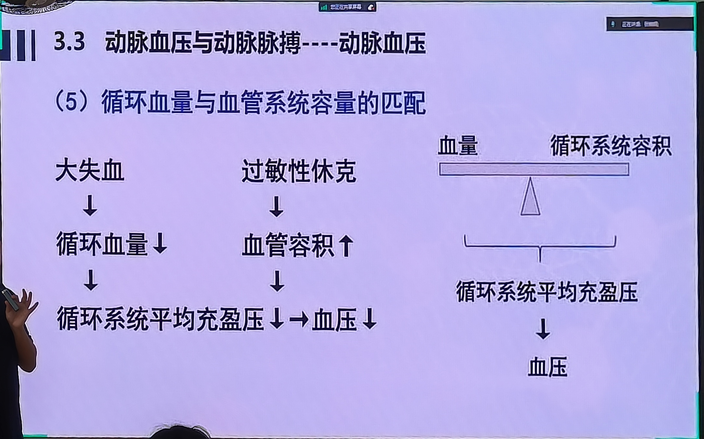

📝 **图中要点**：天平=血量 vs 循环系统容积→循环系统平均充盈压→血压。大失血→循环血量↓→平均充盈压↓→血压↓；过敏性休克→血管容积↑→平均充盈压↓→血压↓。两种失匹配途径都使平均充盈压下降。

老师课堂举例的推理：心率慢时舒张期充分、弹性回缩时间足→舒张压偏低；心率快则弹性回缩来不及、下次射血又来→舒张压偏高；外周阻力升高则血液流不出去、淤积在动脉→血压升高。升压药（如去甲肾上腺素激动α受体）收缩微动脉、增大外周阻力→升压。

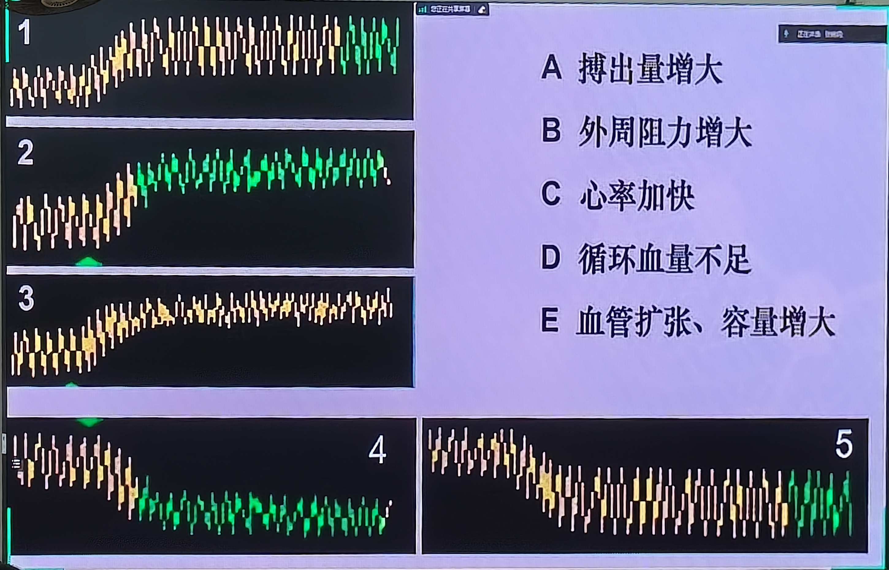

📝 **图中要点**：课堂波形辨析——左侧5个血压波形(1~5)，右侧选项A搏出量增大/B外周阻力增大/C心率加快/D循环血量不足/E血管扩张容量增大。解题思路：整体升高且脉压拉大者对应搏出量增大（A）；整体升高而舒张压升得更多、脉压缩小者对应外周阻力增大或心率加快（B/C）；整体下降者对应循环血量不足或血管扩张（D/E）。据波形水平高低与脉压宽窄匹配选项。

---

# 第八部分　动脉脉搏

【教材补充·生理第10版】每个心动周期动脉内压力和容积周期性变化，引起动脉管壁搏动。典型脉搏波：**上升支**（心室快速射血、血压骤升、血管壁扩张，斜率幅度受射血速度/心输出量/射血阻力影响）；**下降支**（射血减慢+心室舒张）。心室舒张主动脉瓣关闭瞬间，反流血受阻形成一个小折返波称**降中波**，其前一切迹称**降中峡**。下降支形状大致反映外周阻力大小：外周阻力大→下降慢、降中峡位置高。主动脉狭窄→上升支小；主动脉瓣关闭不全→下降支陡峭。脉搏波沿血管壁传播速度远快于血流速度，血管可扩张性越大传播越慢。

---

# 第九部分　静脉血压与中心静脉压（教材补充重点）

> 本部分课堂未展开，依据教材人卫第10版补全。

## 9.1 静脉血压分级

血液经动脉、毛细血管到微静脉时血压已降至**15~20 mmHg**；回流到右心房时接近0。

- **中心静脉压（CVP）**：右心房和胸腔内大静脉的血压。
- **外周静脉压**：各器官静脉的血压。

【考点】**中心静脉压正常4~12 cmH₂O**。其数值取决于**心脏射血能力与静脉回心血量之间的平衡**：
- 心脏射血能力减弱（如心力衰竭）→右心房腔静脉淤血→CVP↑；
- 静脉回心血量增多或回流过快（输液/输血过多过快）→CVP↑。

【考点·临床意义】CVP是判断心血管功能、监测补液速度和补液量的重要指标：
- CVP高于正常或有升高趋势→提示输液过多过快，或心脏射血功能不全；
- CVP偏低或下降趋势→提示补液量不足。
- 右心衰竭→体循环淤血（颈静脉怒张、肝淤血肿大、下肢水肿）；左心衰竭→肺淤血、肺水肿。

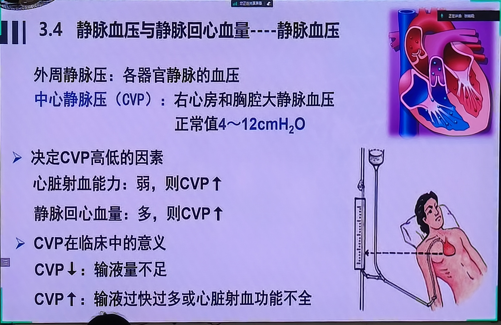

📝 **图中要点**：外周静脉压=各器官静脉血压；中心静脉压(CVP)=右心房和胸腔大静脉血压，**正常值4~12 cmH₂O**。决定因素：心脏射血能力弱→CVP↑；静脉回心血量多→CVP↑。临床意义：CVP↓=输液量不足；CVP↑=输液过快过多或心脏射血功能不全。右上心脏解剖图、右下颈内静脉CVP测量示意。

## 9.2 重力与体位对静脉压的影响

- 平卧时身体各部分大致与心脏同高，静水压大致相同。
- 由平卧转为直立位时，**足部血管血压比平卧时高约80 mmHg**（足到心脏这段血柱的静水压）；心脏水平以上血管压力则降低，如颅顶矢状窦压可降至约-10 mmHg。
- 同一水平动脉、静脉受重力影响相同，但**静脉壁薄、受跨壁压影响大，故重力对静脉的影响远大于动脉**。
- **跨壁压**=血液对管壁压力−血管外组织对管壁压力；静脉壁薄，跨壁压低时易塌陷、容积减小。
- 体位由平卧变直立时，低垂部分静脉因跨壁压增大而扩张，可**多容纳约500 mL血液**→回心血量暂时减少。

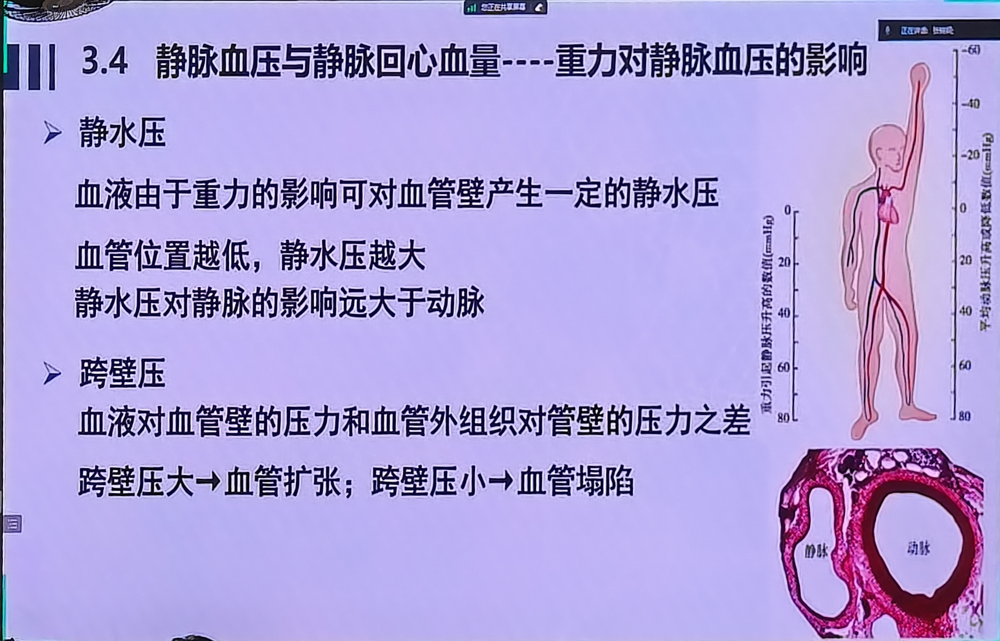

📝 **图中要点**：静水压=血液因重力对血管壁产生的压力；血管位置越低静水压越大；静水压对静脉的影响远大于动脉。跨壁压=血液对血管壁压力−血管外组织对管壁压力；**跨壁压大→血管扩张，跨壁压小→血管塌陷**。右侧直立人体血管压力标尺（足部约+80 mmHg、颅顶约−60 mmHg），右下角动静脉组织学对比（静脉壁薄腔大、动脉壁厚）。

---

# 第十部分　★静脉回心血量及影响因素（"两体三泵"）

静脉回心血量在单位时间上等于心输出量，取决于外周静脉压与中心静脉压之差及静脉血流阻力。五大影响因素可概括为**"两体三泵"**：

【考点】

1. **体循环平均充盈压（血量/充盈——"两体"之一）**：充盈程度越高，回心血越多。血量增加或容量血管收缩→充盈压↑→回心血↑；大失血→回心血↓。

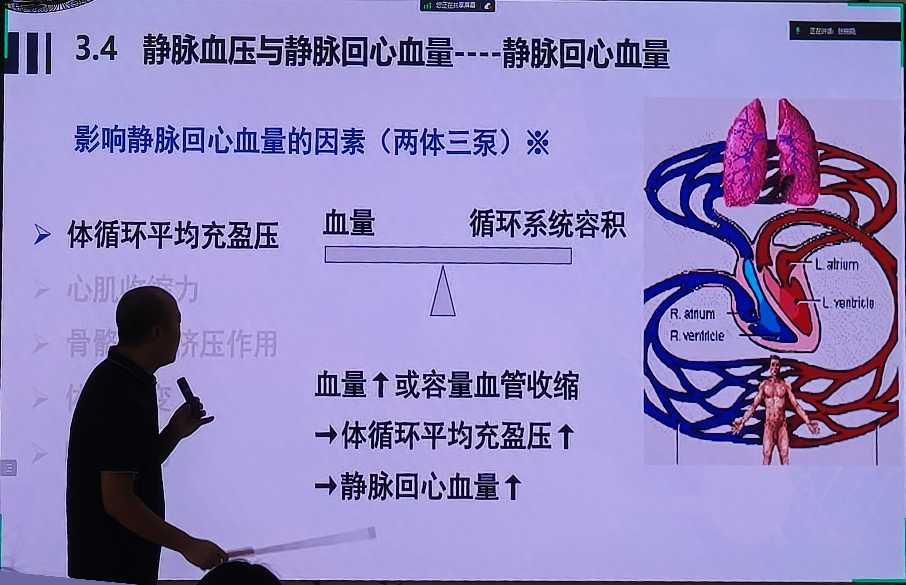

📝 **图中要点（动画帧·高亮体循环平均充盈压）**：天平=血量 vs 循环系统容积；血量↑或容量血管收缩→体循环平均充盈压↑→静脉回心血量↑。右侧完整肺循环/体循环模式图。

2. **体位改变（重力——"两体"之二）**：平卧→直立，低垂静脉扩张多容纳约500 mL血→回心血↓。长期卧床者静脉壁紧张性低、可扩张性大，突然站立时血液淤滞下肢、回心血骤减→可发生**体位性低血压甚至昏厥**。

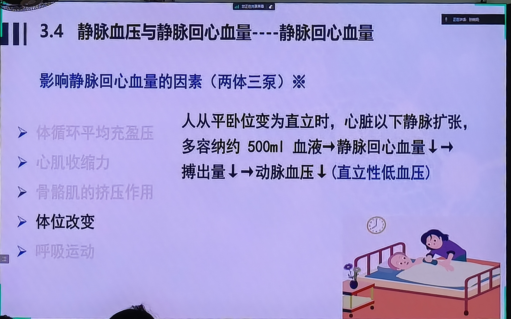

📝 **图中要点（动画帧·高亮体位改变）**：人从平卧位变为直立时，心脏以下静脉扩张、多容纳约500 mL血液→静脉回心血量↓→搏出量↓→动脉血压↓（直立性低血压）。右下为卧床/突然站起卡通示意。

3. **心脏泵（心肌收缩力——"三泵"之一）**：心肌收缩力↑→射血多→心室余血少→舒张期室内压低→对心房和静脉血液的抽吸力量增强→回心血↑。右心衰→射血弱→血液淤积右房大静脉→回心血↓（颈静脉怒张、下肢水肿）。

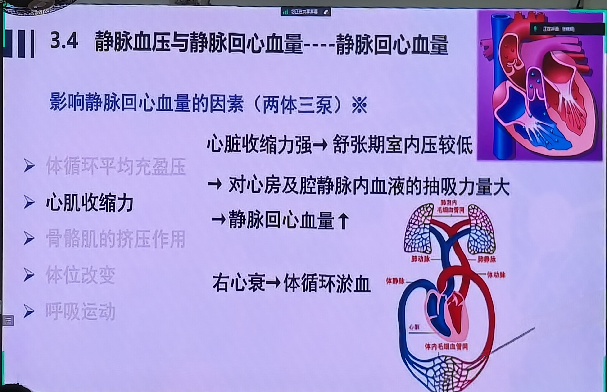

📝 **图中要点（动画帧·高亮心肌收缩力）**：心脏收缩力强→舒张期室内压较低→对心房及腔静脉内血液抽吸力量大→静脉回心血量↑；**右心衰→体循环淤血**。右下为肺循环/体循环血流模式图。

4. **骨骼肌泵（肌肉泵/静脉泵——"三泵"之二）**：骨骼肌节律性收缩挤压肌肉内/间静脉，配合**静脉瓣膜只允许血液向心脏单向流动**，像泵一样促进回流（跑步时下肢肌肉泵每分钟可挤出数升血）。注意：肌肉**持续紧张性收缩**而非节律舒缩时，静脉持续受压、回心血反而减少；久站久坐缺乏肌肉挤压→下肢静脉淤血水肿。

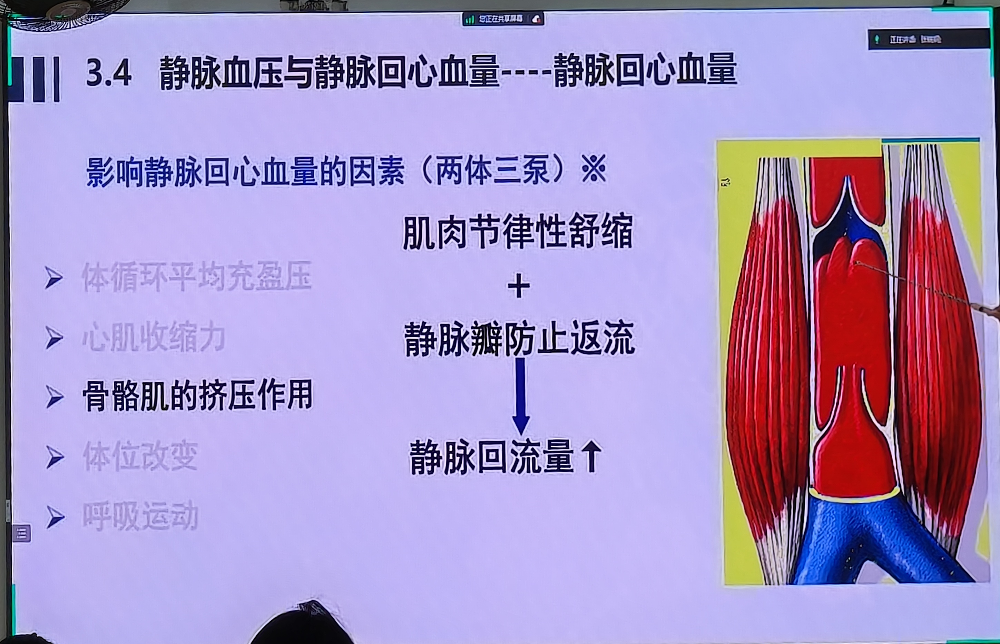

📝 **图中要点（动画帧·高亮骨骼肌挤压作用）**：肌肉节律性舒缩＋静脉瓣防止返流→静脉回流量↑。右侧为小腿肌肉挤压深静脉、静脉瓣单向开放的解剖示意。

5. **呼吸泵（"三泵"之三）**：胸膜腔内压为负压。吸气时胸腔容积增大、胸膜腔负压绝对值增大→胸腔内大静脉和右心房更扩张→促进外周静脉血回流右房；呼气时负压减小→回心血相应减少。呼吸运动对回流起"泵"的作用。

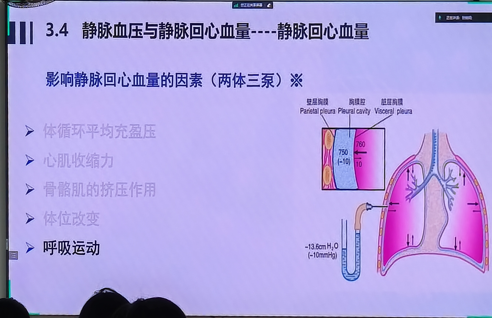

📝 **图中要点（动画帧·高亮呼吸运动）**：胸膜腔负压约−10 mmHg（=−13.6 cmH₂O）；吸气时胸腔大静脉和右心房扩张、抽吸外周静脉血回心，呼气时相反。右上为壁层/脏层胸膜与胸膜腔压力示意图、右下为肺内静脉回流方向。

> 记忆：**两体**=体循环平均充盈压（血量）、体位（重力）；**三泵**=心脏泵（心肌收缩力）、骨骼肌泵（肌肉泵+静脉瓣）、呼吸泵（胸膜腔负压）。

---

# 本课必背数字速查

- 正常青年人：SBP 100~120 mmHg、DBP 60~80 mmHg、脉压 30~40 mmHg；平均动脉压≈DBP+1/3脉压（120/80时≈93 mmHg）。
- 高血压：SBP≥140和/或DBP≥90；正常高值120~139/80~89；低血压SBP<90和/或DBP<60。
- 循环系统平均充盈压：约7 mmHg（停搏时）。
- 血压梯度：主动脉~100→微动脉起始端~85→毛细血管起始端~30（微动脉段骤降55）→微静脉15~20→右心房~0。
- 每搏输出量收缩期只有约1/3流到外周，其余贮于大动脉。
- 中心静脉压CVP：正常4~12 cmH₂O。
- 直立位足部血压比平卧高约80 mmHg；颅顶矢状窦压可降至约-10 mmHg；平卧→直立低垂静脉多容纳约500 mL血。
- 泊肃叶定律：Q∝ΔP·r⁴/(ηL)；血流阻力R∝L·η/r⁴；小动脉微动脉占总阻力50%以上。
- 静脉容纳全身约60%~70%循环血量。
- 房室交界传导最慢约0.02 m/s；房室结纤维直径约0.3 μm vs 浦肯野纤维约70 μm。
- 血压昼夜：2~3时最低，6~10时、16~20时双峰。
- 双侧上臂血压可差5~10 mmHg。
