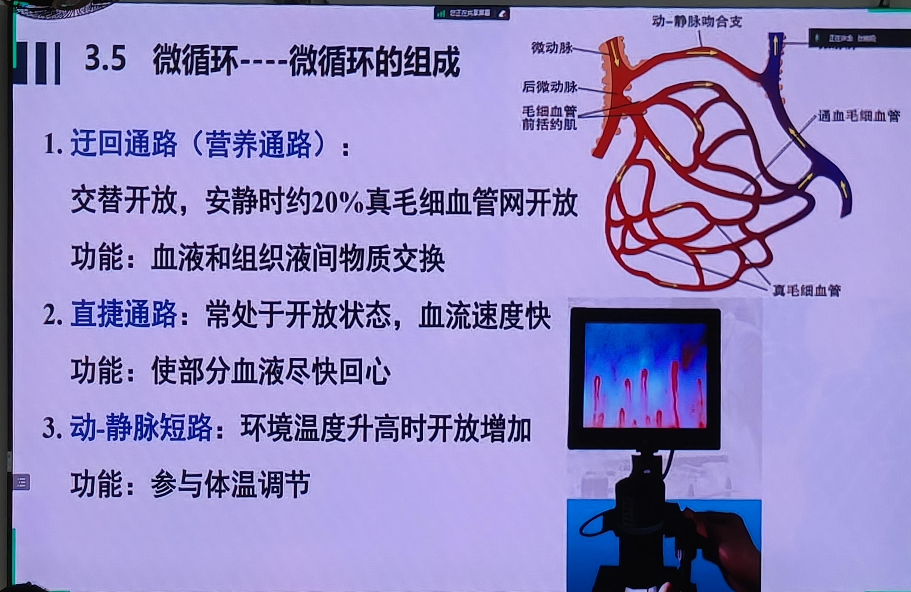
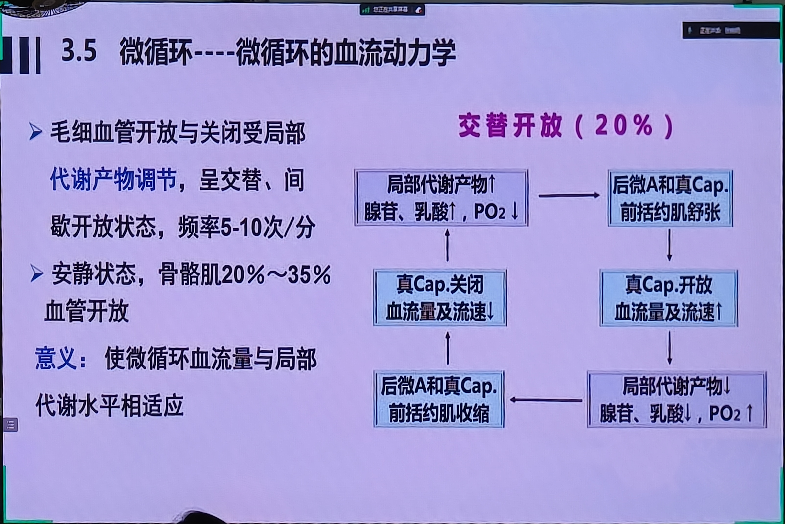
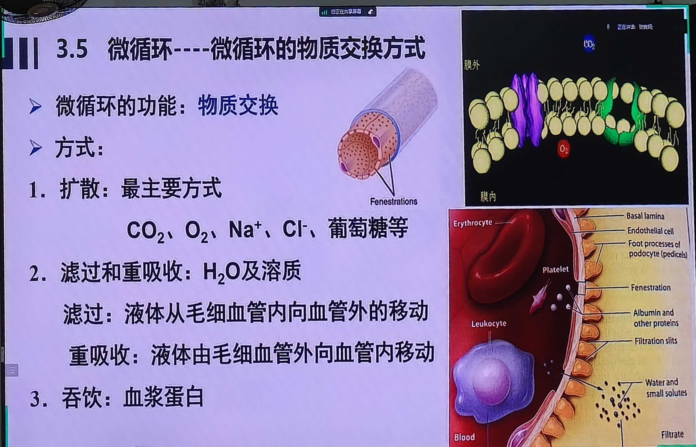
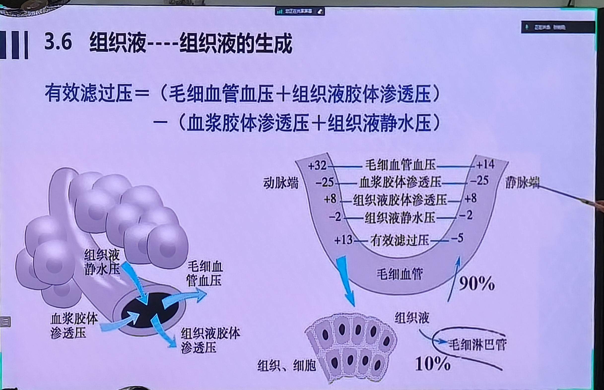

# 第11课 毛细血管与组织液生成机制（教材精讲版）

> **说明**：本课课堂照片4张（微循环三通路/交替开放/物质交换/EFP公式）。
>
> 教材：《生理学》第10版，罗自强/管又飞主编，人民卫生出版社，2024年，第四章 血液循环 第三节 血管生理
> 授课时间：2026-10-15 14:27

---

# 第一部分 上节回顾与速览：动脉血压、静脉血压与静脉回流

> 开头约50分钟是上节课（血管生理第一节、第二节）的回顾和延伸，重点在影响动脉血压的5个因素、中心静脉压CVP、以及静脉回心血量的5个影响因素（"两体三泵"）。这部分是本章主线，必须掌握。

## 1.1 影响动脉血压的5个因素

【教材补充·生理第10版】动脉血压形成的4个前提：①足够的循环血量；②心脏射血；③外周阻力；④大动脉弹性贮器作用。在这个基础上，任何影响这4个前提的因素都会改变血压。

老师总结5个影响因素：

1. **搏出量（每搏输出量）**
2. **心率**
3. **外周阻力**
4. **主动脉/大动脉弹性贮器作用**
5. **循环血量与血管系统容积的匹配**

【考点】老师原话："每一个因素要搞清楚——它主要影响收缩压还是舒张压？升的时候两者谁升得多？降的时候谁降得多？脉压差怎么变？"

### 1.1.1 收缩压与舒张压的本质（理解这一点就全通了）

老师反复强调，要分清收缩压和舒张压的直接来源：

- **收缩压**：心室快速射血期，几十毫升血液突然冲入主动脉，对动脉管壁的**冲击力**——所以收缩压直接反映**搏出量**。
- **舒张压**：舒张期，主动脉里剩余的血液容量、与弹性管壁回缩之间的压力关系——所以舒张压直接反映**舒张期流向外周的血量多少**，流出去的越少、留在主动脉里的越多，舒张压越高。

【考点】老师原话："收缩压是射血那一下对管壁的冲击；舒张压是舒张期主动脉里存余的血量和管壁之间的力。理解这两句话，后面5个因素全不用死记。"

### 1.1.2 搏出量↑→以收缩压升高为主

- 搏出量↑→射入主动脉血量↑→对管壁冲击↑→**收缩压明显↑**；
- 舒张压也↑，但血压升高本身让血流向外周加快（Poiseuille定律：流量与血压差成正比），所以主动脉留存血量增加不明显→舒张压↑不明显；
- 结果：收缩压↑↑，舒张压↑，**脉压差↑**。

【考点】**收缩压的高低主要反映搏出量的多少**。反过来也成立：临床上收缩压异常（升高或降低）首先考虑搏出量变化。

### 1.1.3 心率↑→以舒张压升高为主

- 心率↑→主要缩短舒张期→舒张期流向外周的时间↓→流向外周血量↓→主动脉留存血量↑→**舒张压明显↑**；
- 收缩压也↑，但升高同样被血流加速抵消一部分→收缩压↑不明显；
- 结果：收缩压↑，舒张压↑↑，**脉压差↓**。

【考点】年轻人高血压常见表现为**舒张压偏高**（如130/98），常伴心率偏快（>80次/分），休息不好、交感偏兴奋→外周小动脉收缩→心率↑+外周阻力↑→舒张压↑。把心率降下来，舒张压就下来。

### 1.1.4 外周阻力↑→以舒张压升高为主

- 外周阻力（小动脉、微动脉口径）↑→舒张期血液更难流向外周→主动脉留存血量↑→**舒张压明显↑**；
- 收缩压也↑，同样被血流加速部分抵消；
- 结果：舒张压↑↑，**脉压差↓**。

【考点】**舒张压的高低主要反映外周阻力的大小**。

【教材补充·生理第10版】外周阻力主要来自小动脉和微动脉（阻力血管），因半径r很小，按Poiseuille定律阻力∝1/r⁴，口径微小变化即可引起阻力大幅变化。

### 1.1.5 大动脉弹性↓（动脉硬化）→收缩压↑、舒张压↓、脉压差↑

- 老年人动脉硬化→弹性贮器作用下降：
  - 收缩期：管壁不能弹性扩张缓冲→对血流冲击没有缓冲→**收缩压明显↑**；
  - 舒张期：管壁不能弹性回缩→推动血液继续流向外周的力量消失→血液快速流向外周、主动脉留存血量↓→**舒张压↓**；
- 结果：收缩压↑，舒张压↓，**脉压差明显↑**。

【考点】**脉压差主要反映大动脉弹性**。年轻人弹性好脉压约40 mmHg；老年人动脉硬化后脉压增大（如150/70）。

【考点】老师原话："随着衰老，弹性下降，脉压会越来越大。"

**临床举例：老年单纯收缩期高血压**

- 老年人（>65岁）常见血压150/70 mmHg，收缩压高、舒张压正常甚至偏低；
- 原因：大动脉粥样硬化→弹性贮器功能丧失→收缩期无缓冲→收缩压飙升；舒张期无弹性回缩→血液快速流走→舒张压不高甚至降低；
- 这种高血压与年轻人舒张压高型高血压机制完全不同，用药策略也不同（老年人更强调降收缩压）。

### 1.1.6 循环血量与血管系统容积的匹配

- 大失血→血量↓→平均充盈压↓→血压↓（失血性休克）；
- 过敏→全身血管强烈舒张→血管容积相对过大→血量不足→血压↓（过敏性休克）；
- 这一因素对收缩压、舒张压的影响是同向的，脉压变化不定。

【考点】**循环系统平均充盈压**：心脏暂时停搏（实验性室颤/电击停跳）时，血管中各处压力相等，约7 mmHg（0.93 kPa）。它代表单纯由血液充盈血管产生的压力，与心脏射血无关。

### 1.1.7 五因素总结表

| 影响因素 | 收缩压 | 舒张压 | 脉压差 | 主要反映 |
|---|---|---|---|---|
| 搏出量↑ | ↑↑ | ↑ | ↑ | 搏出量 |
| 心率↑ | ↑ | ↑↑ | ↓ | 心率（与外周阻力同向） |
| 外周阻力↑ | ↑ | ↑↑ | ↓ | 外周阻力 |
| 大动脉弹性↓ | ↑ | ↓ | ↑↑ | 大动脉弹性 |
| 血量↓/血管容积↑ | ↓↓ | ↓ | 不定 | 循环血量与容积匹配 |

---

## 1.2 中心静脉压CVP

【考点】**中心静脉压（CVP）**=右心房和胸腔内大静脉的血压。

- 正常值：4~12 cmH₂O（约3~9 mmHg）；不同教材数值略有差异（5~10 cmH₂O），约数即可。
- 外周静脉压略高于CVP→血液从外周静脉向心回流。

【考点】CVP的意义：
- **生理学意义**：反映心脏射血（泵血）功能。心脏射血能力正常→血液及时泵出→不淤积在心房/大静脉→CVP维持低位；右心衰竭→血液淤积→CVP↑。
- **临床意义**：监测输液速度和量。CVP低→输液量不足；CVP高→输液过快或心功能不全。临床通过中心静脉导管（置管至上腔静脉近右心房处）测量。

【考点】老师原话："生理学里CVP反映心脏射血功能；临床上CVP反映你输液快了还是慢了。"

**CVP临床监测的意义**：

- 正常CVP约4~12 cmH₂O（0.4~1.2 kPa）；
- CVP<5 cmH₂O提示血容量不足（如大失血、脱水），需要补液；
- CVP>15~20 cmH₂O提示心功能不全（右心衰）或输液过快过多，要控制输液；
- 临床监测方法：经颈内静脉或锁骨下静脉穿刺置入中心静脉导管，导管尖端到达上腔静脉近右心房处，连接压力换能器。
- CVP和血压联合判断：
  - CVP低+血压低=血容量不足；
  - CVP高+血压低=心功能不全；
  - CVP高+血压正常=容量血管过度收缩（如疼痛、休克代偿期）。

## 1.3 静脉回流的"两体三泵"五因素

【考点】老师原话："两体三泵"：两体=体循环平均充盈压、体位改变；三泵=心泵（心肌收缩力）、骨骼肌泵、呼吸泵。

**静脉回流与动脉血压的关系**：

静脉回心血量是心输出量的前提——前负荷=EDV=回心血量。静脉回流减少→前负荷↓→搏出量↓→动脉血压↓。这就是为什么休克早期交感神经收缩静脉（容量血管）→增加回心血量→维持血压。全身静脉系统容纳60%~70%血液，静脉轻微收缩即可显著增加回心血量——这是休克代偿的关键环节。

- **两体**：①体循环平均充盈压；②体位改变
- **三泵**：③心泵（心肌收缩力）；④骨骼肌泵；⑤呼吸泵

### 1.3.1 体循环平均充盈压（两体之一）

- 血量↑（输液/补水）→平均充盈压↑→静脉回流↑；
- 大失血→平均充盈压↓→静脉回流↓。

### 1.3.2 体位改变（两体之二）

- 平卧→站立：血液因重力淤积于下肢静脉（可达500 mL以上）→回心血量↓→搏出量↓→血压↓；
- 正常人通过神经调节（颈动脉窦主动脉弓压力感受性反射）迅速代偿；
- **长期卧床者**血管张力下降、静脉更易扩张，突然坐起/站立时下肢淤积更明显→直立性低血压→晕厥。
- **预防**：长期卧床者起床前先在床上坐30秒、再双腿下垂30秒、再站立，让血管逐步适应；穿弹力袜促进静脉回流。

【考点】老师原话："长期卧床的病人，病床都是可摇起来的，不要骤然坐起来，慢慢摇。"

**直立性低血压（体位性低血压）**：

- 定义：从平卧突然站立时，收缩压下降≥20 mmHg或舒张压下降≥10 mmHg，伴头晕、黑矇甚至晕厥；
- 机制：站立后重力使约500~1000 mL血液淤积于下肢和腹腔静脉→回心血量↓→搏出量↓→血压↓；
- 正常人通过颈动脉窦-主动脉弓压力感受性反射迅速代偿（交感兴奋→心率↑、外周血管收缩）；
- 长期卧床者血管张力下降、反射迟钝→代偿不足→易晕厥；
- 老年人、服用降压药/α受体阻滞剂者也常见。

### 1.3.3 心泵（三泵之一）

- 心肌收缩力↑→射血充分→舒张时心室抽吸作用强→心房/大静脉不淤积→回心血量↑；
- **右心衰**：体循环静脉淤血→颈静脉怒张、下肢水肿（下肢受重力影响淤血更明显）；
- **左心衰**：肺循环淤血→肺水肿→呼吸困难、咳嗽、咳粉红色泡沫痰（肺泡被液体填充，影响气体交换）。

【考点】老师原话："右心衰→体循环淤血→下肢水肿；左心衰→肺循环淤血→肺水肿、夜间阵发性呼吸困难。"

**左右心衰淤血对比**：

| 类型 | 淤血部位 | 典型表现 | 机制 |
|---|---|---|---|
| 右心衰 | 体循环静脉系统 | 颈静脉怒张、肝大、下肢凹陷性水肿、腹水 | 右心不能把体循环静脉血泵入肺→静脉压↑→毛细血管血压↑→滤过↑→水肿 |
| 左心衰 | 肺循环 | 劳力性呼吸困难、夜间阵发性呼吸困难、端坐呼吸、咳粉红色泡沫痰 | 左心不能把肺静脉血泵入体循环→肺毛细血管血压↑→液体渗入肺泡→肺水肿 |

### 1.3.4 骨骼肌泵（三泵之二）

- 下肢骨骼肌有节律收缩+静脉瓣单向开放→挤压静脉血向心脏方向回流；
- 长期站立不动→下肢静脉压力持续高→静脉曲张；
- **剧烈运动后不能骤停**：运动时CO高达25~35 L/min需要大量回心血，但骤停后骨骼肌挤压作用立即消失、而心率和CO仍高位运行→回心血量骤减→脑供血不足→晕倒。

【考点】老师原话："剧烈跑完不要立刻停下，再走一走——骨骼肌泵在帮你把血挤回来。"

**静脉瓣的单向阀门作用**：

- 四肢静脉（尤其下肢）内壁有半月形静脉瓣，向心脏方向开放；
- 骨骼肌收缩时挤压静脉→血液只能向心脏方向流动（瓣膜防止逆流）；
- 长期站立、静脉瓣功能不全→静脉血逆流→下肢静脉压持续升高→静脉曲张、下肢水肿；
- 这就是为什么久坐久站后小腿酸胀、要多走动——走路时骨骼肌在帮静脉血回流。

### 1.3.5 呼吸泵（三泵之三）

- 胸膜腔负压（两层胸膜：壁层固定于胸壁刚性、脏层贴肺回缩→腔隙负压）→胸腔内大静脉跨壁压大→静脉扩张、利于回流；
- **吸气时**：胸腔扩大→胸膜负压更负→胸腔大静脉进一步扩张→静脉回流↑；
- 这就是为什么血压曲线随呼吸波动（呼吸性窦律不齐的原理之一）。

【教材补充·生理第10版】胸膜腔内压为负压（平静呼气末约-5 cmH₂O，吸气末约-10 cmH₂O），使胸腔内薄壁静脉处于扩张状态，是呼吸泵的解剖基础。

**呼吸泵的临床意义**：

- 吸气时膈肌下降、胸腔扩大→胸膜负压更负→胸腔大静脉和右心房扩张→CVP↓→外周静脉与CVP压力差↑→静脉回流↑→右心输出量短暂↑；
- 呼气时相反；
- 这就是为什么正常人吸气时静脉回流增多、颈静脉反而更瘪（Kussmaul征相反=缩窄性心包炎）；
- 深呼吸锻炼有助于静脉回流和心肺功能。

---

# 第二部分 微循环

## 2.1 微循环的概念

【考点】**微循环**=微动脉和微静脉之间的血液循环，是血液与组织细胞进行物质交换的场所。

【教材补充·生理第10版】微循环结构：微动脉→后微动脉→毛细血管前括约肌→真毛细血管→通血毛细血管→微静脉。微动脉是微循环的"总闸门"，毛细血管前括约肌是"分闸门"。

## 2.2 三条通路

| 通路 | 路径 | 开放状态 | 功能 |
|---|---|---|---|
| **迂回通路（营养通路）** | 微动脉→后微动脉→毛细血管前括约肌→真毛细血管网→微静脉 | 交替开放（安静时仅1/5~1/3开放） | **物质交换**（主要场所） |
| **直捷通路** | 微动脉→通血毛细血管→微静脉 | 持续开放 | 使部分血液迅速回心，保证静脉回流 |
| **动-静脉短路** | 微动脉→动静脉吻合支→微静脉 | 环境温度升高时开放 | 调节体温（皮肤散热） |

📝 **图：PPT「微循环的组成和血流通路」**。标注微动脉→后微动脉→毛细血管前括约肌→真毛细血管网→微静脉；三条通路：迂回通路（真毛细血管网，物质交换）、直捷通路（通血毛细血管，持续开放）、动-静脉短路（动静脉吻合支，体温调节）。与本节三通路表完全对应。

【考点】老师原话："迂回通路是真正进行物质交换的，安静时只有1/5~1/3真毛细血管开放，交替开放；运动时代谢旺盛开放比例大增。"

**微循环的"闸门"概念**：

【教材补充·生理第10版】微循环有两道闸门：
- **总闸门=微动脉**：管壁平滑肌丰富，交感神经支配+局部代谢产物调节，控制整个微循环的血流量；微动脉收缩→整个微循环血流减少；微动脉舒张→血流增多。
- **分闸门=毛细血管前括约肌**：位于真毛细血管入口处，受局部代谢产物调节，控制哪些真毛细血管网开放。

安静时：微动脉保持一定张力、前括约肌交替收缩→真毛细血管网轮流开放。
运动或代谢增强时：局部代谢产物堆积→微动脉和前括约肌都舒张→更多毛细血管网开放→血流量增加。

## 2.3 毛细血管交替开放的调节

- 真毛细血管网交替开放**主要受局部代谢产物调节**（自身调节）：
  - 组织代谢→O₂↓、CO₂↑、H⁺↑、腺苷↑→前括约肌/微动脉舒张→真毛细血管开放；
  - 血流带走代谢产物→O₂恢复、CO₂↓→前括约肌收缩→毛细血管关闭；
- 这种"代谢产物堆积→开放→冲走→关闭"的循环造成交替开放。

【考点】老师原话："不是交感神经一直在指挥毛细血管开或关，是代谢产物自己在指挥——缺氧、二氧化碳多了，毛细血管就开。"

📝 **图：PPT「微循环血流动力学」**。安静时骨骼肌真毛细血管网约20%交替开放；局部代谢产物（O₂↓/CO₂↑/乳酸/腺苷）使前括约肌舒张→毛细血管开放；血流带走代谢产物→前括约肌收缩→毛细血管关闭。与本节"1/5~1/3开放、代谢产物调节"完全对应。

**微循环自身调节的意义**：

- 器官血流量不是全身统一调度的——每个器官根据自己当时的代谢需求，通过局部代谢产物自动调节开放的真毛细血管数量；
- 安静肌肉仅1/5~1/3开放；剧烈运动时局部O₂↓、CO₂↑、腺苷、乳酸、H⁺堆积→几乎全部开放→血流量可增加数十倍；
- 这种"按需开放"保证了代谢旺盛的组织优先获得血供，同时避免安静时不必要的血流经过。

## 2.4 毛细血管壁结构

【教材补充·生理第10版】毛细血管壁由单层内皮细胞+基膜组成，外径仅5~10 μm，只允许红细胞单行通过。

- **内皮细胞**：单层扁平细胞，细胞间有裂隙（约2~6 nm）；
- **基膜**：外包基板，支持内皮；
- **周细胞**：散在毛细血管壁上，有收缩功能，可调节毛细血管血流。

【考点】毛细血管壁薄、通透性大，是物质交换的结构基础。

**不同部位毛细血管通透性差异**：

【教材补充·生理第10版】：
- **连续毛细血管**（肌肉、肺、中枢神经）：内皮连续、裂隙小、通透性低；
- **有孔毛细血管**（胃肠黏膜、肾 glomerulus）：内皮有穿内皮小孔（fenestrae）、通透性较高；
- **血窦/窦状毛细血管**（肝、脾、骨髓）：管腔大、内皮细胞间隙大、基膜不连续、通透性最大，允许蛋白质甚至血细胞通过。

这就是为什么肝可以合成大量血浆蛋白后直接释放入血、脾可以清除衰老红细胞。

## 2.5 毛细血管的物质交换方式

【考点】三种方式：

1. **扩散（最主要）**：
   - 与细胞膜扩散不同：这里不管物质带电与否、分子量大小（除蛋白质外），都能通过裂隙扩散；
   - O₂、CO₂、葡萄糖、氨基酸、电解质都靠扩散；
2. **滤过与重吸收（水为主）**：
   - 液体从毛细血管内向组织间隙移动=滤过；反之为重吸收；
3. **吞饮（胞饮小泡）**：大分子物质（如血浆蛋白）通过内皮细胞吞饮小泡跨膜转运。

【考点】老师原话："这里的扩散和第二章细胞膜扩散不一样——裂隙很大，带电的、大分子量的（除蛋白质）都能过。水主要靠滤过和重吸收。"

📝 **图：PPT「微循环物质交换方式」**。三种方式：①扩散（最主要，O₂/CO₂/葡萄糖/电解质，裂隙大不分电荷大小）；②滤过与重吸收（水为主）；③吞饮（大分子蛋白质经内皮吞饮小泡跨膜）。配毛细血管壁窗孔/裂隙示意图。与本节三方式完全对应。

---

# 第三部分 组织液的生成与回流（本课核心）

## 3.1 组织液的概念

【考点】**组织液**=存在于组织间隙中的液体，是血浆滤过毛细血管壁形成的。血浆与组织液成分除蛋白质外基本相同——正是因为血浆蛋白不能轻易透出，血浆才有胶体渗透压。

## 3.2 有效滤过压EFP公式

【考点】**有效滤过压（EFP）=（毛细血管血压 + 组织液胶体渗透压）−（血浆胶体渗透压 + 组织液静水压）**

四个力：

| 力 | 方向 | 作用 |
|---|---|---|
| 毛细血管血压 | 血浆→组织液 | **滤过动力** |
| 组织液胶体渗透压 | 组织液→血浆？不，组织液→血浆方向是吸收 | 实际是组织液胶体渗透压低，作为动力弱 |
| 血浆胶体渗透压 | 组织液→血浆 | **重吸收动力**（最大阻力） |
| 组织液静水压 | 组织液→血浆 | 重吸收动力 |

老师把四个力配对：

- **一对流体静压**：毛细血管血压 − 组织液静水压 = 有效流体静压（促进滤过）；
- **一对胶体渗透压**：血浆胶体渗透压 − 组织液胶体渗透压 = 有效胶体渗透压（促进重吸收）。

【考点】老师原话："两个动力两个阻力：毛细血管血压、组织液胶体渗透压是动力；血浆胶体渗透压、组织液静水压是阻力。"

## 3.3 动脉端滤过、静脉端重吸收

【教材补充·生理第10版】典型数值：

| 压力（mmHg） | 动脉端 | 静脉端 |
|---|---|---|
| 毛细血管血压 | 约30 | 约12 |
| 组织液胶体渗透压 | 约15 | 约15 |
| 血浆胶体渗透压 | 约25 | 约25 |
| 组织液静水压 | 约-3（或+1~+3） | 约-3 |
| **EFP** | **约+10~+13（滤过）** | **约-8（重吸收）** |

【考点】老师原话："动脉端正10、正13的时候，动力大于阻力，滤过生成组织液；到静脉端EFP变成负的，阻力大于动力，重吸收。"

📝 **图：PPT「组织液生成与回流——有效滤过压」**。动脉端EFP=+13 mmHg（滤过生成组织液）；静脉端EFP=-5 mmHg（重吸收）；约90%滤出液体在静脉端直接回收入毛细血管，剩余10%进入毛细淋巴管→淋巴循环→回心。与本节数值和回流比例完全对应。

- 动脉端：EFP>0→液体从毛细血管滤出→生成组织液；
- 静脉端：EFP<0→组织液重吸收回毛细血管；
- **约90%滤出的液体在静脉端直接重吸收**，剩下约10%进入毛细淋巴管→淋巴循环→最终汇入腔静脉回心。

【考点】老师原话："滤过多少最终也要重吸收多少，才平衡；10%走淋巴回来。"

**为什么需要两个方向的力配对思考？**

老师强调，不要死记硬背公式，要把它理解成"拔河"：

- 往组织间隙方向拉的力：毛细血管血压（血管内血液压出去）+组织液胶体渗透压（组织间隙蛋白吸水）；
- 往血管内方向拉的力：血浆胶体渗透压（白蛋白吸水回来）+组织液静水压（组织间隙液体压回去）；
- 动脉端血管血压高（靠近动脉），往外推的力大→赢→滤过；
- 静脉端血管血压已经耗得差不多了，往里吸的力占优→重吸收。

这就是为什么毛细血管血压从动脉端30 mmHg降到静脉端12 mmHg——血液在毛细血管里一路克服阻力，压力不断下降，这是导致两端EFP正负反转的根本原因。

## 3.4 影响组织液生成与回流的因素——水肿机制

【考点】水肿=组织液生成>回流，液体积聚在组织间隙。

| 因素 | 机制 | 临床例子 |
|---|---|---|
| **毛细血管血压↑** | 滤过动力↑ | 右心衰→静脉淤血→毛细血管血压↑→下肢水肿；肝硬化/门静脉高压→腹水 |
| **血浆胶体渗透压↓** | 重吸收动力↓ | 肾病综合征（大量蛋白尿丢白蛋白）、肝硬化（白蛋白合成↓）、营养不良（低蛋白）→全身性水肿 |
| **毛细血管通透性↑** | 血浆蛋白漏出→组织液胶体渗透压↑ | 炎症、过敏、烧伤→局部水肿 |
| **淋巴回流受阻** | 10%淋巴回流路断 | 丝虫病→象皮肿；乳腺癌根治术后腋窝淋巴结清扫→上肢水肿；肿瘤压迫淋巴管 |

【考点】老师原话："水肿不是水喝多了，是四个平衡因素出了问题——毛细血管血压高、血浆胶压低、通透性大、淋巴堵。"

**四个水肿原因的临床病例展开**：

1. **毛细血管血压升高（静脉回流受阻）**：
   - 右心衰→体循环静脉压↑→全身水肿；
   - 肝硬化→门静脉高压→腹水；
   - 下肢静脉血栓→患侧下肢水肿；
   - 妊娠子宫压迫髂静脉→下肢水肿。
2. **血浆胶体渗透压降低（低白蛋白血症）**：
   - 肾病综合征：大量白蛋白从尿丢失→低蛋白→全身性水肿（眼睑、下肢）；
   - 肝硬化：肝细胞合成白蛋白能力↓→腹水+下肢水肿；
   - 营养不良/饥饿：蛋白摄入不足→低蛋白水肿（甚至脑水肿）。
3. **毛细血管通透性升高**：
   - 炎症：组胺、缓激肽使内皮细胞收缩→裂隙变大→蛋白漏出→局部红肿热痛；
   - 过敏：荨麻疹、喉头水肿；
   - 烧伤：创面渗出大量血浆样液体。
4. **淋巴回流受阻**：
   - 丝虫病成虫阻塞淋巴管→长期蛋白性水肿→皮肤增厚如象皮（象皮肿）；
   - 乳腺癌根治术清扫腋窝淋巴结→患侧上肢水肿；
   - 盆腔肿瘤压迫髂淋巴管→下肢水肿。

【考点】右心衰→全身水肿（尤其下肢，因重力）；左心衰→肺水肿（肺毛细血管血压↑→液体渗入肺泡）。

## 3.5 组织液回流的生理意义

- 为组织细胞提供营养（O₂、葡萄糖、氨基酸从血浆扩散经组织液到细胞）；
- 带走代谢产物（CO₂、尿素从细胞经组织液回血浆）；
- 维持血管内外液体平衡。

---

# 第四部分 淋巴循环

## 4.1 淋巴系统的组成

【教材补充·生理第10版】毛细淋巴管→淋巴管→淋巴干→右淋巴导管/胸导管→左右静脉角→回入体循环静脉。

- **毛细淋巴管**：盲端起始于组织间隙，管壁由单层内皮细胞构成、细胞间隙大、基膜不连续，蛋白质甚至细胞都能进入；
- 组织液约10%进入毛细淋巴管即为淋巴。

## 4.2 淋巴回流的生理意义

【考点】淋巴回流四大生理意义：

1. **回收蛋白质**：这是淋巴回流最重要的功能。每天约75~200 g血浆蛋白经淋巴回收入血。组织液中的蛋白质不能透过毛细血管壁回收入血，只能靠淋巴管——若淋巴回流受阻，蛋白质积聚在组织间隙→组织液胶体渗透压↑→水肿（象皮肿的机制）。
2. **运输脂肪**：小肠绒毛的毛细淋巴管（乳糜管）吸收脂肪消化产物（乳糜微粒），经淋巴入血。
3. **防御与免疫**：淋巴液经过淋巴结时，巨噬细胞清除异物；淋巴结是免疫器官，产生淋巴细胞和抗体。
4. **调节体液平衡**：把组织液约10%的剩余液体送回血液循环，维持血管内外液体平衡。

【考点】老师原话："淋巴最关键的作用是回收蛋白质——蛋白质回不到血管里，只能走淋巴管。"

**为什么蛋白质只能走淋巴？**

- 毛细血管内皮裂隙约2~6 nm，允许水、电解质、葡萄糖、气体自由通过；
- 但血浆白蛋白（约66 kDa，直径~7 nm）不能穿过内皮裂隙；
- 然而每天仍有少量蛋白通过胞饮等方式漏出到组织间隙——这些蛋白不能再回收入毛细血管（因为裂隙不够大）；
- 如果这些蛋白留在组织间隙→组织液胶体渗透压升高→把水也吸出来→水肿；
- 毛细淋巴管盲端、内皮细胞间隙大、基膜不连续→蛋白可自由进入淋巴管→经淋巴循环回收入血。
- 这就是为什么淋巴回流受阻后出现的是高蛋白性水肿（象皮肿），与普通水肿机制不同。

## 4.3 影响淋巴回流的因素

【教材补充·生理第10版】：新生成的组织液使毛细淋巴管内压升高→推动淋巴流动；骨骼肌节律收缩、呼吸运动（与静脉回流类似的"淋巴泵"）、邻近动脉搏动都促进淋巴回流；淋巴管中有瓣膜防止逆流。

---

# 第五部分 本章数字速查

| 项目 | 数值 |
|---|---|
| 体循环血量分布静脉 | 约60%~70%（老师说64%） |
| 循环系统平均充盈压 | 约7 mmHg |
| CVP | 4~12 cmH₂O |
| 立位下肢静脉压升高 | 约80 mmHg（重力） |
| 安静时真毛细血管开放比例 | 1/5~1/3 |
| 毛细血管血压动脉端 | 约30 mmHg |
| 毛细血管血压静脉端 | 约12 mmHg |
| 血浆胶体渗透压 | 约25 mmHg（白蛋白为主） |
| 组织液胶体渗透压 | 约15 mmHg |
| 组织液静水压 | 约-3 mmHg |
| 动脉端EFP | 约+10~+13 mmHg（滤过） |
| 静脉端EFP | 约-8 mmHg（重吸收） |
| 滤出液静脉端直接重吸收比例 | 约90% |
| 滤出液经淋巴回流比例 | 约10% |
| 每日淋巴回收蛋白质 | 75~200 g |
| 正常脉压差 | 约40 mmHg |

---

# 第六部分 本章易混点与术语纠错

- **"凝集"vs"聚集"**：本章节不涉及；血液章节曾混淆，注意"聚集"是血小板之间黏附，"凝集"是抗原抗体反应。
- **"静脉压"vs"静水压"**：静水压=液体本身对管壁的压力；静脉压特指静脉内血压。
- **"跨壁压"**=血管内压−血管外组织压。跨壁压↑→薄壁静脉扩张；跨壁压↓→静脉塌陷（如回抽时）。
- **"有效滤过压"公式顺序**：动力在前、阻力在后；括号内第一项都是"毛细血管侧"，第二项都是"组织间隙侧"。
- **"迂回通路"**：不是"迂徊"，是迂回（绕远路），对应真毛细血管网物质交换。
- **"两体三泵"**：两体=平均充盈压+体位；三泵=心泵+骨骼肌泵+呼吸泵。不要漏。
- **"动脉端滤过、静脉端重吸收"**：方向不要记反。

---

> 本课完。重点掌握：影响动脉血压5因素对收缩压/舒张压/脉压的不同影响；CVP意义；静脉回流两体三泵；微循环三通路；EFP公式与水肿机制；淋巴回流回收蛋白质。
