# 生理学第5课：红细胞生理特性与生成调节（教材精讲版）

> 授课时间：2026-09-17 14:28 开始（课堂中段 40:47~51:25 为课间休息，共约1.5学时）
> 内容范围：血液的组成与理化特性（第三章第一节）→ 血细胞生成一般过程 → 红细胞生理（形态/三大特性/功能/生成/原料/调节/破坏）→ 白细胞生理开场（第三章第二节）
> **教材依据：《生理学》第10版（人卫，罗自强/管又飞主编）教材第53~61页**，本总结以教材原文为主线精讲，老师课堂数值与教材差异处已标注
> 📷 **本课已插入25张课堂照片**（拍摄时间戳 14:36~15:59，按时间对应插入各知识点），每张附📝批注；无课堂照片处用文字补足
> 阅读建议：本课是"数字密集型"课时——血细胞比容、比重、粘度、渗透压、pH、血沉、溶血浓度、Hb数值等大量数字是选择题高频，建议边读边记数字速记表（见第五部分）

---

## 第一部分 血液的组成与理化特性（教材第53~55页）

### 1.1 血液的功能——先建立"为什么学血液"

血液是**在心血管系统中不断循环流动的流体组织**，主要功能：

1. **运输（最重要）**：携带 O₂ 和营养物质到全身组织器官细胞；把代谢产生的 CO₂ 运到肺部排出；运输**激素**到靶细胞调节其功能。
2. **缓冲功能**：血液含多种缓冲物质，维持血浆 pH 相对稳定。
3. **防御和保护功能**：血小板参与生理性止血（愈合伤口、止血）；白细胞抵御细菌病毒等微生物感染、参与免疫反应；血液可吸收/释放热量，维持体温相对稳定。

> 【理解】血液的所有功能都依赖它的**组成成分和生理特性**——这就是本课先讲组成与理化特性的原因。

### 1.2 血液的组成——离心实验看分层

把静脉血置于含**抗凝剂**的离心管中，离心30分钟可见**清晰三层**：

| 层次 | 成分 | 说明 |
|------|------|------|
| 上层（淡黄色液体） | **血浆** | 占全血体积55%~60% |
| 中层（白色不透明薄层） | **白细胞和血小板** | 夹在中间 |
| 下层（红色沉淀） | **红细胞** | 比重最大，沉在最下面 |

**血液 = 血浆 + 悬浮于其中的血细胞**；血细胞 = 红细胞（数量最多，约占血细胞总数99%）+ 白细胞 + 血小板。

### 1.3 血浆的化学成分

- **水**：占血浆 **91%**
- **晶体物质**：无机盐类和小分子有机物（电解质等）
- **胶体物质**：**血浆蛋白**（多种蛋白总称）
- **气体分子**：O₂、CO₂ 等

**血浆蛋白**（正常成人 **65~80 g/L**）：
- 通过**盐析法**分为三类：**白蛋白（含量最多）→ 构成血浆胶体渗透压的重要组分**；球蛋白；纤维蛋白原
- 电泳法可进一步把球蛋白分为 α1、α2、β、γ-球蛋白【教材补充】
- 主要来源：**白蛋白和大多数球蛋白由肝脏产生**（γ-球蛋白来自浆细胞）——肝病时白蛋白减少、γ-球蛋白增高，白蛋白/球蛋白比值下降（正常1.5~2.5）【教材补充】

**血浆蛋白的功能（6条，简答考点）**【教材补充＋课堂】：
1. 形成血浆胶体渗透压，保持部分水于血管内
2. 与激素可逆性结合，维持激素较长的血浆半衰期
3. 作为**载体**运输脂质、维生素、代谢废物等低分子物质（老师课堂：运输脂质激素等）
4. 参与**血液凝固、抗凝和纤溶**过程
5. 抵御病原微生物入侵
6. 营养功能

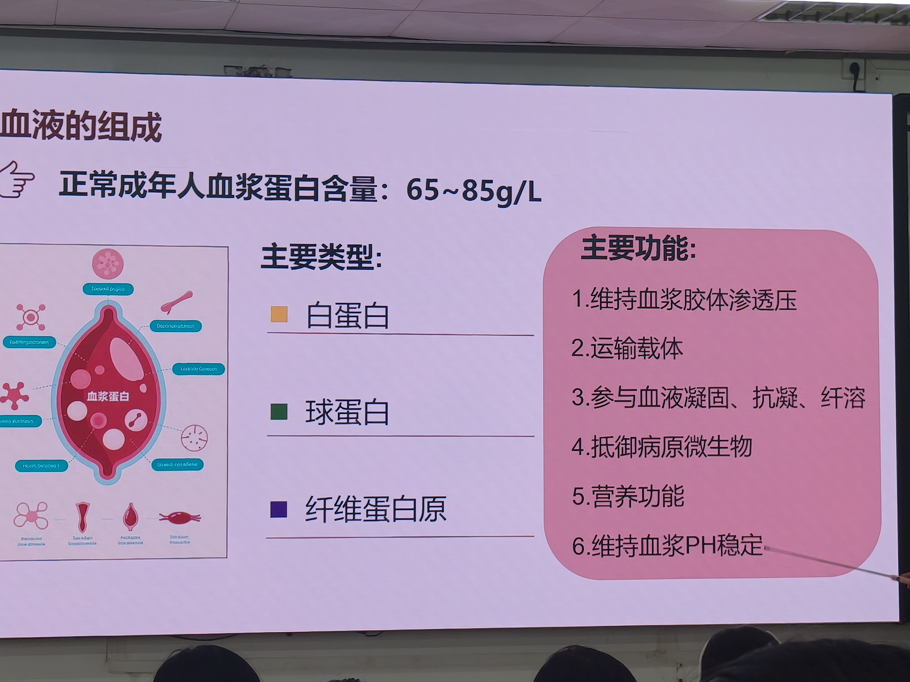
> 📝 **批注（14:36）**：课堂PPT——血浆蛋白含量65~85g/L（PPT口径；教材第10版为65~80g/L，考试若考数值以教材65~80 g/L为准）、三大类型（白蛋白/球蛋白/纤维蛋白原）、六大功能。与正文1.3对照记忆：白蛋白→胶体渗透压+载体；纤维蛋白原→凝血/抗凝/纤溶。

### 1.4 血细胞比容（hematocrit，Hct）——必考定义

**定义**：**血细胞在血液中所占的容积百分比**。

| 人群 | 正常值 |
|------|--------|
| 成年男性 | **40%~50%** |
| 成年女性 | **37%~48%** |
| 新生儿 | **约55%** |

**临床意义**：
- 因红细胞占血细胞99%，测定血细胞比容可了解**红细胞的相对数量**
- **贫血**（红细胞减少）→ 血细胞比容**降低**
- **红细胞增多症、脱水**（血液浓缩）→ 血细胞比容**升高**

> 【考点】"比容"不是"比重"——老师课堂上专门纠正：比容＝容积百分比。概念别记差。

### 1.5 血液的理化特性（四个：比重/粘度/渗透压/pH）

#### 1.5.1 血液的比重

**比重**＝某物质密度与参考物质（液体和固体以水为参照）密度的比值。

| 对象 | 比重 | 取决于 |
|------|------|--------|
| **全血** | 1.050~1.060 | 红细胞的数量（红细胞占比重最大） |
| **血浆** | 1.025~1.030 | 血浆蛋白含量 |
| **红细胞** | 1.090~1.092 | 红细胞内血红蛋白含量（笔记中"1:09~1:09"数字残缺，按教材取1.090~1.092） |

> 【理解】比重不同正是离心分层的原理：比重最轻的血浆在上，最重的红细胞在下。

#### 1.5.2 血液的粘度（viscosity）

**粘度**来源于液体内部分子或颗粒间的**摩擦力**，是形成**血流阻力**的重要因素。

| 对象 | 相对粘度（以水=1） | 取决于 |
|------|-------------------|--------|
| 全血 | **4~5** | 血细胞比容高低 |
| 血浆 | **1.6~2.4** | 血浆蛋白含量 |

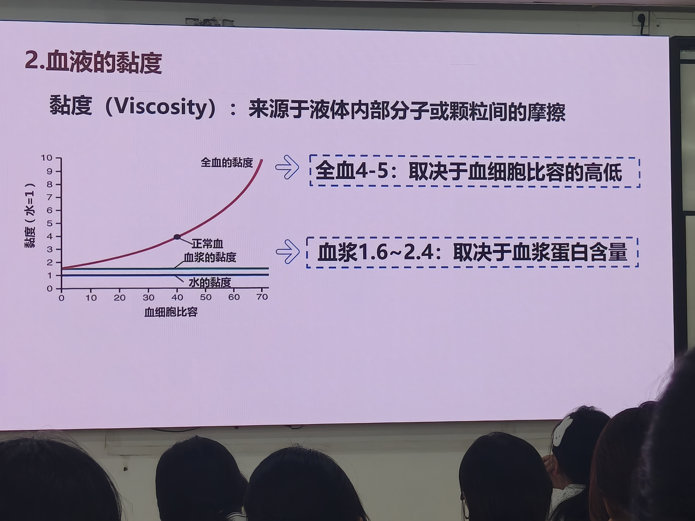
> 📝 **批注（14:42）**：课堂PPT——黏度曲线图：纵轴黏度（水=1）、横轴血细胞比容。**全血黏度随血细胞比容升高而上升**（曲线向上），"正常血"落在全血曲线上；血浆黏度接近水、变化平缓。记住：全血4~5取决于血细胞比容，血浆1.6~2.4取决于血浆蛋白。

**临床联系（老师重点案例）**：血液粘度增大→血液灌流/微循环障碍→组织缺氧→器官病变→**多器官衰竭**。如**严重烧伤**患者：血管内皮损伤→血浆丢失→血液浓缩→粘度增大→微循环障碍→多器官衰竭。正常血液粘度是保证血液循环和微循环顺利进行的重要条件。

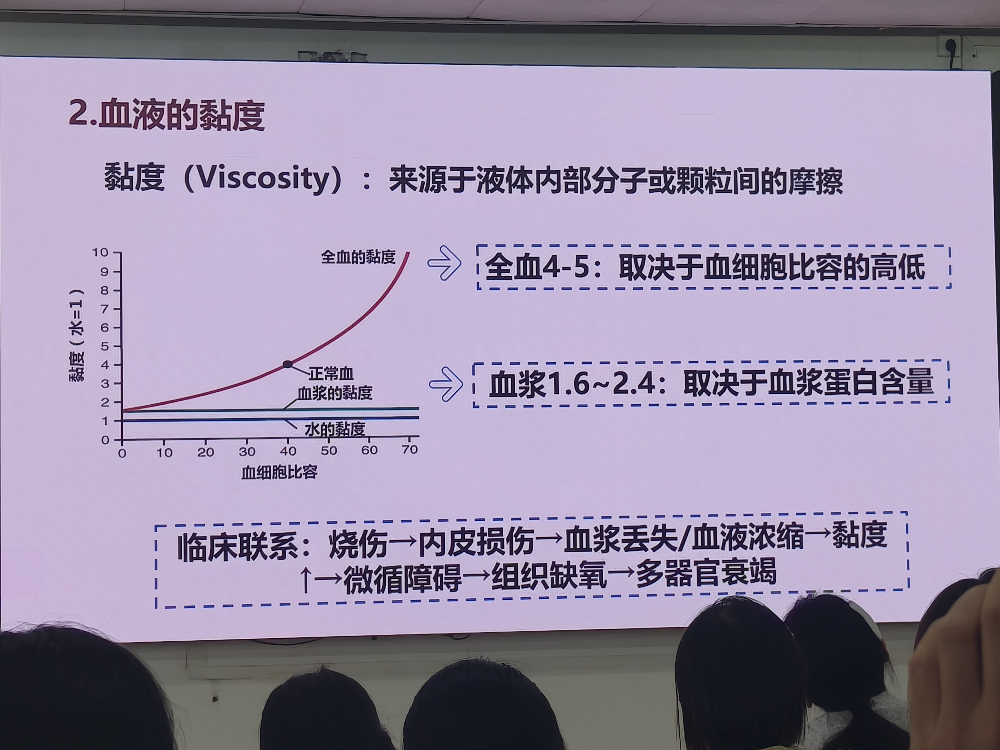
> 📝 **批注（14:43）**：课堂PPT完整链条：**烧伤→内皮损伤→血浆丢失/血液浓缩→黏度↑→微循环障碍→组织缺氧→多器官衰竭**。考试若考临床联系，按此链条作答。

#### 1.5.3 血浆渗透压（osmotic pressure）——本课重中之重

**渗透现象（osmosis）**：半透膜分隔不同浓度溶液时，水分子从**低浓度侧**进入**高浓度侧**；随渗透进行，膜两侧形成压力差，当压力差等于扩散力时液面不再变化，平衡后的压力差即可度量**促进水分子渗透的力量**——这就是**渗透压**。

> 【考点】**渗透压的高低只取决于溶液中溶质颗粒（分子或离子）数目的多少，与溶质种类和大小无关**（范托夫定律，1901年第一位诺贝尔化学奖）。

**血浆渗透压的两部分构成**：

| 类型 | 数值 | 主要来源 | 生理意义 |
|------|------|---------|---------|
| **晶体渗透压** | 约 **300 mmol/L**（≈300 mOsm/(kg·H₂O)，相当于770kPa） | **80%来自 Na⁺ 和 Cl⁻** | **维持细胞内外水的平衡和细胞的正常体积** |
| **胶体渗透压** | 约 **1.3 mmol/L**（≈25mmHg） | 血浆蛋白，**75%~80%来自白蛋白** | **维持血管内外水的平衡和正常血容量** |

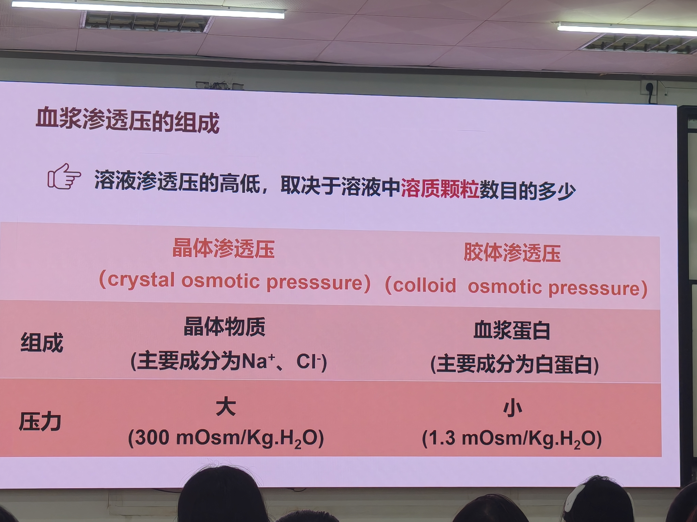
> 📝 **批注（14:47）**：课堂PPT对比表——**晶体渗透压**（晶体物质，主要Na⁺、Cl⁻，300 mOsm/Kg·H₂O，压力**大**）vs **胶体渗透压**（血浆蛋白，主要白蛋白，1.3 mOsm/Kg·H₂O，压力**小**）。核心规律：**渗透压高低取决于溶质颗粒数目多少**（PPT顶部大字）。

**为什么生理意义不同？**——关键在"能否透过"：
- **晶体物质（Na⁺、Cl⁻）和水可自由透过毛细血管壁**，但**不易透过细胞膜**：所以晶体渗透压改变时，水在**细胞内外**之间移动。晶体渗透压升高→细胞（红细胞）内水外移→细胞**皱缩**；降低→水进入细胞→细胞**膨胀破裂**。

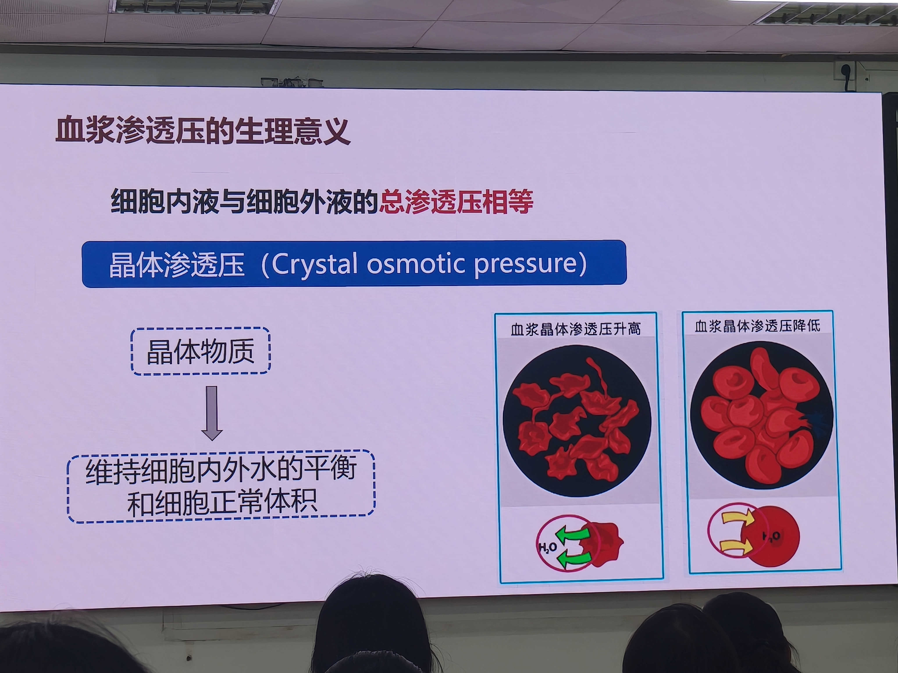
> 📝 **批注（14:50）**：课堂PPT示意图——**血浆晶体渗透压升高→红细胞皱缩；降低→红细胞膨胀破裂**（图中H₂O箭头方向即水移动方向）。前提：细胞内液与细胞外液的总渗透压相等。与等渗/低渗/高渗实验（下图）联动记忆。
- **血浆蛋白不能自由透过毛细血管壁**：所以胶体渗透压改变时，水在**血管内外**之间移动。血浆蛋白浓度降低→胶体渗透压下降→水向组织间隙转移→**水肿**。

> 【考点·临床】**晶体渗透压维持细胞内外水平衡和细胞正常体积；胶体渗透压维持血管内外水平衡和正常血容量**——一句话区分：晶体管"细胞内/外"，胶体管"血管内/外"。低蛋白血症（肝病/肾病/营养不良）→水肿。

**等渗 / 低渗 / 高渗溶液**：
- **等渗溶液**：渗透压与血浆渗透压相等的溶液（如 **0.9% NaCl** 溶液——红细胞置于其中保持正常形态大小）
- 低渗溶液：渗透压低于血浆（如0.5% NaCl）→ 红细胞膨胀破裂（溶血）
- 高渗溶液：渗透压高于血浆（如50% NaCl）→ 红细胞皱缩

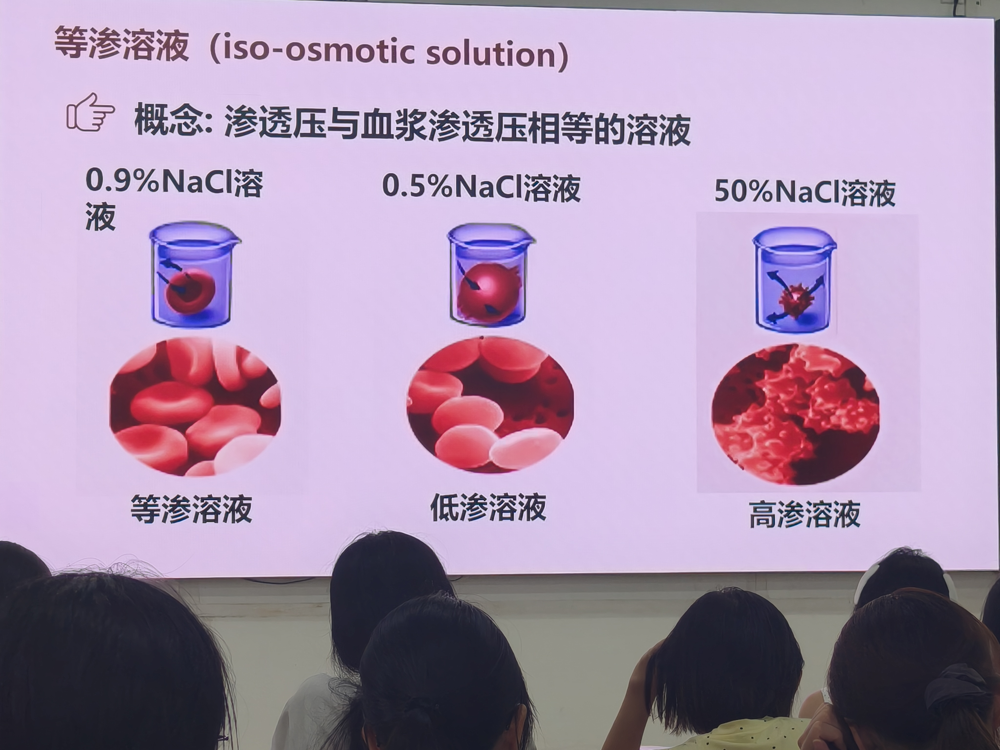
> 📝 **批注（14:53）**：课堂PPT三列对比——**0.9% NaCl=等渗溶液**（红细胞正常形态）、**0.5% NaCl=低渗溶液**（红细胞膨胀溶血）、**50% NaCl=高渗溶液**（红细胞皱缩）。注意图中0.9%组红细胞中央凹陷形态清晰。

**等渗 ≠ 等张（易错难点）**：
- **等张溶液**＝由**不能自由通过细胞膜**的溶质所形成的等渗溶液（能使红细胞保持正常形态大小）
- **1.9% 尿素溶液是等渗溶液，但不是等张溶液**：尿素可自由透过红细胞膜→进入红细胞→红细胞内渗透压升高→水进入→红细胞膨胀破裂溶血
- **0.9% NaCl 既是等渗也是等张**（NaCl不能自由透过红细胞膜）

> 【考点】输液时必须用等渗（且最好等张）溶液，否则引发血细胞形态改变等问题。

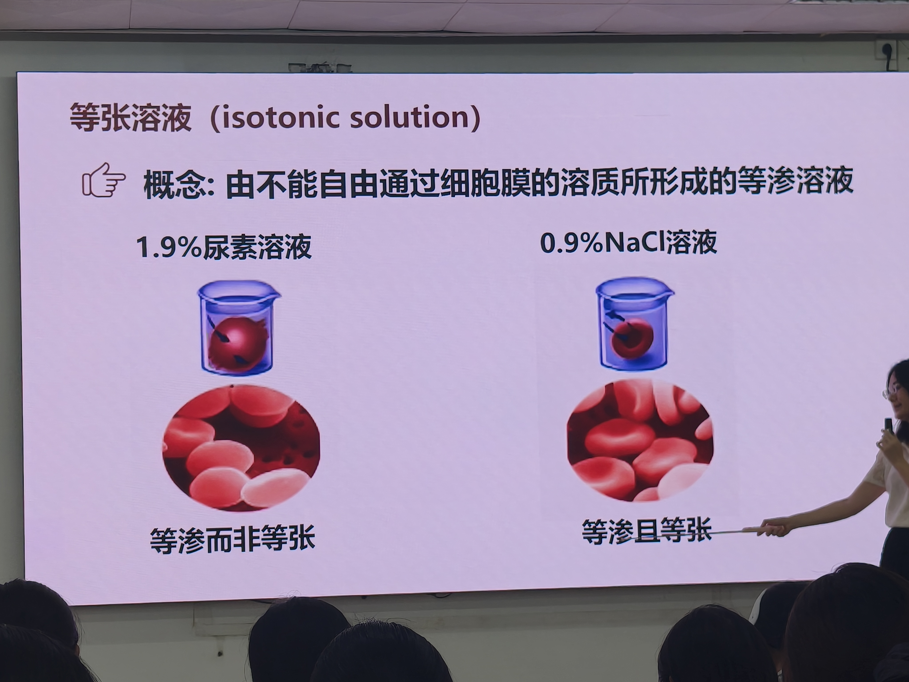
> 📝 **批注（14:55）**：课堂PPT（老师手持教鞭讲解）——等张溶液概念＝**由不能自由通过细胞膜的溶质所形成的等渗溶液**。**1.9%尿素=等渗而非等张**（尿素能自由过膜→红细胞溶血）；**0.9% NaCl=等渗且等张**。此图是"等渗≠等张"考点的最佳图解。

#### 1.5.4 血浆 pH

- 正常人血浆 pH：**7.35~7.45**
- **<7.35 酸中毒；>7.45 碱中毒**；**<6.9 或 >7.8 有死亡风险**
- 缓冲系统：**NaHCO₃/H₂CO₃（比值20:1，最重要）**、Na₂HPO₄/NaH₂PO₄、蛋白质钠盐/蛋白质
- 依赖**肺和肾**的正常功能共同维持（肺排CO₂，肾排酸保碱——呼吸/泌尿章节详讲）

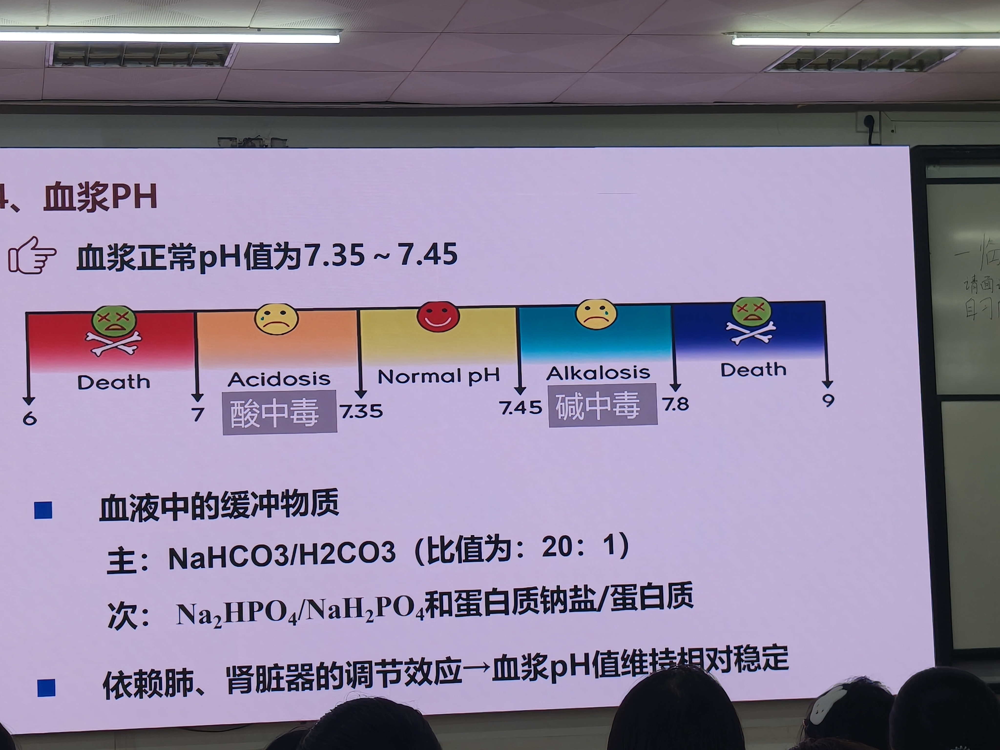
> 📝 **批注（14:56）**：课堂PPT数轴图——pH<6或>9→**死亡**（Death）；酸中毒（<7.35）、正常（7.35~7.45）、碱中毒（>7.45）；主缓冲对NaHCO₃/H₂CO₃=20:1，次缓冲对Na₂HPO₄/NaH₂PO₄、蛋白质钠盐/蛋白质；依赖肺、肾调节。PPT还标注了"一临请面试/自习"通知，与本课无关。

### 1.6 血液的免疫学特性【教材补充，老师未展开】

- **固有免疫（非特异性免疫）**：遗传获得，如吞噬细胞（中性粒细胞、单核巨噬细胞）、树突状细胞（DC）、NK细胞等，是抵御病原微生物的第一道防线
- **获得性免疫（特异性免疫）**：出生后与抗原接触获得，体液免疫（B淋巴细胞→浆细胞产生抗体Ig）＋细胞免疫（T淋巴细胞活化），如临床**CAR-T**细胞治疗

> 本章节老师未细讲，了解即可，免疫学课程会系统学习。

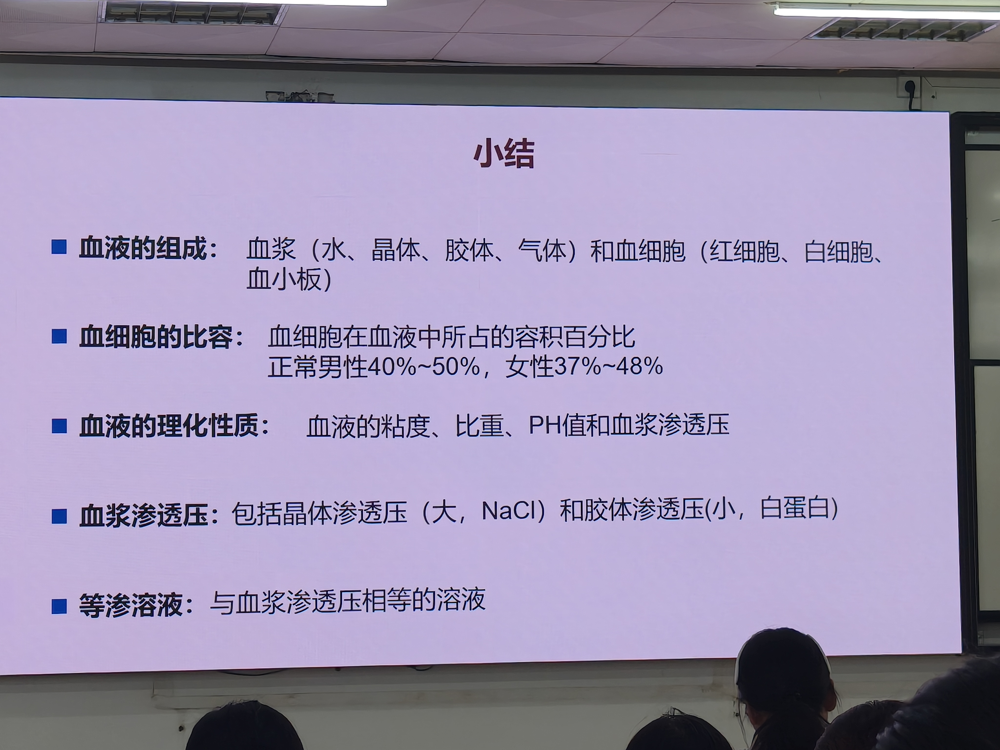
> 📝 **批注（15:02）**：课堂PPT"小结"——第一部分核心五条：①血液组成=血浆（水、晶体、胶体、气体）＋血细胞（红、白、血小板）；②血细胞比容=容积百分比（男40~50%、女37~48%）；③理化性质=粘度、比重、pH、血浆渗透压；④血浆渗透压=晶体（大，NaCl）＋胶体（小，白蛋白）；⑤等渗溶液=与血浆渗透压相等。复习时可先自测这五条再进入第二部分。

---

## 第二部分 血细胞生成的部位和一般过程（教材第56页）

### 2.1 造血过程三阶段

**成人各类血细胞均起源于骨髓造血干细胞（HSC）**：

```
造血干细胞（HSC：自我更新＋多向分化）
   → 造血祖细胞（已限定分化方向，边增殖边分化，不再有自我更新能力）
   → 形态可辨认的前体细胞（幼稚细胞）
   → 终末血细胞（成熟后释放入血液循环）
```

- 造血干细胞通过**对称性有丝分裂**产生两个相同的子代干细胞；**非对称性有丝分裂**产生一个子代干细胞＋一个早期祖细胞——既维持自身数量稳定，又满足造血需求【教材补充】
- 造血祖细胞在体外培养形成**集落形成单位（CFU）**：红系（CFU-E）、粒-巨噬（CFU-GM）、巨核系（CFU-MK）、淋巴系（CFU-L）等【教材补充】
- 早期红系祖细胞形成**红系爆式集落形成单位（BFU-E）**，晚期红系祖细胞形成**红系集落形成单位（CFU-E）**——CFU-E 是 EPO 的主要靶细胞（见3.6，重要衔接！）

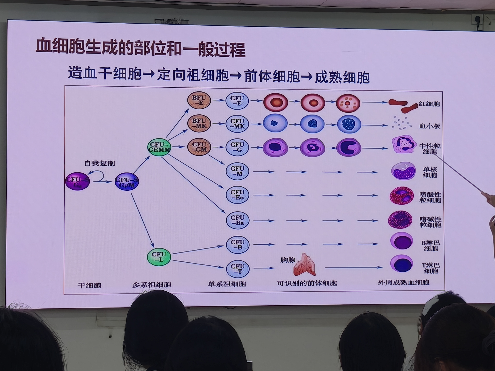
> 📝 **批注（15:04）**：课堂PPT完整造血谱系图（本课最详细的一张）——**造血干细胞（CFU-S，自我复制）→ 多系祖细胞（CFU-GEMM）→ 单系祖细胞（BFU-E/CFU-E、BFU-MK/CFU-MK、CFU-GM、CFU-G/CFU-M/CFU-Eo/CFU-Ba、CFU-B/CFU-T，CFU-L为淋巴系）→ 可识别的前体细胞 → 外周成熟血细胞**（红细胞/血小板/中性粒细胞/单核细胞/嗜酸/嗜碱/B淋巴细胞/T淋巴细胞——T细胞经**胸腺**）。考试最常考"干细胞→定向祖细胞→前体细胞→成熟细胞"四阶段主线。

### 2.2 山中伸弥与 iPS（老师课堂扩展，常识了解）

- 一般认知：分化成熟的体细胞不能再分化（如皮肤细胞不能变心肌细胞）
- 日本科学家**山中伸弥**：把已分化的成熟体细胞通过**重编程（导入4个诱导分子基因）**，诱导成为**多能干细胞（induced pluripotent stem cells，iPS）**
- iPS 可再分化为神经细胞、心肌细胞及多种血细胞，常用于**临床和药理研究**
- 发现**O型血的皮肤细胞更容易诱导**出多能干细胞
- 因此获得 **2012年诺贝尔生理学或医学奖**

> 【教材补充】造血干细胞的定居、增殖、分化需要**造血微环境（造血龛，hematopoietic niche）**支持——由骨髓基质细胞、细胞外基质、造血调节因子等构成。造血干细胞受损（γ射线、X射线、氯霉素、苯、病毒等）或微环境缺陷→**再生障碍性贫血**（全血细胞减少）；恶性突变→白血病。

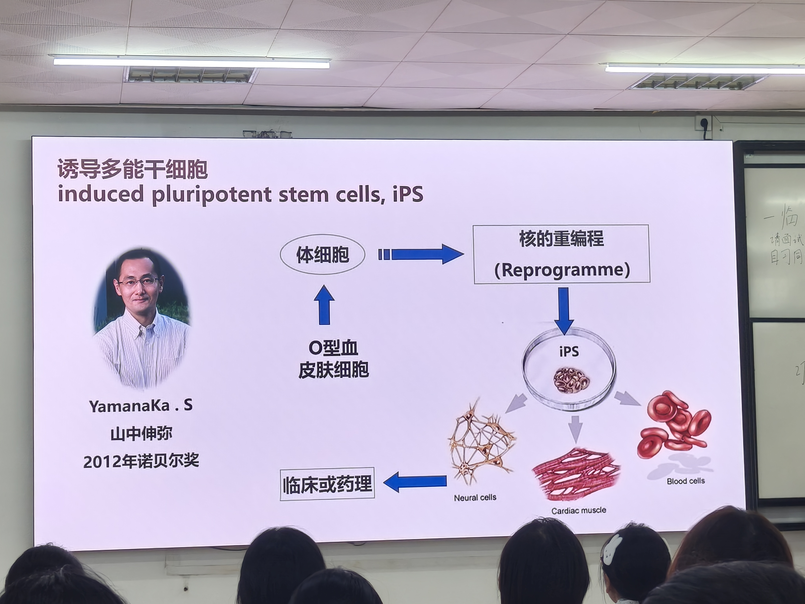
> 📝 **批注（15:05）**：课堂PPT——山中伸弥（Yamanaka.S）2012年诺贝尔奖；**O型血皮肤细胞**（体细胞）→核的重编程（Reprogramme）→iPS→可分化**神经细胞（Neural cells）/心肌细胞（Cardiac muscle）/血细胞（Blood cells）**→用于**临床或药理**研究。扩展考点：iPS是"体细胞重编程为多能干细胞"，与胚胎干细胞（ESC）不同。

---

## 第三部分 红细胞生理（重点中的重点，教材第56~61页）

### 3.1 红细胞的数量和形态

**数量**（人体内数量最多的血细胞）：

| 人群 | 红细胞数（老师课堂） | 红细胞数（人卫第10版教材） | 血红蛋白 Hb |
|------|---------------------|---------------------------|-------------|
| 成年男性 | (4.0~5.5)×10¹²/L | **(4.3~5.8)×10¹²/L** | 120~160 g/L（课堂）/ **130~175 g/L（教材）** |
| 成年女性 | (3.5~5.0)×10¹²/L | **(3.8~5.1)×10¹²/L** | 110~150 g/L（课堂）/ **115~150 g/L（教材）** |

> ⚠️ **数值口径说明**：老师课堂用第9版及以前教材数值（男4-5.5/女3.5-5.0；Hb男120-160/女110-150）；人卫第10版教材已更新（男4.3-5.8/女3.8-5.1；Hb男130-175/女115-150）。**考试答题建议以老师强调的课堂口径为主，若题目明确"教材"则用第10版数值**——两个口径都记住。

**形态**：**双凹圆碟形**——周边厚、中央薄
- 直径约 **7.5 μm**（教材：7~8 μm）
- 周边最厚处 **2.5 μm**，中央最薄处约 **1 μm**
- **无细胞核、无线粒体**（故糖酵解是成熟红细胞获得能量的唯一途径），含丰富**血红蛋白（Hb）**
- 保持双凹圆碟形须消耗能量（钠泵维持Na⁺/K⁺分布和细胞容积形态）【教材补充】

**贫血判定**：外周血红细胞数量或 Hb 浓度低于正常即贫血（低Hb、低红细胞数都是）。

### 3.2 红细胞的三大生理特性（本课核心考点）

#### 3.2.1 可塑变形性（plastic deformation）

**定义**：红细胞在外力作用下具有的**变形能力**（外力撤销后可恢复双凹圆碟形）。

**机制与意义**：
- 红细胞直径约7.5μm，而**毛细血管内径仅约5μm**、脾窦内皮细胞裂隙更小——红细胞必须**变形挤过去**，否则被挤压破裂
- 变形能力的关键：**红细胞具有较大的表面积与体积之比（表面积/体积比大）**——双凹圆碟形表面积约140μm²（等体积球形仅约100μm²）【教材补充】

**水球类比（老师课堂）**：两个相等的气球，一个只装一点水、一个装满水——装一点水的表面积/体积比大，怎么捏都不容易爆；装满水的比值小，一捏就爆。红细胞同理。

**气体交换意义（老师课堂展开）**：红细胞挤着通过时，红细胞膜紧贴毛细血管壁、毛细血管壁紧贴肺泡壁，膜间距离极短→**有利于气体交换**——这就是"红细胞比毛细血管内径大"这一"奇怪构造"的生理意义。

**临床联系（两种贫血对比，易考）**：

| 疾病 | 病因 | 形态/后果 |
|------|------|-----------|
| **遗传性球形红细胞增多症** | 基因突变→膜蛋白缺失→膜脂质丢失→**膜表面积减小**（体积不变） | 球形→表面积/体积比减小→变形能力减弱→易破裂→溶血性贫血 |
| **镰状细胞贫血** | 血红蛋白**β链一个氨基酸突变**（被换成另一种氨基酸） | 红细胞呈镰刀状/月牙状→通过毛细血管像木棍要弯曲→易折断破裂→**寿命短** |

#### 3.2.2 悬浮稳定性（suspension stability）

**定义**：红细胞能**相对稳定地悬浮于血浆中**的特性。

**测定——红细胞沉降率（ESR，血沉）**：抗凝血置血沉管垂直静置，**第1小时末**红细胞下沉的距离。
- 正常成年男性 **0~15 mm/h**，女性 **0~20 mm/h**
- **血沉越快＝悬浮稳定性越小**

**机制**：双凹圆碟形表面积/体积比大→与血浆分子摩擦大→下沉缓慢；若红细胞**彼此以凹面相贴（红细胞叠连）**→团块总表面积/体积比减小→摩擦力下降→**血沉加快**。

**关键结论（老师重点强调）**：
> **决定红细胞叠连快慢的因素不在于红细胞本身，而在于血浆成分的变化。**

实验证据：把正常红细胞放入血沉加快者的血浆中→血沉加快；把血沉加快者的红细胞放入正常血浆中→血沉正常。

| 血浆成分 | 变化 | 对血沉影响 | 机制 |
|---------|------|-----------|------|
| 纤维蛋白原、球蛋白、胆固醇 | 增多 | **加快** | 带正电荷→中和红细胞表面（N-乙酰神经氨酸）负电荷→促进叠连 |
| 白蛋白、卵磷脂 | 增多 | **减慢** | 带负电荷→抑制叠连 |

**临床联系**：**活动性肺结核、风湿热**等疾病时，炎症因子促进肝脏纤维蛋白原合成→血沉加快——临床用血沉辅助诊断。

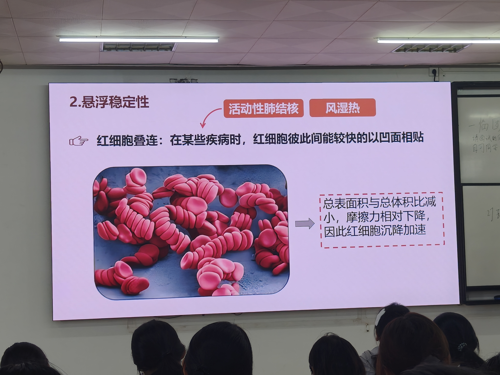
> 📝 **批注（15:27，课间休息后继续）**：课堂PPT——**红细胞叠连**：某些疾病时红细胞彼此较快地以**凹面相贴**；总表面积/体积比减小→摩擦力相对下降→**红细胞沉降加速**。PPT左上角标注了血沉加快的典型疾病：**活动性肺结核、风湿热**。

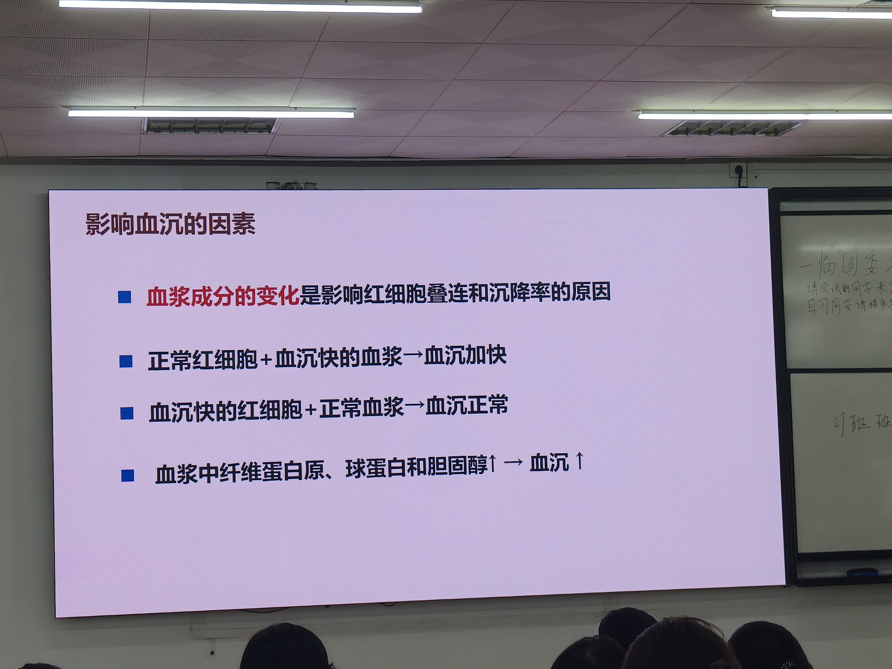
> 📝 **批注（15:28）**：课堂PPT关键结论——**血浆成分的变化是影响红细胞叠连和沉降率的原因**。交叉实验证据：①正常红细胞＋血沉快的血浆→血沉加快；②血沉快的红细胞＋正常血浆→血沉正常。**纤维蛋白原、球蛋白和胆固醇↑→血沉↑**。此图直接对应考点"决定叠连快慢的是血浆成分而非红细胞本身"。

#### 3.2.3 渗透脆性（osmotic fragility）

**定义**：红细胞在**低渗盐溶液中发生膨胀破裂**的特性。

**梯度实验**：红细胞置于一系列浓度递减的低渗 NaCl 溶液中——
- NaCl 降至 **0.42%~0.46%**：部分红细胞开始破裂（开始溶血）【老师课堂强调0.42%】
- NaCl 降至 **0.28%~0.32%**：红细胞**全部溶血**【老师课堂口述0.34%，教材区间0.28%~0.32%，以教材为准】

**要点**：
- 红细胞对低渗溶液**有一定抵抗力**，且**同一个体内不同红细胞抵抗力不同**
- **衰老红细胞**：脆性大、抵抗力低（对低渗溶液更易破裂）
- 刚成熟的红细胞：脆性小、抵抗力高
- **遗传性球形红细胞增多症**：脆性大于正常红细胞（稍入低渗即膨胀破裂）
- 临床意义：测定红细胞渗透脆性有助于某些疾病诊断

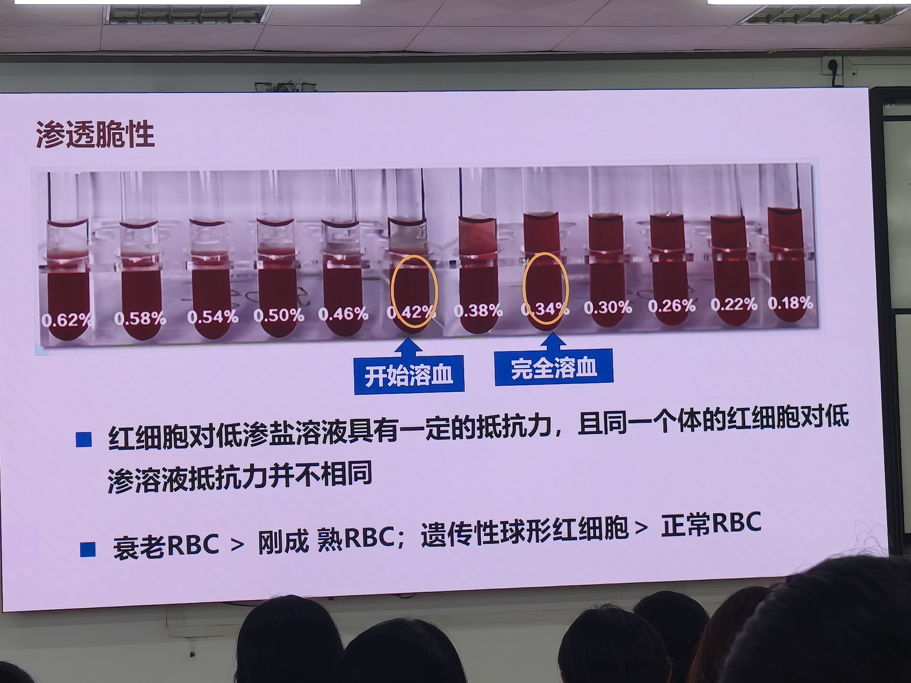
> 📝 **批注（15:30）**：课堂PPT实验图——系列低渗NaCl试管（0.62%→0.18%）：**0.42%开始溶血**、**0.34%完全溶血**（课堂PPT口径，与老师口述一致；教材第10版为0.28%~0.32%完全溶血——考试答课堂PPT数值0.42%/0.34%或按教材区间均可，注意看清题目口径）。下方结论：**衰老RBC＞刚成熟RBC；遗传性球形红细胞＞正常RBC**（脆性大者更易溶血）。

### 3.3 红细胞的功能

1. **运输 O₂ 和 CO₂（核心功能）**：血液中 **98.5% 的 O₂** 以与血红蛋白结合成氧合血红蛋白的形式存在【教材补充】；CO₂ 主要以碳酸氢盐和氨基甲酰血红蛋白形式运输
2. **缓冲酸碱物质**：参与血液酸碱平衡
3. **清除免疫复合物**
4. 双凹圆碟形→**气体交换面积大**、中心到表面距离短→利于气体交换【教材补充】

**血红蛋白（Hb）的构造（老师课堂重点）**：
- **珠蛋白（2条α链＋2条β链）＋4个血红素＋Fe²⁺（二价铁离子）**
- Fe²⁺ 可与 O₂ 结合
- 红细胞内 Hb 一旦逸出到血浆即丧失运输 O₂ 功能【教材补充】

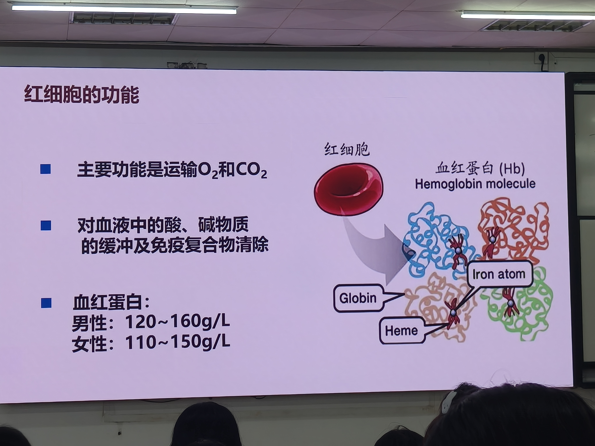
> 📝 **批注（15:32）**：课堂PPT——红细胞功能：**主要功能运输O₂和CO₂**；对血液中酸碱物质的缓冲及免疫复合物清除；右侧Hb分子结构拆解：**Globin（珠蛋白）＋Heme（血红素）＋Iron atom（铁原子）**；男女Hb正常值：男120~160g/L、女110~150g/L（课堂口径）。

### 3.4 红细胞的生成：部位与过程

- **生成部位**：**红骨髓**——成年人红细胞生成的**唯一场所**（老师：目前发现只有在红骨髓产生）
- **生成过程**（顺序必背）：

```
髓系造血干细胞 → 红系定向祖细胞（红系造血祖细胞）
  → 原红细胞 → 早幼红细胞 → 中幼红细胞 → 晚幼红细胞
  → 网织红细胞 → 成熟红细胞
```

- 从原红到中幼红经历3~5次有丝分裂，一个原红细胞可产生8~32个晚幼红细胞；贫血时分裂加快（缩短到2天）【教材补充】
- **成熟红细胞寿命：约120天**
- **网织红细胞**：晚幼红细胞脱核后进入血液，通过自噬清除线粒体、核糖体等残留细胞器发育为成熟红细胞，历时**1~2天**；占外周血红细胞 **0.5%~1.5%**
- **临床意义（必背）**：骨髓造血功能增强→大量网织红细胞释放入血→**通过网织红细胞计数了解骨髓造血功能的盛衰**

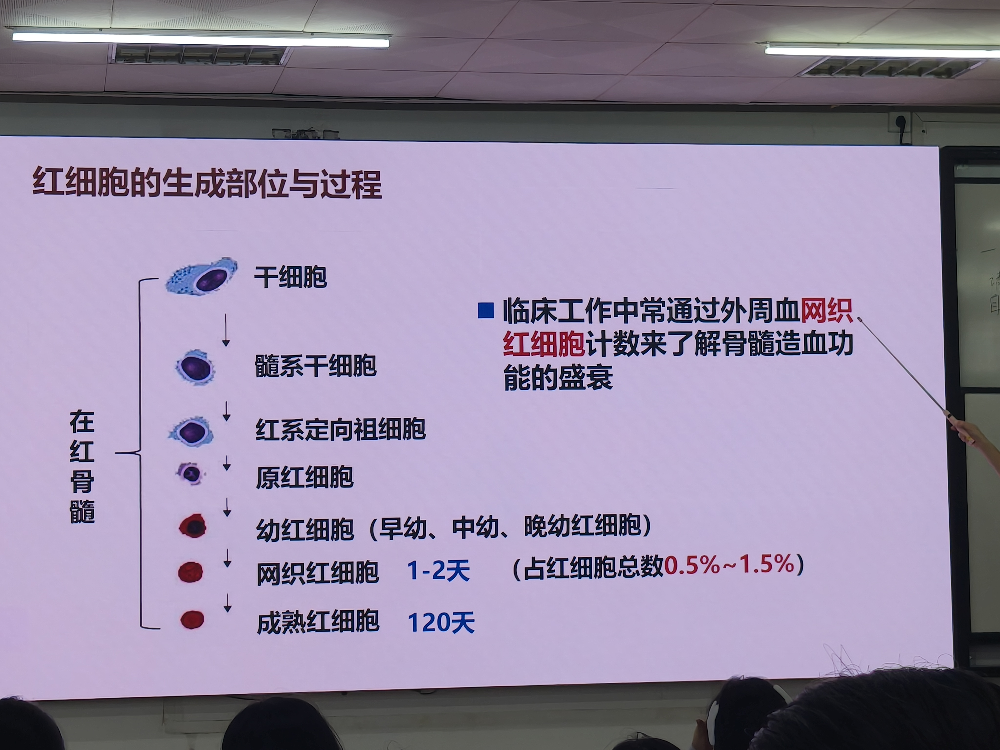
> 📝 **批注（15:34）**：课堂PPT流程图——**在红骨髓**：干细胞→髓系干细胞→红系定向祖细胞→原红细胞→幼红细胞（早幼、中幼、晚幼）→**网织红细胞（1-2天，占红细胞总数0.5%~1.5%）→成熟红细胞（120天）**；右侧红色强调：**临床通过外周血网织红细胞计数了解骨髓造血功能的盛衰**。

### 3.5 红细胞生成的原料（三大核心原料）

**铁 + 叶酸 + 维生素B₁₂**——三个核心原料，对应两种贫血，必考：

| 原料 | 作用 | 缺乏后果 |
|------|------|---------|
| **铁** | **合成血红蛋白的必需原料**（Hb含4个亚铁离子） | **缺铁性贫血**（镜下见红细胞中央苍白区增大——Hb含量减少） |
| **叶酸** | **合成 DNA 的重要辅酶**（N⁵-甲基四氢叶酸→四氢叶酸→参与DNA合成） | **巨幼红细胞性贫血**（DNA合成障碍→核发育滞后于胞质→核大、体积大） |
| **维生素B₁₂** | 协助叶酸转化（四氢叶酸转化需B₁₂），合成DNA重要辅酶 | 同上：巨幼红细胞性贫血 |

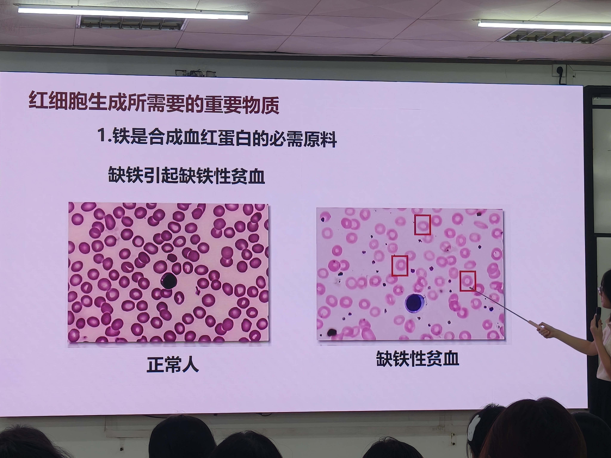
> 📝 **批注（15:36）**：课堂PPT（教师指向右图）——**铁是合成血红蛋白的必需原料，缺铁→缺铁性贫血**。显微对比：正常人红细胞形态饱满、大小均匀；**缺铁性贫血红细胞体积偏小（小细胞低色素）、形态不一、分布稀疏**（红色方框标出异常红细胞）。

**维生素B₁₂ 吸收的特殊性（高频考点）**：
- B₁₂ 不能直接被小肠吸收
- 必须与**内因子**结合——**内因子由胃黏膜壁细胞产生**（笔记中"胃腺的B细胞"实为**胃壁细胞**，纠正）
- 结合后经**回肠末端**的特异性受体识别，才能进入体内

**叶酸代谢链**：N⁵-甲基四氢叶酸 →（需维生素B₁₂）→ 四氢叶酸 → 参与 DNA 合成。缺 B₁₂ → 叶酸利用率下降 → 叶酸相对不足。

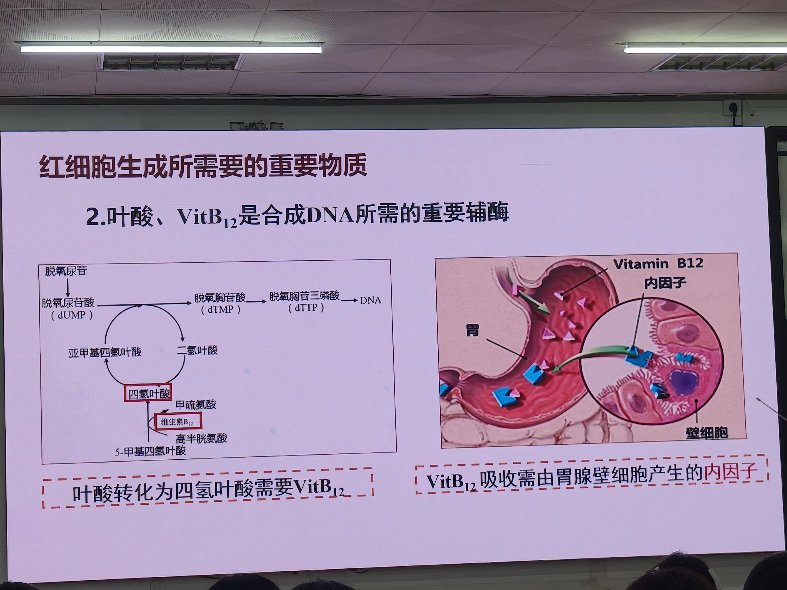
> 📝 **批注（15:37）**：课堂PPT——左侧代谢流程图：**脱氧尿苷酸（dUMP）→脱氧胸苷酸（dTMP）→脱氧胸苷三磷酸（dTTP）→DNA**，中间叶酸循环（亚甲基四氢叶酸/二氢叶酸/四氢叶酸/5-甲基四氢叶酸）与甲硫氨酸-高半胱氨酸循环（需VitB₁₂）；右侧胃部解剖图：**Vitamin B12与内因子结合，胃壁细胞分泌内因子**。底部两条关键结论：①**叶酸转化为四氢叶酸需要VitB₁₂**；②**VitB₁₂吸收需由胃腺壁细胞产生的内因子**。

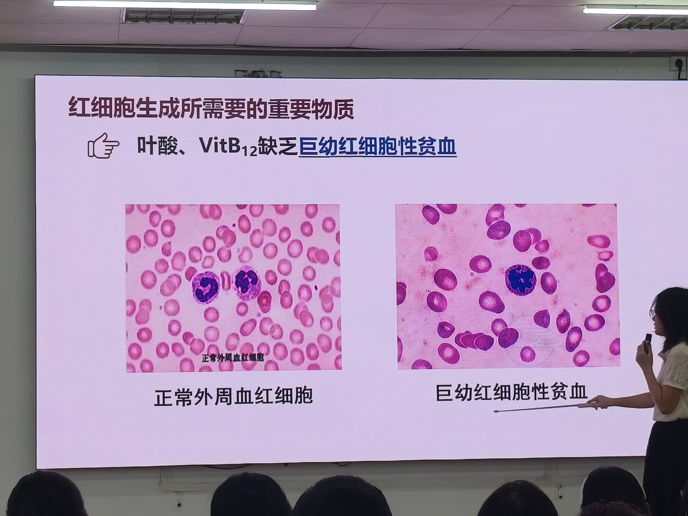
> 📝 **批注（15:38）**：课堂PPT显微对比——左侧正常外周血红细胞（形态均匀、中央浅染区正常），右侧**巨幼红细胞性贫血**（红细胞体积大、大小不一、着色深——大细胞性贫血典型形态）。与15:36缺铁性贫血图对照：**缺铁=小细胞低色素（中央苍白大）；叶酸/B₁₂缺乏=大细胞（巨幼）**。

**【临床案例：胃大部切除术后贫血】（老师课堂重点案例）**

情境：患者因胃溃疡行**胃大部切除术**，术后5年出现明显贫血表现。问：可能是什么类型贫血？机制？

学生回答（部分正确）：巨幼红细胞性贫血——胃黏膜壁细胞减少→内因子减少→B₁₂吸收减少→叶酸利用率下降→DNA合成障碍→核发育滞后于胞质→巨幼红细胞性贫血。

**老师补充（完整答案）**：实际上是**大小细胞混合性贫血**：
1. **巨幼红细胞性贫血**：内因子减少→B₁₂吸收障碍→（如上）
2. **缺铁性贫血（小细胞低色素贫血）**：胃壁细胞除了分泌内因子，**主要还分泌盐酸**；盐酸促进铁的吸收——人体只有**亚铁离子（Fe²⁺）能被吸收**，铁剂在盐酸作用下转变为亚铁离子被吸收。壁细胞被切除→盐酸减少→铁吸收障碍→缺铁性贫血。

> 【考点】胃壁细胞＝分泌**盐酸**（促铁吸收）＋**内因子**（促B₁₂吸收）。胃大部切除→"大小细胞混合性贫血"。

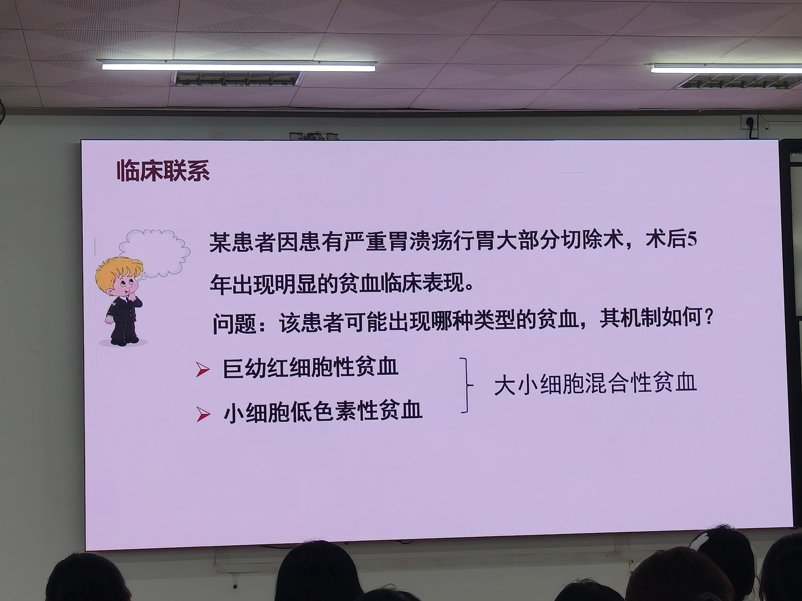
> 📝 **批注（15:41）**：课堂PPT案例题原图——某患者因严重胃溃疡行**胃大部切除术，术后5年出现明显贫血**。问题：可能哪种类型贫血、机制如何？PPT给出三种候选：**巨幼红细胞性贫血 / 小细胞低色素性贫血 / 大小细胞混合性贫血**（正确答案为后者，机制见上文老师补充的完整链条：盐酸↓→缺铁 + 内因子↓→B₁₂吸收↓→巨幼）。

### 3.6 红细胞生成的调节（EPO 为核心，高频考点）

#### 3.6.1 促红细胞生成素（erythropoietin，EPO）

**来源**：**90%~95% 由肾产生**（肾皮质肾小管周围的间质细胞，主要是成纤维细胞——笔记中"管周红细胞"实为**肾管周细胞**，纠正）；**5%~10% 由肝等肾外组织产生**。肾内无 EPO 储存，缺氧可迅速引起 EPO 基因表达增加。

**EPO 的作用（四条，简答考点）**：
1. **抑制晚期红系祖细胞（CFU-E，红系集落形成单位）的凋亡**——CFU-E 的存活完全依赖 EPO（存活因子/survival factor），这是增殖分化的前提
2. **促进晚期红系祖细胞的增殖与分化**
3. **激活血红蛋白等红系特异性基因的表达**，促进红系祖细胞向原红细胞分化及幼红细胞 Hb 合成
4. **促进网织红细胞的成熟与释放**

> 【理解】"红系集落形成单位（CFU-E）"名字的由来：体外培养时晚期红系祖细胞聚集像"一个簇、一个集落"，故称集落形成单位，缩写 CFU-E。

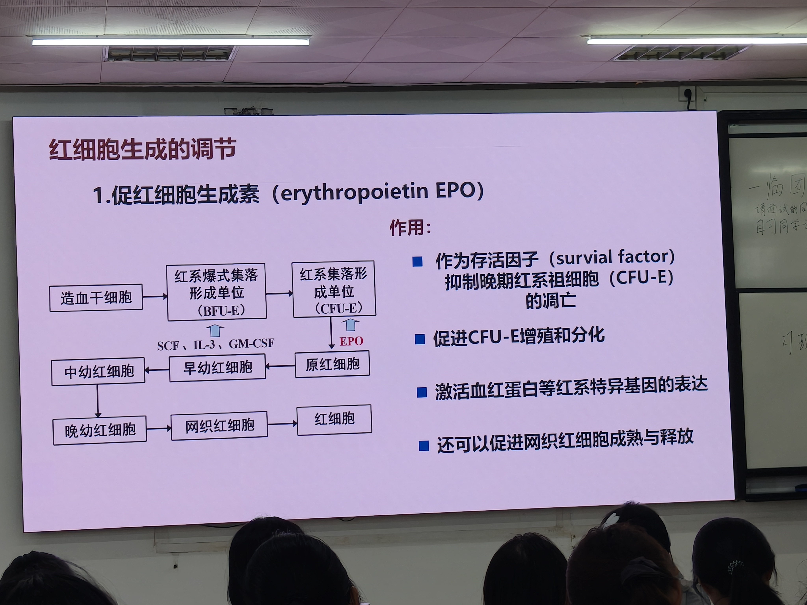
> 📝 **批注（15:44）**：课堂PPT——左侧分化流程图：造血干细胞→**BFU-E→CFU-E→原红细胞→早幼→中幼→晚幼→网织→红细胞**，标注调控因子作用节点（**SCF、IL-3、GM-CSF**作用于BFU-E及以前；**EPO**作用于CFU-E阶段）；右侧EPO四项作用：①作为**存活因子（survival factor）**、抑制晚期红系祖细胞（CFU-E）的凋亡；②促进CFU-E增殖和分化；③激活血红蛋白等红系特异基因的表达；④促进网织红细胞成熟与释放。

**分泌调节（负反馈闭环，必考）**：

```
组织缺氧（贫血 / 肾血流量减少 / 大气氧分压↓ / Hb浓度↓ / 氧亲和力↓ 等）
   → 肾管周细胞（+肝细胞）分泌 EPO ↑
   → 晚期红系祖细胞（CFU-E）增殖分化 ↑
   → 红细胞数量 ↑ → 携氧量 ↑
   → 缺氧缓解 → 负反馈抑制 EPO 分泌
```

- 生理性刺激因素：**组织缺氧**（任何引起肾供氧不足的因素：贫血、缺氧、肾血流量减少）
- 正常人进入高原低氧环境→EPO增多→红细胞和Hb增高（高原训练原理）
- **低氧促进 EPO 基因表达的机制**：**低氧诱导因子-1（HIF-1）**，低氧时肾内 HIF-1 活性增强，与 EPO 基因3'端增强子结合促进表达——**HIF 研究获2019年诺贝尔生理学或医学奖**【教材补充】

**临床联系（老师课堂）**：**慢性肾衰→肾性贫血**
- 双肾实质严重破坏→EPO缺乏→红细胞生成不足
- 且肾衰患者长期透析→红细胞易破裂、寿命缩短；对缺氧**响应慢**（正常人缺氧10%左右立即调节红细胞量，肾衰患者响应很慢）→不能很快增加红细胞量→**肾性贫血**

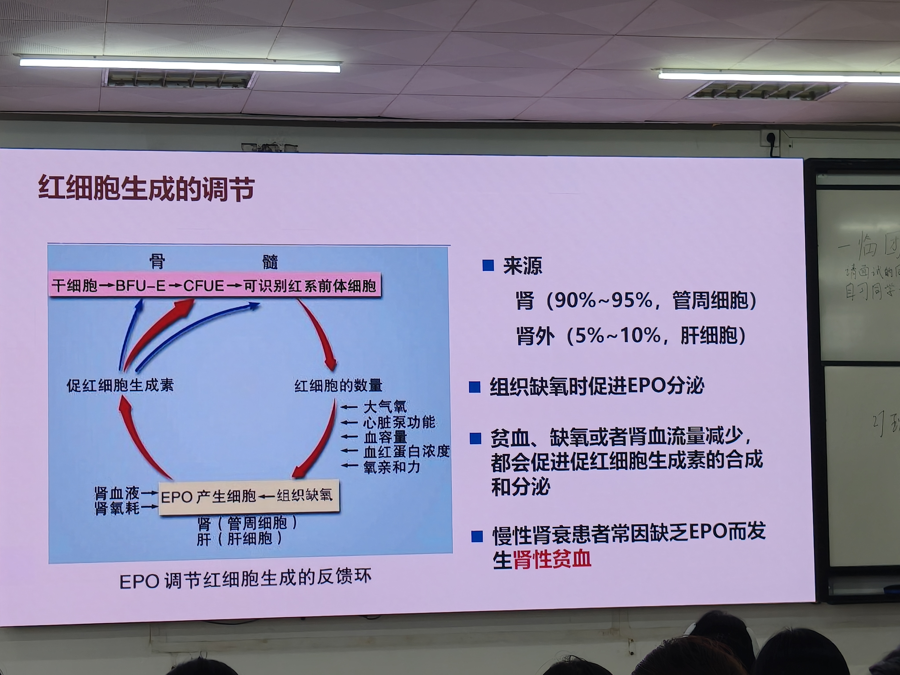
> 📝 **批注（15:47）**：课堂PPT——**EPO调节红细胞生成的反馈环**：影响红细胞数量因素（大气氧分压↓/心脏泵功能↓/血容量↓/Hb浓度↓/氧亲和力↓）→**组织缺氧**→EPO产生细胞（**肾管周细胞、肝肝细胞**）←肾血流↓/肾氧耗↑→EPO↑→骨髓干细胞→BFU-E→CFU-E→可识别红系前体细胞→红细胞数量↑。右侧要点：EPO来源（**肾90%~95%管周细胞；肾外5%~10%肝细胞**）；**贫血、缺氧或肾血流量减少都促进EPO合成分泌**；**慢性肾衰常因缺乏EPO而发生肾性贫血**。

#### 3.6.2 其他激素调节

| 激素 | 作用 |
|------|------|
| **雄激素** | **促进**红细胞生成（刺激EPO产生＋直接刺激骨髓＋促进Hb合成） |
| **甲状腺激素、肾上腺皮质激素、生长激素** | 间接促进（改变组织对氧的需求） |
| **雌激素** | **抑制**红细胞生成（降低红系祖细胞对EPO的反应） |
| **干扰素γ、肿瘤坏死因子、转化生长因子β** | 抑制早期红系祖细胞增殖（与慢性炎症时炎症性贫血有关）【教材补充】 |

> 【考点】**为什么男性红细胞数和Hb高于女性？**——雄激素促进、雌激素抑制红细胞生成。

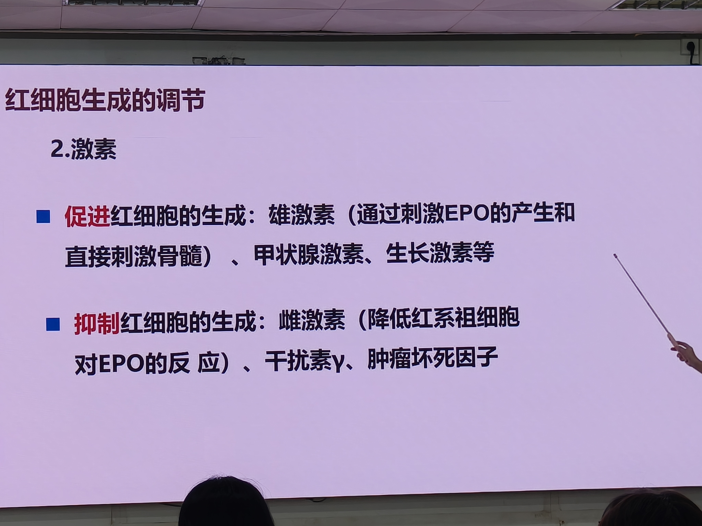
> 📝 **批注（15:48）**：课堂PPT——**促进红细胞生成**：雄激素（通过刺激EPO的产生和直接刺激骨髓）、甲状腺激素、生长激素等；**抑制红细胞生成**：雌激素（降低红系祖细胞对EPO的反应）、干扰素γ、肿瘤坏死因子。与正文3.6.2表格一致。

#### 3.6.3 EPO 与兴奋剂（老师课堂扩展，常识了解）

- EPO 最初用于临床：肾衰/透析患者促进红细胞生成
- **1989年被列为兴奋剂**：运动员用 EPO 提高红细胞→血氧量增加→运动更有力量（高原训练也是利用缺氧促EPO原理）
- 早期难检测（人体自身也有EPO，难以区分内源/外源）；技术进步后可检测外源性EPO的基因修饰差异
- **风险**：EPO可使红细胞比容增加至**70%**，血液过浓→**栓塞风险**
- **案例：芬兰滑雪运动员蒙蒂兰卡（Eero Mäntyranta，笔记"蒙蒂兰卡"）**：连续三次奥运会金牌、12年领域第一；未服兴奋剂，检测发现**EPO基因突变**→天然生成更多EPO→红细胞比常人高20%→**原发性红细胞增多症**

### 3.7 红细胞的破坏

- 红细胞平均寿命 **120天**，每天约0.8%衰老红细胞被破坏
- **血管外破坏（占90%，主要途径）**：衰老红细胞变形能力减退、脆性增高，难以通过脾、肝、骨髓中的微小孔隙（**脾窦裂隙**——笔记"皮窦裂隙"纠正），滞留后**被巨噬细胞吞噬**；吞噬后血红蛋白被消化，释出**铁（可再利用）**、氨基酸（可再利用）和**胆红素**（肝排入胆汁）
- **血管内破坏（占10%）**：血流机械冲击破损；释放的血红蛋白与血浆**触珠蛋白**结合后经肝摄取【教材补充】
- **临床联系**：**脾功能亢进**→红细胞破坏过多→贫血（脾性贫血）；红细胞破坏过多→**溶血性贫血**；大量血管内溶血→Hb超出触珠蛋白结合能力→经肾排出→**血红蛋白尿**【教材补充】

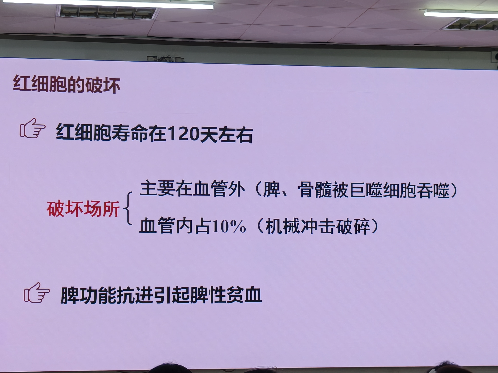
> 📝 **批注（15:52）**：课堂PPT——红细胞寿命**约120天**；破坏场所：**主要在血管外（脾、骨髓被巨噬细胞吞噬）**、**血管内占10%（机械冲击破碎）**；**脾功能亢进引起脾性贫血**。PPT中"脾功能抗进"为排版笔误，应为"脾功能亢进"。

---

## 第四部分 白细胞生理（开场，下节课继续）

### 4.1 白细胞的分类（老师课堂）

白细胞是重要的**免疫/防御细胞**，抵御病毒细菌等微生物入侵。

**按胞质有无颗粒分类**：

| 分类 | 细胞 |
|------|------|
| **颗粒细胞**（含嗜色颗粒） | 嗜中性粒细胞、嗜酸性粒细胞、嗜碱性粒细胞 |
| **无颗粒细胞** | 单核细胞、淋巴细胞（老师课堂把血小板也列入，教材分类血小板不属于白细胞） |

**去向（老师课堂）**：
- **单核细胞**流出组织外→**巨噬细胞**
- **淋巴细胞**（T细胞等）→（活化）→**浆细胞**（B细胞系产生抗体——注意这里课堂表述"T细胞会变成浆细胞"不严谨，正确是B淋巴细胞分化为浆细胞；整理时按教材纠正）
- 白细胞可在血液和组织间往返游走，响应感染风险

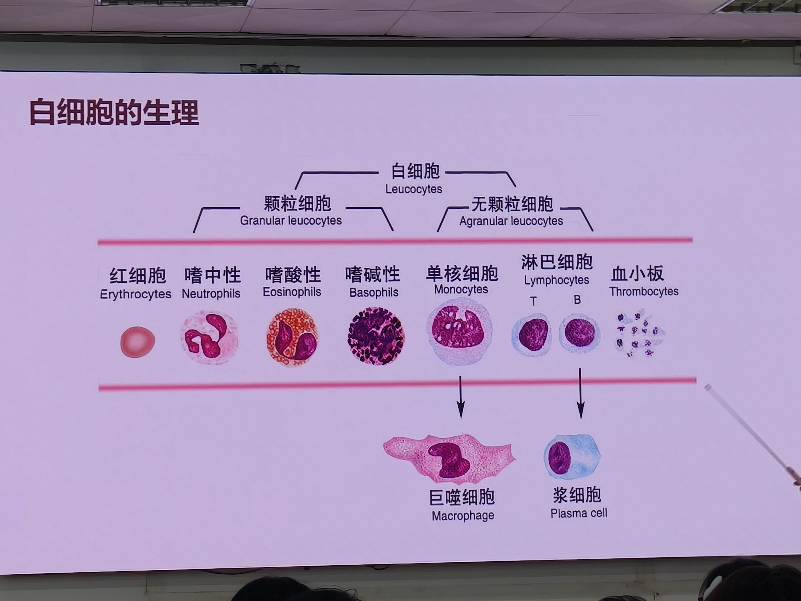
> 📝 **批注（15:59）**：课堂PPT（本课收尾）——白细胞分类：**粒细胞（Granular leucocytes）：嗜中性Neutrophils/嗜酸性Eosinophils/嗜碱性Basophils**；**无粒细胞（Agranular leucocytes）：单核细胞Monocytes/淋巴细胞Lymphocytes（T、B）**；分化：单核细胞→**巨噬细胞（Macrophage）**、淋巴细胞→**浆细胞（Plasma cell）**；右侧同时列出红细胞、血小板。注意：PPT把"淋巴细胞→浆细胞"画在T、B之下，教材严谨表述为B淋巴细胞分化为浆细胞。


> 📝 **批注（15:59）**：课堂PPT（本课收尾）——白细胞分类：**粒细胞（Granular leucocytes）：嗜中性Neutrophils/嗜酸性Eosinophils/嗜碱性Basophils**；**无粒细胞（Agranular leucocytes）：单核细胞Monocytes/淋巴细胞Lymphocytes（T、B）**；分化：单核细胞→**巨噬细胞（Macrophage）**、淋巴细胞→**浆细胞（Plasma cell）**；右侧同时列出红细胞、血小板。注意：PPT把"淋巴细胞→浆细胞"画在T、B之下，教材严谨表述为B淋巴细胞分化为浆细胞。

### 4.2 白细胞数量【教材补充】

- 正常成人白细胞数 **(3.5~9.5)×10⁹/L**
- 分类占比：中性粒细胞 50%~70%、嗜酸性粒细胞 0.5%~5%、嗜碱性粒细胞 0%~1%、单核细胞 3%~8%、淋巴细胞 20%~40%
- 新生儿白细胞数较高（约15×10⁹/L）；下午较早晨稍高；进食、疼痛、情绪激动、剧烈运动、妊娠末期和分娩可使白细胞显著增多

---

## 第五部分 本课小结：数字速记表（复习用，必背）

### 5.1 关键数字速记表

| 项目 | 数值 | 记忆点 |
|------|------|--------|
| 血浆水含量 | 91% | 大部分是水 |
| 血浆蛋白含量 | 65~80 g/L | 白蛋白最多 |
| 血细胞比容 | 男40~50%、女37~48%、新生儿55% | 贫血↓ 脱水/红细胞增多症↑ |
| 全血比重 | 1.050~1.060 | 取决于红细胞数 |
| 血浆比重 | 1.025~1.030 | 取决于血浆蛋白 |
| 红细胞比重 | 1.090~1.092 | 取决于Hb |
| 全血粘度 | 4~5（水=1） | 取决于血细胞比容 |
| 血浆粘度 | 1.6~2.4 | 取决于血浆蛋白 |
| 晶体渗透压 | 约300 mmol/L（80%来自Na⁺Cl⁻） | 维持细胞内外水平衡 |
| 胶体渗透压 | 约1.3 mmol/L（75~80%白蛋白） | 维持血管内外水平衡 |
| 等渗溶液 | 0.9% NaCl（既是等渗也是等张） | 1.9%尿素=等渗非等张 |
| 血浆pH | 7.35~7.45 | <7.35酸中毒 >7.45碱中毒；<6.9/>7.8死亡风险 |
| 缓冲对 | NaHCO₃/H₂CO₃=20:1 | 最重要缓冲对 |
| 红细胞直径 | 7.5μm（周边厚2.5μm、中央1μm） | 毛细血管内径仅5μm→须变形 |
| 红细胞数 | 男(4.0~5.5)/女(3.5~5.0)×10¹²/L | 教材10版：男4.3-5.8/女3.8-5.1 |
| 血红蛋白 | 男120~160/女110~150 g/L | 教材10版：男130-175/女115-150 |
| 血沉 ESR | 男0~15、女0~20 mm/h | 血沉快=悬浮稳定性小 |
| 溶血临界 | 0.42%~0.46%开始溶血；0.28%~0.32%完全溶血 | 教材口径（老师口述0.42%/0.34%） |
| 红细胞寿命 | 120天 | 每天0.8%破坏 |
| 网织红细胞 | 占0.5%~1.5%，存在1~2天 | 计数→了解骨髓造血盛衰 |
| EPO来源 | 肾90~95%（管周细胞）、肝5~10% | 组织缺氧→分泌↑ |
| 肾性贫血 | 慢性肾衰→EPO缺乏/响应弱 | 双肾严重破坏 |
| 血管外/内破坏 | 90%血管外（脾肝骨髓吞噬）／10%血管内 | 脾亢→脾性贫血 |

### 5.2 记忆口诀

- **血细胞比容**："男四女三七，新生儿五五"
- **三大特性**："**塑悬脆**"（可塑变形性、悬浮稳定性、渗透脆性）
- **胶体渗透压意义**："白蛋白保血管内外水"；晶体渗透压："NaCl保细胞内外水"
- **等张**："不能过膜才等张"
- **贫血三原料**："**铁**造血红素，**叶酸B₁₂**造DNA"——缺铁→小细胞低色素（中央苍白大）；缺叶酸B₁₂→巨幼（核大）
- **EPO作用**："**抑凋亡、促增殖、活基因、放网织**"
- **生成顺序**："髓→红→原→早→中→晚→网→熟"

### 5.3 本课复习线索（与前后课衔接）

- 上节课（细胞膜物质转运/电活动）→ 本课血液理化特性（渗透压与等渗等张概念衔接膜转运知识）
- 下节课预告：白细胞生理详细展开＋血小板生理＋生理性止血＋血型输血
- 临床联系线：严重烧伤→血液浓缩→粘度↑→多器官衰竭；低蛋白→水肿；胃大部切除→大小细胞混合贫血；慢性肾衰→肾性贫血；EPO滥用→栓塞；脾亢→贫血

---

## 第六部分 语音识别错误纠正（本课）

| 原笔记 | 纠正为 | 说明 |
|--------|--------|------|
| 皮窦裂隙 | **脾窦裂隙** | 红细胞变形穿过的脾脏血窦孔隙 |
| 管周红细胞 | **肾管周细胞**（肾小管周围间质细胞/成纤维细胞） | EPO来源 |
| 胃腺的B细胞 / 胃壁的B细胞 | **胃壁细胞（壁细胞）** | 分泌内因子和盐酸 |
| et o / ETO | **EPO**（促红细胞生成素） | 英文缩写 |
| 蒙蒂兰卡 | **埃罗·曼蒂兰塔（Eero Mäntyranta）** | 芬兰滑雪运动员，EPO基因突变原发性红细胞增多症 |
| 晚七红系祖细胞 | **晚期红系祖细胞**（CFU-E） | 红系集落形成单位 |
| 1:09~1:09（比重） | **1.090~1.092** | 笔记数字残缺，教材值 |
| 红细集落形成单位 | **红系集落形成单位（CFU-E）** | 术语 |
| cfu杠一 | **CFU-E** | 缩写读音 |
| 山中伸明 | **山中伸弥** | 诺贝尔奖得主 |
| vf类型/ips | **iPS**（诱导多能干细胞） | 术语 |
| 连状细胞 | **镰状细胞** | 镰状细胞贫血 |
| 巨幼细胞性 | **巨幼红细胞性贫血** | 术语 |
| 粒细胞=嗜中性/嗜酸性/嗜碱性（正确） | 嗜中性粒细胞等 | 术语规范 |
| 主要是在气管外 | **主要在血管外（脾脏、骨髓等）** | 学生回答，教师纠正 |
| 皮窦 | **脾窦** | 同上 |
| 蒙蒂兰卡=原发性红细胞增多症 | 埃罗·曼蒂兰塔原发性红细胞增多症 | 病例 |
