# 第7课 心脏泵血功能与心音（教材精讲版）

> 教材：《生理学》第10版，人卫版，第四章 血液循环 第一节 心脏的泵血功能
> 授课时间：2026-09-24 14:29
> 课型：教材精讲 · 循环系统开篇 · 心动周期七期

---

## 一、循环系统章节导言

老师开宗明义：**循环系统是整门生理学"重点最多、难点最大、学时最长、分数最高"的一章**。从这一章开始，每一章的学习套路都是：先讲脏器的功能活动规律，再讲它的调节机制——调节异常才是疾病的根源。

循环系统三要素：**心脏（动力泵）+ 血管（管路）+ 血液（内容物）**。血液循环的本质就是让血液在心血管网络中不停流动——如果不流动，根据上一章刚学的凝血知识，很快就会形成血栓。

循环系统的功能其实就是血液的功能：①物质运输（O₂/CO₂/营养/激素）；②体液调节（激素经血液到达靶器官）；③防御免疫（白细胞、抗体、补体）；④体温调节。

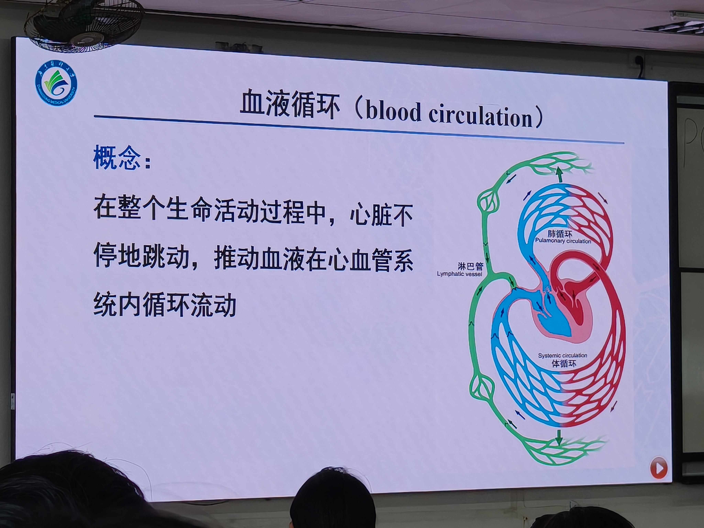

📝 **图：血液循环（blood circulation）概念**。老师在开篇用这张图回顾血液循环：心脏不停跳动推动血液在心血管系统内循环流动；右侧红色为**体循环（systemic circulation）**、蓝色为**肺循环（pulmonary circulation）**、绿色为淋巴管。三者共同构成完整的循环网络。

本章五节内容：①心脏泵血功能（重点）；②心脏生物电活动（难点，也是整本书难度高峰）；③血管生理（重点）；④心血管活动调节（重点）；⑤器官循环（冠脉/肺/脑，临床重要但课堂学时少）。**本节课只讲第一节"心脏泵血功能"中最核心的心动周期七期与心音**。

---

## 二、心动周期的定义

### 2.1 定义

**心动周期（cardiac cycle）**：心脏一次收缩和舒张构成的一个机械活动周期，也就是一次心跳的完整过程。

老师以**心率 75 次/分**为锚点（本课时所有时间数据均基于此心率）：

$$T = 60\ \text{s} \div 75 = 0.8\ \text{s}$$

即一个心动周期 = **0.8 秒**。

### 2.2 心动周期的四大特点

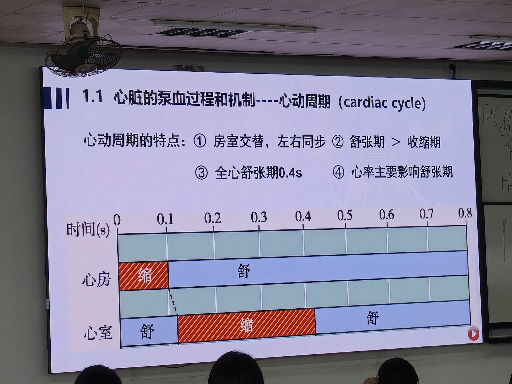

📝 **图：心动周期时间轴（0~0.8 s）**。红色斜线为收缩期、蓝色为舒张期。心房：收缩 0.1 s + 舒张 0.7 s；心室：舒张约 0.1 s → 收缩 0.3 s → 舒张 0.4 s。可以清晰看到**房室不同时收缩、但存在全心舒张期（约 0.4 s）**。

【考点】心动周期四大特点：

1. **房室交替收缩、左右同步**：心房和心室**不会同时收缩**（因为房室延搁机制，详见下节课电生理），但**左右心房、左右心室是同步活动**的；
2. **舒张期 > 收缩期**：心房收缩 0.1 s / 舒张 0.7 s；心室收缩 0.3 s / 舒张 0.5 s。老师的原话很人文："**你懂得休息才能长久工作**"——心脏一生要跳约 30 亿次（以 75 岁、75 次/分估算），舒张期长才能保证心肌休息。生理原因：收缩力度大、速度快，短时间即可把血泵出；舒张力度弱、速度慢，要把同样量的血抽回来，必须给更长时间；
3. **存在全心舒张期（约 0.4 s）**：心房和心室都在舒张，静脉血回流**主要（甚至全部）发生在这一时期**；
4. **心率主要影响舒张期**：收缩期本身已经很短（0.3 s），可压缩空间有限；心率加快时**缩短最明显的是舒张期**——舒张期过短→回心血量不足→"难为无米之炊"，这就是剧烈运动时不能突然停下、以及心率过快诱发心衰的原因之一。

【考点】心率 75 次/分时心动周期 = **0.8 秒**；心房收缩 0.1 s、心室收缩 0.3 s；**全心舒张期约 0.4 s**；心率加快主要缩短**舒张期**。

---

## 三、心动周期七期总览

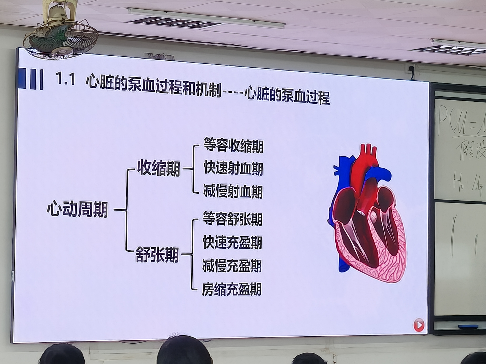

📝 **图：心动周期七期分类树**。收缩期分三期：**等容收缩期 → 快速射血期 → 减慢射血期**；舒张期分四期：**等容舒张期 → 快速充盈期 → 减慢充盈期 → 房缩充盈期（心房收缩期）**。

老师强调：学习七期要**牵一条主线——瓣膜的开与关**。抓住瓣膜状态，压力大小、血流方向、容积变化都能推导出来：

- 房室瓣（二尖瓣/三尖瓣）：只向心室方向开；心室压 > 房压 → 关；房压 > 室压 → 开；
- 动脉瓣（主动脉瓣/肺动脉瓣）：只向动脉方向开；动脉压 > 室压 → 关；室压 > 动脉压 → 开；
- 两个瓣膜都关 → 等容（无血流进出，容积不变）；
- 房室瓣开、动脉瓣关 → 充盈（房→室）；
- 房室瓣关、动脉瓣开 → 射血（室→动脉）。

### 七期总表（核心考点）

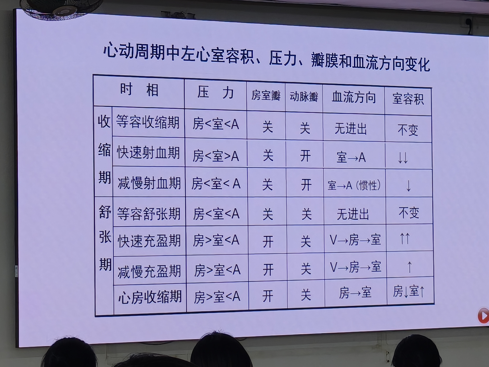

📝 **图：心动周期中左心室容积、压力、瓣膜和血流方向变化总表**。这是本课最核心的一张表，老师要求同学课后**自己默画一遍**。

| 时相 | 压力关系 | 房室瓣 | 动脉瓣 | 血流方向 | 室容积 |
|---|---|---|---|---|---|
| **等容收缩期** | 房 < 室 < 主（动脉压） | 关 | 关 | 无进出 | 不变 |
| **快速射血期** | 房 < 室 > 主 | 关 | 开 | 室 → 动脉 | ↓↓ 骤降 |
| **减慢射血期** | 房 < 室 ≤ 主 | 关 | 开 | 室 → 动脉（惯性） | ↓ |
| **等容舒张期** | 房 < 室 < 主 | 关 | 关 | 无进出 | 不变 |
| **快速充盈期** | 房 > 室 < 主 | 开 | 关 | 静脉→房→室 | ↑↑ 骤升 |
| **减慢充盈期** | 房 > 室 < 主 | 开 | 关 | 静脉→房→室 | ↑ |
| **心房收缩期** | 房 > 室 < 主 | 开 | 关 | 房 → 室 | 房↓室↑（达最大） |

【考点】**两个瓣膜都关闭的时期** = 等容收缩期 + 等容舒张期（"两个等容"）。
【考点】**房室瓣开放的时期** = 快速充盈期 + 减慢充盈期 + 心房收缩期。
【考点】**动脉瓣开放的时期** = 快速射血期 + 减慢射血期。

---

## 四、心室收缩期（三期）

### 4.1 等容收缩期（isovolumetric contraction）

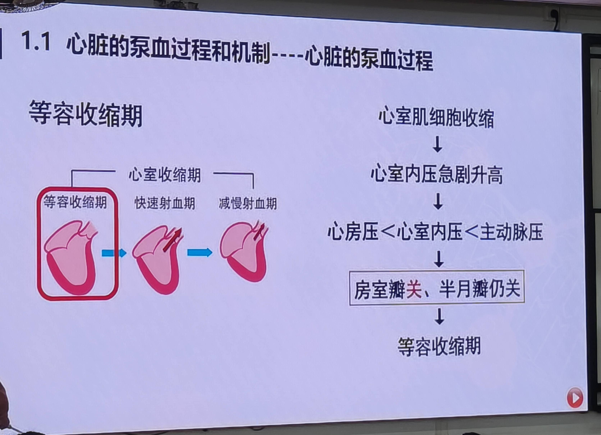

📝 **图：等容收缩期机制链**。心室肌细胞收缩 → 心室内压急剧升高 → 房压 < 室内压 < 主动脉压 → **房室瓣关、半月瓣仍关** → 等容收缩期。

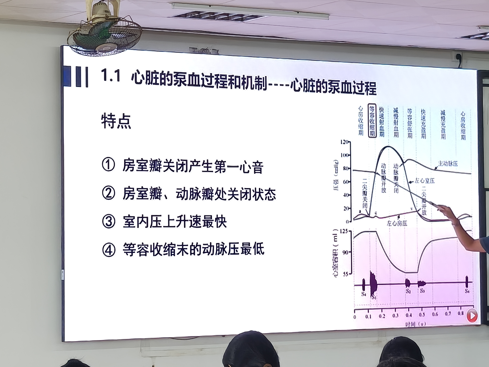

📝 **图：等容收缩期在 Wiggers 图上的位置**。本图高亮"等容收缩期"，对应特点：①房室瓣关闭产生**第一心音**；②房室瓣、动脉瓣**均关闭**；③**室内压上升速率最快**；④等容收缩期末**主动脉压最低**。

机制要点：

- 心室肌开始收缩 → 室内压↑ → 一旦超过房内压（约 5 cmH₂O）→ **房室瓣关闭**，产生**第一心音（S₁）**，标志**心室收缩开始**；
- 但此时室内压仍**低于主动脉压**（约 80 mmHg）→ 动脉瓣仍关闭；
- 两瓣均关 → 心室成为密闭腔，血液量不变（"等容"）；
- 心肌持续收缩 → 室内压**急剧升高**（整个心动周期中**压力上升最快**的时期）；
- 整个等容收缩期没有血液射入主动脉，故主动脉压在此期末降到**整个心动周期最低**（因为从上次射血结束到现在一直没新血射入）。

【考点】**室内压上升最快 = 等容收缩期**；**主动脉压最低 = 等容收缩期末**；**第一心音产生 = 等容收缩期开始**。老师原话："心室内压力上升最快的时期就是等容收缩期。"

### 4.2 快速射血期（rapid ejection）

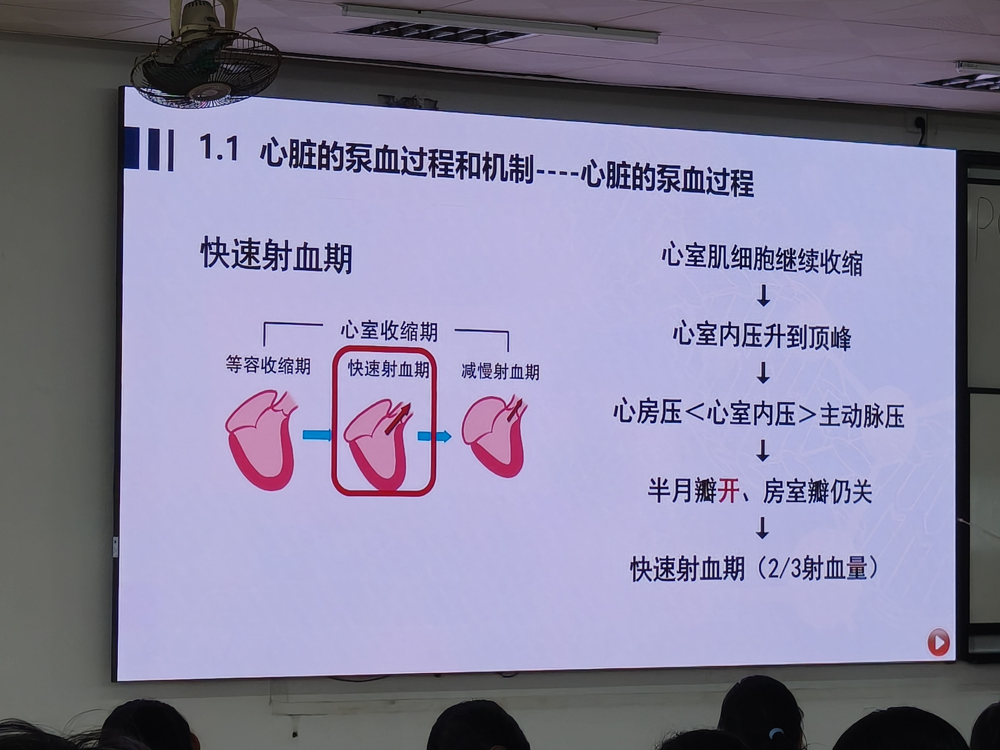

📝 **图：快速射血期机制链**。心室肌继续收缩 → 室内压升到顶峰 → 房压 < 室内压 > 主动脉压 → **半月瓣开、房室瓣仍关** → 快速射血期（占总射血量 2/3）。

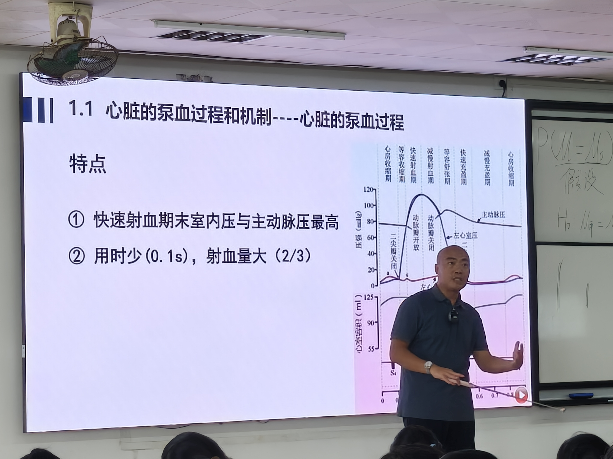

📝 **图：快速射血期在 Wiggers 图上的位置**。本图高亮"快速射血期"，对应特点：①**快速射血期末室内压与主动脉压最高**；②用时短（约 0.1 s），**射血量大（占总射血量 2/3）**。

机制要点：

- 等容收缩期已经把室内压"顶"到接近主动脉压；进入快速射血期后心肌仍在**强力收缩**（与等容收缩期是同一段连续的强力收缩）；
- 室内压一旦**超过主动脉压** → 动脉瓣开放；
- 高压差 + 强收缩 → 血液**快速射入主动脉**；
- 虽然血液在射出、心室容积在减小，但心肌收缩力 > 射血带来的减压效应，故室内压**继续上升，直到快速射血期末达到整个心动周期最高峰**（此时主动脉压也达到最高）；
- 此期约占 0.1 s，却射出总射血量的 **2/3**。

【考点】**室内压最高 = 快速射血期末**；**主动脉压最高 = 快速射血期末**；**射血 2/3 在快速射血期**。老师原话："在快速射血期末，压力达到最大。"

### 4.3 减慢射血期（reduced ejection）

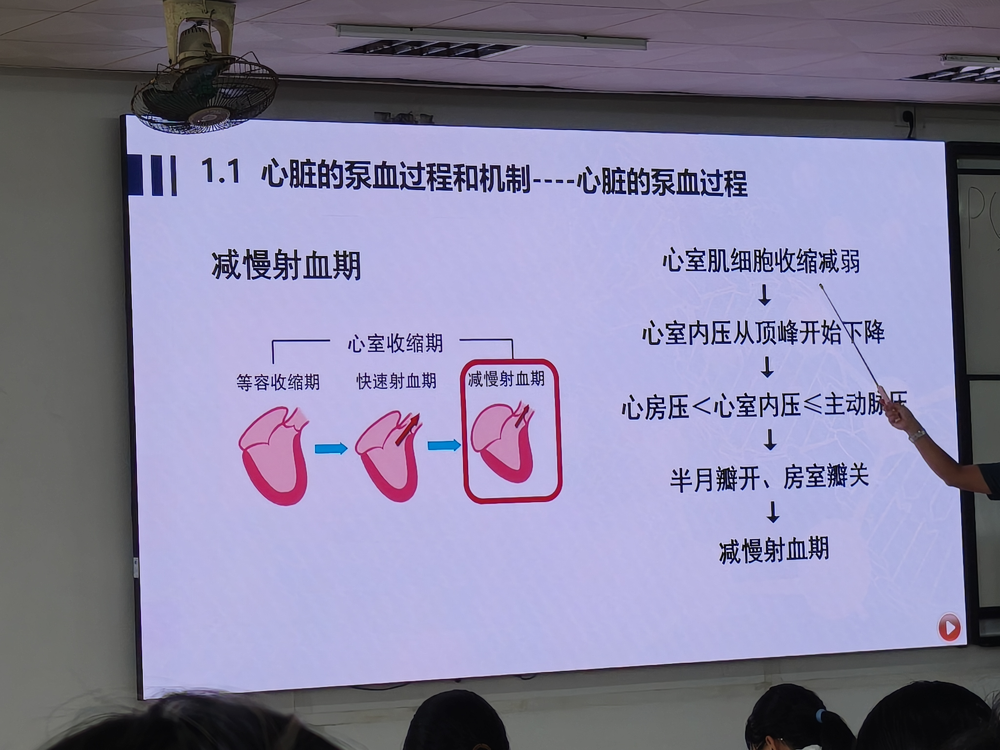

📝 **图：减慢射血期机制链**。心室肌细胞收缩减弱 → 心室内压从顶峰开始下降 → 房压 < 室内压 ≤ 主动脉压 → **半月瓣仍开、房室瓣关** → 减慢射血期。

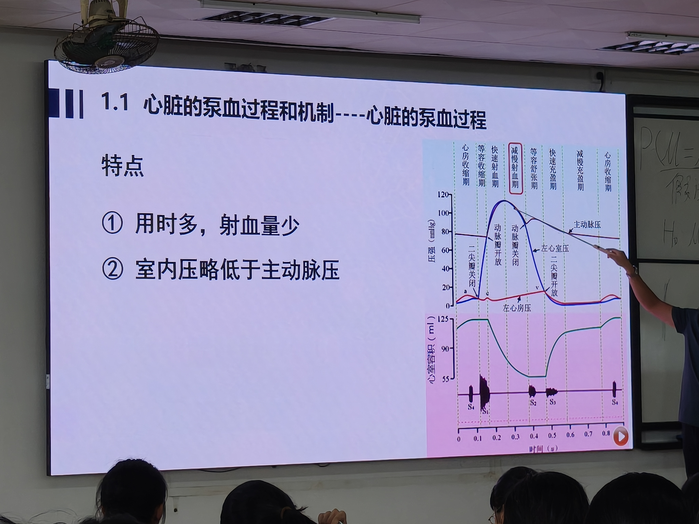

📝 **图：减慢射血期在 Wiggers 图上的位置**。本图高亮"减慢射血期"，特点：①用时多、射血量少（占 1/3）；②室内压**略低于**主动脉压。

机制要点：

- 心室肌收缩明显减弱（国际教材甚至认为此期已不收缩，国内教材仍称"收缩减弱"）；
- 室内压从顶峰下降，**甚至略低于主动脉压**——那为什么动脉瓣还开着、血还在往外射？
- 【考点·难点】两个原因：①压差并不大，只是略低；②**前两期积累的血流动能（惯性）仍在推动血液继续向前**，像公交车到站前不踩油门也能滑一段。
- 此期约 0.15 s，仅射出总血量的 **1/3**；
- 期末心室容积降到**整个心动周期最小**（此时血液已基本射空）。

【考点】**心室容积最小 = 减慢射血期末**；**减慢射血期室内压可略低于主动脉压但仍射血 = 血流惯性**。

---

## 五、心室舒张期（四期）

### 5.1 等容舒张期（isovolumetric relaxation）

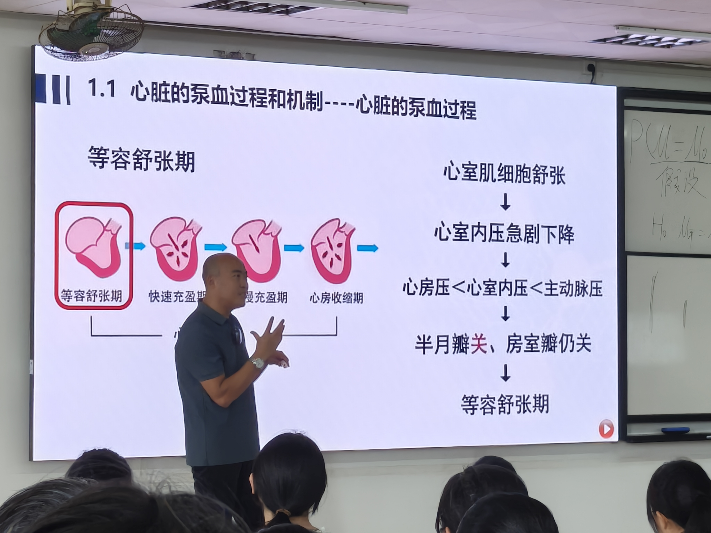

📝 **图：等容舒张期机制链**。心室肌细胞舒张 → 心室内压急剧下降 → 房压 < 室内压 < 主动脉压 → **半月瓣关、房室瓣仍关** → 等容舒张期。

机制要点：

- 射血结束，心室开始**主动舒张**（老师强调：舒张也是耗能的主动过程，不是被动回弹）；
- 室内压迅速下降，一旦**低于主动脉压** → 动脉瓣关闭，产生**第二心音（S₂）**，标志**心室舒张开始**；
- 但此时室内压仍**高于房内压** → 房室瓣仍关；
- 两瓣均关 → 心室又成为密闭腔，"等容"；
- 室内压**急剧下降**（速度比等容收缩期还快），为后面"抽吸"血液充盈创造负压条件；
- 此期心室容积**最小**（刚射完血）。

【考点】**第二心音产生 = 等容舒张期开始（动脉瓣关闭）**；**心室容积最小 = 等容舒张期初/减慢射血期末**；舒张是主动耗能过程。

### 5.2 快速充盈期（rapid filling）

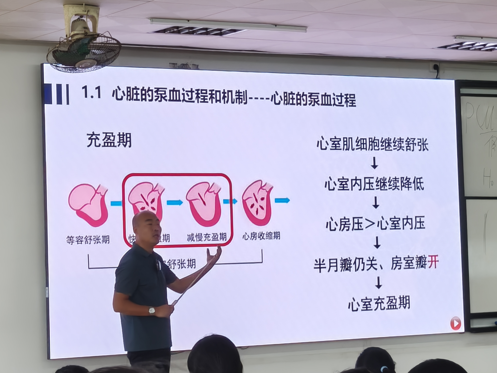

📝 **图：心室充盈期机制链**（含快速充盈期 + 减慢充盈期）。心室肌继续舒张 → 室内压继续降低 → 房压 > 室内压 → **半月瓣仍关、房室瓣开** → 心室充盈期。

机制要点：

- 等容舒张期把室内压"抽"得很低；进入快速充盈期后心室仍在强力舒张；
- 室内压一旦**低于房内压** → 房室瓣开放；
- 高压差（房>室）+ 心室抽吸 → 血液从心房**快速冲入心室**；
- 此期约 0.11 s，充盈量占心室总充盈量的 **2/3**；
- 快速充盈期末室内压降到**整个心动周期最低**，甚至可呈**负压**（这就是心室"抽吸"作用）；
- 快速血流冲击心室壁可振动产生**第三心音（S₃）**——正常青少年可闻，病理情况下见于心衰。

【考点】**室内压最低 = 快速充盈期末（甚至负压）**；**充盈 2/3 在快速充盈期**；**第三心音产生 = 快速充盈期血流冲击心室壁**。

### 5.3 减慢充盈期（reduced filling）

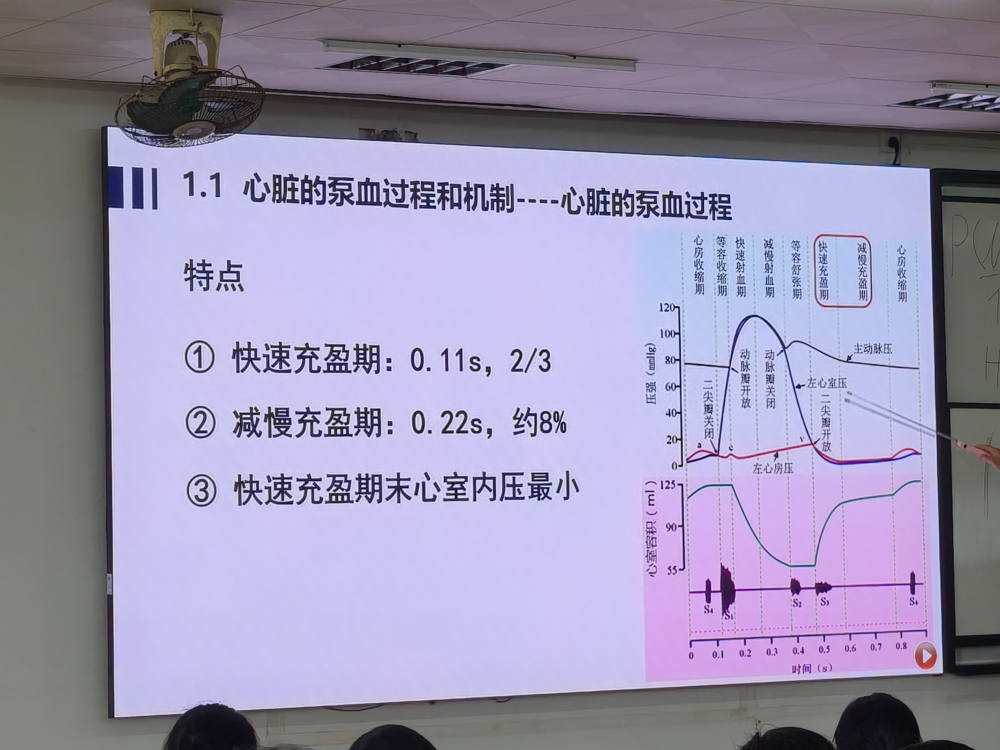

📝 **图：减慢充盈期在 Wiggers 图上的位置**。本图高亮"减慢充盈期"，特点：①快速充盈期 0.11 s 占 2/3；②**减慢充盈期 0.22 s 仅占约 8%**；③快速充盈期末室内压最小。

机制要点：

- 心室舒张速度减慢、甚至接近停止；
- 房室压差变小 → 血液流入速度减慢，故称"减慢充盈期"；
- 此期长（约 0.22 s）但量少（约 8%）；
- 静脉血持续经心房缓慢流入心室。

### 5.4 心房收缩期（atrial systole）

机制要点：

- 到减慢充盈期末，心室已不再舒张，心室舒张产生的"抽吸动力"消失；
- 此时心房收缩，房内压升高，把**剩余约 25%（1/4）**的血液挤入心室；
- 此期房室瓣仍开、动脉瓣仍关；
- **心房收缩期末心室容积达到整个心动周期最大**（即舒张末期容积，EDV）；
- 心房收缩可产生**第四心音（S₄）**——正常青少年偶可闻，病理情况下见于心肌肥厚、顺应性下降。

【考点】**心室容积最大 = 心房收缩期末（=舒张末期）**；**心房收缩贡献总充盈量 25%（1/4）**；**第四心音 = 心房收缩**。

### 5.5 充盈量的数字拼图

老师在课上带大家算过：快速充盈占 **2/3**，减慢充盈占 **约 8%**，加起来不到 75%，剩下的 **约 25%（1/4）** 就是心房收缩期挤进去的。这就是为什么心房收缩被称为"初级泵"——缺了这 1/4，安静时影响不大，但运动/应激时就不够用了。

---

## 六、心房的初级泵作用与心房颤动

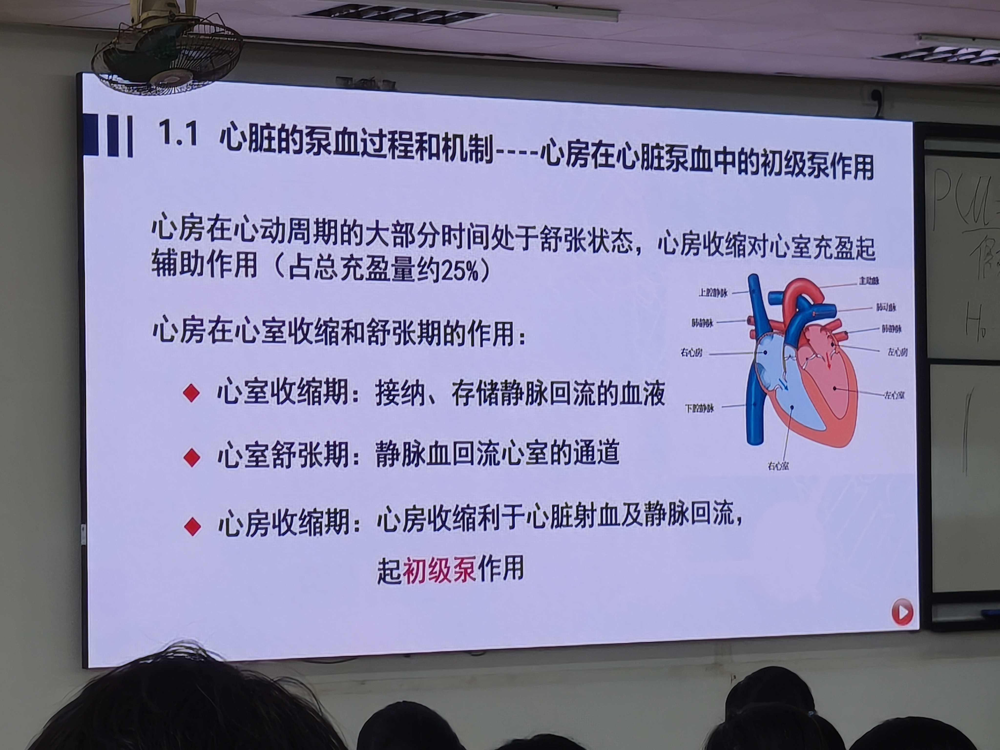

📝 **图：心房在心脏泵血中的初级泵作用**。心房在心动周期大部分时间处于舒张状态，心房收缩对心室充盈起辅助作用（占总充盈量约 25%）。三个作用：①心室收缩期——接纳、存储静脉回流血液；②心室舒张期——静脉血回心室的通道；③心房收缩期——初级泵作用，利于心室充盈。

【考点】心房在心室收缩期 = **储血器**；在心室舒张期 = **通道**；在心房收缩期 = **初级泵（贡献 25% 充盈量）**。

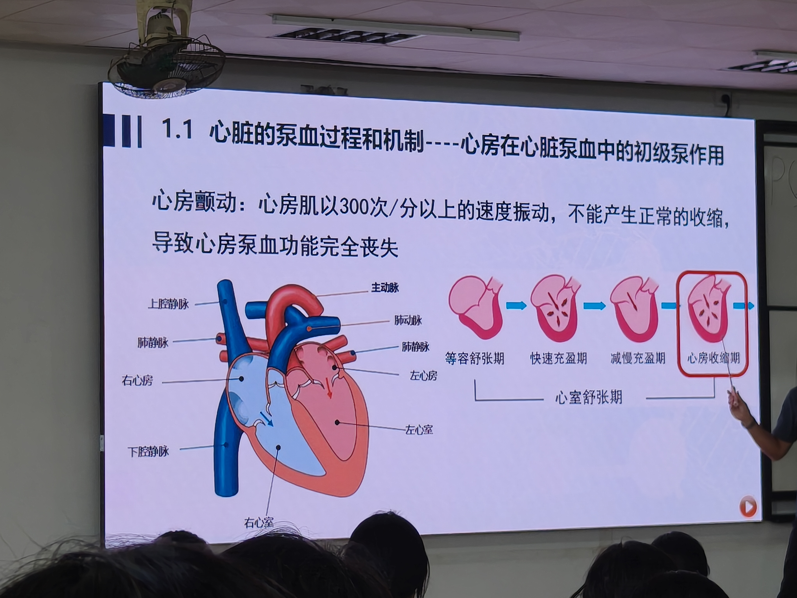

📝 **图：心房颤动（atrial fibrillation, AF）**。心房肌以 300 次/分以上的频率"颤动"，不能产生正常收缩，导致心房泵血功能完全丧失。

老师讲房颤的临床意义：

- 房颤患者失去心房那 25% 的"初级泵"——安静吃饭睡觉影响不大，但**不能耐受体力劳动和剧烈运动**；
- 更危险的是：心房不收缩 → 心房扩大、血流瘀滞 → **极易形成心房附壁血栓** → 血栓脱落导致脑栓塞等。这才是房颤真正的致死致残原因。

---

## 七、心音（heart sounds）

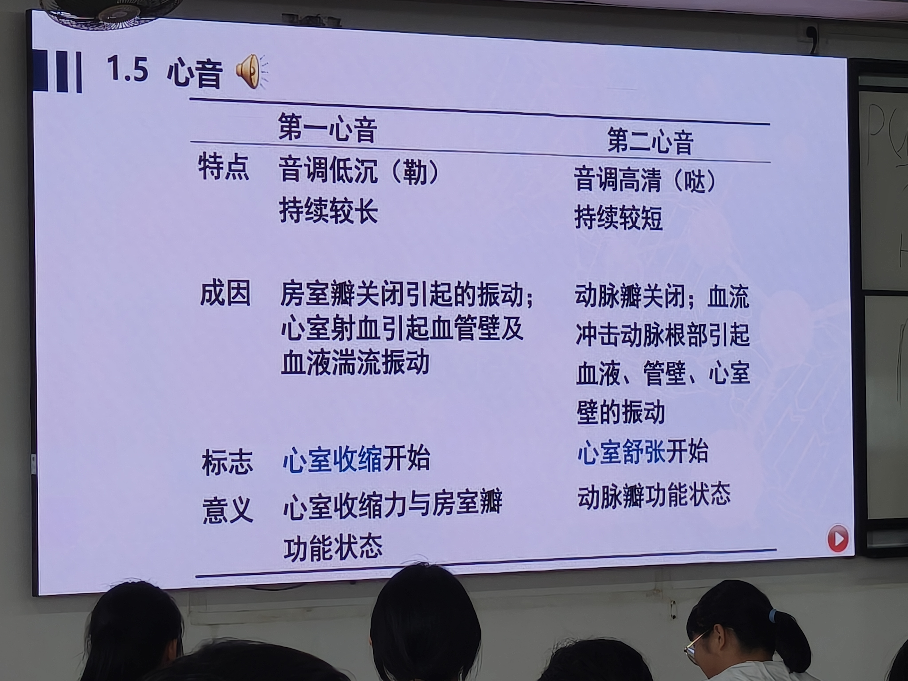

📝 **图：第一心音（S₁）与第二心音（S₂）对比表**。

### 7.1 四个心音总览

| 心音 | 产生时期 | 主要成因 | 标志 | 听诊特点 |
|---|---|---|---|---|
| **S₁ 第一心音** | 等容收缩期初 | **房室瓣关闭**振动 + 心室射血引起大血管壁及血液湍流振动 | **心室收缩开始** | 音调低沉（"勒"）、持续较长 |
| **S₂ 第二心音** | 等容舒张期初 | **动脉瓣关闭** + 血流冲击动脉根部引起血液、管壁、心室壁振动 | **心室舒张开始** | 音调高而清脆（"哒"）、持续较短 |
| **S₃ 第三心音** | 快速充盈期末 | 快速血流冲击心室壁振动 | 快速充盈 | 正常青少年可闻；心衰时增强 |
| **S₄ 第四心音** | 心房收缩期 | 心房收缩推血入心室振动 | 心房收缩 | 正常偶可闻；病理见于心室肥厚 |

【考点】

- **S₁ = 房室瓣关闭 = 收缩期开始**；
- **S₂ = 动脉瓣关闭 = 舒张期开始**；
- 正常人心室听诊只能清晰听到 S₁、S₂；S₃、S₄ 需特定条件或病理状态才能听到；
- 从 S₁ 到 S₂ 的间隔 = **收缩期**（短）；从 S₂ 到下一个 S₁ 的间隔 = **舒张期**（长）——光靠听诊就能判断舒张期 > 收缩期。

老师强调：瓣膜病变（狭窄/关闭不全）时，心音性质会改变，并出现**心脏杂音**——这是后面诊断学的内容，本课只需记住 S₁/S₂ 的成因和标志。

---

## 八、教材勘误（人卫第10版）

老师在课上现场翻教材，发现并纠正了一个排版错误：

> **勘误**：2024 年印刷版人卫《生理学》第10版 **P80** 的心动周期图中，"心室舒张末期最下方"标注写的是 **5 mL**，这是**绝对错误**——没有任何人心室舒张末期只剩 5 mL 血。正确值应为 **55 mL**（即心室收缩末期容积，ESV 约 55 mL）。请在自己教材上把"5"改成"55"。

📌 复习时以 **55 mL** 为准（对应 Wiggers 图中心室容积最低点）；舒张末期容积（EDV）约 125 mL，收缩末期容积（ESV）约 55 mL，每搏输出量（SV）≈ 70 mL【教材补充·人卫第10版】。

---

## 九、Wiggers 图读图要点（考试必看）

本课四张 Wiggers 图分别高亮不同期，合并起来看就是完整的心动周期压力-容积曲线：

- **三条压力曲线**：主动脉压（粗红线，平均 ~80 mmHg）、左室压（红细线，从 0 冲到 120 mmHg 再回 0）、左房压（粉红细线，<10 mmHg）；
- **一条容积曲线**：绿色，从 125 mL 跌到 55 mL 再回到 125 mL；
- **瓣膜开关标记**：二尖瓣（房室瓣）关/开、主动脉瓣（动脉瓣）开/关；
- **心音位置**：S₄（心房收缩）→ S₁（房室瓣关）→ S₂（动脉瓣关）→ S₃（快速充盈）→ S₄；
- **时间轴 0~0.8 s**。

读图口诀：**"瓣膜开关定分期，压力高低定方向，容积升降定收舒"**。

---

## 十、本课术语纠错小结

| 笔记错误 | 正确术语 | 说明 |
|---|---|---|
| 等同收缩期/等公收缩 | **等容收缩期**（isovolumetric contraction） | |
| 等同舒张期/等无数张期 | **等容舒张期**（isovolumetric relaxation） | |
| 快速审/快速设计/快速水解 | **快速射血期**（rapid ejection） | |
| 减慢摄水期/简单设计期 | **减慢射血期**（reduced ejection） | |
| 快速生/快速呼吸期 | **快速充盈期**（rapid filling） | |
| 减慢充期/慢充期 | **减慢充盈期**（reduced filling） | |
| 新房收缩期/新所期 | **心房收缩期**（atrial systole） | |
| 防水/动态板/房室半 | **房室瓣**（二尖瓣/三尖瓣） | |
| 保护板/半国/半自动压 | **半月瓣（动脉瓣）**（主动脉瓣/肺动脉瓣） | |
| 主动本/增压 | **主动脉压** | |
| 心能的/新房 | **心房** | |
| 新式体/信房/心室 | **心室** | |
| 二间瓣 | **二尖瓣**（即左房室瓣） | |
| 新音/基音 | **心音** | |
| 勒/哒 | S₁（低沉"勒"）/S₂（清脆"哒"） | |
| 5 mL | **55 mL**（教材P80勘误） | 心室收缩末期容积 |
| 初级泵/初級泵 | **初级泵（atrial priming pump）** | |

---

## 十一、记忆法与高频考点串讲

### 11.1 "一条主线串七期"

老师反复强调：考试不会让你死记七期名称，而是给你一个特征（"哪个时期室内压上升最快？""哪个时期动脉瓣还开着但室内压已经低于主动脉压？"）让你选期。**只要牵住"瓣膜开关"这一条主线，七期全部能推出来**：

1. **两瓣都关 = 等容**（无血流、容积不变）——等容收缩期（压力↑）、等容舒张期（压力↓）；
2. **房室瓣开 = 充盈**（房→室）——快速充盈（2/3）、减慢充盈（8%）、心房收缩（25%）；
3. **动脉瓣开 = 射血**（室→动脉）——快速射血（2/3、压力峰）、减慢射血（1/3、惯性）。

### 11.2 四个"最"必背

| 极值 | 出现时期 |
|---|---|
| 室内压上升最快 | **等容收缩期** |
| 室内压最高、主动脉压最高 | **快速射血期末** |
| 主动脉压最低 | **等容收缩期末** |
| 室内压最低（可负压） | **快速充盈期末** |
| 心室容积最小 | **减慢射血期末 / 等容舒张期初** |
| 心室容积最大 | **心房收缩期末（=舒张末期）** |

【考点】这六个"最"是选择题高频出题点，务必背熟。

### 11.3 两个"等容"对比

| 项目 | 等容收缩期 | 等容舒张期 |
|---|---|---|
| 心室肌状态 | 收缩（压力↑↑） | 舒张（压力↓↓） |
| 房室瓣 | 关 | 关 |
| 动脉瓣 | 关 | 关 |
| 室内压范围 | 房 < 室 < 主 | 房 < 室 < 主 |
| 心音 | **S₁**（房室瓣关） | **S₂**（动脉瓣关） |
| 标志 | 收缩期开始 | 舒张期开始 |
| 容积 | 最大（舒张末期） | 最小（收缩末期） |

### 11.4 临床联系

1. **房颤（AF）**：心房 300~600 次/分颤动 → 失去 25% 初级泵 + 心房扩大瘀血 → 附壁血栓 → 脑栓塞；治疗用华法林抗凝（回顾上节课：维生素 K 拮抗剂，抑制ⅡⅦⅨⅩ）。
2. **二尖瓣狭窄**：房室瓣口变小 → 左房血难以入左室 → 左房扩大、肺淤血 → S₁ 增强、开放拍击音。
3. **主动脉瓣关闭不全**：舒张期主动脉血反流入左室 → 舒张期杂音、左室容量负荷增大。
4. **心率过快（>180 次/分）**：舒张期明显缩短 → 快速充盈期不足 → 心输出量反而下降——这就是心动过速性心衰的机制之一。
5. **中心静脉压（CVP）**：上下腔静脉右心房交界处压力，反映右心功能和血容量；老师开篇提过，后面血管章细讲。
6. **第一心音分裂/第二心音分裂**：左右心室不同步收缩/舒张所致，属于诊断学内容。

### 11.5 课后自测题（老师随堂练习原题）

> **Q1**：心动周期中，心室内压力上升最快的时期是？
> **A**：等容收缩期。

> **Q2**：下列哪些时期房室瓣开放、动脉瓣关闭？（多选）
> **A**：快速充盈期、减慢充盈期、心房收缩期（血流均从房→室）。等容舒张期虽然是舒张期但两瓣都关，不选。

> **Q3**：心动周期中，心室收缩将血液射入动脉的过程称为？
> **A**：快速射血期（不要选心房收缩期——那是心室舒张期）。

> **Q4**：心房收缩的主要作用是？
> **A**：促进心室充分充盈（把剩余 25% 血液挤入心室）。

> **Q5**：哪个时期心室内压可能略高于房压、但仍处于舒张状态？
> **A**：等容舒张期（此时室内压从最高点骤降，但仍高于房压，房室瓣未开）。
