# 第8课 心肌动作电位与离子通道（教材精讲版·扩写）

> **说明**：本课课堂照片23张（PPT/板书，已去重3张因果链重复帧，教材书页实拍1张仅用于改错核对未插入）。
>
> 教材：《生理学》第10版，罗自强/管又飞主编，人民卫生出版社，2024年，第四章 血液循环 第二节 心脏的生物电活动
> 授课时间：2026-09-28 14:22
> 课型：教材精讲 · 循环系统难点高峰
>
> 📌 **本版说明**：本课前半节课（约35分钟）是第一节"心脏泵血功能"收尾——心功能指标、影响心输出量的因素；后半节课（约40分钟）是第二节"心肌细胞电生理"——本课核心难点。本笔记两部分都详细展开：第一部分把上节内容逐期逐指标讲透，第二部分把心室肌动作电位0~4期逐个离子流讲透。

---

# 第一部分　上节回顾与深入讲解（心脏泵血功能收尾）

## 1.1 心动周期七期——逐期展开

心动周期指心脏一次收缩和舒张构成的一个机械活动周期。以HR=75次/分为例，一个周期T=60/75=0.8 s。本小节用"瓣膜状态/压力变化/容积变化/时间占比/关键数据"五栏把七期逐个讲透。

### 1.1.1 收缩期三期

**（1）等容收缩期**

- 时程：约0.05 s（0.02~0.06 s）。
- 触发：心室肌开始收缩，室内压从心房收缩期末的约5 mmHg开始急剧上升。
- 瓣膜状态：当室内压刚超过房压（约5 mmHg）时，**房室瓣（二尖瓣）关闭**——这就是**第一心音S₁**的来源；此时室内压还远低于主动脉压（约80 mmHg），**动脉瓣（主动脉瓣）仍关闭**。两瓣均关。
- 压力变化：两瓣均关→心室成封闭腔→心肌继续收缩→室内压**急剧上升**（是整个心动周期中室内压上升速率最快的时期），从5 mmHg一路冲到80 mmHg以上。
- 容积变化：两瓣均关，血液既进不来也出不去→**心室容积不变**（这就是"等容"二字的由来），仍为EDV≈125 mL。
- 关键意义：S₁标志**心室收缩期开始**；此期末主动脉压降到整个周期最低。

【考点】等容收缩期=两瓣均关、室内压上升最快、S₁、期末主动脉压最低。

**为什么主动脉压在等容收缩期末最低？**

- 舒张期主动脉瓣是关闭的，主动脉内血液靠弹性回缩继续流向外周→主动脉压从舒张期开始逐渐下降；
- 等到心室收缩、动脉瓣开放前，主动脉压降到整个周期最低（约80 mmHg，即舒张压）；
- 动脉瓣一开，心室把血射入主动脉→主动脉压迅速升到最高（约120 mmHg，即收缩压）；
- 所以**主动脉压最低=等容收缩期末=舒张压时刻**。

**（2）快速射血期**

- 时程：约0.10 s。
- 触发：室内压超过主动脉压（约80 mmHg）→**动脉瓣开放**。
- 瓣膜状态：房室瓣仍关；动脉瓣开。
- 压力变化：心室继续强力收缩→室内压继续上升，在本期中段达到整个心动周期的**最高峰**（室内压≈主动脉压≈120~130 mmHg）。
- 容积变化：血液高速射入主动脉→心室容积快速下降；本期射出总血量的约**2/3**（约40~45 mL）。
- 血流方向：从心室流向主动脉，靠心室收缩产生的压力差。

【考点】快速射血期=动脉瓣开、室内压最高、0.1 s射血2/3。

**（3）减慢射血期**

- 时程：约0.15 s。
- 瓣膜状态：动脉瓣仍开、房室瓣仍关。
- 压力变化：心室收缩力减弱，室内压从顶峰开始下降；**期末室内压可略低于主动脉压**——这是七期中最特殊的一点。
- 为什么压力低了血还在往外流？老师原话："因为前两期快速收缩赋予了血液一定的**流动惯性（动能）**，血液靠惯性继续往外流。"
- 容积变化：本期射出总血量的约1/3（约20~25 mL）；期末心室容积达到整个周期**最小**（=ESV≈55 mL）。

【考点】减慢射血期=室内压可略低于主动脉压靠惯性继续射血、0.15 s射血1/3、期末心室容积最小。

### 1.1.2 舒张期四期

**（4）等容舒张期**

- 时程：约0.06~0.08 s。
- 触发：心室开始舒张，室内压从峰值快速下降。
- 瓣膜状态：当室内压刚低于主动脉压时，**动脉瓣关闭**——这就是**第二心音S₂**的来源；此时室内压仍高于房压，**房室瓣仍关闭**。两瓣均关。
- 压力变化：两瓣均关→心室再次成封闭腔→心肌继续舒张→室内压**急剧下降**（从120 mmHg一路降到接近0甚至负压）。
- 容积变化：两瓣均关→**心室容积不变**（仍为ESV≈55 mL）。
- 关键意义：S₂标志**心室舒张期开始**。

【考点】等容舒张期=两瓣均关、室内压急剧下降、S₂。

**（5）快速充盈期**

- 时程：约0.11 s。
- 触发：室内压降到低于房压→**房室瓣开放**。
- 瓣膜状态：动脉瓣关；房室瓣开。
- 压力变化：心室**主动舒张**非常迅猛，室内压可以降到**0 mmHg以下（负压）**——这是心室"抽吸"作用最强的时期；本期期末室内压达到整个周期最低。
- 容积变化：心房和大静脉中的血液被心室"抽吸"快速冲入心室；本期充盈量占总充盈量的约**2/3**（约70~80 mL）。
- 听诊：快速充盈血流冲击室壁可产生**第三心音S₃**（正常儿童、青少年可闻，成年人听到常提示心衰）。

【考点】快速充盈期=房室瓣开、心室主动舒张抽吸、0.11 s充盈2/3、期末室内压最低可负压、S₃。

**（6）减慢充盈期**

- 时程：约0.22 s——是七期中**最长**的一期。
- 瓣膜状态：房室瓣仍开、动脉瓣仍关。
- 压力变化：心室主动舒张已近极限（强弩之末），压力差变小，血流缓慢流入。
- 容积变化：本期充盈量仅占总充盈量的约**8%**（约10 mL）；虽然时间最长，但量最少。
- 老师原话："这一期最长，但量最少；因为心室已经舒张不动了，压力差小了。"

【考点】减慢充盈期=0.22 s仅占8%，最长但量最少。

**（7）心房收缩期**

- 时程：约0.10 s。
- 瓣膜状态：房室瓣开、动脉瓣关。
- 压力变化：心室已舒张到位、无法再舒张，但还差最后约1/4充盈量；此时**心房主动收缩**，把房内剩余血液挤入心室。
- 容积变化：本期挤入最后约25%（约25~30 mL）血液；期末心室容积达到整个周期**最大**（=EDV≈125 mL）。
- 听诊：心房收缩可产生**第四心音S₄**（正常听不到，听到常提示心室肥厚、顺应性下降）。
- 生理意义：心房是"初级泵"，贡献约25%充盈量；房颤时这部分丧失→心输出量下降约25%。

【考点】心房收缩期=挤入最后25%、期末心室容积最大=EDV、S₄。

### 1.1.3 心动周期四大特点

老师在第7课开场讲过，这里复述强化：

1. **房室交替收缩、左右同步**：心房和心室不会同时收缩（但可以同时舒张=全心舒张期）；左右两侧心室/心房几乎同步活动。
2. **舒张期>收缩期**：心房收缩0.1 s/舒张0.7 s；心室收缩0.3 s/舒张0.5 s。心脏"工作半天、休息更长"。
3. **全心舒张期约0.4 s**：心房和心室都在舒张的时期，静脉回流主要在此期完成。
4. **心率主要影响舒张期**：心率加快时，收缩期和舒张期都缩短，但舒张期缩短更明显——所以心率过快→充盈不足→CO下降。

### 1.1.4 六个"最"必背

| 极值 | 发生时期 |
|---|---|
| 室内压上升最快 | 等容收缩期 |
| 室内压/主动脉压最高 | 快速射血期末 |
| 主动脉压最低 | 等容收缩期末 |
| 室内压最低（可负压） | 快速充盈期末 |
| 心室容积最小 | 减慢射血期末 |
| 心室容积最大 | 心房收缩期末（EDV） |

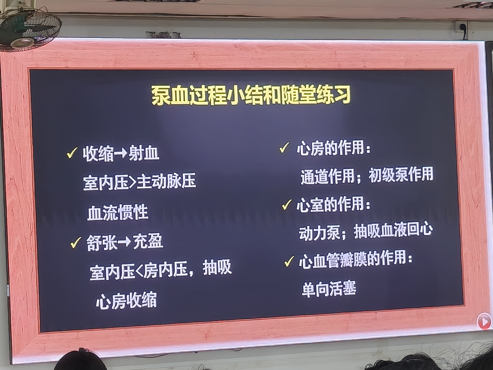

📝 **图：PPT「泵血过程小结和随堂练习」**。收缩→射血（室内压>主动脉压、血流惯性）；舒张→充盈（室内压<房内压、抽吸、心房收缩）；心房作用=通道/初级泵；心室作用=动力泵/抽吸回心；瓣膜=单向活塞。与本节"压力差主线"完全对应。

---

## 1.2 心音S₁~S₄产生机制与听诊要点

老师在课堂上放了正常心音和二尖瓣病变心音的笔记，要求掌握：

| 心音 | 产生机制 | 标志 | 听诊特点 | 临床意义 |
|---|---|---|---|---|
| **S₁** | 房室瓣（二尖瓣、三尖瓣）关闭 | 心室**收缩期开始** | 低沉、"勒"，心尖部最响 | 正常必有；二尖瓣狭窄时S₁亢进 |
| **S₂** | 半月瓣（主动脉瓣、肺动脉瓣）关闭 | 心室**舒张期开始** | 清脆、"哒"，心底最响 | 正常必有；高血压时A₂亢进 |
| **S₃** | 快速充盈期血流冲击室壁 | 快速充盈期 | 低调、重听、青少年可闻 | 成年人听到常提示心衰、心室扩大 |
| **S₄** | 心房收缩 | 心房收缩期 | 低调、罕见 | 听到常提示心室肥厚、顺应性下降（高血压心脏病、心梗后） |

【考点】老师原话："正常人听诊只能听到S₁和S₂，两个'勒-哒'之间短的是收缩期、长的是舒张期——舒张期比收缩期长。"

**S₃和S₄的听诊要点**：

- **S₃**：出现在快速充盈期（S₂后约0.12~0.18 s），低调、重听；
  - 儿童、青少年可听到（生理性）；
  - 40岁以上听到S₃常提示心衰、心室扩大；
- **S₄**：出现在心房收缩期（S₁前约0.08~0.10 s），低调；
  - 正常听不到；
  - 听到S₄常提示心室肥厚、顺应性下降（高血压心脏病、肥厚型心肌病、心梗后）。

老师原话："S₃、S₄在诊断课会专门听，生理学只要知道它们什么时候产生、提示什么。"

### 瓣膜病：关闭不全 vs 狭窄

老师课堂放了二尖瓣关闭不全的杂音笔记：

- **瓣膜关闭不全（regurgitation）**：门没关严。以二尖瓣关闭不全为例——心室收缩时本该把血全部射入主动脉，但二尖瓣没关严，一部分血从左心室**反流回左心房**。听诊上，**整个收缩期**都能听到反流的"吹风样"杂音，而不是清脆的S₁。
- **瓣膜狭窄（stenosis）**：门太小。心室舒张时血要从心房穿过狭窄的房室瓣流入心室，血流加速产生湍流→舒张期杂音。
- 老师强调：心脏瓣膜一生要开闭约**30亿次**（75岁×75次/分×60分×24h×365天），本身就是易损结构；年龄衰老、风湿免疫病、酗酒等都会加速退变。

---

## 1.3 五个心功能指标——逐个展开

### 1.3.1 每搏输出量（Stroke Volume, SV）

- **定义**：一侧心室一次心搏所射出的血液量。
- **公式**：SV = 舒张末期容积（EDV）− 收缩末期容积（ESV）。
- **正常值**：安静、成人、未动用储备时，EDV≈120~125 mL、ESV≈55 mL，故**SV≈65~70 mL**（教材范围60~80 mL）。
- **临床意义**：
  - 它是最基础的泵血指标，但**单独看SV意义有限**；
  - 老师原话："心脏扩大早期，SV仍可维持在70 mL，单看SV看不出问题。"
- **易错点**：SV是"一次"的量，单位mL；不要与心输出量CO（每分钟的量，单位L/min）混淆。

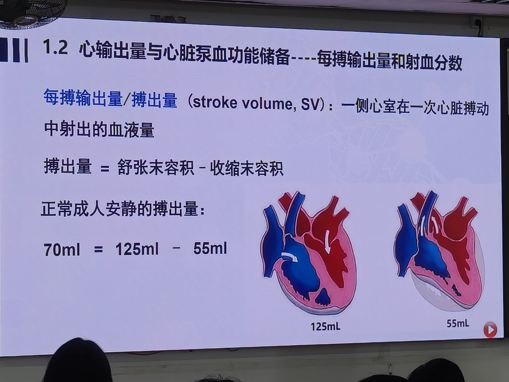

📝 **图：PPT「1.2 心输出量与泵血储备——每搏输出量和射血分数」**。SV定义=一侧心室一次心搏射出血量；SV=舒张末容积−收缩末容积；安静70 mL=125 mL−55 mL；配图心脏舒张125 mL/收缩55 mL。与本节"EDV≈125、ESV≈55、SV≈70"完全一致。

### 1.3.2 射血分数（Ejection Fraction, EF）

- **定义**：搏出量占心室舒张末期容积的百分比。
- **公式**：EF = SV / EDV × 100%。
- **正常值**：**55%~65%**（约60%）。
- **临床意义**：
  - 比SV更敏感的早期心衰指标；
  - 老师举例：扩张型心肌病患者心脏变大，EDV从125 mL涨到140 mL，但SV仍维持70 mL——单看SV正常，但EF=70/140=50%，已经降到正常下限以下；
  - 心脏彩超（超声心动图）常规测量EF，是体检和心衰随访的核心指标。
- **易错点**：EF是百分比，不是绝对值；心脏变大但SV正常时EF已下降。

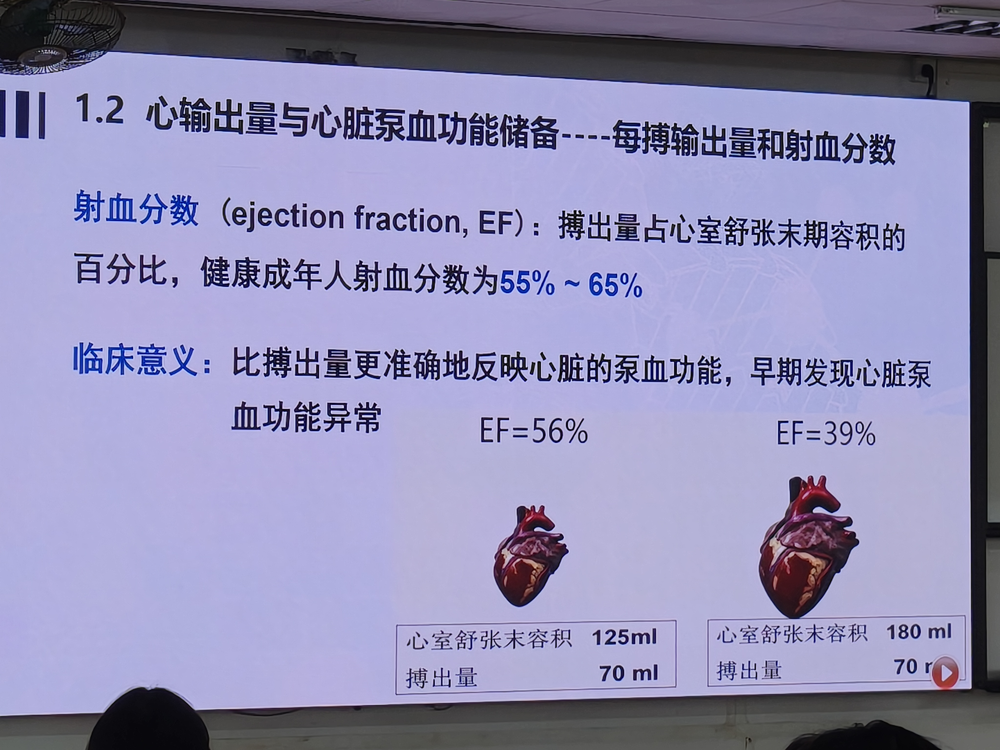

📝 **图：PPT「射血分数EF」**。EF=搏出量占EDV百分比，55%~65%；比SV更早发现泵血异常；对比图：EF=56%（EDV 125 mL/SV 70 mL）vs EF=39%（EDV 180 mL/SV 70 mL）——SV同样70 mL，但EDV扩大后EF从56%掉到39%。这就是"扩张型心肌病SV正常但EF已降"的直观图解。

**EF的临床分级**【教材补充】：

| EF值 | 分级 |
|---|---|
| ≥55% | 正常 |
| 41%~54% | 轻度下降（HFmrEF） |
| 31%~40% | 中度下降（HFmrEF/HFrEF交界） |
| ≤30% | 重度下降（HFrEF） |

心衰患者EF<35%是猝死高风险，需要考虑植入ICD（埋藏式心脏除颤器）。

### 1.3.3 心输出量（Cardiac Output, CO）

- **定义**：一侧心室每分钟射出的血液量。
- **公式**：CO = SV × HR（心率）。
- **正常值**：安静时约70 mL × 75次/分 ≈ **5.25 L/min**（教材范围4.5~6.0 L/min）。
- **临床意义**：
  - 连续指标，反映整体循环供血能力；
  - 运动时可增至25~35 L/min（扩大6~7倍）；
  - 老师原话："血液约占体重4~8%，按50 kg体重算约4 L；安静时CO≈5 L，意味着**每分钟把全身血液循环一遍**——这是CO的象征意义。"
  - 心功能差的人安静时CO也能维持5 L，但那是因为他**安静时已经在动用储备**（比如心率偏快），一旦运动就无法提升——所以心衰患者"安静没事、不能干活"。
- **易错点**：CO不是一氧化碳（carbon monoxide），是cardiac output。

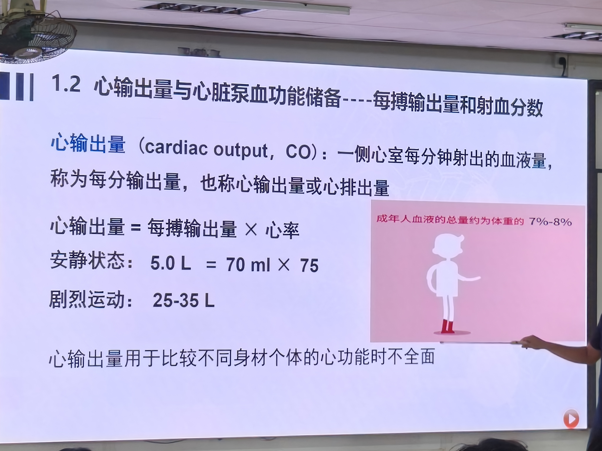

📝 **图：PPT「心输出量CO」**。CO=一侧心室每分射出血量；CO=SV×HR；安静5.0 L=70 mL×75；剧烈运动25~35 L；成年人血液总量约体重7%~8%；CO比较不同身材个体时不全面（所以要用心指数）。与本节"血液占体重4~8%、每分钟泵全身血一遍"完全对应。

**CO的临床意义深入**：
- 老师举例：心衰患者安静时CO仍能维持5 L，但那是因为他**安静时已经在动用储备**——比如心率偏快（70次/分本来可以，他要跳到90次/分才能维持5 L）；
- 一旦运动，正常人CO能升到25~35 L，心衰患者最多升到8~10 L就上不去了——所以表现为"一动就喘"；
- 这就是为什么心衰分级不是看安静CO（都正常），而是看**运动耐量**（NYHA分级：I级日常无症状、II级轻度活动受限、III级明显活动受限、IV级安静时也喘）。

### 1.3.4 心指数（Cardiac Index, CI）

- **定义**：空腹安静状态下，每平方米体表面积的心输出量。
- **公式**：CI = CO / 体表面积（m²）。
- **正常值**：**3.0~3.5 L/(min·m²)**。
- **临床意义**：剔除年龄、身高、体重差异，用于**不同个体之间**心功能比较（小孩vs运动员、胖子vs瘦子）。
- **易错点**：体表面积由身高、体重公式估算，不能直接测；临床实际应用有限，多用于科研和不同体表面积患者比较。

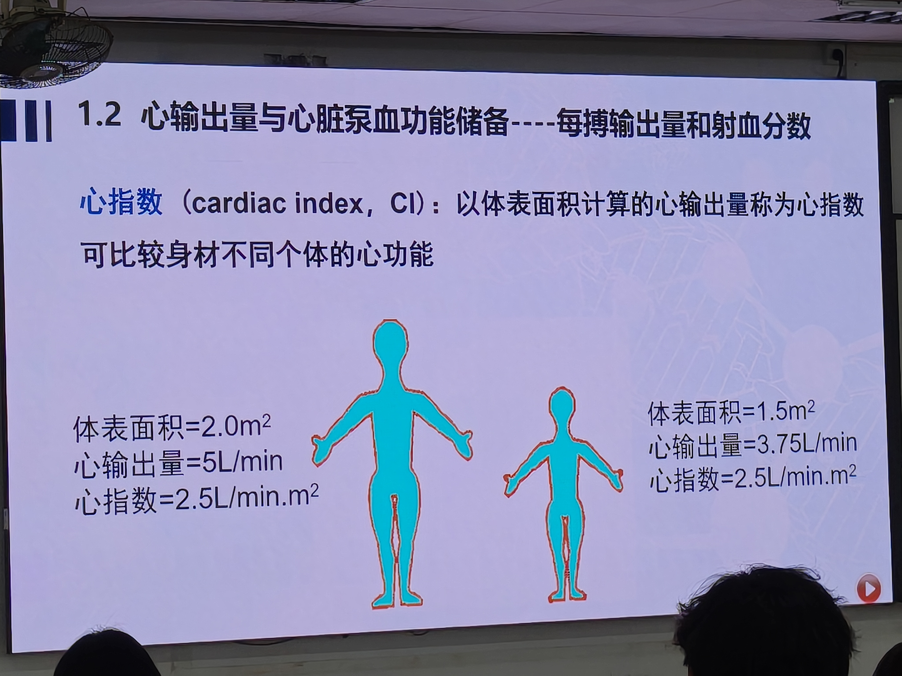

📝 **图：PPT「心指数CI」**。CI=以体表面积计算的CO，可比较不同身材个体；对比图：体表面积2.0 m²/CO 5 L→CI 2.5；1.5 m²/CO 3.75 L→CI 2.5 L/(min·m²)——虽然CO不同，但CI相同。与本节"剔除身材差异"对应。

### 1.3.5 心力储备（Cardiac Reserve）

- **定义**：心输出量随机体代谢需要而增加的能力。
- **公式**：心力储备 = 最大CO − 安静CO。
- **正常值**：健康成人最大CO可达25~35 L/min，为安静值的**6~7倍**。
- **构成**：
  - **搏出量储备**：
    - **收缩期储备（更大）**：安静时ESV≈55 mL；剧烈收缩时ESV可降到20 mL以下→多射出约35 mL；
    - **舒张期储备（较小）**：安静时EDV≈125 mL；舒张更充分时EDV可到140 mL→仅多容纳约15 mL，且受心包结构限制。
  - **心率储备**：安静75次/分→最大可到160~180次/分（>180后充盈不足CO反降）。

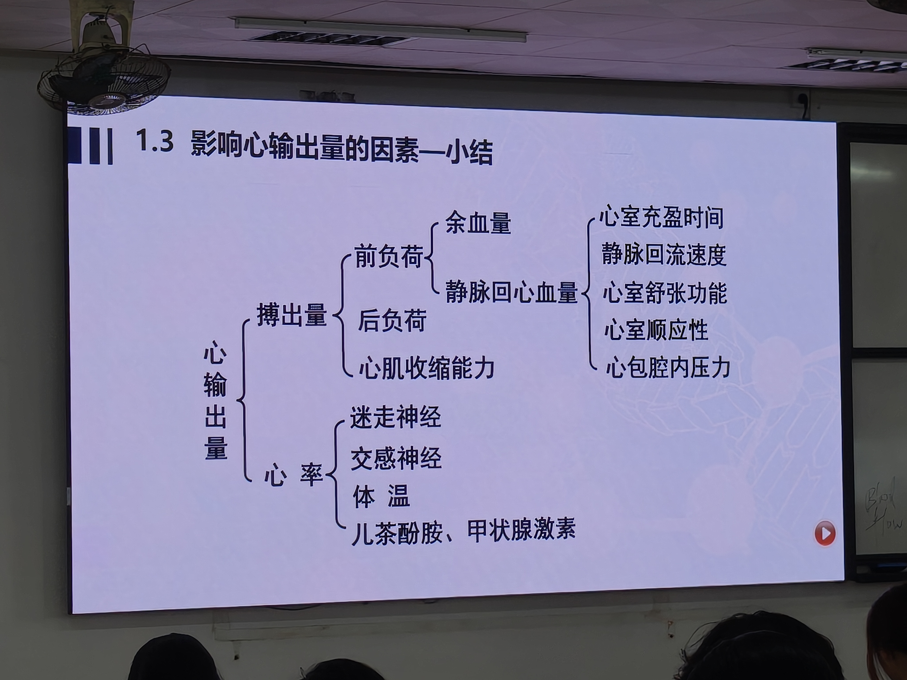

📝 **图：PPT「影响心输出量的因素——小结」思维导图**。CO=搏出量（前负荷[余血量/回心血量]/后负荷/心肌收缩能力）+心率（迷走/交感/体温/儿茶酚胺甲状腺激素）；回心血量细分=充盈时间/回流速度/舒张功能/顺应性/心包腔内压力。这是本章上半部分总思维导图。
- 老师原话："**收缩期储备比舒张期储备大。**"

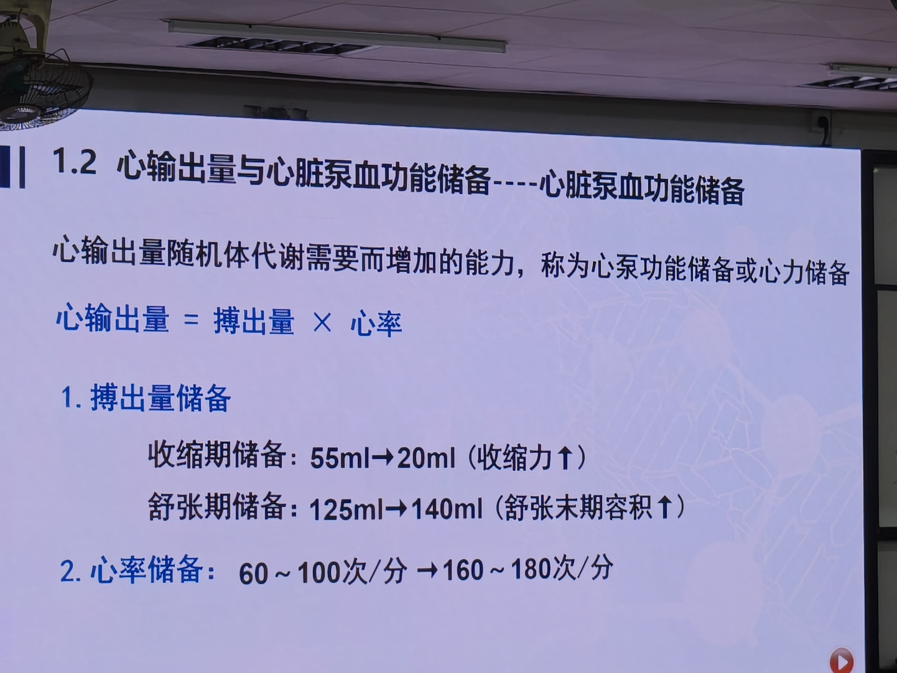

📝 **图：PPT「心输出量与泵血功能储备」**。心力储备=CO随机体代谢需要增加的能力；CO=SV×HR；搏出量储备：收缩期55 mL→20 mL（多射35 mL）、舒张期125 mL→140 mL（多容纳15 mL）；心率储备60~100→160~180次/分。与本节"收缩期储备>舒张期储备"完全对应。

**运动员心脏 vs 心衰心脏**：

| 项目 | 运动员心脏 | 心衰心脏 |
|---|---|---|
| 形态 | 离心性肥厚（心室腔扩大、室壁轻度增厚） | 离心性扩大+室壁变薄 |
| 安静HR | 心动过缓（50次/分左右，迷走张力高） | 心动过速（90次/分以上，代偿性） |
| 安静EF | 正常或偏高（>60%） | 下降（<50%） |
| 最大CO | 35~40 L/min | 8~10 L/min |
| 储备 | 大 | 小（已提前动用） |

老师原话："运动员安静时心率慢，但储备大；心衰患者安静时心率已经快了，储备用光了，一运动就不行。"

### 五指标对比表

| 指标 | 公式 | 正常值 | 临床意义 | 易错点 |
|---|---|---|---|---|
| SV | EDV−ESV | 60~80 mL | 单次搏出量 | 早期心衰可正常 |
| EF | SV/EDV | 55%~65% | 早期心衰敏感 | 心脏扩大时EF先降 |
| CO | SV×HR | 4.5~6.0 L/min | 连续供血量 | 不是一氧化碳 |
| CI | CO/体表面积 | 3.0~3.5 L/(min·m²) | 个体间比较 | 剔除身材差异 |
| 心力储备 | 最大CO−安静CO | 安静值6~7倍 | 心功能潜力 | 收缩期储备>舒张期储备 |

### 1.3.6 心功能评价方法（有创心导管/无创超声+左室压力-容积环）

PPT补充内容，笔记原有：

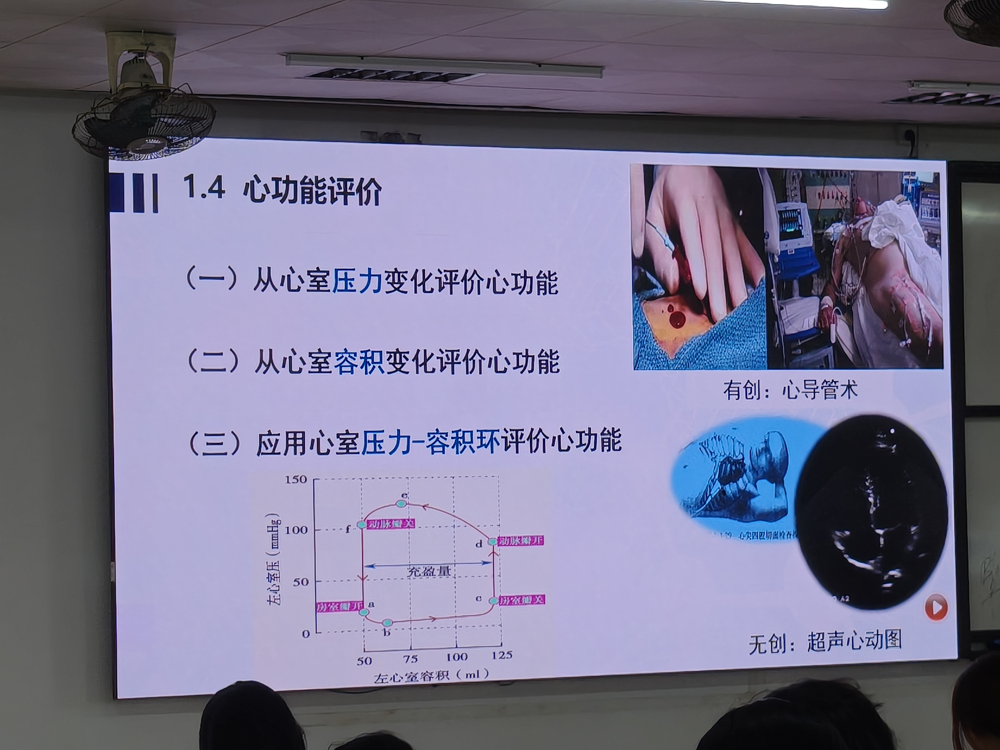

📝 **图：PPT「1.4 心功能评价」**。三个评价角度：
1. **从心室压力变化**：有创=心导管术（直接测左室压波形、dP/dt_max），最准确但需插管，仅用于危重/手术患者；
2. **从心室容积变化**：无创=超声心动图（拟合EDV/ESV、测量EF），最常用；
3. **从心室压力-容积环评价**：左室压(mmHg)×左室容积(mL)画出闭合环（a房室瓣开/b/c/d/e/f、动脉瓣开关、充盈量）——一个环完整反映一个心动周期的压力-容积变化。

老师原话："心功能评价不是生理学教学重点，后面诊断学专门讲；我们这里只要知道有这些指标和方法。"

---

## 1.4 影响心输出量的四因素

CO = SV × HR，所以影响因素分两大类：影响SV的（前负荷、后负荷、心肌收缩能力）+ 影响HR的。

### 1.4.1 前负荷——异长自身调节（Frank-Starling定律）

- **前负荷 = 心肌收缩前的初长度 = 心室舒张末期容积（EDV）**。

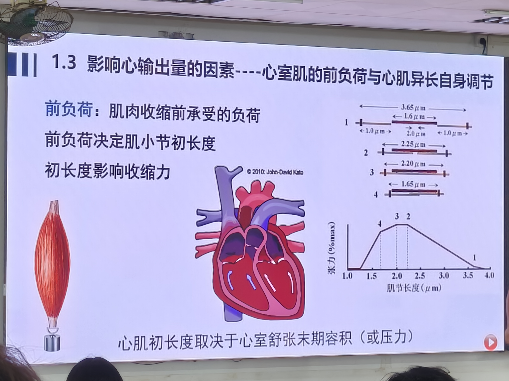

📝 **图：PPT「前负荷与异长自身调节」**。前负荷=肌肉收缩前承受的负荷；前负荷决定肌小节初长度；初长度影响收缩力；心肌初长度取决于心室舒张末期容积（或压力）。配图：骨骼肌悬吊重物、心脏解剖、肌小节长度（3.65/2.25/2.20/1.65 μm）与张力%max长度-张力曲线——最适初长度约2.25 μm。
- 直接测心室容积困难，临床常用**左房压（或肺动脉楔压）**代表前负荷——因为舒张末期房室相通、房压≈室压。
- **Frank-Starling定律**：在一定范围内，回心血量越多（EDV越大），心室收缩力越强、搏出量越多。这是心肌的**自身调节**，不依赖神经体液。

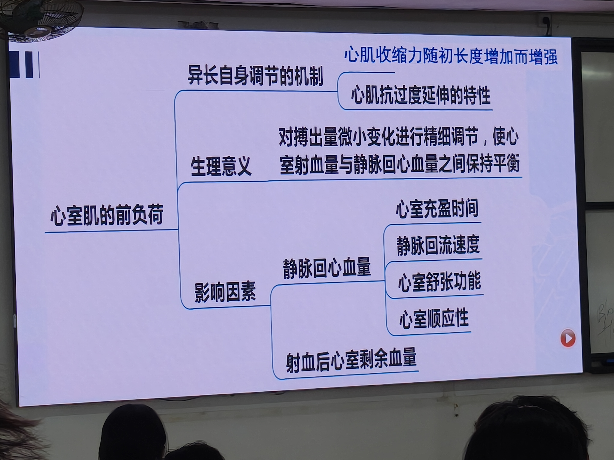

📝 **图：PPT思维导图「心室肌的前负荷」**。异长自身调节机制（收缩力随初长度增强、抗过度延伸特性）；生理意义（精细调节使射血量与回心血量平衡）；影响因素=静脉回心血量（充盈时间/回流速度/舒张功能/顺应性）+射血后剩余血量。
- **心室功能曲线（Frank-Starling曲线）**：横坐标=左房压（代表前负荷），纵坐标=搏出功。与骨骼肌长度-张力曲线不同，**心肌曲线上升后变平、没有明显下降支**。

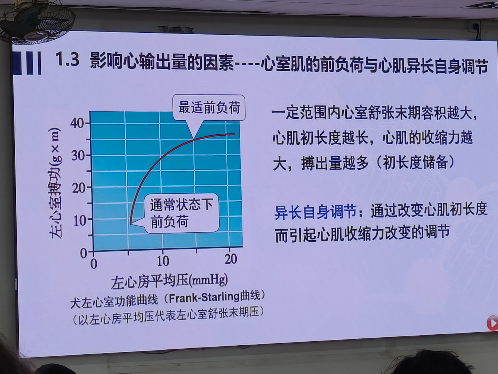

📝 **图：PPT「犬左心室功能曲线（Frank-Starling曲线）」**。横轴左房平均压（代表左室舒张末压）mmHg、纵轴左室搏功(g·m)；标注"通常状态下前负荷"（约5 mmHg）和"最适前负荷"（约15 mmHg）；一定范围内EDV越大/初长度越长收缩力越大搏出量越多，但超过最适后曲线变平、不下降。与本节"安静左房压5 mmHg远未达最适15 mmHg、前负荷储备大"完全对应。
- **为什么不降？结构基础**：
  1. 心肌细胞内有**肌联蛋白（titin）**强弹性蛋白，像弹簧把肌节拉住，过度拉长很难；
  2. 心肌外间质有**胶原纤维**提供弹性阻力；
  3. 心肌纤维**交错网状排列**（不像骨骼肌平行排列），不易被拉散。

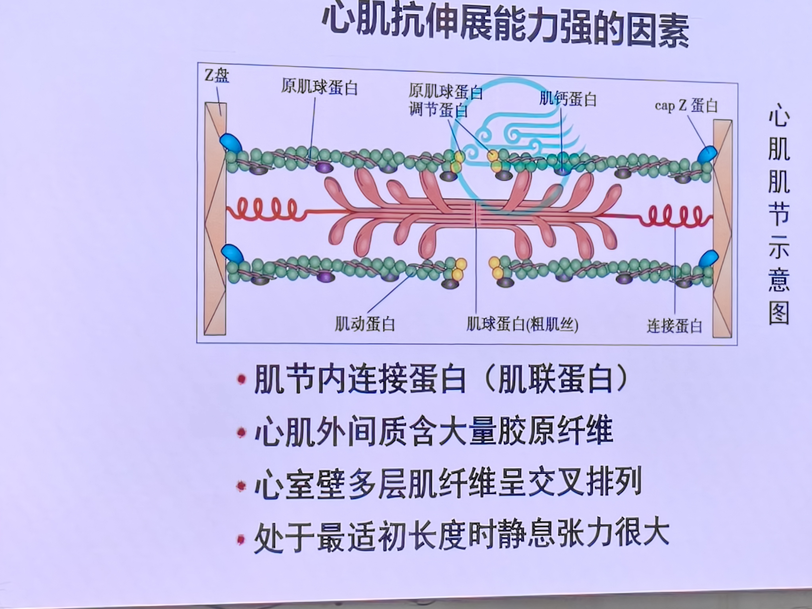

📝 **图：PPT「心肌抗伸展能力强的因素」**。心肌肌节示意图（Z盘/原肌球蛋白/肌钙蛋白/capZ蛋白/肌动蛋白/肌球蛋白粗肌丝/连接蛋白）；要点：①肌节内连接蛋白（肌联蛋白titin）；②心肌外间质大量胶原纤维；③心室壁多层肌纤维交叉排列；④最适初长度时静息张力大。与本节三点结构基础完全对应。

**为什么这三点结构让心肌曲线不降？**

- 骨骼肌：肌节平行排列，过度拉长时粗细肌丝重叠减少→张力下降；
- 心肌：
  - 肌联蛋白像弹簧把Z线和粗肌丝连在一起，过度拉长时弹簧阻力增大，不让肌节拉太长；
  - 心外膜胶原纤维像网套住心肌，限制过度扩张；
  - 心肌纤维网状交错，一个方向拉长会被其他方向纤维拉住；
- 所以即使EDV增大，心肌也不会像骨骼肌那样被拉到"粗细肌丝脱离接触"，曲线最多变平、不降。

**临床意义**：
- 正常心脏EDV储备大（5 mmHg vs 最适15 mmHg）；
- 但晚期心衰时，弹性结构被破坏→心脏被拉散→曲线出现下降支→EDV再大搏出量反而↓。
- **生理意义**：安静时左房压约5 mmHg，远未达最适长度对应的15 mmHg→前负荷储备大；体位改变（站起时回心血量↓→搏出量↓；躺下反之）、短暂血压波动时自动平衡搏出量与回心血量。

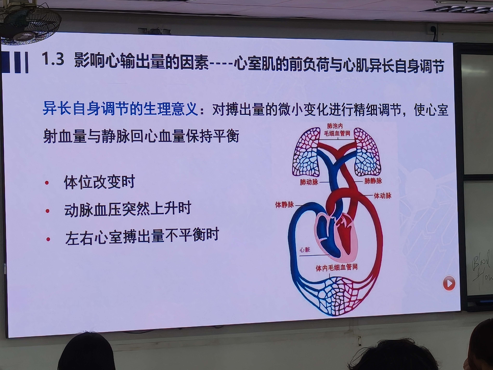

📝 **图：PPT「异长自身调节的生理意义」**。异长调节精细调节搏出量、使射血量与回心血量平衡；举例：体位改变/动脉血压突升/左右室搏出量不平衡；配整体血液循环示意图（心脏/肺泡毛细血管/体循环）。

【考点】**异长自身调节 = 通过改变心肌初长度调节搏出量**。

**体位改变时的异长调节例子**（老师课堂详细讲）：

- **突然从卧位站起**：重力作用使约500 mL血液淤积在下肢静脉→回心血量↓→EDV↓→前负荷↓→搏出量↓→短暂脑供血不足→头晕眼黑（这就是"体位性低血压"）；
- 正常人：几秒钟内通过异长调节+颈动脉窦压力感受器反射恢复；
- **长期卧床者**：体位性低血压更明显，因为静脉张力下降、调节功能减弱；
- **反过来，从站位突然躺下**：下肢淤积的血液回流→回心血量↑→EDV↑→搏出量↑→异长调节自动平衡。

老师原话："心脏是个泵，进来多少就得泵出去多少，短暂不平衡可以，长期不平衡不行。异长调节就是干这个的——对微小变化精细调节。"

**影响前负荷（静脉回心血量）的5个因素**：

1. **心室充盈时间**：心率过快→舒张期短→充盈不足→前负荷↓；
2. **静脉回流速度**：取决于外周静脉压与房压差；心室舒张抽吸越强、压差越大、回流越快；
3. **心室舒张功能**：舒张是主动耗能过程，依赖肌质网**钙泵（SERCA）**把Ca²⁺泵回——钙回收越快、舒张越快、抽吸越强；
4. **心室顺应性**：心室被动扩张的容易程度；心肌纤维化→顺应性↓→充盈困难；
5. **心包**：心包积液/缩窄→限制心室扩张→前负荷↓。

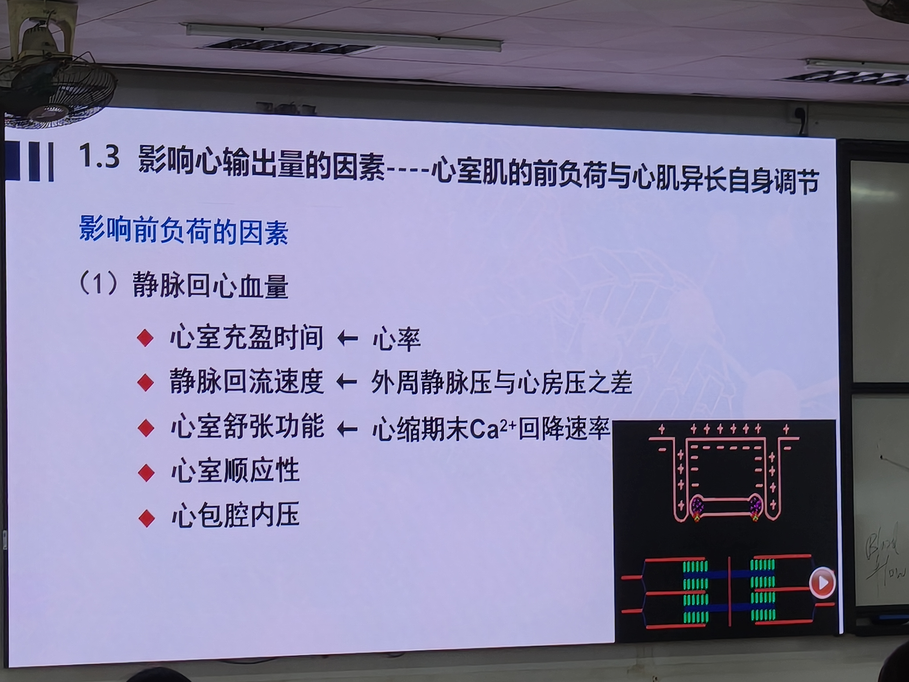

📝 **图：PPT「影响前负荷的因素——静脉回心血量」**。心室充盈时间←心率；静脉回流速度←外周静脉压与房压之差；心室舒张功能←心缩期末Ca²⁺回降速率；心室顺应性；心包腔内压。与本节5个影响因素一一对应。

### 1.4.2 后负荷——动脉血压

- **后负荷 = 心室收缩射血时遇到的阻力 = 主动脉血压**。
- 血压突然升高→等容收缩期延长（要更长时间才能把室内压升到超过主动脉压）→射血期缩短、射血速度减慢→搏出量暂时↓→心室内剩余血量↑→下一轮EDV↑→通过异长调节搏出量恢复。
- **80~170 mmHg范围内**，这种代偿可维持搏出量稳定。
- **长期高血压的病理过程**（老师详细讲）：
  1. 后负荷持续↑→心肌做功持续增加；
  2. 心肌纤维代偿性增粗（**向心性肥厚**）；
  3. 肥厚心肌挤占心室腔容积→前负荷↓；
  4. 心肌耗氧量↑而冠脉供血相对不足→**心肌缺血**；
  5. 长期缺血→心肌坏死、弹性结构破坏→心室扩大、收缩力↓→**失代偿→心衰**；
  6. 心电图上"左室高电压"就是左室心肌肥厚的表现（产电结构增加，叠加电位升高）。
- 降压药（ACEI/ARB类）通过扩张动脉降低外周阻力→降低后负荷，可延缓甚至逆转肥厚。

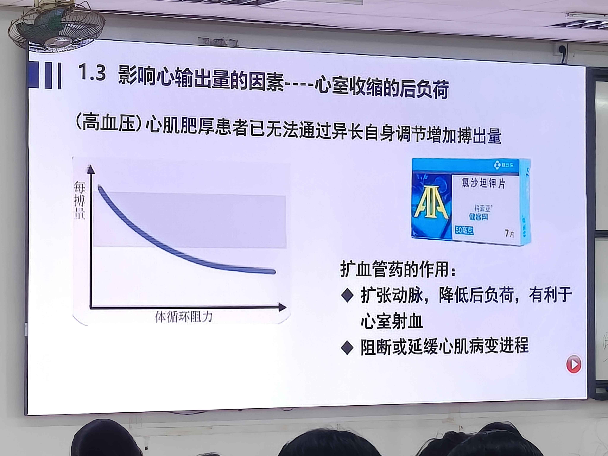

📝 **图：PPT「后负荷」**。高血压心肌肥厚患者已无法通过异长调节增加搏出量；每搏量-体循环阻力下降曲线；扩血管药（氯沙坦钾片ARB）作用=扩张动脉降后负荷利于射血、阻断/延缓心肌病变。与本节长期高血压→心肌肥厚→缺血坏死→心衰病理链完全对应。

**高血压→心衰的完整病理链**（老师课堂详细讲）：

1. 长期高血压（后负荷↑）→左心室射血阻力↑；
2. 早期代偿：心肌纤维增粗（向心性肥厚）→收缩力↑→搏出量维持；
3. 心电图表现：**左室高电压**（肥厚心肌产电总量增加，叠加出高电压）；
4. 失代偿：肥厚心肌挤占心室腔→EDV↓；肥厚心肌耗氧量↑而冠脉供血相对不足→心肌缺血；
5. 缺血→心肌坏死→弹性结构破坏→心室扩大（离心性肥厚）；
6. 扩大心肌收缩力↓→搏出量↓→心衰；
7. 临床表现：活动后气促（左心衰肺淤血）、下肢水肿（右心衰体循环淤血）。

老师原话："高血压是心衰的最常见病因之一，所以血压必须控制。"

**后负荷突然增加的即时反应**：

- 血压从120突然升到150（比如情绪激动）；
- 等容收缩期延长（要更长时间才能把室内压升到超过150）；
- 射血期缩短→搏出量暂时↓→心室内剩余血量↑；
- 下一轮EDV↑→异长调节启动→搏出量恢复；
- 这就是为什么短暂血压波动不会导致明显CO下降——异长调节在几拍内就代偿了。

老师原话："80~170 mmHg范围内，血压波动心脏自己能调；长期高血压才会出问题。"

**为什么后负荷代偿范围是80~170 mmHg？**

- 低于80 mmHg（休克）：主动脉压太低，即使心室收缩力正常，射血驱动力也不足→CO下降；
- 高于170 mmHg（恶性高血压）：后负荷太大，异长调节也代偿不过来→搏出量下降；
- 这个范围是临床观察出来的生理极限，超出此范围心功能就失代偿。

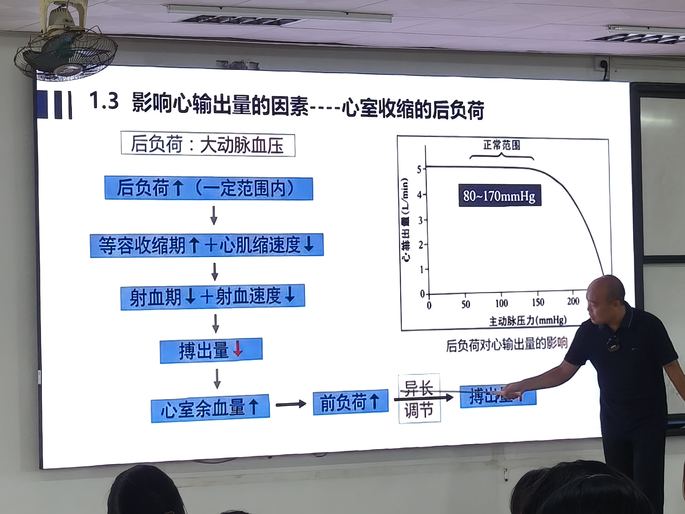

📝 **图：PPT「心室收缩的后负荷」**。后负荷=大动脉血压；后负荷↑→等容收缩期↑/缩速↓→射血期↓/射速↓→搏出量↓→余血量↑→前负荷↑→异长调节恢复；后负荷对CO影响曲线（主动脉压mmHg，80~170 mmHg正常范围）。与本节代偿范围完全一致。

【考点】高血压→后负荷↑→心肌肥厚→左室高电压→缺血坏死→心衰。

### 1.4.3 心肌收缩能力——等长调节

- **定义**：不依赖前/后负荷，心肌本身收缩效能的改变。
- **机制**：
  1. **活化横桥数目**：胞质Ca²⁺浓度越高、维持越久，活化横桥越多；
  2. **肌钙蛋白对Ca²⁺的亲和力**：儿茶酚胺（肾上腺素/去甲肾上腺素）可提高亲和力；
  3. **肌球蛋白ATP酶活性**：能量代谢水平；
  4. **ATP供应**。
- 交感神经兴奋、肾上腺素→胞质Ca²⁺↑→收缩力↑（正性变力作用）。
- 因为同样的初长度下收缩力变了，所以叫**等长调节（homometric regulation）**。

**等长调节的例子**：

- 情绪激动、运动、紧张时→交感神经兴奋→去甲肾上腺素释放→心肌β₁受体激活→胞内cAMP↑→L型钙通道开放概率↑→胞质Ca²⁺↑→收缩力↑（正性变力）；
- 甲状腺激素→肌球蛋白ATP酶活性↑→收缩力↑；
- 缺氧、酸中毒→收缩力↓（负性变力）；
- 老师原话："等长调节是真正'改变心脏本身收缩能力'的调节，异长调节只是'靠拉长肌肉来调'。"

### 1.4.4 心率

- 安静60~100次/分；
- **40~180次/分范围内**：HR↑→CO↑（CO=SV×HR，SV相对稳定）；
- **HR>180次/分**：舒张期过短→充盈不足→SV明显↓→CO反而↓；
- **HR<40次/分**：舒张末期充盈已饱和，HR再慢CO也上不去。
- 临床联系：室上速HR 160~220次/分时，患者血压下降、头晕、黑矇——就是心率过快→舒张期充盈不足→CO骤降→脑供血不足。

**心率对CO的U型曲线**：

老师在1:29:01讲了一个关键观点：心率对CO的影响不是线性的，而是U型（钟型）：

| HR范围 | CO变化 | 原因 |
|---|---|---|
| 40次/分以下 | HR↑→CO↑ | 舒张末期充盈已饱和，SV不变，HR升CO升 |
| 40~180次/分 | HR↑→CO↑ | SV相对稳定，HR升CO升 |
| 180次/分以上 | HR↑→CO↓ | 舒张期太短→SV骤降→CO反降 |

这就是为什么：
- 运动员安静HR 50次/分，CO仍正常（因为SV大）；
- 室上速HR 200次/分，CO反而下降（因为SV小）；
- 窦性心动过缓HR 40次/分，如果是运动员，无症状；如果是房室传导阻滞，可能头晕。

老师原话："心率不是越快越好，太快了反而泵不动。"

### 1.4.5 心功能评价方法（老师课堂提及）

老师在1:33:17提到，前面讲的SV/EF/CO/CI只是"指标"，不是真正的临床评价。真正的心功能评价分两类：

| 方法 | 原理 | 优缺点 |
|---|---|---|
| **有创检查**：心室压力导管 | 直接测室内压变化（压力波形、dP/dt_max） | 最准确，但需插管，仅用于危重/手术患者 |
| **无创检查**：超声心动图 | 通过超声拟合心室容积变化、测量EF | 最常用、无创、可重复；但精度受操作者经验影响 |

老师原话："心功能评价不是生理学教学重点，后面诊断学会专门讲；我们这里只要知道有这些指标就行。"

---

# 第二部分　心肌细胞电生理（本课核心，逐期详解）

## 2.1 为什么要学电生理？——因果链

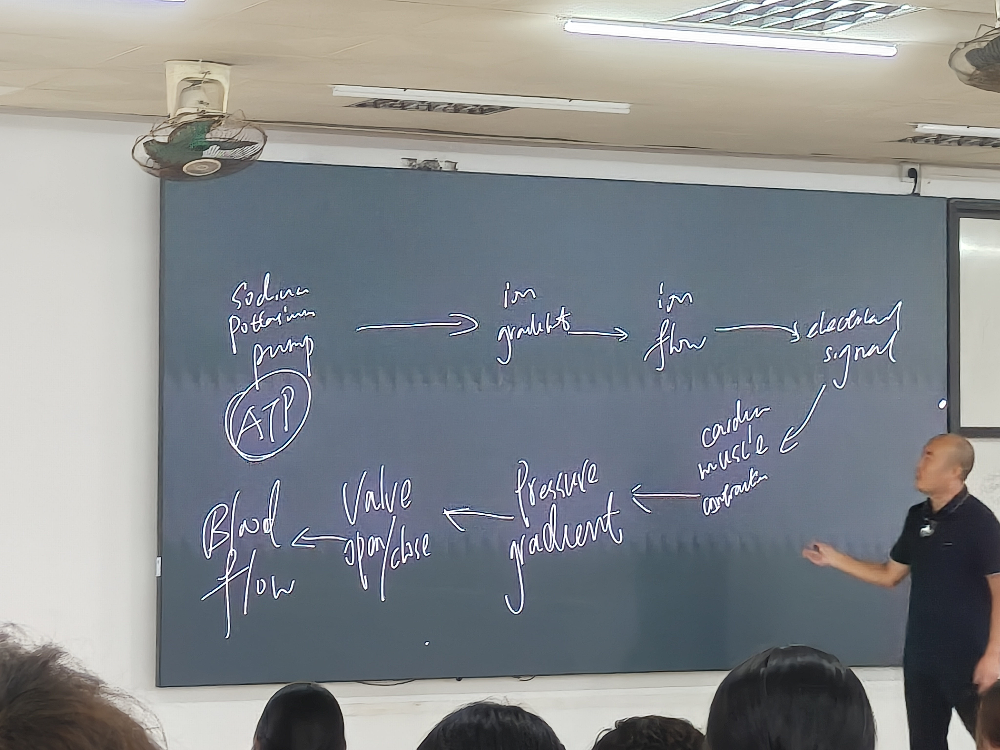

📝 **图：黑板手写因果链（老师立于黑板旁讲解）**。sodium-potassium pump (ATP) → ion gradient → ion flow → electrical signal → cardiac muscle contraction → pressure gradient → valve open/close → blood flow。这是本课总纲：钠钾泵耗能建立离子梯度→离子跨膜流动产生电信号→电信号触发心肌收缩→产生压力梯度→驱动瓣膜开闭→推动血流。

老师在01:36:48开课，先用一条因果链把整节逻辑串起来：

> **钠钾泵耗能建立离子梯度（胞外高Na⁺、胞内高K⁺、胞外高Ca²⁺）**
> → **带电离子跨膜流动**（驱动力 × 通透性 = 离子电流）
> → **膜电位波动（静息电位、动作电位）**
> → **动作电位沿心肌传导（窦房结→房室→浦肯野→心室肌）**
> → **心肌兴奋-收缩耦联（Ca²⁺触发收缩）**
> → **心肌收缩/舒张 → 室内压变化 → 压力梯度 → 瓣膜开关 → 血流**

第一节讲的"泵血"是结果，本节电生理才是机制。老师原话："第二节是本章乃至整本生理学难度最高的部分。"

**这条因果链的临床意义**：

- 任何一个环节出问题都会导致泵血障碍：
  - 钠钾泵出问题（缺氧、氰化物中毒）→离子梯度崩溃→AP消失→心脏停搏；
  - 通道出问题（通道病）→AP图形异常→心律失常；
  - 传导系统出问题（房室传导阻滞）→冲动传不下去→心室跳慢；
  - 兴奋-收缩耦联出问题（低钙）→心肌不能收缩→心衰；
  - 瓣膜出问题（狭窄/关闭不全）→即使压力梯度正常，血流也不对。
- 所以心脏病不是单一疾病，而是这条链上任何一环出问题。

---

## 2.2 神经纤维动作电位——学心肌AP之前的脚手架

老师先以神经纤维为模型复习，并且**追问"为什么"**。

### 2.2.1 基本数字

- **静息电位 RP ≈ -70 mV**；
- **超射最高点 ≈ +30 mV**；
- **上升支**：Na⁺内流，电压门控钠通道；
- **下降支**：K⁺外流，电压门控钾通道；
- 从阈电位到锋电位仅1~2 ms。

### 2.2.2 追问一：为什么上升支只有Na⁺、下降支只有K⁺？

刺激一来，钠通道和钾通道**都**接受了去极化刺激，但为什么不是两个同时开放？

答案：**门控动力学不同——钠通道瞬时激活、钾通道延迟激活。**

- **电压门控钠通道：瞬时激活（快开快关）**。受刺激后立即开放，但只开1~2 ms就失活关闭，即使膜电位还在去极化状态它也关。
- **电压门控钾通道：延迟激活**。受刺激后要"延迟"1~2 ms才开始开放，开放后不失活。

时间线：
1. 0 ms 刺激到来：钠通道立即开放→Na⁺内流→去极化（上升支）；钾通道还在"延迟中"。
2. 1~2 ms：钠通道失活关闭；钾通道延迟结束→K⁺外流→复极化（下降支）。

两股电流此消彼长、交替主导。

【考点】**钠通道=瞬时激活（1~2 ms即失活）；钾通道=延迟激活**。

### 2.2.3 追问二：超射为什么停在+30 mV，不到E_Na（+60 mV）？

- E_Na理论上约+60 mV，但实际只到+30 mV就拐头；
- 原因①：膜电位到正电位后，Na⁺（正离子）再往里流要"挤进正电场"，同性相斥，**Na⁺内流驱动力大幅减弱**；
- 原因②：延迟激活的钾通道在+30 mV附近已经开放，**K⁺外流逐渐增强**；
- 当"正在减弱的Na⁺内流"与"正在增强的K⁺外流"相等时，出现拐点。

### 2.2.4 追问三：AP为什么不衰减传播？

- 因为全身每一段细胞膜内外的Na⁺/K⁺浓度梯度都一样；
- AP每传到一处，都用同样的梯度重新"点燃"一个同样幅度的AP——不是同一个电流在传，而是沿途不断"再生"。

【考点】**AP幅度由膜内外Na⁺浓度差决定**。老师举例：长期吃盐多→胞外Na⁺升高→Na⁺内流驱动力增大→AP幅度变大。

### 2.2.5 阈电位、阈刺激、局部电位

- **有效刺激**：能让膜电位从RP波动到**阈电位**的刺激；
- 神经纤维RP=-70 mV，**阈电位约-55 mV**（比RP小10~20 mV）；
- 若刺激太小，膜只波动10 mV（比如到-60 mV）未达阈电位→**局部电位（电紧张电位）**，不爆发AP；
- 一旦到阈电位，**相当一部分电压门控钠通道被激活**→Na⁺内流→进一步去极化→激活更多钠通道→**再生式正反馈**→AP爆发。

### 2.2.6 钠通道三状态模型【教材补充·生理第10版】

老师在01:50左右讲钠通道门控时提到，钠通道不是简单的"开/关"，而是有三种状态：

| 状态 | m门（激活门） | h门（失活门） | 能否激活 |
|---|---|---|---|
| **静息态**（备用） | 关 | 开 | 可激活（受刺激后m门开） |
| **激活态** | 开 | 开 | Na⁺内流 |
| **失活态** | 开 | 关 | 不可激活（必须复极化后复活） |

- 钠通道**瞬时激活**的本质：m门快速开放后，h门经过1~2 ms延迟关闭→通道失活；
- 失活后的钠通道**不能直接重新开放**，必须等膜电位复极化（回到负电位）后，h门才重新打开、m门重新关闭，回到静息态——这叫**复活**；
- 这就是为什么AP之后有**不应期**：失活态的钠通道无法再次被激活。

【考点】钠通道三状态：静息（m关h开）→激活（m开h开）→失活（m开h关），必须复极化才能复活。

### 2.2.7 局部电位 vs 动作电位对比【教材补充】

| 项目 | 局部电位 | 动作电位 |
|---|---|---|
| 刺激强度 | 阈下刺激 | 阈上刺激 |
| 幅度 | 等级性（随刺激强度变） | 全或无 |
| 传导 | 电紧张扩布、衰减 | 不衰减传播 |
| 不应期 | 无 | 有（绝对不应期） |
| 总和 | 可时间总和+空间总和 | 不可总和 |
| 例子 | 终板电位、感受器电位、突触后电位 | 神经纤维AP |

老师原话："局部电位是'小波动'，总和达到阈电位就爆发AP。"

---

## 2.3 心脏起搏传导系统与细胞分类

### 2.3.1 传导系统

老师在01:57:58画出传导顺序：

> **窦房结（SA node）→ 心房肌（优势传导通路）→ 房室结（AV node）→ 房室束（希氏束）→ 左右束支 → 浦肯野纤维（Purkinje）→ 心室肌**

正常情况下**窦房结是起搏点**（自律性最高，约100次/分，受迷走神经抑制安静时75次/分）；下游组织自律性依次递减（房室结约50次/分、浦肯野约25次/分），所以窦房结"先发令"，下游只能跟着传。

**传导路径与速度【教材补充】**：

| 部位 | 传导速度 | 生理意义 |
|---|---|---|
| 窦房结 | —— | 起搏点 |
| 心房肌/优势传导通路 | 约1 m/s | 把冲动传到房室结 |
| **房室结** | **约0.02 m/s（最慢）** | **房室延搁**：冲动在此延迟约0.1 s，保证心房先收缩、心室后收缩 |
| 房室束/左右束支 | 约2~4 m/s | 快速下传 |
| **浦肯野纤维** | **约2~4 m/s（最快）** | 心室内快速同步传导，保证左右心室同步收缩 |
| 心室肌 | 约1 m/s | 从心内膜到心外膜扩布 |

【考点】**房室延搁**：房室结传导最慢，冲动在此延迟约0.1 s——保证心房收缩完毕、心室才开始收缩，心室有充分时间充盈。这是房室结最重要的生理意义。

【考点】浦肯野纤维传导最快——保证整个心室肌几乎同步收缩，产生合力射血。

### 2.3.2 工作细胞 vs 自律细胞

| 细胞类型 | 包括 | 收缩性 | 自律性 | 兴奋性 | 传导性 |
|---|---|---|---|---|---|
| **工作细胞** | 心房肌、**心室肌** | **有** | 无 | 有 | 有 |

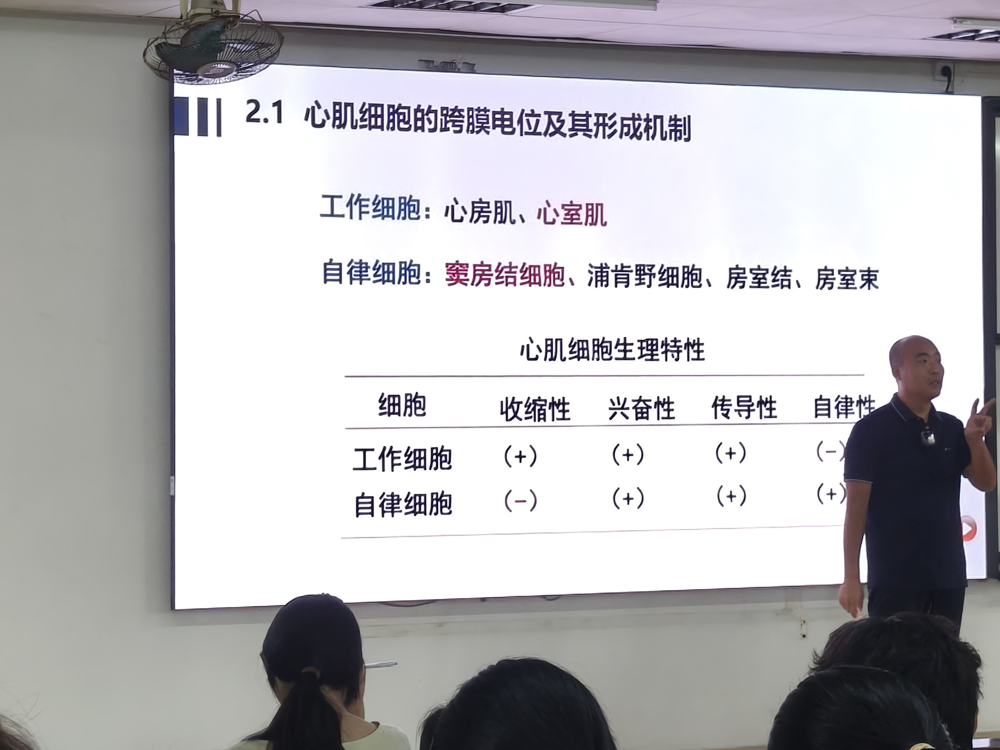

📝 **图：PPT「心肌细胞跨膜电位」**。工作细胞（心房肌、心室肌）；自律细胞（窦房结细胞、浦肯野细胞、房室结、房室束）；生理特性表：工作细胞收缩+/兴奋+/传导+/自律−；自律细胞收缩−/兴奋+/传导+/自律+。
| **自律细胞** | **窦房结P细胞**、浦肯野 | 无 | **有** | 有 | 有（浦肯野最快） |

【考点】本课重点：**心室肌（工作细胞代表）**+**窦房结P细胞（自律细胞代表）**。

---

## 2.4 离子流动的"两手抓"：驱动力 × 通透性

老师在02:02讲了一个贯穿整节的辩证思想：

> **离子是否跨膜流动 = 电化学驱动力 × 膜对该离子的通透性（即是否表达相应通道）。**

- **驱动力**：由钠钾泵耗能建立的离子浓度差 + 膜电位差决定。所有细胞（心肌、骨骼肌、神经）驱动力几乎一样。
- **通透性**：由细胞膜上表达什么离子通道决定——**基因选择性表达**的结果。

老师原话："**心肌和神经/骨骼肌动作电位图形不一样，不是因为离子梯度不一样，而是因为离子通道（通透性）不一样。**"

**为什么是"两手抓"？**

老师用一个比喻解释：
- **驱动力**就像水位差——河两岸水位差越大，水越容易流；
- **通透性**就像河上有没有桥/闸——即使水位差再大，没有桥/闸，水也过不去；
- 同样，即使胞外Na⁺再高（驱动力大），如果细胞膜上不表达钠通道（通透性为零），Na⁺也不会内流；
- 这就是为什么不是所有细胞都能产生动作电位——比如红细胞，虽然离子梯度正常，但不表达电压门控钠通道，所以不能产生AP。

**心肌 vs 神经 vs 骨骼肌的图形差异**，用"两手抓"解释：
- 三者驱动力（离子梯度）几乎一样；
- 但心肌表达了L型钙通道（神经/骨骼肌没有长时程L型钙通道开放）；
- 心肌I_K1在去极化时关闭（神经的钾漏通道不关闭）；
- 所以心肌有2期平台，神经/骨骼肌没有。

---

## 2.5 心室肌细胞静息电位

- 数值：RP ≈ **-90 mV**（教材范围-80~-90 mV）；注意比神经纤维的-70 mV更负。
- 形成机制：主要由**K⁺外流**形成，接近K⁺平衡电位E_K（约-90 mV）。
- 介导通道：**内向整流钾通道（I_K1, inward rectifier K⁺ channel）**。

【教材补充·生理第10版】"内向整流"含义：I_K1通道对K⁺内流方向通透性高、对K⁺外流方向通透性低；而且它的开放概率随膜电位去极化而**降低**——膜越去极化，I_K1越关闭。这个特性在2期平台期至关重要。

**为什么叫"内向整流"？** 整流是电子学术语，指"只让电流单向通过"。I_K1通道在膜电位为负（静息状态）时，允许K⁺外流（相当于电流内流方向，因为K⁺带正电、从胞内到胞外=电流从胞外到胞内）；但在膜电位去极化（0 mV左右）时，它反而关闭、不让K⁺外流。所以叫"内向整流"——只容易让内向方向的电流通过。

这个特性的生理意义：
1. 静息状态下（-90 mV）：I_K1开放→K⁺外流→维持RP；
2. 去极化状态下（0 mV平台期）：I_K1自动关闭→K⁺外流减少→不打断平台期的Ca²⁺内流平衡；
3. 复极化时（3期回到负电位）：I_K1重新开放→K⁺外流加速复极。

一句话：**I_K1"该开的时候开、该关的时候关"，自己根据膜电位调节，是平台期形成的关键配角。**

---

## 2.6 心室肌动作电位0~4期（核心中的核心）

与神经纤维AP"尖峰状、对称、1~2 ms"截然不同，**心室肌AP时程200~300 ms**，图形扁长、有平台，分5期。

### 2.6.1 总览表

| 时期 | 名称 | 膜电位变化 | 历时 | 主要离子流 | 通道 |
|---|---|---|---|---|---|
| **0期** | 去极化 | -90 → +30 mV | 1~2 ms | **Na⁺快速内流** | 快钠通道 I_Na |
| **1期** | 快速复极初期 | +30 → 0 mV | 约10 ms | **K⁺一过性外流** | 瞬时外向钾通道 I_to |
| **2期** | **平台期** | 0 mV左右 | **100~150 ms** | **Ca²⁺内流 ≈ K⁺外流** | L型钙通道 I_Ca-L + I_K |
| **3期** | 快速复极末期 | 0 → -90 mV | 100~150 ms | **K⁺外流占优势** | I_K延迟整流 |
| **4期** | 静息期 | 稳定-90 mV | —— | 钠钾泵+NCX恢复梯度 | Na⁺-K⁺-ATP酶、NCX |

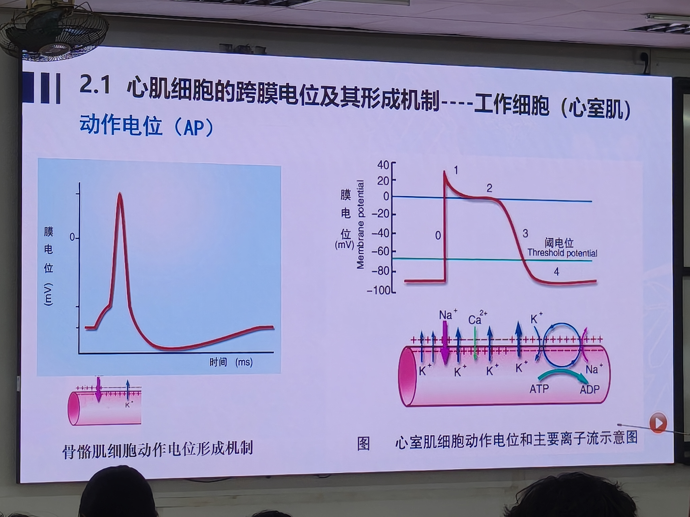

📝 **图：PPT「工作细胞(心室肌)动作电位AP」**。左=骨骼肌AP尖峰状；右=心室肌AP五期（0/1/2/3/4）曲线+阈电位+主要离子流（Na⁺内流/Ca²⁺内流/K⁺外流/钠钾泵ATP）示意。直观对比心肌与骨骼肌AP图形差异。

### 2.6.2 0期——去极化（Na⁺再生性内流）

**触发**：来自窦房结的兴奋传到心室肌，膜电位从-90 mV去极化到**阈电位（约-70 mV）**。注意：心室肌阈电位（-70 mV）比神经纤维（-55 mV）更负，因为RP本身更负。

**机制**：
1. 阈电位到达后，**先激活一部分"活性最高"的快钠通道**（电压门控Na⁺通道，I_Na）；
2. Na⁺少量内流→膜电位进一步去极化；
3. 钠通道门控特性是"**去极化越深，开放越多**"→去极化加深又激活更多活性稍低的钠通道；
4. 这就是老师强调的**再生式（生电性）Na⁺内流 = 正反馈**：钠内流→去极化→更多钠通道开放→更多钠内流……
5. 结果：膜电位在1~2 ms内从-90 mV冲到+30 mV左右，形成陡峭上升支。

老师原话："如果阈电位时所有钠通道一下全开，那就没有正反馈了。真实情况是先开一部分，靠正反馈越开越多。"

**钠通道失活**：冲到+30 mV时，快钠通道已经一过性开放1~2 ms、基本失活关闭——上升支结束。

【考点】**0期 = 快钠通道I_Na介导Na⁺内流（再生式正反馈）**。这种以快钠通道为0期机制的细胞叫**快反应细胞**。

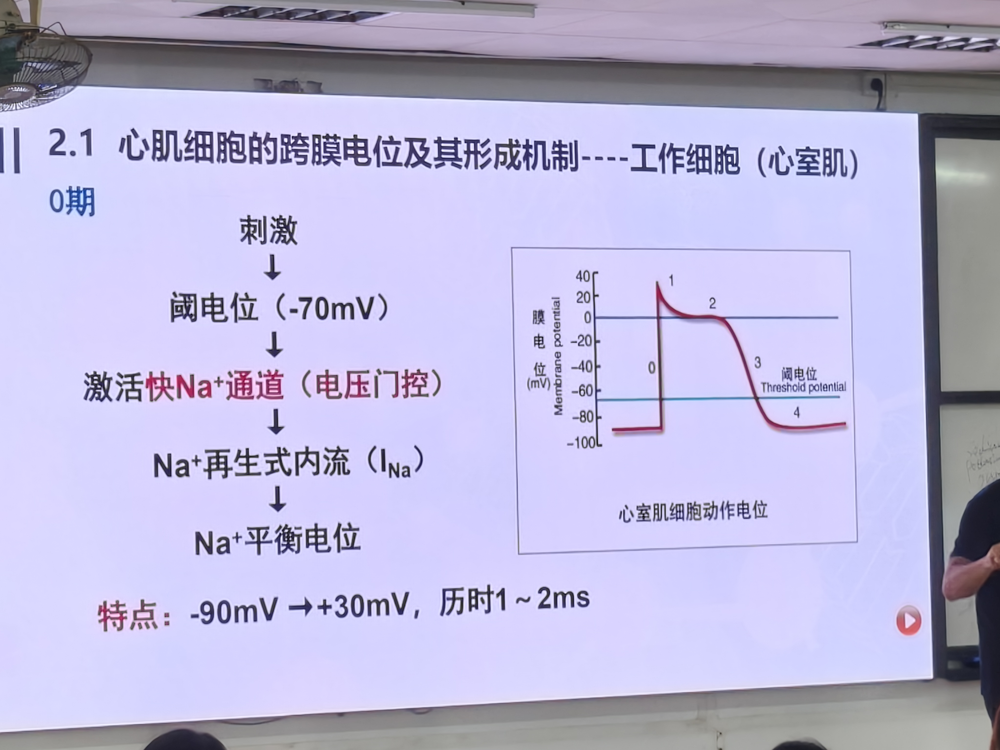

📝 **图：PPT「工作细胞(心室肌)0期」**。刺激→阈电位(-70 mV)→激活快Na⁺通道（电压门控）→Na⁺再生式内流（I_Na）→Na⁺平衡电位；特点：-90 mV→+30 mV历时1~2 ms。

**钠通道药理学【教材补充】**：
- **河豚毒（TTX）**：特异性阻断快钠通道→0期消失→AP不能爆发。是实验工具药。
- **局麻药（利多卡因、普鲁卡因）**：阻断钠通道→神经不能传导痛觉→止痛。
- **Ⅰ类抗心律失常药（奎尼丁、利多卡因）**：阻断心肌钠通道→减慢0期去极→减慢传导→治疗室性心律失常。
- 老师原话："钠通道是局麻药和Ⅰ类抗心律失常药的作用靶点。"

### 2.6.3 1期——快速复极初期

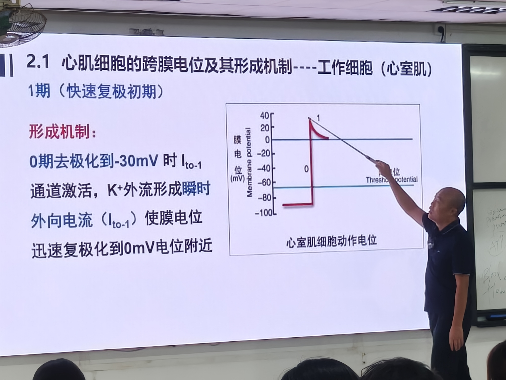

📝 **图：PPT「工作细胞(心室肌)1期(快速复极初期)」**。0期去极到-30 mV时I_to-1通道激活、K⁺外流形成瞬时外向电流，使膜电位迅速复极到0 mV附近；配心室肌AP图（标0、1期）。

- 钠通道已失活，但此时**瞬时外向钾通道（I_to, transient outward K⁺ current）**开始工作；
- I_to在0期去极化过程中（约-30 mV起）就已被激活，到0期末达到充分开放；
- 介导**一过性K⁺外流**→膜电位从+30 mV快速回落到0 mV左右；
- 历时约10 ms。

【考点】1期 = I_to介导的K⁺外流，+30→0 mV。

**I_to通道的特点【教材补充】**：
- I_to = transient outward K⁺ current，瞬时外向钾电流；
- 它在0期去极化到约-30 mV时就开始激活，到0期末充分开放；
- 开放后快速失活（所以叫"瞬时"）；
- 它的作用是让锋电位顶部快速回落，形成1期小切迹；
- 临床上，I_to增强可见于Brugada综合征（遗传性心律失常）——右心室外膜AP切迹加深→J波→室速。

### 2.6.4 2期——平台期（本课最难、最核心）

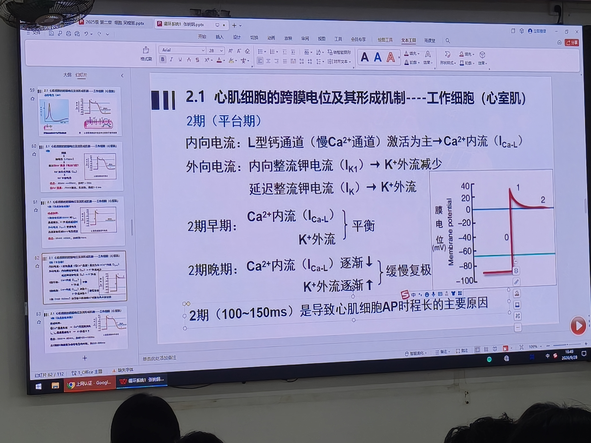

📝 **图：PPT「2期(平台期)」**。内向=L型钙通道（I_Ca-L）Ca²⁺内流；外向=I_K1使K⁺外流减少+I_K延迟整流K⁺外流；2期早期Ca²⁺内流与K⁺外流平衡；2期晚期Ca²⁺↓/K⁺↑缓慢复极；2期100~150 ms是AP时程长主因。

这是**心室肌AP与神经/骨骼肌AP图形差异的根本原因**。

**为什么能"平"？——两股方向相反的电流平衡**：

- **内向电流（去极化方向）**：
  - **L型钙通道（L-type Ca²⁺ channel, I_Ca-L）**开放，Ca²⁺缓慢内流；
  - "L"= Long-lasting（长时程），这种通道**激活慢、失活更慢**，可开放几十到上百毫秒；
  - 它在膜电位去极化到约-40 mV时才开始开放（比钠通道的-70 mV晚）。

- **外向电流（复极化方向）**：
  - 理论上K⁺外流应让电位快速下降，但有个"拖后腿"的细节——
  - **I_K1（内向整流钾通道）在去极化状态下反而不愿意开放**（内向整流特性：喜欢负电位、不喜欢去极化），所以它介导的K⁺外流在2期**很少**；
  - **I_K（延迟整流钾通道）**缓慢开放，提供一定量K⁺外流，但它"延迟"，数量上还没完全上来。

**结果**：内向Ca²⁺内流 ≈ 外向K⁺外流 → 两股电流抵消 → 膜电位停在0 mV左右，形成**平台**。

**平台期时相变化**：
- **早期**：L型钙通道刚开放，Ca²⁺内流稍占优势，电位微平；
- **晚期**：L型钙通道缓慢失活关闭→Ca²⁺内流逐渐减少；而I_K延迟整流钾通道越开越多→K⁺外流逐渐增多；
- 平衡被打破：内向变小、外向变大→电位缓慢下降，平台结束，过渡到3期。

【考点】**2期平台期 = L型Ca²⁺内流与K⁺外流（I_K为主）平衡**。这是心肌AP时程长达200~300 ms的主要原因。

【考点·临床意义】平台期长→心室肌**有效不应期长达约200 ms**（几乎覆盖整个收缩期+舒张早期）→心肌在收缩期内**无论多强刺激都不能再爆发第二次AP**→**心肌不会发生完全强直收缩**→心肌始终"收缩0.3 s→舒张0.5 s"交替，保证心室有时间充盈。这是心肌与骨骼肌（完全强直收缩）的本质区别。

**为什么平台期是心肌特有的？——与骨骼肌/神经对比**

老师在课堂上反复强调这个对比，因为这是考试高频考点：

| 对比项 | 骨骼肌/神经AP | 心室肌AP |
|---|---|---|
| 0期后有没有1期 | 没有（尖峰直接下来） | 有（I_to K⁺外流） |
| 有没有平台期 | **没有** | **有！** |
| 2期谁主导 | 无此期 | L型Ca²⁺通道开放 |
| K⁺外流什么时候开始 | 0期后立即大量外流 | 早期I_K1关闭、I_K延迟→K⁺外流少 |
| 结果 | 1~2 ms内复极完毕 | 100~150 ms平台+100~150 ms复极=总200~300 ms |

骨骼肌/神经之所以没有平台期，是因为：
1. 它们没有L型钙通道长时程开放这回事——0期钠通道失活后，延迟整流钾通道立即大量开放，K⁺迅速外流，膜电位快速复极；
2. 它们的K⁺通道在去极化时不关闭（不像I_K1那样内向整流），所以K⁺外流持续强势，没有"等Ca²⁺"的过程。

心肌之所以进化出平台期，是为了：
1. 让心肌收缩持续足够时间（泵血需要）；
2. 让有效不应期足够长（防止强直收缩）；
3. 让2期进来的Ca²⁺有足够时间触发CICR（心肌收缩依赖外钙）。

【教材补充·生理第10版】为什么心肌不会强直收缩？因为：
1. 心室肌有效不应期（ERP）约200~300 ms，几乎覆盖整个收缩期（约300 ms）；
2. 在有效不应期内，无论多强刺激都不能产生新的AP；
3. 所以心肌永远是单收缩、不会总和成强直收缩；
4. 生理意义：保证心室收缩后必有舒张期充盈，维持泵血功能。

### 2.6.5 3期——快速复极末期

- L型钙通道完全关闭→Ca²⁺内流停止；
- I_K延迟整流钾通道充分开放→K⁺外流迅速占优势；
- 膜电位从0 mV快速回到-90 mV；
- I_K1在复极回到负电位后重新开放，协助完成最后复极。

【考点】3期 = I_K延迟整流K⁺外流占优势。

**3期复极的细节【教材补充】**：
- 3期初：L型钙通道关闭→Ca²⁺内流停止；
- 此时I_K延迟整流钾通道已经开放了一段时间，K⁺外流持续；
- 随着复极进行，膜电位从0 mV向-90 mV回归，I_K1（内向整流钾通道）在负电位下重新开放→K⁺外流进一步增强；
- 两股K⁺外流（I_K+I_K1）合力→膜电位快速回到-90 mV；
- 3期时程约100~150 ms。

**QT间期**：从QRS波起点到T波终点的时间，反映心室AP时程。QT延长→复极延迟→易诱发尖端扭转型室速（TdP）。胺碘酮、三环类抗抑郁药、低血钾都可延长QT。

### 2.6.6 4期——静息期

- 心室肌是工作细胞，4期电位**稳定在-90 mV**（不像自律细胞自动去极化）；
- 但"稳定"不等于"什么都没干"——必须把AP期间漏进来的Na⁺、Ca²⁺排出去，把漏出去的K⁺摄回来：
  - **Na⁺-K⁺泵**（3 Na⁺出 / 2 K⁺入 / 1 ATP）：恢复Na⁺、K⁺梯度；
  - **Na⁺/Ca²⁺交换体（NCX）**：3 Na⁺入 / 1 Ca²⁺出，把2期进来的Ca²⁺排出；
  - **钙泵（SERCA/PMCA）**：进一步回收/排出Ca²⁺；
- 这些活动消耗ATP，所以4期虽然电位不动，离子泵一直在工作。

**4期离子泵工作详解【教材补充】**：

一次AP期间，有多少离子跨膜了？
- Na⁺：0期内流约0.002%的胞内Na⁺总量（看起来少，但每秒钟75次AP×一辈子，不泵回去就完了）；
- Ca²⁺：2期内流约1~2 μmol/L（触发CICR足够了）；
- K⁺：1、3期外流；

4期必须做的"对账"工作：
1. **Na⁺-K⁺泵（3Na⁺出/2K⁺入/1ATP）**：把AP期间进来的Na⁺泵出去、出去的K⁺泵回来；
2. **Na⁺/Ca²⁺交换体（NCX，3Na⁺入/1Ca²⁺出）**：把2期进来的Ca²⁺排出去；这个是继发性主动转运，靠Na⁺浓度梯度（钠泵维持）提供能量；
3. **肌质网SERCA钙泵**：把胞质Ca²⁺泵回肌质网（这是舒张的关键）；
4. **细胞膜PMCA钙泵**：进一步把少量Ca²⁺排出胞外。

老师原话："收缩和舒张都是耗能的——收缩要ATP拉横桥，舒张要ATP把Ca²⁺泵回去。这就是为什么心肌缺血时舒张功能首先受损。"

**为什么舒张功能先受损？**

- 心肌缺血→ATP↓→SERCA钙泵活性↓→Ca²⁺回收慢→舒张延迟；
- 早期心衰患者EF可能正常（55~65%），但舒张功能已经下降（E/A比值倒置）——这叫**射血分数保留的心衰（HFpEF）**；
- 临床表现：活动后气促，但心脏彩超EF正常；
- 这就是为什么不能只看EF，还要看舒张功能指标（E/e'、E/A比值）。

【教材补充·生理第10版】**自律细胞（窦房结P细胞）4期并不稳定**——它在3期复极到最大复极电位后，会**自动、缓慢地去极化**（4期自动去极化），达到阈电位就爆发下一次AP。这就是自律性的电生理基础。离子机制：
1. **I_K通道进行性衰减**：K⁺外流随时间递减（最主要）；
2. **If通道（funny channel，起搏电流）**：Na⁺内流，在复极到-60 mV以下激活；
3. **T型钙通道**：少量Ca²⁺内流，辅助达到阈电位。
窦房结4期自动去极化最快，所以是心脏正常起搏点。

---

## 2.7 心肌 vs 神经/骨骼肌动作电位对比表

| 项目 | 神经纤维 / 骨骼肌 | 心室肌工作细胞 |
|---|---|---|
| 静息电位 | -70 mV（钾漏通道） | **-90 mV（I_K1）** |
| 0期去极 | Na⁺内流（快钠通道） | Na⁺内流（快钠通道）——机制相同 |
| 1期 | 无独立1期 | **有I_to K⁺外流** |
| 2期平台 | **无**（尖峰状） | **有！L型Ca²⁺内流≈K⁺外流，100~150 ms** |
| 3期复极 | K⁺外流（延迟整流） | K⁺外流（I_K延迟整流） |
| 4期 | 稳定 | 稳定（心室肌）；自律细胞自动去极 |
| AP总时程 | **1~2 ms** | **200~300 ms** |
| 有效不应期 | 短（1~2 ms） | **长（约200 ms）→ 不强直收缩** |
| 收缩所需Ca²⁺ | 100%来自SR | **外钙内流触发SR释放= CICR** |
| 图形 | 尖峰状、对称 | 扁长、有平台 |

【考点】**所有细胞离子梯度相同，图形差异来自通道表达（通透性）不同**。

**复习：AP为什么不衰减传播？**

老师在01:55:35追问过这个问题，这里再深入：

- AP一旦在某点爆发，沿细胞膜传出去后幅度为什么不越传越小？
- 答案：因为每一段细胞膜内外的Na⁺/K⁺浓度梯度都一样（胞外高Na⁺、胞内高K⁺，全身到处都一样）；
- AP传到某处→该处膜去极化→该处钠通道开放→该处Na⁺内流→在该处重新产生一个同样幅度的AP；
- 不是"同一个电流在传"，而是沿途每一段都在"重新发电"；
- 这就是为什么神经纤维动作电位可以传几十厘米而幅度不减。

**AP幅度由什么决定？**

老师举例：长期吃盐多→胞外Na⁺浓度升高→Na⁺内流驱动力增大→AP幅度变大；低钠血症时AP幅度变小。这就是为什么**AP幅度∝膜内外Na⁺浓度差**。

但注意：不衰减传播≠幅度不变——如果胞外Na⁺浓度变了，整条神经的AP幅度都会变（因为所有段的梯度都变了），但传播过程中幅度不衰减。

---

## 2.8 快反应细胞 vs 慢反应细胞【教材补充·生理第10版】

按0期去极化速度，心肌细胞分两类：

| 类型 | 包括 | 0期机制 | 0期速度 | RP | 平台期 |
|---|---|---|---|---|---|
| **快反应细胞** | 心房肌、**心室肌**、浦肯野 | **快钠通道Na⁺内流** | 快（1~2 ms升到顶） | -90 mV（心室肌） | 有明显平台 |
| **慢反应细胞** | **窦房结P细胞**、房室结 | **L型钙通道Ca²⁺内流** | 慢（去极化缓慢） | -60~-70 mV（无明显RP） | 无平台、无1/2期之分 |

【考点】窦房结P细胞0期不是Na⁺内流而是**L型Ca²⁺内流**——这就是它叫"慢反应"的原因；它4期自动去极化最快，所以是心脏起搏点。

### 窦房结P细胞动作电位特点【教材补充】

窦房结P细胞是慢反应自律细胞，AP图形与心室肌截然不同：

1. **没有明显的静息电位**：最大复极电位约-60~-70 mV，达不到心室肌的-90 mV；
2. **0期去极化慢**：由L型钙通道Ca²⁺内流介导，去极速度慢、幅度小（只到0 mV左右）；
3. **没有1期和2期**：没有平台期，0期后直接复极；
4. **3期复极**：K⁺外流；
5. **4期自动去极化**：这是自律细胞最核心的特征——3期复极到最大复极电位后，膜电位不维持稳定，而是**自动、缓慢地去极化**，达到阈电位（约-40 mV）就爆发下一次AP。

4期自动去极化的离子机制：
- **I_K进行性衰减**：复极后K⁺外流随时间递减（最主要）；
- **If电流（funny channel）**：Na⁺内流，在复极到-60 mV以下激活，随时间增强；
- **T型钙通道**：少量Ca²⁺内流，辅助达到阈电位。

【考点】**窦房结4期自动去极化最快（约0.1 V/s）→自律性最高→心脏正常起搏点**。浦肯野4期自动去极化慢，所以是潜在起搏点（窦房结失效时才起搏，叫逸搏心律）。

---

## 2.9 兴奋-收缩耦联：CICR

老师在02:27特别强调：

- **骨骼肌**：AP沿横管传到三联管→L型钙通道像"拔塞子"直接机械激活SR的RYR→Ca²⁺100%从SR释放；**不依赖外钙**；
- **心肌**：二联管结构，横管膜上L型钙通道先让**少量外钙内流（就是2期平台期的Ca²⁺电流）**→这部分Ca²⁺结合SR的RYR2→触发SR释放**大量**Ca²⁺（比进来的多10倍以上）→胞质Ca²⁺骤升→肌丝滑行收缩。

这叫**钙触发钙释放（calcium-induced calcium release, CICR）**。

【考点】2期平台期进来的Ca²⁺不是"白进来的"——它既是电活动的一部分，又是收缩的触发信号。这就是为什么钙通道阻滞剂（维拉帕米）既能影响心肌电活动、又能减弱心肌收缩力。

### 心肌CICR详细过程【教材补充】

老师在02:27特别对比了骨骼肌和心肌的钙来源：

1. AP沿横管膜传到二联管；
2. 横管膜上L型钙通道开放→少量胞外Ca²⁺内流（约占收缩所需Ca²⁺的10~20%）；
3. 这部分Ca²⁺结合到肌质网膜上的**RYR2（兰尼碱受体2型）**；
4. RYR2开放→肌质网内大量Ca²⁺释放到胞质（占80~90%）；
5. 胞质Ca²⁺从0.1 μmol/L升到1~10 μmol/L；
6. Ca²⁺结合肌钙蛋白TnC→原肌球蛋白移位→暴露肌动蛋白结合位点→横桥周期→肌肉收缩；
7. 舒张时：SERCA钙泵把Ca²⁺泵回肌质网（耗能）+NCX把Ca²⁺排出胞外→胞质Ca²⁺回落→肌肉舒张。

**与骨骼肌对比**：
- 骨骼肌L型钙通道不允许Ca²⁺内流，它像"塞子"一样机械激活RYR1；
- 心肌L型钙通道真的允许Ca²⁺内流，靠这部分Ca²⁺化学触发RYR2；
- 所以心肌收缩**依赖胞外钙**——无钙灌流液中心肌不能收缩；骨骼肌则不受影响。

【考点】**无钙灌流液：心肌不能收缩，骨骼肌照常收缩**——这是CICR的经典实验证据。

---

## 2.10 心肌兴奋性的周期性变化【教材补充·生理第10版】

心肌细胞一次兴奋过程中，膜电位经历0~3期，其兴奋性也发生周期性变化：

| 时期 | 对应AP时相 | 兴奋性 | 机制 |
|---|---|---|---|
| **有效不应期** | 0期~3期复极到-60 mV | **0**（无论多强刺激都不产生AP） | 钠通道处于激活或失活状态，不能复活 |
| **相对不应期** | 3期-60~-80 mV | 低（需阈上刺激） | 部分钠通道复活 |
| **超常期** | 3期-80~-90 mV | 高（阈下刺激即可） | 膜电位接近阈电位 |

【考点】**心肌有效不应期特别长（约200~300 ms）**——这是心肌不发生强直收缩的电生理基础，保证心脏始终"收缩-舒张"交替泵血。

### 期前收缩与代偿间歇【教材补充·生理第10版】

由于有效不应期长，心肌有两个特殊现象：

1. **期前收缩（早搏）**：在窦房结下一次冲动到来之前，如果心室受到一个额外刺激（比如在相对不应期或超常期），可以提前爆发一次AP和收缩——这叫期前收缩（早搏）。
2. **代偿间歇**：期前收缩本身也有自己的有效不应期，当窦房结的正常冲动恰好落在期前收缩的有效不应期内时，就不能引起心室兴奋——要等下一次窦房结冲动到来才收缩。所以期前收缩之后会出现一个较长的舒张间歇，叫代偿间歇。

老师虽没在课堂上细讲，但这是心肌电生理的经典临床联系：**室性早搏、房性早搏**的电生理基础就是这个。

**为什么会有代偿间歇？**

正常窦性心律：窦房结每0.8 s发一次冲动。
假设在两次窦性冲动之间，心室受到一个额外刺激（比如在相对不应期），产生了一次期前收缩：
- 期前收缩也有自己的有效不应期（约200 ms）；
- 下一次窦性冲动本来该在0.8 s后到，但它恰好落在期前收缩的有效不应期内→不能引起心室兴奋；
- 要再等下一次窦性冲动（再等0.8 s）才收缩；
- 所以期前收缩之后有一个较长的"间歇"——这就是代偿间歇。

**房性早搏为什么代偿间歇不完全？**

如果早搏来自心房（房早），它的逆传可以侵入窦房结，使窦房结提前除极→窦律重整→代偿间歇不完全。这是室早和房早的鉴别点之一。

老师原话："期前收缩+代偿间歇，是心肌不应期长的直接表现。"

---

## 2.11 心肌电生理数字汇总表（考前速查）

| 项目 | 数值 |
|---|---|
| 心室肌RP | -90 mV |

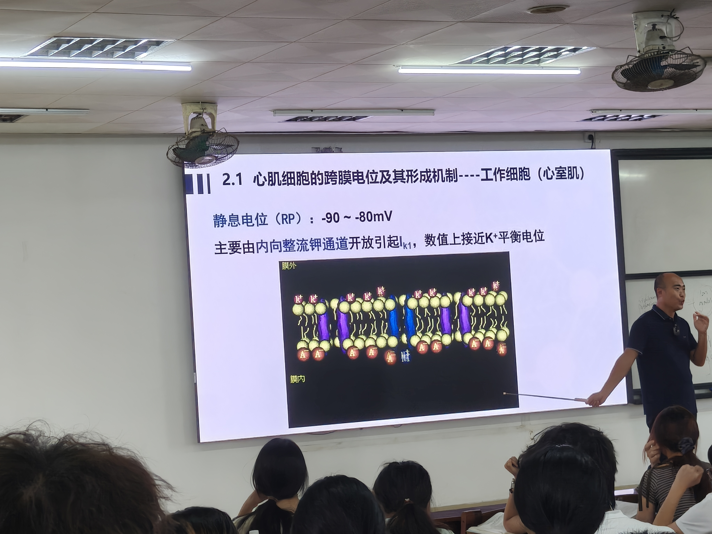

📝 **图：PPT「工作细胞(心室肌)静息电位」**。RP=-90~-80 mV，主要由内向整流钾通道（I_K1）开放引起、数值接近K⁺平衡电位；配膜内外K⁺通道磷脂双分子层示意。
| 神经纤维RP | -70 mV |
| 心室肌阈电位 | -70 mV |
| 神经纤维阈电位 | -55 mV |
| 心室肌AP超射 | +30 mV |
| 0期时程 | 1~2 ms |
| 1期时程 | 约10 ms |
| 2期平台期时程 | 100~150 ms |
| 3期时程 | 100~150 ms |
| 心室肌AP总时程 | 200~300 ms |
| 神经纤维AP时程 | 1~2 ms |
| 心室肌有效不应期 | 200~300 ms |
| 窦房结自律性 | 约100次/分（安静75） |
| 房室结自律性 | 约50次/分 |
| 浦肯野自律性 | 约25次/分 |
| 胞外Na⁺:胞内Na⁺ | 10:1 |
| 胞内K⁺:胞外K⁺ | 30:1 |
| E_K | 约-90 mV |
| E_Na | 约+60 mV |
| 钠钾泵 | 3Na⁺出/2K⁺入/1ATP |
| L型钙通道激活电位 | 约-40 mV |
| I_K1介导的RP | -90 mV |

---

## 2.12 临床联系预告

老师在课堂上埋了几个伏笔：

- **钠通道阻滞剂**（Ⅰ类抗心律失常药：奎尼丁、利多卡因）：阻断0期Na⁺内流→减慢传导；
- **钙通道阻滞剂**（维拉帕米、硝苯地平）：阻断L型钙通道→减慢窦房结自律性、减弱收缩力、扩张血管降压；
- **钾通道阻滞剂**（胺碘酮）：阻断I_K→延长复极、延长QT间期；
- **强心苷（地高辛）**：抑制Na⁺/K⁺-ATP酶→胞内Na⁺↑→NCX交换减弱→胞内Ca²⁺↑→收缩力↑（治心衰）；
- **β受体阻滞剂**（美托洛尔）：阻断交感作用→降心率、降收缩力、降后负荷。

**各类药物详细机制**：

| 药物类别 | 代表药 | 作用靶点 | 临床用途 |
|---|---|---|---|
| Ⅰ类抗心律失常 | 奎尼丁、利多卡因 | 阻断快钠通道I_Na | 室性心律失常 |
| Ⅱ类抗心律失常 | 美托洛尔 | 阻断β受体 | 降心率、降心肌氧耗 |
| Ⅲ类抗心律失常 | 胺碘酮 | 阻断I_K钾通道 | 延长QT、广谱抗心律失常 |
| Ⅳ类抗心律失常 | 维拉帕米 | 阻断L型钙通道I_Ca-L | 室上速、降压 |
| 钙通道阻滞剂 | 硝苯地平 | 阻断L型钙通道（血管为主） | 降血压、心绞痛 |
| 强心苷 | 地高辛 | 抑制Na⁺/K⁺-ATP酶 | 心衰、房颤 |
| 腺苷 | 腺苷 | 激活ACh受体→K⁺外流↑ | 室上速急性终止 |

老师原话："这些药后面药理课会细讲，生理学只要知道它们作用在哪个通道上。"

**总结：通道病与心律失常**

所有抗心律失常药都是通过改变某个离子通道的功能而起作用的。理解了心肌AP各期离子流，就理解了心律失常的本质——不是"心脏乱跳"，而是"某一期离子流出问题了"。后面心律失常章节会按这个框架展开。

---

## 2.12 术语纠错小结

| 笔记错误 | 正确术语 |
|---|---|
| 新能的/新式体/新金属 | 心室 |
| 新房 | 心房 |
| 豆房/豆房结 | 窦房结 |
| 仿术/纺织学 | 房室束/房室结 |
| 新世纪/心世纪 | 心室肌 |
| 自粒细胞 | 自律细胞 |
| L型电动通道/大电动通道 | L型钙通道（I_Ca-L） |
| 甲通道/假通道 | 钾通道 |
| 内向整流甲通道 | 内向整流钾通道 I_K1 |
| 瞬时外向通道 | 瞬时外向钾通道 I_to |
| 延时整流甲通道/岩石整流 | 延迟整流钾通道 I_K |
| 空桥/虹桥 | 横桥 |
| 国出量/活出量/播出量 | 搏出量 SV |
| 美国输出量/吸收量 | 心输出量 CO |
| 心理储备 | 心力储备 |
| 异常直调节/异常血 | 异长自身调节 |
| 布曲线/布兰曲线 | Frank-Starling曲线 |

---

## 2.13 本课必背清单

1. 心动周期七期：等容收缩（两瓣关、S₁、压升最快）→快速射血（动脉瓣开、压最高、0.1 s射2/3）→减慢射血（压可低于主动脉靠惯性、0.15 s射1/3、容积最小）→等容舒张（两瓣关、S₂、压降最快）→快速充盈（房室瓣开、抽吸、0.11 s充2/3、压最低）→减慢充盈（0.22 s仅8%）→心房收缩（挤入25%、容积最大EDV、S₄）。
2. 五指标：SV 60~80 mL、EF 55~65%、CO 4.5~6.0 L/min、CI 3.0~3.5、心力储备6~7倍。
3. 影响CO四因素：前负荷（Frank-Starling/异长调节）、后负荷（动脉血压）、心肌收缩能力（等长调节）、心率（40~180区间）。
4. 心室肌RP=-90 mV（I_K1）；神经-70 mV。
5. 心室肌AP五期：0期I_Na Na⁺内流（再生式正反馈，-90→+30，1~2 ms）；1期I_to K⁺外流（+30→0）；2期平台I_Ca-L Ca²⁺内流≈I_K K⁺外流（100~150 ms）；3期I_K K⁺外流（0→-90）；4期钠钾泵+NCX恢复梯度。
6. 平台期意义：AP时程长→有效不应期长→心肌不发生强直收缩→保证泵血。
7. 快反应细胞（心室肌、浦肯野）0期=快Na⁺；慢反应细胞（窦房结、房室结）0期=L型Ca²⁺。
8. 窦房结4期自动去极化：I_K衰减+If电流+T型钙流。
9. CICR：外钙内流触发SR释放更多Ca²⁺；骨骼肌Ca²⁺100%来自SR。
10. 钠通道瞬时激活（1~2 ms失活），钾通道延迟激活——此消彼长形成AP图形。
