# 第9课 钾浓度对静息电位与兴奋性影响（教材精讲版·扩写）

> **说明**：本课课堂照片19张（全部为PPT/教学视频投影照片，无教材书页实拍）；按"同页重复帧去重只留清晰一张"原则，窦房结P细胞"4期自动去极化"同一PPT共拍3帧（15:10、15:21、15:23），仅保留信息最全、三条要点与时间轴标注完整的最终帧（IMG20261008152345.jpg），故**实际插入笔记照片17张**（已全部复制至 `./照片/` 子目录）。
>
> 教材：《生理学》第10版，罗自强/管又飞主编，人民卫生出版社，2024年，第四章 血液循环 第二节 心脏的生物电活动（P93~P103）
> 授课时间：2026-10-08 14:27（下午课）
> 课型：心肌电生理延续课 · 循环系统难点高峰收尾
>
> 📌 **本版说明**：本课名义标题是"钾浓度对静息电位与兴奋性影响"，但课堂实际流程是——先用约70分钟把第8课（国庆前）没讲完的**心肌细胞跨膜电位**全部讲完（心室肌工作细胞0~4期逐期离子流、心房肌对比、窦房结自律细胞、浦肯野自律细胞、三种细胞对比），再用一个英文动画视频串讲，然后进入**心肌生理特性之首——兴奋性**（有效不应期/相对不应期/超常期），最后才落到本课标题的核心问题：**胞外K⁺浓度如何改变静息电位、进而改变兴奋性**。本笔记严格按课堂实际顺序组织，前半是第8课的延续收尾，后半（最后两节）才是本课标题所指的钾浓度专题——这也是临床班最"致命"的一节。

---

# 第一部分　驱动力与通透性：贯穿全章的总线索（承接第8课）

## 1.1 "一手驱动力，一手通透性"

老师开场原话回顾："只要是物质转运，它都遵循这样的特点，那就是**驱动力和通透性，一手驱动力，一手通透性，它们两手抓、动态平衡来看**。"

这个框架在第二章物质转运、在本章生物电现象里是通用的：

- **驱动力** = 离子的跨膜浓度差/电化学势差。机体任何细胞都遵循"**胞外高钠、胞内高钾**"：胞外Na⁺≈140 mmol/L，胞内Na⁺≈14 mmol/L（约10:1）；胞内K⁺≈140~150 mmol/L，胞外K⁺≈3.5~5.5 mmol/L（约30:1）。这套离子分布在全机体是一致的。
- **通透性** = 膜对某种离子通透的难易，其本质就是**离子通道的开放与否**（通道=通透性的分子载体）。

【考点】神经纤维动作电位和心肌细胞动作电位图形差别如此之大，**不是驱动力不同**（离子分布机体都一样），**而是通透性不同**——即心肌和神经纤维上表达的**离子通道种类、数量、门控特性不同**。

老师反复强调："它们的图形不一样，不是说驱动力不一样，那只能是通透性。通透性的本质就是离子通道。"

---

# 第二部分　心室肌工作细胞动作电位逐期机制（第8课延续重点）

## 2.1 静息电位（4期静息状态）

- 心室肌RP≈**-90 mV**（比神经纤维-70 mV更负）。
- 形成机制：安静时膜对K⁺通透，介导这一K⁺外流的通道是**内向整流钾通道 I_K1**（inward rectifier K⁺ channel）。K⁺顺浓度差外流→内负外正→接近K⁺平衡电位E_K。
- 老师提示："至于什么叫内向整流，我们可以不用管它，它的名字叫内向整流通道，就是它引起静息电位。"
- 【教材补充·生理第10版】心室肌RP=-90 mV、阈电位=-70 mV，由I_K1介导K⁺外流形成。

## 2.2 0期（去极化期）

刺激→局部电位波动达到**阈电位（-70 mV）**→激活**电压门控快Na⁺通道**→Na⁺再生式（正反馈）内流→冲向Na⁺平衡电位。

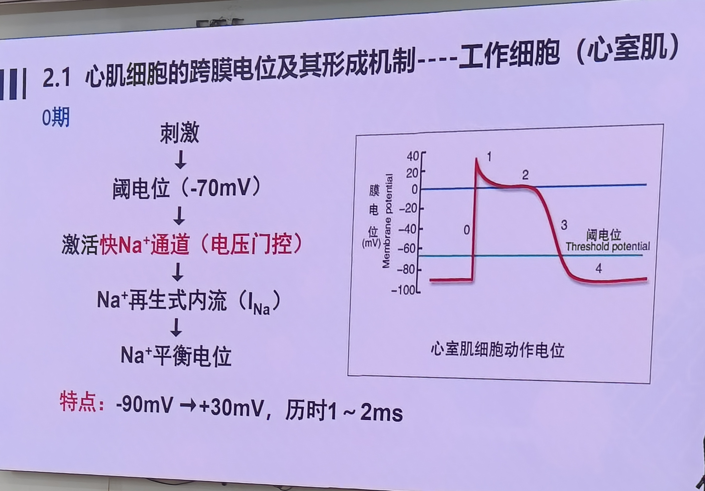

📝 **图中要点**：0期链条为"刺激→阈电位(-70 mV)→激活快Na⁺通道(电压门控)→Na⁺再生式内流(I_Na)→Na⁺平衡电位"；特点红笔标注"**-90 mV→+30 mV，历时1~2 ms**"。这一过程与神经纤维、骨骼肌的0期是**同一种快钠通道**介导，去极化机制完全相同。

老师补充：任何动作电位都不是"从静息电位无缝直达阈电位"，而是先经历**局部电位**，局部电位波动到达阈电位后才激活快钠通道；先开放的那一小批钠通道引起Na⁺内流、使膜进一步去极化，又开放下一批……这就是**正反馈（再生式循环）**。

【考点】0期=快Na⁺通道、再生式内流、-90→+30 mV、仅1~2 ms、阈电位-70 mV。

## 2.3 1期（快速复极初期）

0期去极化到约**-30 mV**时，**瞬时外向钾通道 I_to**（transient outward K⁺ current）激活，K⁺外流形成瞬时外向电流，把膜电位迅速从顶峰（+30 mV）拉回到0 mV附近。

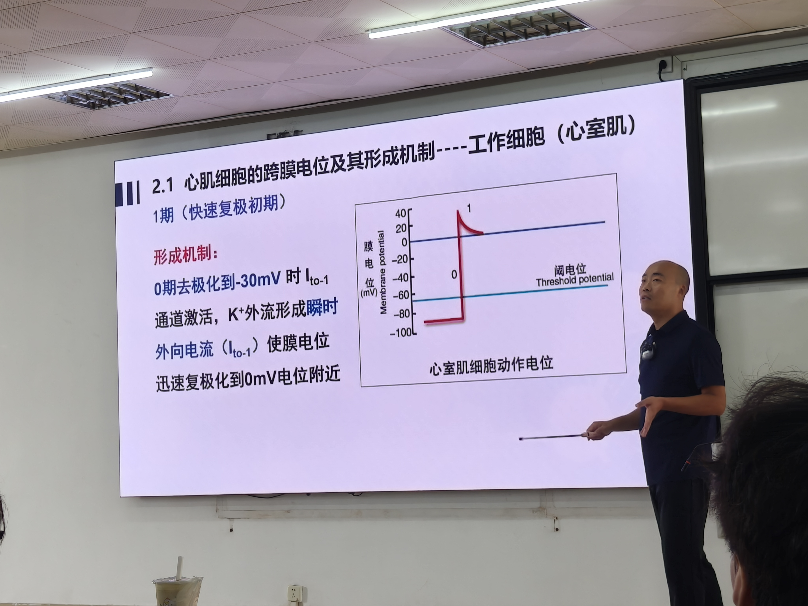

📝 **图中要点**：标题"1期（快速复极初期）形成机制：0期去极化到-30 mV时I_to-1通道激活，K⁺外流形成瞬时外向电流(I_to-1)使膜电位迅速复极化到0 mV电位附近"。I_to是心室肌特有的、神经纤维钾通道里没有的新型钾电流。

## 2.4 2期（平台期）——心肌区别于神经/骨骼肌的最关键一期

2期膜电位停在0 mV附近形成"平台"，是因为**内向电流与外向电流恰好相当**。

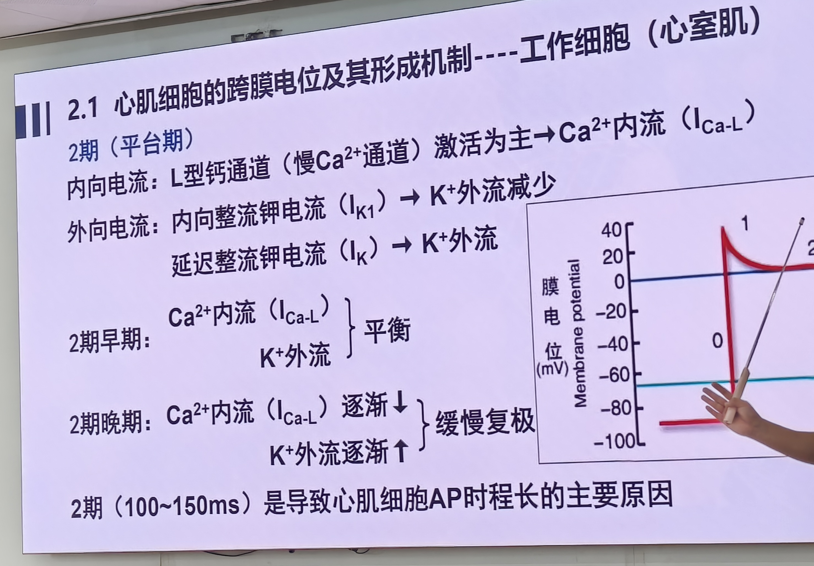

📝 **图中要点**：内向电流=L型钙通道（慢Ca²⁺通道）激活为主→Ca²⁺内流(I_Ca-L)；外向电流=内向整流钾电流(I_K1)在去极化状态下反而使K⁺外流**减少**，加上延迟整流钾电流(I_K)→K⁺外流。**2期早期**：Ca²⁺内流与K⁺外流二者平衡，维持平台；**2期晚期**：Ca²⁺内流逐渐↓、K⁺外流逐渐↑→缓慢复极。底部红笔"**2期(100~150 ms)是导致心肌细胞AP时程长的主要原因**"。

老师用"坐山观虎斗"解释I_K1：
- I_K1（内向整流钾通道）在2期这种**去极化（0 mV）状态下不发挥作用、不介导K⁺外流**。
- 为什么必须如此？"如果内向整流钾通道它依然像静息时那样开放，那么两个钾通道介导的电流加起来远超钙内流，那就不存在平台期了，膜电位就一直在下降。"
- "内向整流"的通俗含义（老师版）：在去极化状态（0 mV），通道倾向于让膜维持在去极化、**不让K⁺外流去对抗这个去极化状态**；只有当膜往复极方向走时它才重新开放。

**钙来源的种属差异（联系第4课）**：心肌肌质网不如骨骼肌发达、钙库储备少，2期必须靠**胞外Ca²⁺经L型钙通道内流**补充，再由这部分外钙触发肌质网释放更多钙（**CICR，钙触发钙释放**）；骨骼肌则完全不需要外钙，钙100%来自发达的肌质网。
【教材补充·生理第10版】心肌兴奋时细胞外Ca²⁺（10%~20%）经L型钙通道流入胞质，触发肌质网释放Ca²⁺（80%~90%）使胞质Ca²⁺升高引起收缩；舒张时肌质网钙泵回收80%~90%，肌膜钙泵与Na⁺-Ca²⁺交换体排出10%~20%。

**平台期的生理意义**：2期拉长了整个动作电位时程（心室肌AP总时程200~300 ms）→有效不应期特别长→**心肌不会发生完全强直收缩**，保证收缩、舒张交替进行，心脏才能泵血。

【考点】2期平台期=L型钙通道Ca²⁺内流≈延迟整流钾通道K⁺外流，I_K1此时不参与；是心肌AP时程长、不发生强直收缩的根本原因。

## 2.5 3期（快速复极末期）

慢Ca²⁺通道（L型）失活关闭→Ca²⁺内流渐消失；同时I_K、I_K1通道通透性↑→K⁺外流↑↑，膜电位从0 mV快速回到-90 mV。

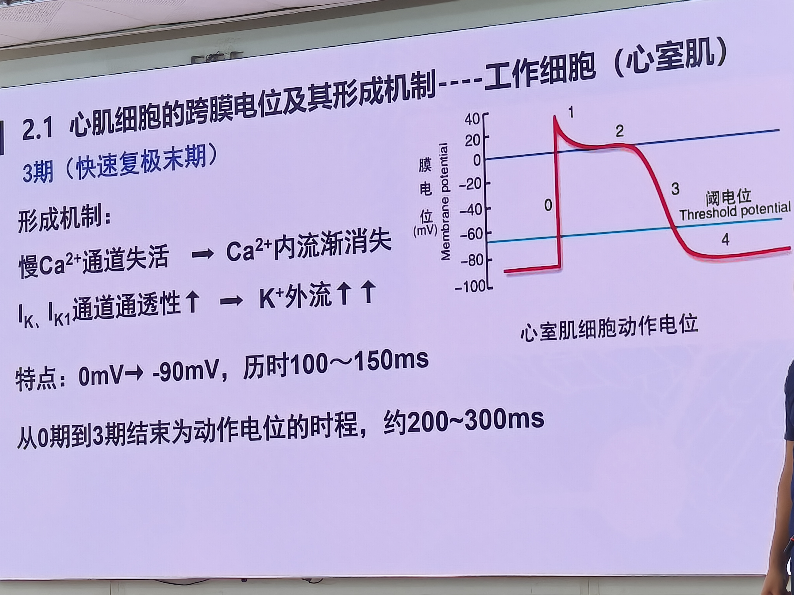

📝 **图中要点**：形成机制"慢Ca²⁺通道失活→Ca²⁺内流渐消失；I_K、I_K1通道通透性↑→K⁺外流↑↑"；特点"0 mV→-90 mV，历时100~150 ms"；底部红笔"**从0期到3期结束为动作电位的时程，约200~300 ms**"。

老师补充3期内部也分前后段：3期中段以前，I_K（延迟整流）开放已较充分，加上I_K1逐渐开始介导K⁺外流，钾外流较大；3期后段（约-50 mV以下），电压门控的I_K因去极化刺激减弱而开始关闭，但I_K1开放概率越来越大——两个钾通道此消彼长，合起来钾外流仍然明显，故复极快速。

## 2.6 4期（静息期/恢复离子分布）

膜电位数值虽已恢复到-90 mV，但**膜两侧离子分布并未恢复**（经历过Na⁺内流、K⁺外流、Ca²⁺内流）。4期要用各种主动转运把离子分布真正恢复到静息状态。

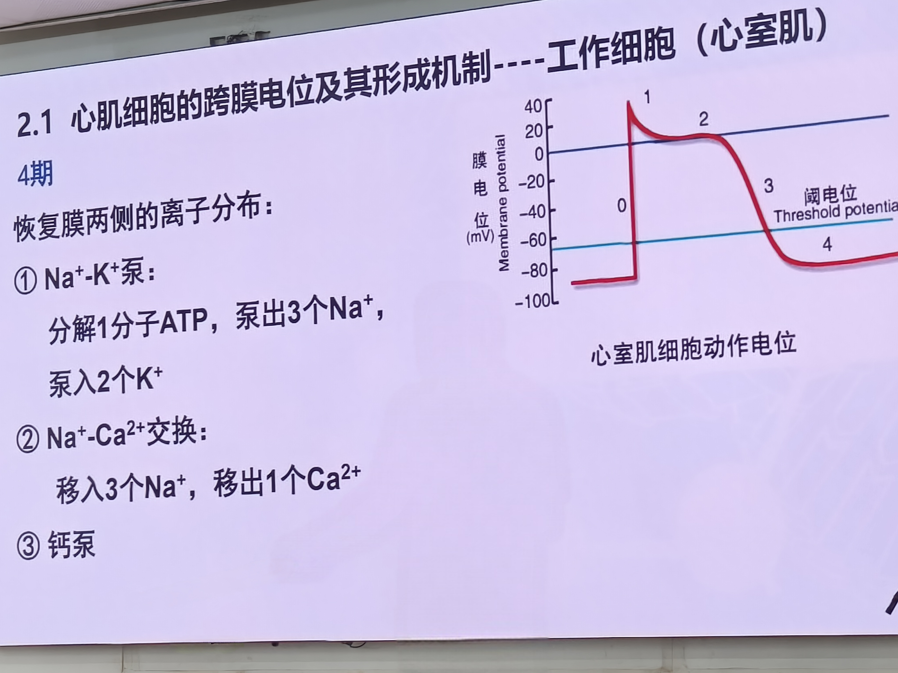

📝 **图中要点**：①**Na⁺-K⁺泵**：分解1分子ATP，泵出3个Na⁺、泵入2个K⁺；②**Na⁺-Ca²⁺交换**：移入3个Na⁺、移出1个Ca²⁺（继发性主动转运，利用Na⁺浓度梯度势能）；③**钙泵**：直接消耗ATP把Ca²⁺泵出胞外或泵回肌质网。

【考点】钠钾泵=分解1ATP、泵出3Na⁺、泵入2K⁺（3出2进）；Na⁺-Ca²⁺交换是**继发性主动转运**（反向转运/交换体），钠钙交换进来的Na⁺再由钠钾泵泵出。

## 2.7 心室肌动作电位各期离子流总览

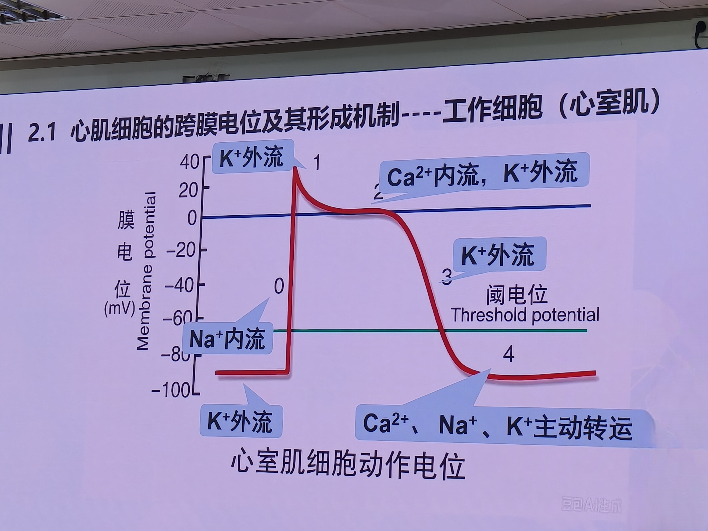

📝 **图中要点**：一图总结——静息/4期基线K⁺外流；**0期Na⁺内流**（粗箭头，剧烈）；**1期K⁺外流**（I_to）；**2期Ca²⁺内流+K⁺外流**（平台，二者相当）；**3期K⁺外流**（两种钾通道合流，下降最快）；**4期Ca²⁺、Na⁺、K⁺主动转运**恢复梯度。箭头粗细代表电流强弱。

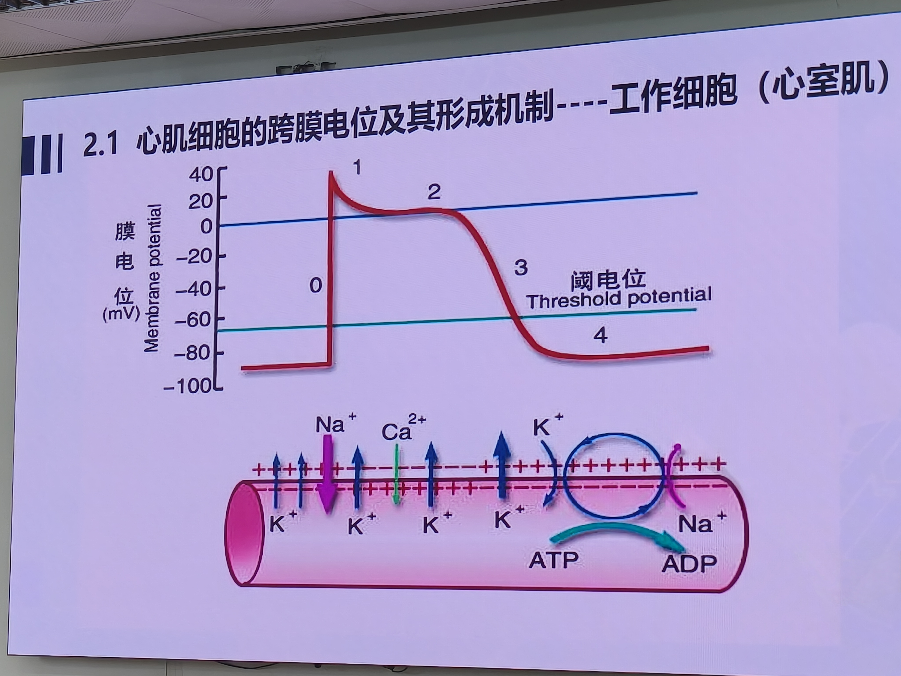

📝 **图中要点**：上图为动作电位曲线，下图为细胞膜断面示意——标出多种K⁺外流通道（蓝色向上箭头）、Na⁺内流（紫色粗箭头）、Ca²⁺内流（绿色），以及右下角Na⁺-K⁺泵把ATP水解为ADP、同时转运Na⁺/K⁺的过程。帮助建立"曲线每一期↔膜上哪种通道"的对应关系。

老师提醒："至少要知道离子流是内向还是外向，通道名（I_K、I_K1、I_to、I_Ca-L）能记住更好；这些箭头的粗细一定程度上代表电流强弱。"

---

# 第三部分　心房肌 vs 心室肌（对比，不要求掌握）

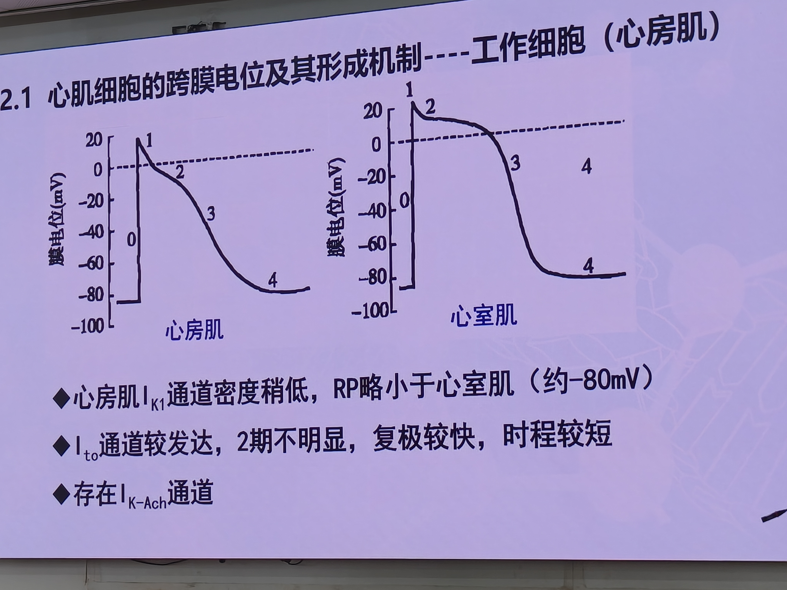

📝 **图中要点**：左侧心房肌、右侧心室肌动作电位对比。三条◆：①心房肌I_K1通道密度稍低，RP略小于心室肌（约**-80 mV**，心室肌-90 mV）；②I_to通道较发达，**2期不明显**，复极较快、时程较短；③存在**I_K-Ach**（乙酰胆碱激活的钾通道）。

老师讲解逻辑——结构决定功能：
- **RP为什么心房肌只到-80 mV？** 因为心房肌介导RP的I_K1通道数量比心室肌少→K⁺外流没那么多→RP负值没那么大。"如果有某一种心肌细胞I_K1非常丰富，它的静息电位可能会更负。"
- **为什么心房肌2期不明显？** 因为心房肌I_to太发达，1期猛、直接把电位拉下来，与2期叠加后外向力明显压过L型钙内流，平台维持不住，直接进入复极。
- **I_K-Ach的意义**：迷走神经兴奋释放乙酰胆碱(ACh)→激活I_K-Ach→三期/复极时又多一条K⁺外流通道→复极加快、动作电位时程缩短→心房肌收缩减弱（负性变力）。这是迷走神经控制心率的重要结构基础（窦房结就在心房，也有同样机制）。

【考点】心房肌=RP约-80 mV（I_K1少）+2期不明显（I_to发达）+有I_K-Ach；心室肌才是重点掌握对象。

---

# 第四部分　自律细胞——窦房结P细胞（本课难点高峰）

工作细胞（心室肌、心房肌）动作电位有完整0、1、2、3、4五期；自律细胞图形与心室肌差别"非常非常大，几乎没有太一致的地方"。

## 4.1 窦房结P细胞动作电位五大特点

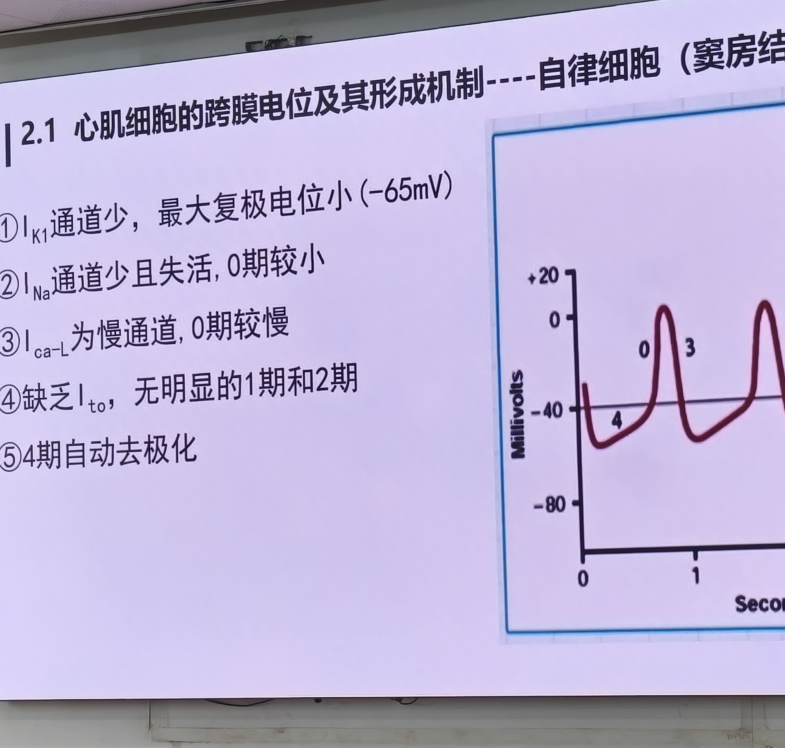

📝 **图中要点**：自律细胞（窦房结）①I_K1通道少，**最大复极电位小（约-65 mV）**；②I_Na通道少且失活，**0期幅度小**；③I_Ca-L为慢通道，**0期速度慢**；④缺乏I_to，**无明显1期和2期**；⑤**4期自动去极化**。图中窦房结动作电位只有0、3、4三期，无稳定静息电位。

逐条解释：
1. **最大复极电位只有-65 mV**（不是-90 mV）：因为窦房结P细胞膜上I_K1通道少→介导RP的K⁺外流少→电位没那么负。
2. **没有能用的快钠通道**：窦房结I_Na通道表达极少，且-65 mV的最大复极电位下钠通道本来就处于失活状态。所以0期**不是Na⁺内流**，而是由**L型钙通道介导的Ca²⁺内流**引起。
3. **0期慢而幅度小**：胞外Ca²⁺只有约2.5 mmol/L，而胞外Na⁺约140 mmol/L——钙本身的驱动力就远小于钠；加之L型钙通道是"慢通道"（开放慢、关闭慢、离子流不迅猛），又没有快钠通道那样的强正反馈。所以窦房结0期**去极速度慢、幅度小**，刚过0 mV就到顶。
4. **缺乏I_to**：所以没有明显1期，0期后直接进入3期。
5. **4期自动去极化**：4期膜电位不稳定，在最大复极电位后自动、缓慢地去极化——这就是自律性的基础。

【教材补充·生理第10版】窦房结P细胞0期由I_Ca-L引起，称**慢反应细胞**，其动作电位称**慢反应动作电位**；0期去极速度约10 V/s、持续约7 ms、幅度70~85 mV；受细胞外Ca²⁺浓度影响明显，可被钙通道阻滞剂（维拉帕米）阻断。

## 4.2 窦房结3期（复极）

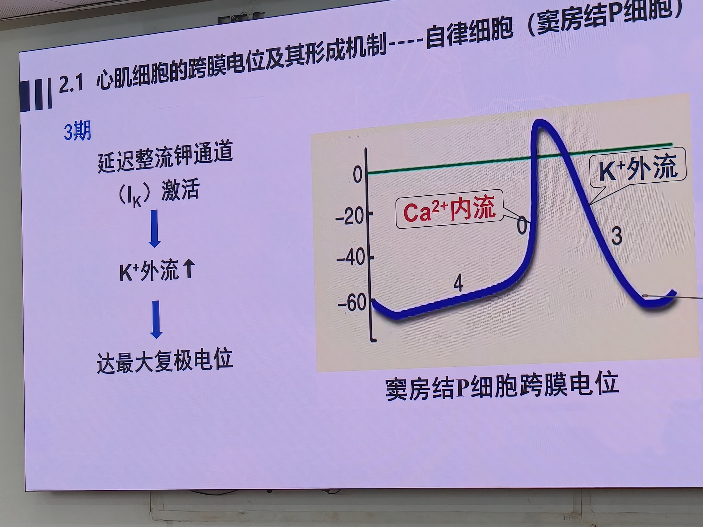

📝 **图中要点**：3期由**延迟整流钾通道I_K激活→K⁺外流↑→达最大复极电位**。图上标注窦房结跨膜电位：0期是Ca²⁺内流（上升支），3期是K⁺外流（下降支）。复极到达的最低点称**最大复极电位**（约-65 mV）。

老师对比记忆：窦房结上升支靠**钙**、下降支靠**钾**（钙-钾）；神经纤维上升支靠**钠**、下降支靠**钾**（钠-钾）。

## 4.3 窦房结4期自动去极化——三大电流接力（重中之重）

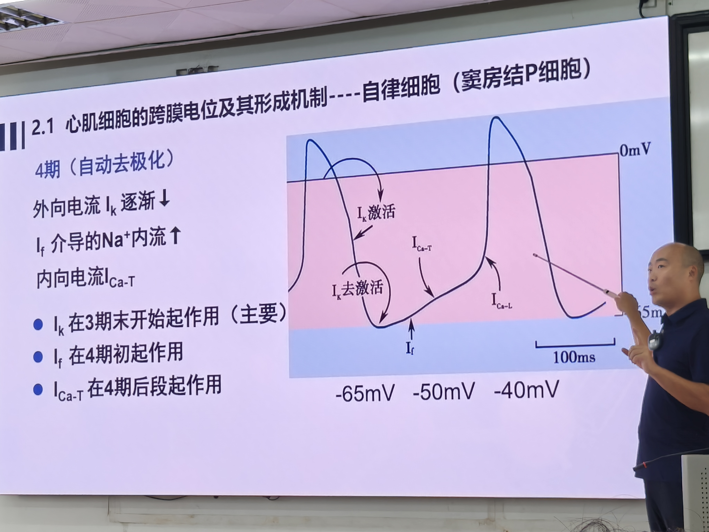

📝 **图中要点**：4期（自动去极化）三方面——外向电流I_K逐渐↓；I_f介导的Na⁺内流↑；内向电流I_Ca-T。三条●要点：**I_K在3期末开始起作用（主要）**；**I_f在4期初起作用**；**I_Ca-T在4期后段起作用**。图上时间轴从-65 mV→-50 mV→-40 mV，标注I_K激活/I_K去激活、I_f、I_Ca-T、I_Ca-L，100 ms标尺。

这是一个"接力"过程：
- **第一棒（最主要）——I_K进行性衰减**：3期后段膜电位变负、去极化刺激减弱，电压依赖性的I-K（延迟整流钾通道）逐渐**去激活（关闭）**→外向K⁺外流越来越少。外向电流一撤，膜就开始往去极化方向走。"I_K失活是前提、是最主要的原因。"
- **第二棒——I_f（funny current，有趣电流）**：在4期初，超极化激活的Na⁺内流I_f开始参与，轻轻把膜往去极化方向推。它"有趣"在：**它是超极化（而不是去极化）时激活的内向电流**，最大激活电位约-100 mV，与所有传统电压门控通道（去极化激活）相反。但窦房结最大复极电位只有-65 mV，远不是-100 mV的最佳激活点，所以I_f在窦房结作用**次要**（用Cs⁺阻断后窦房结放电仅轻度减慢）。
- **第三棒——I_Ca-T（T型钙电流）**：膜电位到约**-50 mV**时，T型钙通道激活、Ca²⁺内流进一步推膜去极化（4期后段）。
- 膜电位继续被推到**-40 mV**（=I_Ca-L的阈电位）时，L型钙通道激活、Ca²⁺内流爆发新的动作电位（0期）。

【教材补充·生理第10版】I_f通道最大激活电位约-100 mV；正常窦房结最大复极电位-65 mV，故I_f对窦房结4期自动去极作用远不如I_K衰减；实验用铯(Cs⁺)选择性阻断I_f后窦房结自发放电频率仅轻度降低。I_Ca-T是阈电位较低、快速衰减的内向电流，可为低浓度镍(Ni²⁺)阻滞，主要在4期自动去极化后期起作用。

**迷走/交感如何调心率（联系4期）**：
- **迷走神经兴奋（ACh）**：心房肌和窦房结都有I_K-Ach。ACh→激活I_K-Ach→3期K⁺外流变成"两种"（I_K+I_K-Ach）→最大复极电位从-65 mV变得更负（如-70 mV）→4期自动去极速度不变但要从更负的起点爬到-40 mV，所需时间更长→**心率变慢**。
- **交感兴奋/肾上腺素（β受体）**：增强I_f和I_Ca-T两种内向电流→4期自动去极化加快→**心率变快**。
【教材补充·生理第10版】肾上腺素通过β受体增强I_Ca-T和I_f，产生正性变时效应使心率增快；Ⅱ类抗心律失常药（β受体拮抗剂）通过减慢4期自动去极而降低自律性；伊伐布雷定可通过阻断I_f减慢心率。

【考点】窦房结=慢反应细胞（0期I_Ca-L）+3期I_K+4期自动去极（**I_K衰减为主**、I_f次之、I_Ca-T接力）；P细胞=Pacemaker起搏细胞；迷走使最大复极电位更负→心率慢，交感增强I_f/I_Ca-T→心率快。

---

# 第五部分　浦肯野细胞（自律细胞中的快反应细胞）

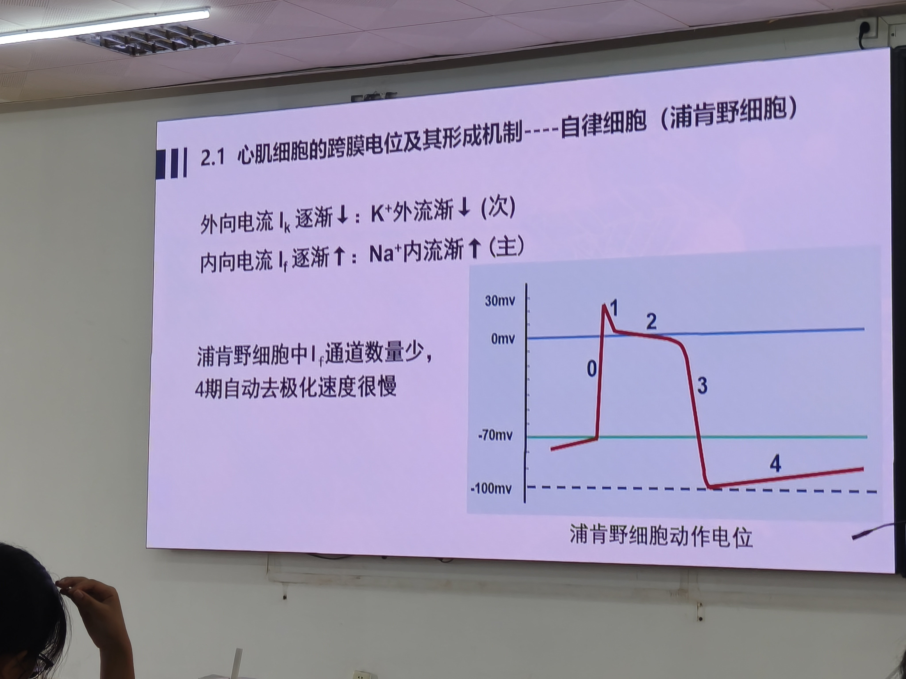

📝 **图中要点**：自律细胞（浦肯野）——外向电流I_K逐渐↓（K⁺外流渐↓，**次要**）；内向电流I_f逐渐↑（Na⁺内流渐↑，**主要**）；"浦肯野细胞中I_f通道数量少，4期自动去极化速度很慢"。图中浦肯野动作电位有完整0、1、2、3、4期，最大复极电位达**-100 mV**（比心室肌-90 mV还负）。

浦肯野是"窦房结和心室肌的结合体"：
- **0~3期像心室肌**：有完整0、1、2、3期，0期由快钠通道介导（快反应细胞），有明显平台期。
- **4期像自律细胞**：4期不稳定、会自动去极化。
- **为什么浦肯野最大复极电位能到-100 mV？** 因为浦肯野膜上I_K1通道密度高、对K⁺通透大→K⁺外流多→电位更负；这也使它下降（复极）时间更长。
- **4期自动去极为什么慢？** 与窦房结主次相反——浦肯野以**I_f为主**：因为它正好复极到-100 mV，恰是I_f最佳激活点，I_f开放状态最好；但**I_f通道总数量太少**（"满共就几百个，跟正常几万个钠通道没法比"），开放虽充分但电流小→去极慢。加上I_K衰减（次要）。
- 【教材补充·生理第10版】浦肯野0期去极速率可达200~800 V/s；4期自动去极化速度很慢（约0.02 V/s）；**在所有心肌细胞中，浦肯野细胞的动作电位时程最长**。

【考点】快反应细胞=0期由快钠通道介导（心室肌、心房肌、浦肯野）；慢反应细胞=0期由L型钙通道介导（窦房结、房室结）。自律性不必然=慢反应。

---

# 第六部分　三种心肌细胞动作电位对比总结

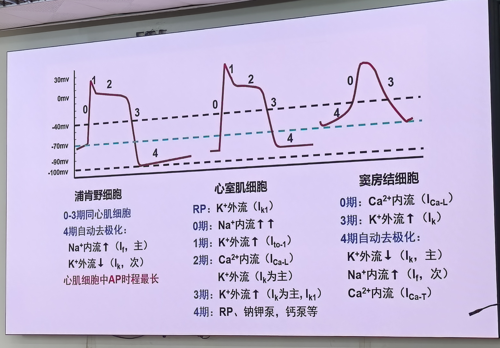

📝 **图中要点**：三条动作电位曲线并列+各期离子流对照表。
- **浦肯野细胞**：0~3期同心肌细胞；4期自动去极化——Na⁺内流↑(I_f，主)、K⁺外流↓(I_K，次)；红笔"**心肌细胞中AP时程最长**"。
- **心室肌细胞**：RP=K⁺外流(I_K1)；0期=Na⁺内流↑↑；1期=K⁺外流↑(I_to-1)；2期=Ca²⁺内流(I_Ca-L)+K⁺外流(I_K为主)；3期=K⁺外流↑(I_K为主、I_K1)；4期=RP、钠钾泵、钙泵等。
- **窦房结细胞**：0期=Ca²⁺内流(I_Ca-L)；3期=K⁺外流↑(I_K)；4期自动去极化——K⁺外流↓(I_K，主)、Na⁺内流↑(I_f，次)、Ca²⁺内流(I_Ca-T)。

课堂还播放了一段Alila Medical Media的英文动画视频串讲：

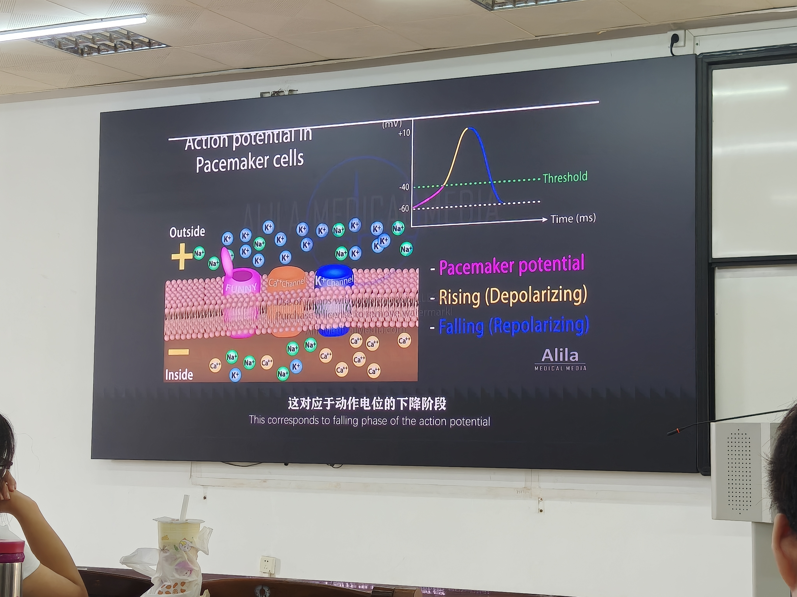

📝 **图中要点**：英文课件"Action potential in Pacemaker cells"——膜上标出FUNNY通道(I_f)、Ca²⁺ channel、K⁺ channel；曲线分三段：Pacemaker potential（4期自动去极，-60 mV缓慢爬升）→Rising/Depolarizing（0期，达阈电位-40 mV后钙内流上升）→Falling/Repolarizing（3期，钾外流下降）。视频旁白要点：心脏是可自动节律搏动的肌性泵；起搏细胞(Pacemaker Cells)丧失收缩功能、专门负责发起和传导电活动；窦房结是primary pacemaker；细胞间靠gap junction（缝隙连接）电偶联；窦房结自发约80次/分；起搏细胞没有真正的静息电位，从约-60 mV自动爬升到-40 mV阈电位即触发下一跳。

---

# 第七部分　心肌的生理特性总论

老师明确：心肌有四种基本生理特性——**兴奋性、传导性、自律性、收缩性**。
- 前三者（兴奋性、传导性、自律性）都涉及生物电，称**电生理特性**；
- 收缩性是**机械特性**。
- 工作细胞（心室肌）有兴奋性、传导性、收缩性，无自律性；自律细胞有兴奋性、自律性、传导性，无收缩性。

【教材补充·生理第10版】严重心脏病时可出现"有电活动但不能收缩"，称兴奋-收缩脱耦联，临床称"电-机械分离"。

---

# 第八部分　心肌兴奋性的周期性变化（本节核心）

心肌每兴奋一次，膜电位经历一轮规律变化，兴奋性也随之周期变化。以心室肌为例。

## 8.1 有效不应期 ERP

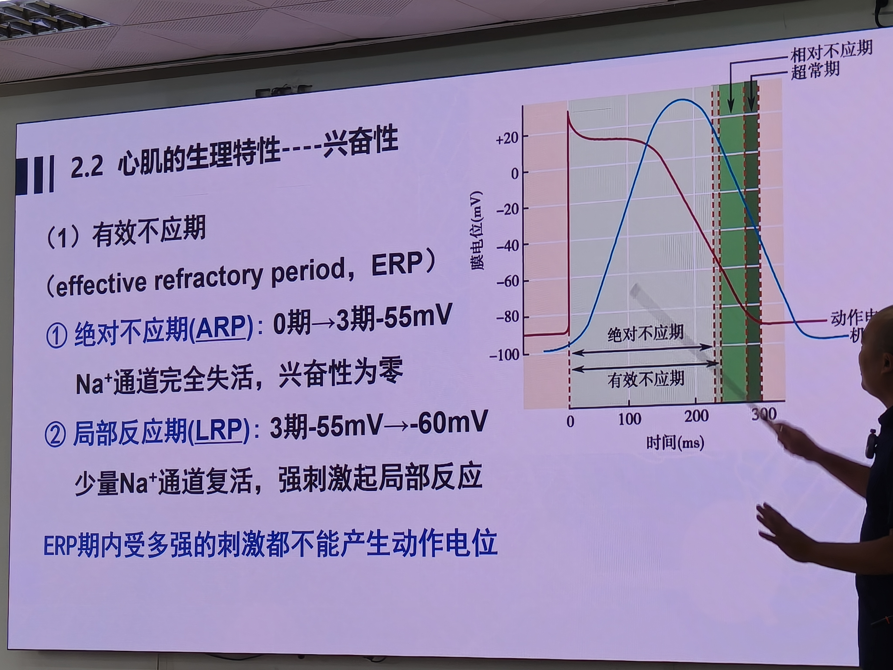

📝 **图中要点**：2.2心肌的生理特性——兴奋性。(1)**有效不应期ERP(effective refractory period)**：①**绝对不应期ARP**：0期→3期-55 mV，Na⁺通道完全失活，兴奋性为零；②**局部反应期LRP**：3期-55 mV→-60 mV，少量Na⁺通道复活，强刺激起局部反应。底部蓝字"**ERP期内受多强的刺激都不能产生动作电位**"。图中标注ARP/ERP/相对不应期/超常期在时间轴上的位置。

拆开理解：
- **绝对不应期ARP**（0期→3期-55 mV）：所有钠通道要么在开放、要么在失活（失活态=h门关），**没有一个钠通道处在可被再次激活的静息状态**。所以无论给多强刺激都不产生任何电变化，兴奋性=0。
- **局部反应期LRP**（-55→-60 mV）：只有3%~4%极少数钠通道复活了。给很强的刺激最多引起一个小**局部电位**，仍远不足以触发动作电位。
- ARP+LRP合称**ERP**。"只要不能引起动作电位，不管你完全没反应还是只能引起小局部电位，统统归入有效不应期。"

【教材补充·生理第10版】ERP之所以长，是其兴奋性变化的最重要特点，最重要生理意义是**保证心肌不能发生完全强直收缩**，确保心室收缩、舒张交替。

## 8.2 相对不应期 RRP 与 超常期 SNP

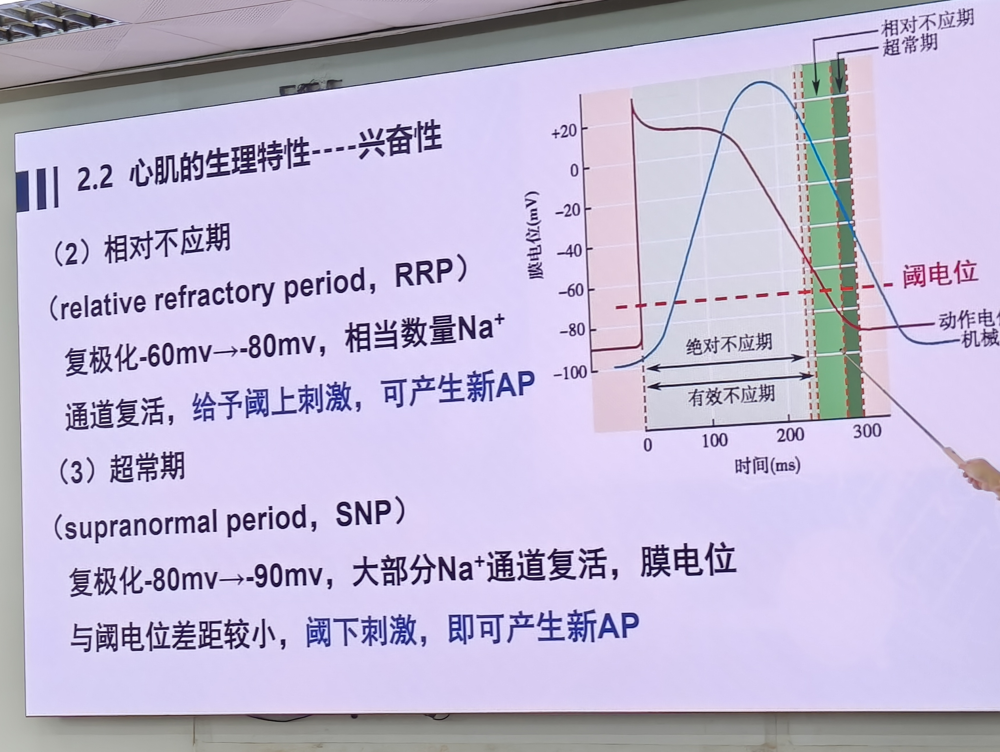

📝 **图中要点**：(2)**相对不应期RRP(relative refractory period)**：复极化-60 mV→-80 mV，相当数量Na⁺通道复活，给予**阈上刺激**可产生新AP；(3)**超常期SNP(supranormal period)**：复极化-80 mV→-90 mV，大部分Na⁺通道复活，膜电位与阈电位差距较小，**阈下刺激**即可产生新AP。

- **RRP（-60→-80 mV）**：约50%~60%钠通道已复活，但未全部恢复。需**阈上（比正常更强）刺激**才能触发；且因复活通道数量有限，再生式正反馈力度不足，新AP的**幅度较小、0期上升支斜率（速度）较平缓**。
- **SNP（-80→-90 mV）**：约80%~90%钠通道已复活、接近正常；且膜电位-80~-90 mV比-90 mV离阈电位（-70 mV）更近，所需刺激更小（阈下即可），故名"超常"。但AP幅度和斜率仍不及静息电位-90 mV时。

## 8.3 在RRP、SNP内产生的动作电位有什么特点

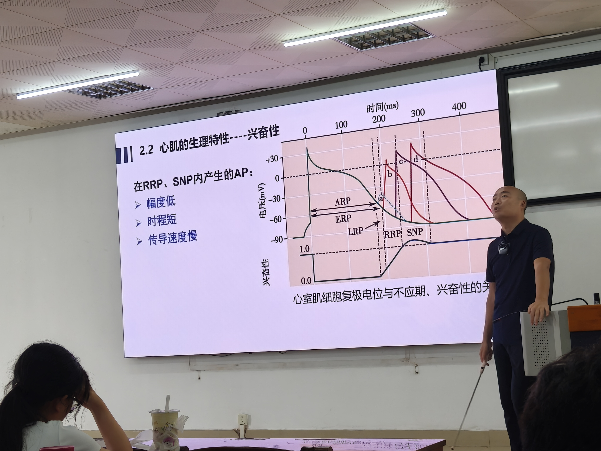

📝 **图中要点**："在RRP、SNP内产生的AP：**幅度低、时程短、传导速度慢**"。图为心室肌细胞复极电位与不应期、兴奋性的关系：标注ARP、ERP、LRP、RRP、SNP，以及a（局部反应）、b（RRP内）、c/d（SNP内）几个幅度逐渐增大但都小于正常的动作电位；下方曲线为兴奋性从0恢复到1.0的过程。

老师解释"传导为什么慢"：动作电位产生是为了传播。本部位钠通道开放越多、Na⁺内流越大，向邻近部位扩布的**局部电流**就越大、传导越快。RRP/SNP内钠通道不是100%复活，局部电流达不到最大值→**传导速度慢**；又因幅度小、复极所需时间短→**时程短**。

【教材补充·生理第10版】在RRP和SNP，钠通道开放速率和数量低于静息水平，故新产生AP的0期去极速度和幅度都低于正常、兴奋传导较慢；由于不应期较短，容易产生**期前兴奋**，又因心脏各部分兴奋性恢复程度不一，兴奋较易形成**折返激动**而导致快速性心律失常。

**期前收缩与代偿间歇**【教材补充·生理第10版】：若在心室ERP之后、下一次窦房结兴奋到达之前，心室受到一次外来刺激，可提前产生一次兴奋和收缩，称**期前兴奋/期前收缩**；期前兴奋也有自己的ERP，当紧接其后的那次窦房结兴奋正好落在期前兴奋ERP内时就不能引起心室收缩，形成一次"脱失"，于是期前收缩后常出现一段较长的心室舒张期，称**代偿间歇**。

【考点】ERP=ARP(0期→-55 mV，兴奋性0)+LRP(-55→-60 mV，局部反应)；RRP(-60→-80 mV，阈上刺激可产AP、幅度小斜率低)；SNP(-80→-90 mV，阈下刺激即可、离阈电位近)；RRP/SNP内AP=幅度低、时程短、传导慢。

---

# 第九部分　影响兴奋性的因素——本课标题核心：钾浓度专题

## 9.1 总规律：兴奋性取决于"静息电位与阈电位之间的距离"

老师：兴奋性高低取决于**静息电位(RP)和阈电位(TP)之间的距离**。
- RP与TP距离**变近**→所需刺激变小→**兴奋性升高**；
- RP与TP距离**变远**→所需刺激变大→**兴奋性降低**。

距离改变有两条途径：①TP本身上移/下移；②RP本身上移/下移。生理情况下**TP一般相对稳定**（只有明显缺钙等才会变），**RP则可上可下、变动空间更大**——所以本课聚焦RP的变化。

- RP下移（更负，超极化，如-90→-95）→离TP更远→兴奋性降低；
- RP上移（去极化，如-90→-80）→离TP更近→兴奋性升高。

## 9.2 ★胞外K⁺浓度如何改变静息电位

静息电位主要由I_K1介导的**K⁺外流**形成，而K⁺外流的驱动力取决于**胞内外K⁺浓度差**。因此胞外K⁺浓度一变，K⁺外流强度立刻变，RP随之变。

**（1）胞外K⁺浓度下降（低钾血症）**

- 胞外K⁺少了→胞内高K⁺与胞外的浓度差更大→K⁺外流变得更容易、外流增多。
- K⁺外流增多→膜内负电荷更多→膜电位**下移（更负）=超极化**（-90→更负）。
- RP更负→与阈电位(-70 mV)距离变大→需要更强刺激才能达阈电位→**兴奋性降低**。

老师现场引导："胞外钾浓度下降，由I_K介导的钾外流——胞外钾少了，钾外流变得更容易了，更多了是不是？所以更多的K⁺流出去，静息电位就下，就是超极化。"

**（2）胞外K⁺浓度轻度上升（轻度高钾）**

- 胞外K⁺多了→胞内外K⁺浓度差缩小→K⁺外流受到阻碍、外流减少。
- K⁺外流减少→膜内负电荷变少→RP**上移（去极化）**，如-90→-80 mV。
- RP上移、离阈电位(-70 mV)更近→所需刺激变小→**兴奋性升高**。

老师："胞外钾浓度轻度上升，膜电位会轻度去极化（从-90到-80），外流少了、静息电位往上移，和阈电位之间距离变短，所以兴奋性增加。这里指的是钾浓度**轻度**上升。"

**（3）胞外K⁺浓度明显上升（严重高钾）——兴奋性反而骤降，甚至心跳停止**

- 若高钾继续加重→RP继续上移（进一步去极化，膜电位越来越小）。
- 关键转折：介导0期的**电压门控快钠通道**有个特性——它必须在膜电位较负（静息状态）时才处于"可被激活的备用状态"。当膜因持续去极化而越来越小（如从-90移到-70、-60），钠通道会**逐步失活**。
- 轻度高钾时RP上移幅度小，还没到让钠通道失活的程度，所以表现为"靠近阈电位、兴奋性升高"；
- 但高钾明显加重、膜显著去极化后→大量钠通道失活→**能被激活的钠通道所剩无几→兴奋性反而降低，甚至完全丧失（不能建位/不能产生动作电位）→心脏停搏**。

老师原话："如果不是轻度上升、是相对更明显的上升，膜会继续去极化……你这个去极化离静息电位越来越远，钠通道就失活了。失活了是什么意思？就是心脏不能跳了。死刑犯注射执行，其中第三针就是高钾——就是高钾让他心跳停止。所以钾极为关键。"

【教材补充·生理第10版】P96原文："当细胞外K⁺浓度轻度升高时，由于膜电位轻度去极化，使膜电位与阈电位水平靠近，兴奋性升高；而当细胞外K⁺浓度明显升高（**血清钾＞7~9 mmol/L**）时，膜电位显著减小，钠通道部分甚至完全失活，兴奋性则降低或丧失。"正常血清钾3.5~5.5 mmol/L。

【教材补充·生理第10版】P99原文解释为什么膜电位减小会让0期垮掉：正常静息电位(-90 mV)时钠通道处于最佳可利用状态，0期最大去极速度可达500 V/s；膜电位变小时钠通道开放效率降低；**当膜电位减小至-55 mV时，0期最大去极速度几乎为零**（钠通道已失活关闭）。故持续去极化→0期幅度速度双降→传导减慢甚至阻滞。

## 9.3 一张图记住：高钾对兴奋性的"先升后降"双向效应

| 胞外K⁺浓度 | K⁺外流 | 静息电位变化 | 与阈电位距离 | 钠通道状态 | 兴奋性 |
|---|---|---|---|---|---|
| 降低（低钾） | 增多 | 下移/超极化（更负） | 变远 | 正常、复活充分 | **降低** |
| 轻度升高（轻高钾） | 减少 | 上移/轻度去极化（-90→-80） | 变近 | 仍在备用状态 | **升高** |
| 明显升高（血清钾>7~9） | 显著减少 | 显著上移/去极化（向-55逼近） | 钠通道失活、TP上移 | 部分甚至完全失活 | **降低→丧失** |

【考点】高钾对兴奋性是"**双向**"的：轻度高钾→去极化、靠近阈电位→兴奋性↑；重度高钾→钠通道失活→兴奋性↓乃至停搏。低钾→超极化→兴奋性↓。**不可一概而论"高钾就兴奋/低钾就抑制"，一定要分程度。**

## 9.4 钠 vs 钾：为什么临床班"一听到钾就紧张"

老师给临床班的叮嘱（原话）：
- "膜内外钠浓度差，它更多影响的只是**动作电位的幅度**——钠多一点幅度大一点、少一点幅度小一点，影响有限。"
- "但是**钾影响的是静息电位的水平**。可以这样说，钾在这里临床意义更关键、更致命。你们将来走向工作岗位，听到钠怎么样，心里大概嗯多少有点数；但凡听到**钾**这个字，你立马就紧张——不用说钾浓度怎么样，只要听到钾这个词，你立马就紧张，因为钾的影响非常深刻。"

【考点】钠→主要影响动作电位幅度；钾→主要影响静息电位水平。钾紊乱更致命。

## 9.5 临床联系：高钾血症 / 低钾血症与心电图

【教材补充·生理第10版】P103："机体明显**低血钾**时，常常会有**U波**出现"（U波在T波后0.02~0.04 s出现，低而宽，方向与T波一致；成因尚不完全清楚）。

结合生理学机制的临床要点（按老师讲解+教材，不确定处不臆造）：

- **高钾血症**：膜去极化→早期可使兴奋性升高、心肌自律性/传导紊乱；严重高钾→钠通道失活→0期幅度速度下降→传导减慢、阻滞，最终心脏停搏于舒张状态。这就是为什么高钾是临床急症、也是注射死刑致死的药理基础。急救核心是**迅速降低血钾**（钙剂稳定膜/拮抗钾对钠通道的作用、胰岛素+葡萄糖促钾内移、利尿/排钾、透析等）。
- **低钾血症**：膜超极化→RP与阈电位距离加大→兴奋性降低；复极时程改变，心电图上出现特征性**U波**（教材明确点出）。

> ⚠️ 说明：高钾/低钾血症具体的心电图各波演变（T波高尖、PR间期延长、QRS增宽等）属于诊断学/内科学范围，本课老师未展开，本笔记不臆造；教材本章明确写到的只有"明显低血钾→U波"。

---

# 本课必背数字速查

- 心室肌RP=-90 mV、阈电位=-70 mV；0期1~2 ms、2期平台期100~150 ms、3期100~150 ms；AP总时程200~300 ms。
- 窦房结：最大复极电位-65 mV、I_Ca-L阈电位约-40 mV、0期约10 V/s/约7 ms/幅度70~85 mV；自律性约100次/分（迷走后约70）。
- 浦肯野：最大复极电位-100 mV、0期200~800 V/s、4期自动去极约0.02 V/s、AP时程为所有心肌细胞中最长。
- 不应期电压分界：ARP=0期→-55 mV；LRP=-55→-60 mV；ERP=ARP+LRP；RRP=-60→-80 mV；SNP=-80→-90 mV。
- 血清钾正常3.5~5.5 mmol/L；明显高钾（兴奋性反降）阈值>7~9 mmol/L；膜电位小到-55 mV时0期最大去极速度几乎为零。
- 钠钾泵：3Na⁺出/2K⁺入/分解1ATP；Na⁺-Ca²⁺交换：3Na⁺入/1Ca²⁺出（继发性主动转运）。
