# 06_毛概 — 知识框架与思维导图

> 全课程整合版（基于已学1课时内容整理）

---

## 一、Mermaid 思维导图

```mermaid
mindmap
  root((毛概))
    课程导论
      课程安排
        14周理论+2周社会实践
        成绩：卷面+平时
        实践报告：分组≤8人不跨班
      核心问题
        中国共产党为什么能
        马克思主义为什么行
        中国特色社会主义为什么好
    开学第一课：抗战精神
      烽火岁月
        1931九一八事变
        1937七七事变
        14年抗战
        伤亡3500万
      伟大胜利
        民族复兴转折点
        东方主战场
        大国地位提升
      精神永存
        爱国精神
        民族气节
        英雄气概
        必胜信念
      青年担当
        坚定理想信念
        厚植爱国情怀
        练就过硬本领
        矢志艰苦奋斗
    马克思主义中国化时代化
      为什么选择马克思主义
        此前各种方案均失败
        十月革命送来马列主义
        中共应运而生
      为什么要中国化时代化
        教条主义的教训
        遵义会议转折
        两个结合
      内涵
        运用立场观点方法
        总结实践经验上升理论
        民族语言扎根传统文化
      发展脉络
        新民主主义革命时期
          1921-1949
          农村包围城市
          毛泽东思想
        社会主义革命和建设时期
          1949-1978
          第二次结合
        改革开放和现代化时期
          1978-2012
          邓小平理论
          三个代表
          科学发展观
        新时代
          2012至今
          习近平新时代中国特色社会主义思想
      理论成果关系
        五个理论成果
        一脉相承与时俱进
        中国特色社会主义理论体系不含毛泽东思想
    第一章：毛泽东思想及其历史地位（第2课）
      导入
        2026新年贺词
          十四五收官
          GDP140万亿
          石榴籽（民族团结）
          铭记历史缅怀先烈
        历史周期率
          窑洞之问（1945黄炎培）
          毛泽东第一答案：让人民监督政府（民主）
          习近平第二答案：党的自我革命
      时代背景
        1900八国联军侵华
        1901辛丑条约
        近代探索皆失败（太平天国/戊戌/义和团/辛亥）
        1917十月革命→李大钊"赤旗的世界"
        国情：半殖民地半封建+错失工业革命
      实践基础
        不能照搬俄国城市起义
          统治力量城市集中
          无合法斗争空间
          主力军在农村
      形成四阶段
        萌芽（大革命1924-1927）
          1925五卅运动
          《中国社会各阶级的分析》
          《湖南农民运动考察报告》
        初步形成（土地革命1927-1937）
          秋收起义上井冈山
          农村包围城市
          《反对本本主义》没有调查没有发言权
        成熟（1935-1945）
          遵义会议（1935.1转折）
          《实践论》《矛盾论》（1937）
          1945七大确立指导思想
        继续发展（1945-1976）
          1949占领南京（百万雄师过大江）
          社会主义革命确立基本制度
          《论十大关系》第二次结合
      核心内涵
        定义四要素
          马列主义在中国的运用和发展
          正确的理论原则和经验总结
          集体智慧的结晶
          第一次历史性飞跃
        主要内容六方面
          新民主主义革命理论
          社会主义革命和建设理论
          革命军队建设和军事战略
          政策和策略
          思想政治工作和文化工作
          党的建设
        新民主主义革命理论
          领导：无产阶级
          依靠：工农联盟
          对象：帝封官（三座大山）
          前途：社会主义
          资产阶级分两类（民族可争取/官僚是对象）
        活的灵魂：实事求是/群众路线/独立自主
      历史地位
        第一次历史性飞跃
        中华民族精神支柱
        中国特色社会主义理论体系不含毛泽东思想
    第一章续：第3课 正确评价毛泽东与毛泽东思想（2026-09-21）
      军事思想
        三湾改编1927
          支部建在连上
          士兵委员会官兵平等
          铸军魂凝军心
        古田会议1929.12
          思想建党政治建军
          党指挥枪不是枪指挥党
          全心全意为人民服务唯一宗旨
          三大纪律八项注意
          官兵一致军民一致瓦解敌军
        历史定位三节点
          发端于南昌起义
          奠基于三湾改编
          定型于古田会议
        战略战术
          论持久战1938
          游击战十六字诀
      政策和策略
        政策和策略是党的生命
        战略藐视战术重视
          孟良崮战役1947.5
        掌握主要方向不四面出击
        利用矛盾争取多数反对少数各个击破
      思想政治工作和文化工作
        经济决定文化文化反作用
        双百方针1956
          百花齐放=艺术
          百家争鸣=科学
        古为今用洋为中用
        德才兼备又红又专
      党的建设
        窑洞之问
          毛泽东第一答案：人民监督政府
          习近平第二答案：自我革命
        豆选三三制控告箱
        七届二中全会1949.3西柏坡
          工作重心乡村→城市
          两个务必
          警惕糖衣炮弹
        二十大三个务必2022
        延安整风团结批评团结
        三大作风
      活的灵魂
        实事求是
          1930反对本本主义没有调查没有发言权
          1937实践论矛盾论
          1941改造我们的学习经典定义
          延安整风+七大确立
        群众路线
          1943关于领导方法的若干问题首次完整论述
          1945七大写入党章
          1981十一届六中全会概括
          一切为了群众一切依靠群众从群众中来到群众中去
        独立自主
          井冈山道路
          抗日统一战线保持独立性
          建国初期以苏为鉴
          解放牌卡车1956
          北斗导航
          东方红一号1970
      历史地位三句话
        第一次历史性飞跃理论成果
        中国革命和建设科学指南
        党和人民宝贵精神财富
      科学评价
        1981十一届六中全会历史决议
        邓小平旗帜论毛泽东思想丢不得
        1980答法拉奇毛主席像永远保留
        反对两种错误倾向
        毛泽东晚年错误不属于毛泽东思想
        功大于过
        革命领袖是人不是神
    第一章续：第4课 新民主主义革命理论及其三大法宝（2026-09-28）
      形成依据
        国情
          半殖民地半封建社会三步形成
            两次鸦片战争开始沦为
            甲午马关条约大大加深
            1901辛丑条约完全沦为
          两对主要矛盾
            帝国主义和中华民族（最主要）
            封建主义和人民大众
          帝国主义是第一个最凶恶敌人
        时代特征
          1917十月革命送马列
          1919五四运动工人阶级登上舞台
          旧民主主义1840-1919
          新民主主义1919-1949
        实践基础
          两次胜利两次失败
          南昌起义1927.8.1
          井冈山第一个农村根据地
          长征遵义会议1935
          七届二中全会1949.3西柏坡
      总路线
        无产阶级领导的人民大众的反帝反封建反官僚资本革命
        对象
          帝国主义（首要）
          封建地主阶级（社会基础）
          官僚资本主义（四大家族四行二局）
        动力
          无产阶级（最基本）
          农民（主力军80%）
          城市小资产阶级（最可靠同盟）
          民族资产阶级（两面性又联合又斗争）
        领导权
          无产阶级领导权是中心问题
          区别新旧民主主义革命根本标志
        性质前途
          资产阶级民主主义革命
          两步走：新民主主义→社会主义
          反陈独秀二次革命论右倾
          反王明一次革命论左倾
      基本纲领
        政治：各革命阶级联合专政+三三制
        经济：打土豪分田地→减租减息→土改
        文化：民族的科学的大众的
      革命道路
        农村包围城市武装夺取政权
        工农武装割据三支柱
          土地革命（基本内容）
          武装斗争（主要形式）
          农村革命根据地（战略阵地）
      三大法宝（1939共产党人发刊词）
        统一战线
          彝海结盟刘伯承小叶丹1935
          四阶段：国民革命/工农民主/抗日民族/人民民主
        武装斗争
          党指挥枪
          为人民服务
          人民战争
        党的建设
          农民小资产阶级出身占多数
          思想上建党
        关系：党是掌握两个武器的英勇战士
```

---

## 二、层级知识框架

### 第一篇：开学第一课——抗战精神

#### 一、时间节点
- 9月3日：抗战胜利纪念日
- 1931年九一八事变：局部抗战开始（14年抗战起点）
- 1937年七七事变：全面抗战开始
- 1945年9月2日：日本签署投降书

#### 二、抗战精神四方面
1. 天下兴亡、匹夫有责的爱国精神
2. 视死如归、宁死不屈的民族气节
3. 不畏强暴、血战到底的英雄气概
4. 百折不挠、坚忍不拔的必胜信念

#### 三、当代青年四个担当
1. 坚定理想信念（用习思想武装头脑）
2. 厚植爱国情怀（理性看待社会问题）
3. 练就过硬本领（突破卡脖子技术）
4. 矢志艰苦奋斗（在基层一线锻炼）

---

### 第二篇：导论——马克思主义中国化时代化

#### 一、为什么选择马克思主义
1. 历史背景：半殖民地半封建社会，亡国灭种危机
2. 此前救国方案全部失败：太平天国、洋务运动、戊戌变法、辛亥革命
3. 十月革命送来马克思列宁主义
4. 中国共产党应运而生（历史和人民的选择）
5. 根本原因：马克思主义能解决救亡图存的历史性课题

#### 二、为什么要中国化时代化
1. 教条主义教训：照搬苏联模式导致革命挫折
2. 关键节点：
   - 1935年遵义会议：确立毛泽东领导
   - 1938年六届六中全会：首次提出"马克思主义中国化"
   - 党的七大：毛泽东思想=中国化的马克思主义
   - 2009年十七届四中全会：提出"马克思主义时代化"
3. **两个结合**：
   - 同中国具体实际相结合
   - 同中华优秀传统文化相结合

#### 三、内涵（三方面）
1. 运用马克思主义立场观点方法观察时代、把握时代、引领时代
   - 农村包围城市道路
   - 社会主义市场经济
   - 精准扶贫、绿水青山
2. 总结实践经验上升为理论，丰富发展马克思主义
3. 用民族语言讲述马克思主义，扎根中华优秀传统文化
   - 群众路线
   - 六尺巷的故事

#### 四、发展脉络（四个时期）

| 时期 | 时间 | 理论成果 |
|------|------|---------|
| 新民主主义革命 | 1921~1949 | 毛泽东思想 |
| 社会主义革命和建设 | 1949~1978 | 毛泽东思想（第二次结合） |
| 改革开放和现代化 | 1978~2012 | 邓小平理论→三个代表→科学发展观 |
| 新时代 | 2012至今 | 习近平新时代中国特色社会主义思想 |

#### 五、理论成果关系
1. 五大成果：毛泽东思想、邓小平理论、三个代表、科学发展观、习近平新时代中国特色社会主义思想
2. **马克思主义中国化时代化** = 全部5个
3. **中国特色社会主义理论体系** = 后4个（不含毛泽东思想）
4. 一脉相承：
   - 都坚持马克思列宁主义指导
   - 都为民族复兴而奋斗
   - 都坚持实事求是、群众路线、独立自主

---

### 第三篇：第一章——毛泽东思想及其历史地位（第2课）

#### 一、延安窑洞之问与历史周期率
- **历史周期率**：其兴也勃焉、其亡也忽焉的王朝兴亡循环
- **1945年黄炎培延安窑洞之问**：中共能否跳出周期率？
- **毛泽东第一答案**：让人民来监督政府（新路=民主）
- **习近平第二答案**：党的自我革命（永葆先进性和纯洁性）

#### 二、时代背景
1. 1900年八国联军侵华、1901年《辛丑条约》——中国以屈辱进入20世纪
2. 近代救国探索皆失败：太平天国、戊戌变法、义和团、辛亥革命
3. 1917年十月革命送来马列主义；李大钊《庶民的胜利》《布尔什维主义的胜利》——"看将来的环球，必是赤旗的世界"
4. 国情：错失工业革命机遇 + 1840鸦片战争后半殖民地半封建社会

#### 三、实践基础（为什么不能照搬俄国）
1. 反动统治力量在城市集中强大
2. 无资产阶级民主制度下的合法斗争空间
3. 革命主力军在农村（农民是中国革命的主力军）

#### 四、形成发展四阶段
| 阶段 | 时间 | 标志性事件/著作 |
|------|------|----------------|
| 萌芽 | 大革命时期 1924~1927 | 五卅运动、《中国社会各阶级的分析》《湖南农民运动考察报告》 |
| 初步形成 | 土地革命 1927~1937 | 秋收起义上井冈山、农村包围城市、《反对本本主义》"没有调查没有发言权" |
| 成熟 | 1935~1945 | 遵义会议（转折）、《实践论》《矛盾论》、1945七大确立指导思想 |
| 继续发展 | 1945~1976 | 占领南京"百万雄师过大江"、确立社会主义制度、《论十大关系》"第二次结合" |

#### 五、核心内涵
1. **定义四要素**：马列主义在中国的运用和发展；正确的理论原则和经验总结；集体智慧的结晶；第一次历史性飞跃
2. **主要内容6方面**：新民主主义革命理论 / 社会主义革命和建设理论 / 革命军队建设和军事战略 / 政策和策略 / 思想政治工作和文化工作 / 党的建设
3. **新民主主义革命理论**：无产阶级领导、工农联盟、反帝反封建反官僚资本主义、前途社会主义；民族资产阶级（两面性，既联合又斗争）≠官僚资产阶级（革命对象）
4. **活的灵魂**：实事求是、群众路线、独立自主

#### 六、历史地位
- 马克思主义中国化的第一次历史性飞跃
- 中华民族的精神支柱
- **"中国特色社会主义理论体系"不包括毛泽东思想**

---

## 三、本轮扩写补充数字与案例（2026-09-10）

- **抗战数字**：军民伤亡3500万、死亡约2000万；牵制日本陆军主力约2/3；敌后根据地19个；刘老庄连82人全部牺牲、平均年龄<25岁。
- **课程成绩**：48学时/14周理论+2周实践/3学分；期末卷面50%+学习通平时50%；平时=作业30%+分组任务50%（≤8人不跨班实践报告）+签到5%+课程积分5%+讨论10%。
- **2026春晚四会场**：合肥=创新、义乌=开放、哈尔滨=绿色、宜宾=生态。
- **"十四五"成就数字**：经济增量超35万亿、对世界增长贡献率约30%；2024粮食1.4万亿斤/人均500kg；养老保险参保10.72亿/95%；人均预期寿命79岁；519个世界冠军/68次世界纪录。
- **新增案例**：游击战十六字诀（敌进我退…）、《中国社会各阶级的分析》《湖南农民运动考察报告》、六尺巷、刘长春单人参赛vs冬奥286人、北斗系统独立自主。

---

### 第四篇：第3课——正确评价毛泽东与毛泽东思想（2026-09-21）

#### 一、毛泽东思想主要内容（续第2课）

**1. 革命军队建设和军事战略理论**

- 三湾改编（1927）：支部建在连上、士兵委员会；铸军魂凝军心
- 古田会议（1929.12）：思想建党、政治建军、党指挥枪、全心全意为人民服务唯一宗旨
- 党对军队绝对领导三节点：发端于南昌起义 → 奠基于三湾改编 → 定型于古田会议
- 战略战术：持久战（1938《论持久战》）、游击战十六字诀

**2. 政策和策略理论**

- "政策和策略是党的生命"
- 三原则：战略藐视+战术重视 / 掌握主要方向不四面出击 / 利用矛盾争取多数反对少数各个击破
- 典型战例：孟良崮战役（1947.5，歼整编74师，张灵甫阵亡）

**3. 思想政治工作和文化工作理论**

- 经济决定文化、文化反作用于政治经济
- 双百方针（1956）：百花齐放=艺术、百家争鸣=科学
- 古为今用、洋为中用；德才兼备、又红又专

**4. 党的建设理论**

- 窑洞之问：毛泽东第一答案=人民监督政府；习近平第二答案=自我革命
- 民主实践：豆选、三三制、1932控告箱
- 七届二中全会（1949.3西柏坡）：工作重心乡村→城市；两个务必；警惕糖衣炮弹
- 2022二十大三个务必；延安整风"团结—批评—团结"；三大作风

#### 二、毛泽东思想活的灵魂（1981十一届六中全会概括）

| 方面 | 核心 | 关键文献/节点 |
|------|------|--------------|
| 实事求是 | 思想路线核心 | 1930《反对本本主义》、1937《实践论》《矛盾论》、1941《改造我们的学习》、延安整风+七大 |
| 群众路线 | 生命线和根本工作路线 | 1943《关于领导方法的若干问题》、1945七大写入党章、1981《决议》概括 |
| 独立自主 | 立党立国重要原则 | 井冈山道路、以苏为鉴、解放牌卡车、北斗、东方红一号 |

#### 三、毛泽东思想历史地位（三句话）

1. 马克思主义中国化**第一次历史性飞跃**的理论成果；
2. 中国革命和建设的**科学指南**；
3. 中国共产党和中国人民**宝贵的精神财富**。

#### 四、科学评价毛泽东与毛泽东思想

- **1981年十一届六中全会《关于建国以来党的若干历史问题的决议》**：科学、实事求是评价
- **邓小平**："毛泽东思想这个旗帜丢不得"；1980.8答法拉奇"毛主席像永远保留"
- **反对两种错误倾向**：否定毛泽东思想 vs 教条主义照搬
- **核心区分**：毛泽东晚年错误（"文化大革命"）**不属于毛泽东思想科学体系**
- **评价原则**：实事求是、功过两分、**功大于过**；"革命领袖是人不是神"（习近平）

---

### 第五篇：第4课——新民主主义革命理论及其三大法宝（2026-09-28）

#### 一、形成依据

**1. 近代中国国情**

- 半殖民地半封建社会形成三步：开始（两次鸦片战争）→ 大大加深（1895《马关条约》）→ 完全沦为（1901《辛丑条约》）
- 两对主要矛盾：帝国主义和中华民族的矛盾（最主要）、封建主义和人民大众的矛盾
- 帝国主义是中国人民第一个和最凶恶的敌人

**2. 时代特征**

- 1917十月革命送来马列主义
- 1919五四运动：无产阶级作为独立政治力量登上历史舞台
- 旧民主主义革命（1840—1919，资产阶级领导）→ 新民主主义革命（1919—1949，无产阶级领导）

**3. 实践基础**

- 两次胜利两次失败：北伐战争→1927大革命失败；土地革命（红军30万）→第五次反围剿失败长征（不足3万）
- 南昌起义1927.8.1；井冈山第一个农村根据地；遵义会议1935；七届二中全会1949.3

#### 二、新民主主义革命总路线

> "无产阶级领导的，人民大众的，反对帝国主义、封建主义和官僚资本主义的革命。"

| 要素 | 内容 |
|------|------|
| 对象 | 帝国主义（首要）、封建地主阶级（社会基础）、官僚资本主义（四大家族/四行二局） |
| 动力 | 无产阶级（最基本）、农民（主力军80%）、城市小资产阶级（最可靠同盟）、民族资产阶级（两面性，又联合又斗争） |
| 领导 | 无产阶级领导权（中心问题；区别新旧民主主义革命根本标志） |
| 性质 | 资产阶级民主主义革命（由革命对象决定） |
| 前途 | 两步走：新民主主义→社会主义 |

- 错误倾向：陈独秀"二次革命论"（右倾）vs 王明"一次革命论/毕其功于一役"（"左"倾）

#### 三、基本纲领

- **政治**：无产阶级领导、工农联盟为基础、各革命阶级联合专政；三三制
- **经济**：打土豪分田地（土地革命）→ 减租减息（抗战）→ 土地改革（解放战争）
- **文化**：民族的、科学的、大众的文化；1942延安文艺座谈会；《兄妹开荒》

#### 四、革命道路

- 道路：**农村包围城市、武装夺取政权**
- 工农武装割据三支柱（三角形）：土地革命（基本内容）+ 武装斗争（主要形式）+ 农村革命根据地（战略阵地）
- 走通5条件：发展不平衡 / 农民革命愿望强 / 革命形势发展 / 正式红军存在 / 党的领导政策不错误

#### 五、三大法宝（1939《〈共产党人〉发刊词》）

| 法宝 | 要点 |
|------|------|
| 统一战线 | 彝海结盟（刘伯承×小叶丹1935）；四阶段：国民革命/工农民主/抗日民族/人民民主 |
| 武装斗争 | 党指挥枪；全心全意为人民服务；人民战争以少胜多 |
| 党的建设 | 农民小资产阶级出身占多数，必须思想上建党 |

- **关系**：统一战线和武装斗争是两个基本武器；党是掌握这两个武器对敌冲锋陷阵的英勇战士。
