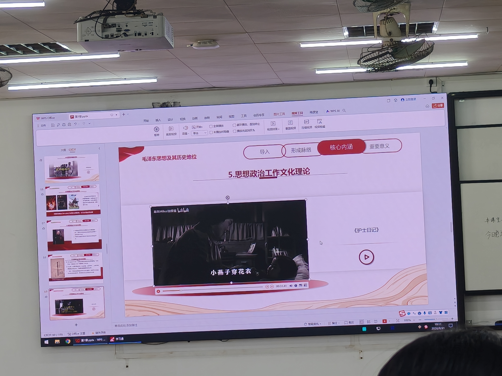

# 第3课 正确评价毛泽东与毛泽东思想 —— 知识点总结（教材精讲版）

> **说明**：本课课堂照片6张（均为2026-09-21上午拍摄）。其中5张（10:11:08/10:11:14/10:11:26/10:11:30/10:11:59）为同一页PPT（幻灯片69/116）播放电影《护士日记》视频的连续帧，按"同页只留一张清晰"原则只插入第一张，其余4张保留在`照片/`目录并标`_不插入`；第6张（11:26:40）为下课后食堂餐盘照片，非课堂内容，不插入。
> 授课时间：2026-09-21　|　课程：毛泽东思想和中国特色社会主义理论体系概论
> 本课主线：毛泽东思想主要内容（续）→ 活的灵魂 → 历史地位 → 科学评价

---

## 一、导入：从2025年九三阅兵看人民军队的"根"

2025年9月3日，中国举行了纪念中国人民抗日战争暨世界反法西斯战争胜利**80周年**盛大阅兵。老师强调：9月3日是中国人民抗日战争暨世界反法西斯战争胜利纪念日（第1课已讲），国家逢五逢十通常大办，逢80、90、100周年必隆重举行。

阅兵中首次公开亮相的新型装备引发外界高度关注：

- **东风-21D**：解说词"打击海上大型移动目标"——老师原话："那就是打击航母"，是反舰弹道导弹；
- **东风-5C**：液体燃料洲际弹道导弹，射程覆盖全球；
- **巨浪-3**：潜射洲际导弹，由核潜艇搭载，打击范围全球覆盖。

【考点】老师用一个生动细节引出军事思想："九三阅兵那天，美国五角大楼（美国国防部办公大楼、最高军事指挥中心）的必胜客、达美乐披萨订单暴涨——因为他们的军事专家、高层都围着电视加班看阅兵，要重新做一套对华军事武器评估报告。"

由此切入本课核心问题：**毛泽东解决了"如何把以农民为主要成分的革命军队，建设成为一支无产阶级性质的、具有严格纪律的、同人民群众保持密切联系的新型人民军队"的问题**。这就要从**三湾改编**说起。

---

## 二、毛泽东思想的主要内容（重点展开）

> 第2课已讲定义四要素与六方面框架，本课重点展开第3~6方面：军事思想、政策和策略、思想政治工作和文化工作、党的建设。另简要回顾前两方面。

### 2.1 新民主主义革命理论（简要回顾）

一条完整的革命链条：

- **领导阶级**：无产阶级；
- **阶级基础/动力**：工农联盟（工人+农民）及人民大众；
- **革命对象**：三座大山——帝国主义、封建主义、官僚资本主义；
- **革命前途**：建立社会主义社会。

### 2.2 社会主义革命和建设理论（简要回顾）

依据新民主主义革命胜利创造的政治经济条件，采取**社会主义工业化和社会主义改造同时并举**（"双管齐下"）的方针，逐步实现国家的社会主义工业化，并逐步实现国家对农业、手工业和资本主义工商业的社会主义改造（"三大改造"）。

### 2.3 革命军队建设和军事战略理论（本课重点）

#### （1）三湾改编（1927年）

- **历史背景**：1927年秋收起义失利后，部队陷入困境——组织涣散（受"左"倾错误影响）、思想混乱、士兵逃亡。军队急需重塑。
- **两个关键举措**：
  1. **把支部建在连上**：班、排设党小组，营、团建立党委，把党的基层组织扎根到连队，从组织上确立党对军队的领导。老师比喻："党组织就像龙骨，把散的零件穿成一条大船。"
  2. **建立士兵委员会**：实行官兵平等、经济公开，打破旧军队军阀作风。当官的和士兵平等，收入公开，军队有了凝聚力。
- **核心**：**铸军魂、凝军心**，从政治上组织上让军队彻底归属于党，是党军队建设的最初积淀。

【考点】**三湾改编 1927 年**——"支部建在连上"，党对军队领导的组织基础。

#### （2）古田会议（1929年12月）

- **时间地点**：**1929年12月**，福建省上杭县古田村，召开红军第四军党的第九次代表大会（"古田会议"）。
- **核心内容**：
  - 确立**思想建党、政治建军**原则；
  - 规定**党对军队绝对领导**的原则；
  - 指明"**党指挥枪，而不是枪指挥党**"；
  - 规定**全心全意为人民服务是人民军队的唯一宗旨**；
  - 制定**三大纪律、八项注意**；
  - 实行政治、经济、军事三大民主；
  - 确立**官兵一致、军民一致、瓦解敌军**三大原则；
  - 总结一套军队政治工作的方法和原则。

【考点】**古田会议 1929年12月**——确立"党对军队绝对领导""党指挥枪"。

#### （3）新时代延续：习近平2017年建军90周年讲话

- 2017年，习近平在庆祝中国人民解放军建军90周年大会上指出：人民军队素以纪律严明著称于世，"把革命的坚定性、政治的自觉性和纪律的严肃性结合起来……千军万马，有令必行，有禁必止，攻如猛虎，守如泰山"。
- **历史定位（老师原话串联）**："党对军队绝对领导**发端于南昌起义，奠基于三湾改编，定型于古田会议**。"这句话直接串联起历史与当下。
- 现实体现：高铁站、医院设军人优先窗口；即使群众偶尔挤占，军人也不计较——体现"军民是一家"。

#### （4）人民军队建设原则与战略战术

- **唯一宗旨**：全心全意为人民服务；
- **三大原则**：官兵一致、军民一致、瓦解敌军；
- **政治工作三大民主**：政治民主、经济民主、军事民主；
- **持久战思想**：《论持久战》（1938）批驳"亡国论""速胜论"，指出抗日战争是持久战，最后胜利属于中国；
- **游击战十六字诀**（第1课已讲）：**敌进我退，敌驻我扰，敌疲我打，敌退我追**。

### 2.4 政策和策略理论

#### （1）经典论断

【考点】**"政策和策略是党的生命，是革命政党一切实际行动的出发点和归宿。"**

革命斗争没有固定模板，脱离实际、没有正确方法，再坚定的信念也难以落地。制定政策**绝不能一刀切**，必须根据政治形势、阶级关系和实际情况的变化灵活调整，把**原则性和灵活性**结合起来。

老师举例：解放战争题材影片中"毛泽东预判了蒋介石的预判"——在敌方预判基础上更上一层楼，提前包抄，这就是政策和策略的生动体现。

#### （2）三大策略原则

**① 战略上藐视敌人，战术上重视敌人**

- 解放战争初期，国民党在兵力、装备上占绝对优势，叫嚣"三个月消灭共产党"——这是战略上轻敌。
- 我们党战略上坚信人民力量必胜；战术上绝不轻敌，提出**集中兵力、各个歼敌**，避开敌人主力、专打薄弱环节。
- **典型战例：孟良崮战役（1947年5月13日—16日，山东临沂蒙阴县孟良崮）**
  - 国民党军对山东解放区重点进攻，对华东野战军呈弧形包围；
  - 华东野战军诱敌深入，5月13日发起进攻，割裂国民党军整编第七十四师与其各部联系，切断退路；
  - 5月14日完成包围，构成"围点打援"态势；
  - 5月15日总攻，号称国民党军"五大主力"之一的整编第七十四师全部被歼，师长**张灵甫阵亡**；
  - 此役共歼敌3.2万余人，其中俘虏1.9万；
  - 意义：粉碎国民党军对山东的重点进攻，迫使国民党军暂时停止对山东解放区的进攻。

**② 掌握斗争主要方向，不要四面出击**

- 革命对象是"三座大山"（国民党反动派、封建势力、帝国主义势力），但不能同时出击、分散兵力。
- 必须分清主次：解放战争时期主要斗争方向是国民党反动派；对愿意反对内战的中间力量积极团结，"能团结的就一定要团结起来"，凝聚最广泛的革命力量。

**③ 区别对待、分化瓦解，利用矛盾、争取多数、反对少数、各个击破**

- 典型案例：**抗日战争时期对汉奸、伪军、伪地方武装的区别政策**：
  - **铁杆汉奸**（死心塌地投靠日本）：坚决打击，绝不姑息；
  - **被胁迫者**（日军以家人性命威胁的普通百姓）：积极宣传教育，争取反正、投入抗日；
  - **摇摆不定的地方武装**：讲民族大义，争取保持中立或暗中支持抗日。
- 老师强调：这些思想不是凭空提出，而是从革命实践中总结出来的，是党带领人民一次次化险为夷、取得胜利的关键。

### 2.5 思想政治工作和文化工作理论

#### （1）文化与政治经济的辩证关系

作为历史唯物主义者，毛泽东强调：

- **一定形态的政治和经济，决定一定形态的文化**（经济决定文化）；
- 同时**文化反作用于政治和经济**——一方面推动新的经济基础和上层建筑的形成巩固，另一方面为消灭旧的经济基础和上层建筑而奋斗。

#### （2）"百花齐放、百家争鸣"方针（"双百"方针）

- **提出过程**：1951年为戏曲问题提出"百花齐放"；1953年为历史研究问题提出"百家争鸣"；**1956年毛泽东将其概括为"百花齐放、百家争鸣"**。
- **内涵**：
  - **百花齐放**——发展**艺术**的方针；
  - **百家争鸣**——发展**科学**的方针。
- **意义**：促进社会主义文化繁荣、艺术发展和科学进步，是发展科学和艺术的必由之路；打破思想禁锢，激发文艺工作者创作热情。

【考点】**"百花齐放、百家争鸣"（1956）**：百花齐放=艺术，百家争鸣=科学。

#### （3）典型案例：1957年电影《护士日记》

- 主角简素华，护士学校毕业，主动放弃城市舒适生活，志愿奔赴边疆，在艰苦环境中成长为优秀医护人才；
- 主题曲《小燕子》家喻户晓；
- 体现：青年知识分子自我改造、投身社会主义建设，"以情动人、以理服人"，潜移默化传递主流价值——这是思想政治工作与文化工作深度融合的早期实践。

> 📝 **批注**：此为PPT幻灯片69/116，顶部导航"导入—形成脉络—**核心内涵**—重要意义"高亮在"核心内涵"，标题"5.思想政治工作文化理论"，右侧标注《护士日记》并嵌入视频。屏幕正播放主题曲《小燕子》歌词"小燕子穿花衣"。考点提示：本课用《护士日记》（1957）+主题曲《小燕子》作为"思想政治工作和文化工作理论"的典型案例，对应教材六方面之第五方面；图中PPT标题简写为"思想政治工作文化理论"，教材全称是"思想政治工作和文化工作理论"，考试按教材全称写。

#### （4）其他方针（教材要点）

- **古为今用、洋为中用**：批判地继承中国古代文化，有分析地吸收外国文化；
- **德才兼备、又红又专**：干部和知识分子既要政治合格（红），又要业务过硬（专）。

#### （5）当代传承

老师联系2025年爆款电影（《哪吒之魔童闹海》《南京照相馆》《浪浪山小妖怪》）指出：这些作品扎根中华优秀传统文化、回望民族历史，又紧扣当代审美与现实议题，以群众喜闻乐见的形式传播主流价值——这正是"双百"方针穿越岁月的生命力，是思想政治工作和文化工作代代相传的必然结果。

### 2.6 党的建设理论（本课重点）

毛泽东建党学说创造性地解决了在中国这样特殊社会历史条件下建设马克思主义政党的一系列重大问题。

#### （1）窑洞之问：跳出历史周期率的第一个答案

- **历史周期率**：一个王朝"其兴也勃焉，其亡也忽焉"——建立、繁荣、衰败、被新王朝取代的循环。
- **1945年黄炎培延安窑洞之问**：中共能否跳出历史周期率？
- **毛泽东第一个答案：让人民来监督政府（民主）**。原话："只有让人民来监督政府，政府才不敢松懈；只有人人起来负责，才不会人亡政息。"
- **习近平第二个答案：党的自我革命**（上节课已讲，本课强调：把党外人民民主监督与党内自我革命结合起来，"双管齐下"）。

#### （2）毛泽东民主思想的实践案例

- **"豆选"**：陕甘宁边区农民不识字，候选人坐一排，身后放碗，选民把豆子投进中意候选人身后的碗，最后"数豆子"计票。民谣："金豆豆，银豆豆，豆豆不能随便投；选好人，办好事，投在好人碗里头。"
- **"三三制"政权**：共产党员、左派进步分子、中间分子各占1/3，保障各抗日阶级的民主权利。
- **1932年中央工农检查部设立"控告箱"**：群众可直接检举干部贪污腐败、官僚主义。
- 当代延续：国务院"总理信箱"、小程序领导留言板、网络问政、政务公开。

#### （3）七届二中全会与"两个务必"（1949年3月）

- **时间地点**：**1949年3月5日—13日**，在河北平山县**西柏坡**召开。会场是一间不足80平米的大伙房，拆掉炉灶、挂上棉门帘防寒；没有话筒、没有发言席，谁发言就站在主席台一角脱稿发言。出席中央委员34人、候补中央委员19人。
- **核心决策**：
  - 规定党在全国胜利后在政治、经济、外交方面应采取的基本政策；
  - 指出中国由**农业国转变为工业国、由新民主主义社会转变为社会主义社会**的发展方向；
  - **工作重心由乡村转移到城市**——"用乡村包围城市……这样一种工作方式的时期已经完结。从现在起，开始了由城市到乡村并由城市领导乡村的时期。"
- **"两个务必"**（毛泽东提出）：
  1. 务必使同志们继续地保持**谦虚、谨慎、不骄、不躁**的作风；
  2. 务必使同志们继续地保持**艰苦奋斗**的作风。
- **告诫**：夺取全国胜利只是万里长征走完了第一步；必须警惕**资产阶级"糖衣炮弹"**的攻击，不要在这种攻击面前打败仗。
- **2022年党的二十大**，习近平提出**"三个务必"**：
  1. 务必不忘初心、牢记使命；
  2. 务必谦虚谨慎、艰苦奋斗；
  3. 务必敢于斗争、善于斗争。

【考点】**七届二中全会 1949年3月（西柏坡）**：工作重心乡村→城市；"两个务必"；警惕糖衣炮弹。

#### （4）整风运动与三大作风（教材要点）

- **整风运动**：1942年延安整风，宗旨是"**团结—批评—团结**"，反对主观主义以整顿学风、反对宗派主义以整顿党风、反对党八股以整顿文风；
- **党的三大作风**（党的七大概括）：
  1. **理论和实践相结合**的作风；
  2. **和人民群众紧密地联系在一起**的作风；
  3. **自我批评**的作风。

---

## 三、毛泽东思想活的灵魂

> 毛泽东思想各个组成部分，贯穿一套彼此联系的立场、观点、方法——这就是**活的灵魂**，包括三个基本方面：**实事求是、群众路线、独立自主**。

### 3.1 实事求是——党的思想路线核心

#### （1）提出与确立历程

| 时间 | 著作/会议 | 贡献 |
|------|----------|------|
| 1930年 | 《反对本本主义》 | 首次提出"**没有调查，就没有发言权**"，强调调查研究是一切工作的第一步 |
| 1937年 | 《实践论》《矛盾论》 | 深刻阐述理论对实践的依赖关系，阐述矛盾普遍性与特殊性的关系，对党的思想路线作系统哲学论证 |
| 1938年 | 六届六中全会 | 提出"共产党员应是实事求是的模范" |
| 1941年 | 《改造我们的学习》 | 对"实事求是"作经典界定（见下） |
| 延安整风、党的七大 | —— | 实事求是思想路线在全党确立 |

#### （2）经典定义（1941年《改造我们的学习》）

- **"实事"**：就是客观存在着的一切事物；
- **"是"**：就是客观事物的内部联系，即**规律性**；
- **"求"**：就是我们去研究。

> 实事求是：从客观存在的事物出发，研究其内部规律性，按客观规律办事。

#### （3）坚持实事求是的三点要求

1. **深入实际，了解事物的本来面貌**——透过现象看本质，把握内在联系，按客观规律办事；自觉坚定实事求是的信念、增强实事求是的本领；
2. **清醒认识和正确把握我国基本国情**——一切路线方针政策都从**社会主义初级阶段**这个最大实际出发；既反对超越阶段、急于求成（如"大跃进"教训），也反对因循守旧、固步自封；
3. **不断推进实践基础上的理论创新**——马克思主义没有穷尽真理，必须以马克思主义为指导，在实践中丰富发展马克思主义，形成中国化时代化的马克思主义新成果。

#### （4）实事求是在不同历史时期的体现

- **新民主主义革命时期**：及时纠正"左"倾、右倾错误；不照搬苏联城市起义模式，立足中国农民占多数的国情，开辟**农村包围城市、武装夺取政权**的道路；
- **社会主义革命和建设时期**：立足本国实际，迅速恢复国民经济，完成农业、手工业、资本主义工商业**三大改造**，确立社会主义基本制度；
- **改革开放新时期**：邓小平提出"**摸着石头过河**"，解放思想、实事求是，大胆探索、勇于实践；
- **新时代**：面对新问题新挑战，始终坚持一切从实际出发、理论联系实际，把论文写在祖国大地上（如脱贫攻坚从"输血式扶贫"转向"造血式扶贫"，授人以渔）。

### 3.2 群众路线——党的生命线和根本工作路线

#### （1）形成发展脉络

| 时间 | 文献/会议 | 贡献 |
|------|----------|------|
| 1930年 | 《反对本本主义》 | 群众路线思想雏形 |
| 1933年 | 查田运动 | 首次提出"群众路线"概念雏形，强调查田工作必须按群众路线开展 |
| 1943年 | 《关于领导方法的若干问题》 | **首次完整论述**群众路线核心内涵："在党的一切实际工作中，凡属正确的领导，必须是从群众中来，到群众中去"，把群众路线与马克思主义认识论结合 |
| 1945年 | 党的七大 | 首次将群众路线**写入党章**，明确为党的根本政治路线和组织路线 |
| 1956年 | 党的八大 | 结合执政新形势，强调反对官僚主义、改进工作方法 |
| 1981年 | 十一届六中全会 | 将群众路线概括为"**一切为了群众，一切依靠群众，从群众中来，到群众中去**"，列为毛泽东思想活的灵魂 |

> **现行党章表述**："一切为了群众，一切依靠群众，从群众中来，到群众中去，把党的正确主张变为群众的自觉行动。"

#### （2）践行群众路线的三点要求

**① 人民群众是历史的创造者**（马克思主义基本原理）

- 人民群众是推动历史发展的根本力量；
- 经典案例：**淮海战役被称为"人民用小车推出来的胜利"**——543万支前群众推着小车送军粮，"最后一碗米做军粮"；
- 新时代案例：脱贫攻坚——亿万贫困群众在党的引领下主动奋斗、扎根乡土发展产业，实现近1亿人脱贫，彰显人民磅礴伟力。

**② 全心全意为人民服务**

- 周恩来一生佩戴"为人民服务"徽章到生命最后一刻；
- 当代案例：**重庆轨道交通"背篓专线"**——有人建议禁止进城卖菜老人的背篓上车，官方回应"交通轨道以人为本、服务民生，只要物品合法合规就不干涉"——不一刀切，照顾进城卖菜群众生计；
- 核心不变：**把人民利益放在最高位置**。

**③ 保持党同人民群众的血肉联系**

- 1930年毛泽东在江西寻乌进行一个月社会调查，写下**《寻乌调查》**，坚持"没有调查，就没有发言权"；
- 新时代"**我为群众办实事**"实践活动：党员干部走村入户，解决就业、养老、出行等急难愁盼问题；
- 案例视频：河南鹿邑县范庄村驻村第一书记董桂林"挨家挨户蹭饭"——以粗瓷碗盛满农家烟火，打破干部与群众隔阂，从"村里的陌生人"变成"群众的自家人"，为新时代践行群众路线写下生动注脚。

### 3.3 独立自主——立党立国、立国建国的重要原则

#### （1）三个历史节点的逻辑

1. **井冈山时期**：摆脱教条主义束缚，不照搬俄国城市革命模式，立足农村实际，走**农村包围城市、武装夺取政权**的独特道路；
2. **抗日民族统一战线时期**：团结一切可以团结的力量共同抗日，同时**保持自身独立性**，牢牢掌握抗日斗争领导权，不被国民党妥协路线所软化；
3. **建国初期工业化探索**：提出"**以苏为鉴**"，走自己的工业化道路；结合中国"人口多、底子薄"的国情，不照搬苏联模式（中苏关系变化后苏联专家撤走、图纸撕毁，证明依附他人必然中道崩殂）。

#### （2）内涵与三点要求

**内涵**：坚持独立思考，走自己的路；坚定不移维护民族独立、捍卫国家主权；依靠自己力量筑牢根基，同时积极争取合理外援、借鉴有益经验。

**① 坚持独立思考，走自己的路**

- 把国家和民族发展放在自己力量的基点上；
- 案例：**长春第一汽车制造厂**（1953年启动建设，1956年生产出第一辆**解放牌**卡车，结束中国不能制造汽车的历史）；新时代不盲从西方燃油车模式，把握电动化、智能化趋势，集中力量发展新能源汽车，实现从跟跑到领跑；
- 案例：**北斗卫星导航系统**——GPS掌握在美国手中，一旦掐断信号将"闭着眼睛挨打"；北斗实现自主可控，且信息更新更快、更精准。

**② 坚定不移维护民族独立、捍卫国家主权（底线，任何时候不能动摇）**

- 抗日战争：浴血抗击日本帝国主义侵略；
- 新中国成立后：反对西方封锁禁运，坚持独立自主和平外交；
- 新时代：**中美贸易战**——美国单边加征关税、高技术出口管制、企图迫使中国让渡经济利益；中国"不想打、不怕打、必要时不得不打"，采取反制组合拳（对美商品加征关税、**稀土相关物项出口管制**、将危害国家安全的美企列入管控名单、在WTO争端解决机制起诉美方），既不妥协退让，也不主动升级冲突。

**③ 辩证统一：自力更生为主，争取外援为辅**

- 既不封建保守、固步自封，也不依附妥协、丧失自我；
- 案例：**中国航天事业**——1956年国防部第五研究院创建；苏联援助中断后自主研制东风系列导弹、长征一号火箭；**1970年成功发射"东方红一号"**，成为世界上第5个独立研制并发射人造地球卫星的国家；载人航天"三步走"：神舟五号载人飞行、天宫空间站、探月工程"绕、落、回"全程，实现自主可控。

#### （3）独立自主在各领域的成就

- **经济领域**：从一穷二白成长为世界第二大经济体；
- **民生领域**：打赢人类历史上规模最大的脱贫攻坚战，全面建成小康社会，为全球减贫提供中国样板；
- **国防领域**：独立自主推进国防和军队现代化，实现大型飞机等自主研制，建设世界一流军队；
- **生态文明领域**：不照搬资本主义"先污染后治理"老路，走人与自然和谐共生的绿色发展道路。

【考点】独立自主是**中华民族的精神之魂**，是党立党立国的重要原则，是国家发展的根本保证。

---

## 四、毛泽东思想的历史地位（三个角度）

### 4.1 马克思主义中国化的第一次历史性飞跃的理论成果

- 毛泽东在党内**首次明确提出"马克思主义中国化"**的重大任务并进行艰苦探索；
- 使马克思列宁主义在中国生根、开花、结果；
- 为党的革命和建设事业奠定坚实思想理论基础；
- 是马克思主义中国化时代化的**第一个重大理论成果**（注：中国特色社会主义理论体系不包括毛泽东思想，二者是继承发展关系，毛泽东思想在前）。

### 4.2 中国革命和建设的科学指南

- 是被实践证明了的关于中国革命和建设的正确理论原则和经验总结；
- 指引党和人民：
  - 找到新民主主义革命正确道路，推翻"三座大山"，结束半殖民地半封建社会历史，建立中华人民共和国；
  - 找到从新民主主义向社会主义过渡的道路，确立社会主义基本制度；
  - 对适合中国国情的社会主义道路进行艰辛探索，取得独创性理论成果和重大成就；
- 为新的历史时期开创中国特色社会主义提供了**宝贵经验、理论准备、物质基础**。

### 4.3 中国共产党和中国人民宝贵的精神财富

- 毛泽东思想所蕴含的基本原理、原则和方法，具有跨越时空的普遍指导意义和价值；
- 确立了**实事求是**的思想路线、**全心全意为人民服务**的根本宗旨、**自力更生和艰苦奋斗**的革命精神；
- 毛泽东矢志不渝追求中华民族屹立于世界民族之林的理想，像灯塔一样照亮中华民族前进道路。

---

## 五、科学评价毛泽东和毛泽东思想

### 5.1 为什么必须科学评价

- 关系到**党和国家历史的安定团结**，关系到全党全国人民思想统一到十一届三中全会路线上来；
- "文化大革命"结束后，社会上出现两种错误倾向：
  - **错误倾向一**：因毛泽东晚年错误（如"文化大革命"）就否定毛泽东思想的科学价值和指导作用；
  - **错误倾向二**：对毛泽东言论采取教条主义态度，认为他说过的话全是真理，不愿实事求是承认其晚年错误。
- 必须**反对这两种错误倾向**。

### 5.2 邓小平与历史决议

- **1977年4月**（尚未复出）：邓小平致信党中央，提出必须**世世代代用准确的、完整的毛泽东思想**指导全党全军全国人民；
- **1980年8月**：邓小平接受意大利记者**法拉奇**采访，单刀直入问"天安门上的毛主席像是否永远保留"，邓小平干脆回答：**"要永远保留下去。"**
- **1980年3月—1981年6月**：邓小平10余次召集历史决议起草组开会，强调"**确立毛泽东同志的历史地位，坚持和发展毛泽东思想，这是最核心的一条**"；
- 邓小平原话："**毛泽东思想这个旗帜丢不得。丢了这个旗帜，实际上就否定了我们党的光辉历史。**""如果不写或写不好这个部分，整个决议都不如不做。"
- 邓小平还指出：讲错误不应只讲毛泽东同志，中央许多同志都有错误；"大跃进"毛泽东同志头脑发热，我们不发热——评价要公正。

### 5.3 十一届六中全会与历史决议

- **1981年6月，党的十一届六中全会**通过**《关于建国以来党的若干历史问题的决议》**；
- 对**毛泽东和毛泽东思想的历史地位**作出了**科学的、实事求是的评价**；
- **核心区分**：
  - **毛泽东同志的历史功绩是第一位的**，他为中国革命和建设建立了不可磨灭的功勋；
  - **他的晚年错误（"文化大革命"等）是第二位的**，就他的一生来看，**功是大于过的**；
  - **毛泽东同志的晚年错误，不属于毛泽东思想的科学体系**——毛泽东思想是被实践证明了的关于中国革命和建设的正确的理论原则和经验总结，是中国共产党集体智慧的结晶。

### 5.4 评价原则

- **实事求是**：不夸大、不缩小，尊重历史事实；
- **功过两分、功大于过**：辩证看待，不因晚年错误否定前半生功绩，也不因历史功绩回避错误；
- **历史唯物主义立场**：习近平指出——"**革命领袖是人不是神**"，金无足赤、人无完人；革命领袖的认识和行动不能不受时代条件的制约，不能以"神"的标准提出不切实际的苛刻要求；
- **把毛泽东个人与毛泽东思想科学体系区分开来**：既不能因为个人错误否定科学理论，也不能因为科学理论掩盖个人错误。

---

## 六、重要会议与时间点总表

| 时间 | 会议/事件 | 地点 | 核心内容 | 历史意义 |
|------|----------|------|---------|---------|
| 1927年 | 三湾改编 | 江西永新三湾村 | 支部建在连上；士兵委员会 | 确立党对军队的组织领导，新型人民军队开端 |
| 1929年12月 | 古田会议（红四军九大） | 福建上杭古田 | 思想建党、政治建军；党指挥枪 | 定型党对军队绝对领导 |
| 1930年 | 《反对本本主义》 | —— | "没有调查，就没有发言权" | 实事求是思想雏形、群众路线雏形 |
| 1932年 | 中央工农检察部设控告箱 | 瑞金 | 群众直接检举干部 | 人民监督政府早期实践 |
| 1935年1月 | 遵义会议 | 贵州遵义 | 确立毛泽东在党和红军的领导 | 党的历史上生死攸关的转折点 |
| 1937年 | 《实践论》《矛盾论》 | 延安 | 实践与认识、矛盾普特关系 | 实事求是思想路线的哲学论证 |
| 1938年 | 六届六中全会 | 延安 | 首次提出"马克思主义中国化"；"共产党员应是实事求是的模范" | 马克思主义中国化命题首次提出 |
| 1941年 | 《改造我们的学习》 | 延安 | 实事求是经典定义 | 整风文献 |
| 1942年 | 延安整风 | 延安 | 团结—批评—团结 | 全党思想统一 |
| 1943年 | 《关于领导方法的若干问题》 | 延安 | 首次完整论述群众路线 | 群众路线理论形成 |
| 1945年 | 党的七大 | 延安 | 毛泽东思想确立为指导思想；群众路线写入党章；三大作风 | 建党以来第一次全面总结 |
| 1947年5月 | 孟良崮战役 | 山东蒙阴 | 全歼整编七十四师 | 粉碎国民党对山东重点进攻 |
| 1949年3月5—13日 | 七届二中全会 | 河北平山西柏坡 | 工作重心乡村→城市；两个务必；警惕糖衣炮弹 | 建国前最后一次中央全会 |
| 1953年 | 长春一汽开工 | 长春 | 独立自主发展汽车工业 | 1956年造出第一辆解放牌卡车 |
| 1956年 | "双百"方针；党的八大 | 北京 | 百花齐放、百家争鸣；反官僚主义 | 社会主义文化与执政党建设 |
| 1956年 | 国防部五院成立 | 北京 | 中国航天起步 | 后自主研制东风、长征、东方红一号 |
| 1970年 | 东方红一号发射 | —— | 第5个独立发射卫星国家 | 航天独立自主里程碑 |
| 1981年6月 | 十一届六中全会 | 北京 | 《关于建国以来党的若干历史问题的决议》 | 科学评价毛泽东与毛泽东思想；概括活的灵魂三方面 |

---

## 七、本课老师金句与强调点（原话保留）

1. 【考点】"**政策和策略是党的生命**，是革命政党一切实际行动的出发点和归宿。"
2. 【考点】"**党指挥枪，而不是枪指挥党。**"
3. 【考点】"党对军队绝对领导**发端于南昌起义，奠基于三湾改编，定型于古田会议**。"（习近平2017建军90周年讲话）
4. 【考点】"**没有调查，就没有发言权。**"（1930《反对本本主义》）
5. 【考点】"**实事求是**：实事就是客观存在着的一切事物；是就是客观事物的内部联系，即规律性；求就是我们去研究。"（1941《改造我们的学习》）
6. 【考点】群众路线现行党章表述："**一切为了群众，一切依靠群众，从群众中来，到群众中去，把党的正确主张变为群众的自觉行动。**"
7. 【考点】"**两个务必**"：务必谦虚谨慎、不骄不躁；务必艰苦奋斗。（七届二中全会1949.3）
8. 【考点】"**三个务必**"：不忘初心牢记使命；谦虚谨慎艰苦奋斗；敢于斗争善于斗争。（2022二十大）
9. 【考点】"**毛泽东思想这个旗帜丢不得。丢了这个旗帜，实际上就否定了我们党的光辉历史。**"（邓小平）
10. 【考点】"**革命领袖是人不是神**"（习近平论评价历史人物）——金无足赤，人无完人。
11. 老师比喻：输血式扶贫→造血式扶贫，"授人以鱼不如授人以渔"；把论文写在祖国大地上。
12. 老师案例：淮海战役"人民用小车推出来的胜利"，543万支前群众；重庆轨道交通"背篓专线"；河南驻村第一书记董桂林"蹭饭式"群众工作。

---

## 八、易错点与术语纠正（本课）

| 笔记/易错 | 正确表述 | 说明 |
|----------|---------|------|
| 三湾改变 | **三湾改编** | 1927年，非"改变" |
| 古田5年会议/定情 | **古田会议/定型** | 1929年12月 |
| 基建与三湾改编 | **奠基于三湾改编** | 习近平讲话原话 |
| 查年运动 | **查田运动** | 1933年 |
| 反对版本主义 | **反对本本主义** | 1930年 |
| 豆选/都选/动选 | **豆选** | 陕甘宁边区投票方式 |
| 通告箱 | **控告箱** | 1932年中央工农检查部 |
| 整过程人民民主 | **全过程人民民主** | 习近平提出 |
| 捷豹牌卡车 | **解放牌卡车** | 一汽1956年第一辆 |
| 以苏为念 | **以苏为鉴** | 建国初期工业化方针 |
| 至始不渝 | **矢志不渝** | 成语 |
| 活的灵魂（口误"国的灵魂"） | **活的灵魂** | 实事求是/群众路线/独立自主 |
| 胡起包围 | **弧形包围** | 孟良崮战役国民党态势 |
| 移民阻击 | **一面阻击** | 华东野战军战术 |
| 中决战计划 | **重点进攻计划** | 国民党对山东解放区 |
| 由令必行由禁必止 | **有令必行、有禁必止** | 习近平建军90周年讲话 |
| 动作交加 | **饥寒交迫** | 将士们处境 |
| 优思 | **忧思** | 对长治久安的忧虑 |
| 董卫林 | **董桂林** | 河南鹿邑范庄村驻村第一书记 |
| 北斗专线 | **背篓专线** | 重庆轨道交通便民措施 |
| 刀郎山小妖怪 | **《浪浪山小妖怪》**（2025年动画电影） | 老师举例 |
| 故事日记/减速网 | **《护士日记》/简素华** | 1957年电影，本课PPT第69/116页播放片段，主题曲《小燕子》 |
| 课件简称"思想政治工作文化理论" | **教材全称"思想政治工作和文化工作理论"** | PPT标题简写，考试按教材全称；属毛泽东思想主要内容第六方面 |
| 照片核对结论 | —— | 2026-09-21对照6张课堂照片复核：五大会时间地点（三湾改编1927/古田会议1929.12/遵义会议1935.1/七届二中全会1949.3/十一届六中全会1981.6）、毛泽东思想主要内容六方面、党的三大作风、活的灵魂三方面均与教材一致，未发现需改正的笔记错误 |

---

## 九、本课时核心结论速记

1. **军事思想两会议**：三湾改编1927（支部建在连上）→ 古田会议1929.12（党指挥枪、政治建军）；
2. **政策策略三原则**：战略藐视+战术重视；掌握主要方向不四面出击；利用矛盾、争取多数、反对少数、各个击破；
3. **文化工作双百方针**：百花齐放（艺术）、百家争鸣（科学），1956年提出；
4. **党的建设两务必**：1949七届二中全会（西柏坡）→2022二十大三个务必；窑洞之问第一答案=人民监督政府；
5. **活的灵魂三方面**：实事求是（思想路线）、群众路线（根本工作路线）、独立自主（根本立场）；
6. **历史地位三句话**：第一次历史性飞跃的理论成果；中国革命和建设的科学指南；党和人民宝贵精神财富；
7. **科学评价一决议**：1981十一届六中全会《关于建国以来党的若干历史问题的决议》——功大于过；毛泽东晚年错误不属于毛泽东思想科学体系；
8. **关键时间点**：1927三湾改编 → 1929古田会议 → 1935遵义会议 → 1949.3七届二中全会 → 1981.6十一届六中全会。
