# 07 医学伦理学 — 知识框架与思维导图

## 一、Mermaid 思维导图

```mermaid
mindmap
  root((医学伦理学<br/>课程导论))
    课程定位
      培养职业道德
      保护患者也保护医生
      医学伦理委员会
        培训
        指导监督
        咨询解答
      成绩
        平时30%
        签到作业讨论
      执业医师考试内容
    基本概念
      道德 个体内心
      伦理 行业社会关系
      应用规范伦理学
      三大伦理传统
        中国 仁孝修身
        西方 动机善恶
        马克思主义 社会实践
      研究对象
        医患关系
        医医关系
        医社关系
    发展简史
      中国古代
        萌芽 利民之所必救
        形成 黄帝内经 莫贵于人
        发展 孙思邈 大医精诚
        完善 行业规则
      国外古代
        希波克拉底誓言
      中国近代
        红医精神
          1928年起源
          中国医科大学前身
          政治坚定 技术优良
          白求恩 马海德
      国外近代三大文件
        纽伦堡法典 知情同意
        赫尔辛基宣言 随时退出
        贝尔蒙报告 尊重有利公正
    四大基本理论
      美德论 成为谁 自律
      义务论 做什么 重动机
      功利论 重结果 有局限
      公正论 分配公平 按需
    四大基本原则
      尊重
        生命
        人格隐私
        自主权 知情同意
      不伤害
        不等于零伤害
        风险最小化
      有利
        收益大于风险
        减轻痛苦
      公正
        按需分配
        弱势群体保护
        利益诱导禁止
    指导原则
      1942 救死扶伤革命人道主义
      1981 全心全意为人民服务
      80年代中 身心健康服务
    基本规范
      对患者 以人为本 一视同仁
      对专业 大医精诚 廉洁行医
      对同事 团结协作
      对社会 乐于奉献
    医德培养
      长期实践积累
      良好沟通
      医患信任
      行业社会和谐
    第2课 医患权利义务与人际关系
      以人为本双重含义
        患者权利
        医务人员权利
      病人权利发展史
        世界人权宣言 第3条生命权 第25条健康权
        法国大革命 病床权
        19世纪末20世纪初 消费者权益运动
        纽伦堡法典 知情同意三要素
          知情
          自由意志
          能力
        1972 美国医学会 病人权利法案
        1975 欧洲议会 16国草案
        1981 世界医学会 病人权利文章
        1986 第38届世界医学会 医师专业独立与自由宣言
      世界医学会病人权利6项
        自由选择医师
        医生独立临床判断
        接受或拒绝治疗
        保密隐私
        死亡尊严 临终关怀 安乐死我国不合法
        宗教慰藉 我国有条件
      我国邱仁宗病人权利6项
        基本医疗权 终身不被剥夺
        疾病认知权
        知情同意权
        保护隐私权
        免除一定社会责任权 病假
        要求赔偿权 侵权责任法
      患者义务
        如实告知病情
        配合治疗
        避免传播疾病
        尊重医务人员及其劳动
        遵守医院规章
        支持医学教育科研
      医务人员权利 执业医师法§21
        诊疗权 含问诊权
        证明权 出生证 死亡证 诊断证明
        要求支付费用权
        医学研究权
        维护医疗秩序权 打击医闹 2012
        特殊干预权 传染病隔离 无需同意
        医疗行为豁免权 医疗事故处理条例§33
      医务人员义务 执业医师法§22
        对社会 宣传正确医学知识 胡万林反面案例
        对患者
          治疗义务
          解释说明义务
          解除痛苦义务 躯体+心理
          保密义务
      医患关系
        狭义 个体对个体
        广义 医疗群体对患者群体
        西格里斯特
        三大特点
          目的一致性
          无隐私的陌生人
          非对称关系 地位信息选择不对等
        四重属性
          技术属性
          伦理属性
          法律属性
          价值属性
        2010缝肛门事件
      医际关系
        平等合作
        指导服从
        对手竞争
        对立拆台 应避免
    第3课 医疗纠纷处理与预防
      概述
        定义 诊疗活动引发的争议
        非诊疗争议 不属于医疗纠纷 天花板掉落
        包含关系 投诉大于医患纠纷大于医疗纠纷
        影响三层面 患者 医务人员 医院
        分类
          医源性 医疗过失 服务缺陷
          非医源性 无过错损害 患方因素 不良动机
        易发十环节 手术诊断检验沟通病历观察药物制度抢救院感
        易发六疾病 心梗脑出血硬膜外血肿刀刺伤骨折高危妊娠
        易发十二人群 醉精犯穷熟独医危毒祸权痞
      处理
        目标 患者 医务人员 医院 三层面
        流程 接待 复印封存 协调治疗 调查分析 协商 调解 诉讼
        封存 医患双方代表共同签名
        口诀123456
          1条例
          2鉴定 死亡原因 医疗损害
          3原则 公平公正及时
          4告知 维权途径 封存 复印 尸体解剖
          5途径 协商 医调委 行政调解 诉讼 其他
          6部门 卫生行政 司法 公安 媒体 保险 政府
      预防
        1目标 患者安全
        3理念 系统改进 关口前移 风险监控
        5大工作 预见性沟通 核心制度 风险预警 持续改进 安全文化
        核心制度口诀
          两诊 首诊负责 会诊
          三查 三级查房 查对 手术安全核查
          三讨论 疑难 术前 死亡
          输血抢救危急值抗菌值班写病历技术信息两分级
      沟通技巧
        口头6语言 赞美鼓励安慰劝说暗示慎指令
        肢体语言 仪表举止
        目光3条 接触 面颊下部 不斜视不游移
    第4课 医德教育与修养评价
      主线 教育 修养 评价 闭环
        道德是养成的 修养是关键 评价是反馈
      医德教育
        含义 有组织有计划有目的 系统教育实践
        意义 体现本质 培养人才 塑造价值观 促进医患关系
        三性 系统性 层次性 程序性
        三原则 理论与实践 主体间性 知情意行
        知情意行
          知 前提
          情 认同
          意 意志
          行 实践
          案例 泄露隐私 知而不行
        方法 言传身教 榜样学习 浸入式教育
      医德修养
        含义 自我教育 自我磨练 自我陶冶 内化
        过程 认知觉醒 行为内化 价值升华
        与教育区别 外因引导 vs 个体内化 他律到自律
        意义 微观 中观 宏观
        四方法 修习 内省 慎独 从小事
        四境界 自立 先私后公 先公后私 大公无私
      医学道德评价
        定义 依据道德标准的善恶判断
        三标准
          疗效 根本
          经济 保障
          社会 底线
          案例 A/B两药
        两依据
          动机与效果 辩证统一
          目的与手段 辩证统一
          案例 盗取角膜
          三方式
            社会舆论 外在约束
            传统习俗 去其糟粕
            内心信念 自律核心动力
            案例 收红包
    第5课 公共卫生伦理与基本原则
      导入案例 传染病上报投票
        急诊科 高热 磨玻璃影 疑似新传染病
        患者哭求不上报 怕隔离失业
        ABCD四选项 147人投票
        结论 必须上报 法定义务
        伦理无唯一答案 追求可辩护的决策
      公共卫生定义
        国家地区有组织活动
        预防疾病 延长寿命 促进身心健康
        政府主导
        客体 全体社会成员
        手段 行政 法律法规
        目标 群体健康
      公卫 vs 临床
        客体 群体 vs 个体
        时机 前瞻性 vs 反应性
        重点 预防 vs 治疗
        手段 行政法律 vs 诊疗技术
        强制权 可依法隔离上报 vs 尊重拒绝治疗
      五大特点
        群体性 面向全体成员
        社会性 需全社会共同参与 爱国卫生运动
        前瞻性 以未来为导向 预防为先
        易错 不是以现在为导向
        滞后性 结核病计划免疫数年才见效
        统计性 群体数据评价 地区儿童患病率
      理论基础与张力
        功利主义 最大多数人最大利益
        社群主义 成员相互依存
        家长主义 为本人利益可强制
        自由主义 个人自由优先
        张力 个体自由 vs 群体健康
      五大基本原则
        全社会参与原则 垃圾分类
          个人行为伤及他人 自由受合理限制
          限制须适度 不剥夺权利
        社会公益原则 老人免费流感疫苗
          资源有限 优先最需要者
          最大多数人最大利益 vs 最需要者优先
        社会公正原则
          有奖有罚 权利义务对等
          拒不上报要担责
        互助协同原则 流调隐私
          公民有配合义务
          工作人员有保密义务
        信息公开原则
          及时透明 防谣言
          不为防恐慌而隐瞒
      四案例分析框架
        找冲突价值
        判断是否伤及他人
        限制是否适度对等
        给可辩护结论
      身份提醒
        临床医生 + 公卫体系一环
```

---

## 二、层级列表版

### 1. 课程定位
- 培养职业道德；保护患者也保护医生；
- 市级以上单位涉人研究应设医学伦理委员会；
- 平时分30%；执业医师考试内容。

### 2. 基本概念
- 道德：个体内心、善恶评价；
- 伦理：社会/行业关系规范；
- 医学伦理学 = 应用规范伦理学；
- 研究对象：医患、医医、医社三大关系。

### 3. 发展简史
- 中国古代四时期：萌芽（利民之所必救）→形成（黄帝内经、莫贵于人）→发展（孙思邈《大医精诚》）→完善（行业规则）；
- 国外古代：希波克拉底誓言；
- 中国近代：红医精神（1928年起源、中国医科大学前身、政治坚定技术优良；白求恩、马海德）；
- 国外近代：纽伦堡法典、赫尔辛基宣言、贝尔蒙报告。

### 4. 四大基本理论
- 美德论：我要成为怎样的医生，重自律；
- 义务论：我应该做什么，重动机；
- 功利论：重结果，有违生命平等之局限；
- 公正论：分配公平，按需处理。

### 5. 四大基本原则
- 尊重：生命、人格、隐私、自主权（知情同意）；
- 不伤害：≠零伤害，风险最小化；
- 有利：收益大于风险，减轻痛苦；
- 公正：按需分配，弱势群体保护，禁止利益诱导。

### 6. 指导原则与基本规范
- 指导原则：1942年题词→1981年全心全意为人民服务→80年代身心健康服务；
- 基本规范：对患者、对专业（廉洁行医）、对同事、对社会。

### 7. 医德培养
- 长期实践积累；
- 良好沟通→医患信任→诊疗与研究顺利；
- 个人→行业→社会和谐。

---

## 三、第2课补充层级列表（医患权利义务与人际关系）

### 8. 病人权利发展史
- 思想源头：《世界人权宣言》第3条（生命、自由、人身安全）、第25条（健康与医疗）；
- 起源：法国大革命提出"一个病人一张病床"的健康权；
- 推进：19世纪末—20世纪初消费者权益运动；
- 里程碑：纽伦堡法典（二战甲级战犯审判；731部队、奥斯维辛人体实验）；
- 时间线：1972 AMA病人权利法案→1975欧洲议会16国草案→1981 WMA→1986第38届WMA《医师专业独立与自由宣言》。

### 9. 知情同意三要素
- 知情、自由意志、能力；
- 即使知情且不愿意，无能力拒绝仍不被伦理接受。

### 10. 世界医学会病人权利6项
- 自由选择医师；医生独立判断；接受/拒绝治疗；保密隐私；死亡尊严；宗教慰藉；
- 我国适用性：前4项可行；第5项有条件（安乐死不合法）；第6项不接受病房大型宗教仪式。

### 11. 我国病人权利（邱仁宗6项）
- 基本医疗权（终身不被剥夺）、疾病认知权、知情同意权、保护隐私权、免除一定社会责任权、要求赔偿权；
- 法律散见于宪法、民法通则、执业医师法、侵权责任法；
- 实习/见习须依《医学教育临床实践管理暂行规定》（2009-01-01）告知、同意、保安全。

### 12. 患者义务（6项）
- 如实告知；配合治疗；避免传播疾病；尊重医务人员及劳动；遵守医院规章；支持医学教育科研。

### 13. 医务人员权利（《执业医师法》§21，伦理概括7项）
- 诊疗权（含问诊权）、证明权、要求支付费用权、医学研究权、维护医疗秩序权、特殊干预权、医疗行为豁免权。

### 14. 医务人员义务（《执业医师法》§22，伦理两方面）
- 对社会：宣传正确医学知识（胡万林反面案例）；
- 对患者：治疗、解释说明、解除痛苦（躯体+心理）、保密。

### 15. 医患关系
- 狭义：医生个体—患者个体；
- 广义：医疗群体（医、护、技、行政、机构）—患者群体（患者、家属、亲友）；
- 三大特点：目的一致性、无隐私的陌生人、非对称关系（地位/信息/选择不对等）；
- 四重属性：技术、伦理、法律、价值；
- 经典案例：2010年缝肛门事件。

### 16. 医际关系
- 医疗单位之间、医务人员之间、医务人员与单位之间；
- 四种模式：平等合作、指导服从、对手竞争、对立拆台（避免）。

---

## 四、第3课补充层级列表（医疗纠纷的处理与预防）

### 17. 医疗纠纷概述
- **定义**：医患双方因**诊疗活动**引发的争议（非诊疗活动引发→不属于医疗纠纷：地板滑/天花板掉落案例）
- **包含关系**：投诉 > 医患纠纷 > 医疗纠纷
- **影响三层面**：患者（伤害+经济压力）→医务人员（压力+伤医+职业倦怠）→医院（成本+秩序+声誉）
- **分类**：医源性（医疗过失/服务缺陷）vs 非医源性（无过错损害/患方因素/不良动机/其他）
- **易发环节10**：手术/临床诊断/检验检查/医患沟通/病历记录/病情观察与处理/药物相关/核心制度执行/抢救/医院感染
- **易发疾病6**：心梗或心律失常/脑出血/硬膜外血肿/刀刺伤/骨折/高危妊娠
- **易发人群12**：饮酒/精神异常/犯罪前科/经济拮据/职工家属熟人/独生子女/家属学医/多器官病变/吸毒/车祸斗殴/家属高干/地痞黑社会

### 18. 医疗纠纷的处理
- **目标**：患者（挽救伤害）、医务人员（帮助+人身安全）、医院（化解矛盾控制影响）
- **流程**：接待（稳定情绪、引导理性表达、立即报告科主任和医务部）→复印封存（**医患双方代表共同签名**）→协调治疗→调查分析→处理协商→调解→诉讼
- **口诀123456**：1条例《医疗纠纷预防与处理条例》/2鉴定（死亡原因+医疗损害）/3原则（公平公正及时）/4告知（维权途径+封存+复印+尸体解剖）/5途径（协商+医调委+行政调解+诉讼+其他）/6部门（卫生行政+司法+公安+新闻媒体+保险+政府）

### 19. 医疗纠纷的预防
- **1目标**：患者安全
- **3理念**：系统改进 / 关口前移（重点科室：产科、新生儿科、麻醉科、急诊）/ 风险监控
- **5大工作**：预见性医患沟通 / 落实核心制度 / 医疗风险预警 / 医疗安全持续改进 / 患者安全文化
- **核心制度口诀**：两诊（首诊负责/会诊）三查（三级查房/查对/手术安全核查）三讨论（疑难/术前/死亡），输血（用血审核）抢救（急危重抢救）危急值（报告），抗菌（药物分级）值班（交接班）写病历（管理），技术（新项目准入）信息（安全）两分级（护理分级/手术分级）
- **持续改进**：质量安全事件点评 / 安全隐患分析整改 / 每月专题会议 / 过错纠纷强制上报不良事件

### 20. 医患沟通技巧
- **口头语言6技巧**：多用赞美 / 常用鼓励 / 善用安慰 / 巧用劝说 / 妙用暗示 / 慎用指令；礼貌性语言是基本要求
- **肢体语言**：举手投足、仪表举止（容貌/体态/姿势），赢得尊重与信任
- **目光3条**：保持接触 / 注视面颊下部（不盯眼睛）/ 不斜视不游移
- 经典案例：门急诊医生低头写病历被投诉（缺乏目光接触与倾听）

---

## 五、第4课补充层级列表（医德教育与修养评价）

### 21. 本课主线
- **医德建设闭环**：教育（知：外在引导形成正确认知）→修养（行：内化为自觉行为、职业本能）→评价（反馈：用标准/依据/方式检验）→发现问题→纠错→再教育再修养
- 一句话：**"道德是养成的，基础修养是关键，评价是反馈促进"**；医学技术决定下限，医德决定上限

### 22. 医德教育
- **含义**：医学教育机构+卫生行政部门+相关专业组织，有组织、有计划、有目的的系统性教育实践活动（关键词：有组织有计划有目的/教育实践/基本原理）
- **意义4条**：①体现医学道德本质（生命健康为核心价值的人文学科）②培养高素质医学人才（医术医德同步）③塑造正确职业价值观（抵御工具主义）④促进医患关系行业发展
- **三性**：系统性（立体化教育体系）/层次性（基本要求+先进典型）/程序性（贯穿职业生涯全过程）
- **三原则**：理论与实践相结合 / 主体间性（平等对话，不单向灌输）/ 知情意行
- **知情意行**：知=前提起点 → 情=情感认同 → 意=意志坚守 → 行=实践转化；案例：医学生聚会泄露患者隐私（未匿名化）＝知而不行，纠正需案例教育+榜样示范+实践体验+持续反思
- **方法**：言传身教 / 榜样学习 / 浸入式教育（医学生宣誓、主题活动、社会实践）

### 23. 医德修养
- **含义**：医疗实践中道德的自我教育、自我磨练、自我陶冶，将规范内化为内心认同信念
- **过程**：认知觉醒（要我做到我要做）→行为内化（知行统一）→价值升华（无人监督也做）
- **与教育区别**：教育=外在引导灌输（外因）；修养=个体内化（内因）；共同实现他律→自律
- **意义三层面**：微观（个人品质素养）/中观（医患关系、消除信息差不当得利）/宏观（行业风清气正、社会信任）
- **四方法**：修习（学习+实践）/内省（反思纠错）/慎独（无人监督坚守，最高境界）/从小事做起
- **四境界**（由低到高）：自立→先私后公→先公后私→大公无私；**不贴标签**，是持续提升过程

### 24. 医学道德评价
- **定义**：依据道德标准对医务人员和医疗机构行为活动的善恶判断与价值评定；主体涵盖社会各界；对象=医疗行为/诊疗决策/医患沟通/管理活动
- **三标准**：疗效（根本，生命健康首位）/经济（保障，合理控成本，义利结合）/社会（底线，技术能做≠伦理应该做）；案例：A/B两药疗效相同选经济最优
- **两依据**：动机与效果辩证统一（唯动机论/唯效果论片面）；目的与手段辩证统一（目的正当性不能豁免手段缺陷）；案例：盗取死者角膜救人
- **三方式**：社会舆论（外在约束）/传统习俗（去其糟粕取其精华）/内心信念（自律核心动力）——对应道德定义三靠，实现他律→自律
- **案例：收红包**四层剖析：对象（送与收都是评价对象）→标准（违背职业道德底线）→依据（动机效果、目的手段）→方式（舆论谴责、习俗否定、信念约束）→落点（教育筑基+修养建判断体系+拒收即实践信念）

---

## 六、第5课补充层级列表（公共卫生伦理与基本原则）

### 25. 导入案例：传染病上报投票
- 急诊科接诊高热、呼吸困难、肺CT磨玻璃影、疑似新型传染病患者，患者哭求不要上报（否则隔离失业）；
- 四选项：A签（依法上报是义务）/B不签（同情）/C先劝再签（缓冲）/D请示上级；147人投票ABCD均有；
- **结论**：必须上报，因医务人员是公卫体系一环，上报是法定义务；执行要人性化，原则不让步、方式可以柔；
- **方法论**：伦理无唯一正确答案，目标是做出**可辩护的决策**。

### 26. 公共卫生定义
- 国家/地区通过有组织的社会活动，预防疾病、延长寿命、促进身心健康；
- **主体**：政府主导（不是某家医院/某个医生）；**客体**：全体社会成员；**手段**：行政+法律法规+健康教育；**目标**：保障群体健康。

### 27. 公共卫生 vs 临床医学
- 客体：全体社会成员 vs 就诊个体患者；
- 时机：前瞻性（未病先防）vs 反应性（得病诊治）；
- 重点：预防 vs 诊断治疗；
- 手段：行政法律健康教育 vs 诊疗技术药物手术；
- 强制权：可依法强制隔离/上报 vs 尊重患者拒绝治疗的自主权；
- 效益：群体健康收益、滞后显现 vs 个体治愈、即时成就感。

### 28. 公共卫生五大特点
- **群体性**：面向社会群体成员，关注群体健康；
- **社会性**：需组织者、实施者、人民群众共同参与（疫苗接种、爱国卫生运动）；
- **前瞻性**：以**未来**为导向、预防为先（从小控烟）；**易错点：不是以现在为导向**；
- **滞后性**：效果长期才显现（结核病计划免疫数年十几年才见效；公卫的"成功"常表现为什么都没发生）；
- **统计性**：用群体数据评价（地区儿童发育合格率、患病率）。

### 29. 理论基础与张力
- **功利主义**：最大多数人的最大利益；
- **社群主义**：社会成员相互依存，个人与社群责任对应；
- **家长主义**：为本人利益可代为决定、实施必要强制（隔离、强制接种）；
- **自由主义**：个人自由自主优先；
- **核心张力**：个体自由/自主 vs 群体健康/公共利益；公正原则负责有限资源分配。

### 30. 公共卫生五大基本原则
- **全社会参与原则**：政府+公众共同参与；垃圾分类案例——个人行为伤及他人健康时自由受合理限制，限制须适度、不剥夺权利；
- **社会公益原则**：群体利益最大化；老人免费流感疫苗案例——资源有限，优先最脆弱最需要者（两条思路：最大多数人最大利益 vs 最需要者优先）；
- **社会公正原则**：有奖有罚、权利义务对等；享受公卫保护就要配合上报防控，逃避义务危害公众者受惩戒；
- **互助协同原则**：双向义务——公卫人员要让群众理解"为什么这么做"，公民有配合义务（流调），工作人员同时负有保护隐私义务；
- **信息公开原则**：及时准确透明公开公共卫生信息，是全社会参与和防谣言的前提，不能为"防恐慌"而隐瞒。

### 31. 四案例分析框架
- 传染病上报 / 垃圾分类 / 老人流感疫苗 / 流调隐私；
- 步骤：找冲突双方价值（个体自由隐私 vs 群体健康公共安全）→判断个人行为是否伤及他人→限制是否适度对等→给出可辩护结论。

### 32. 身份提醒
- 面对病床上的个体=临床医师；面对社会人群=公共卫生体系一环；双重角色、两套伦理视角。
